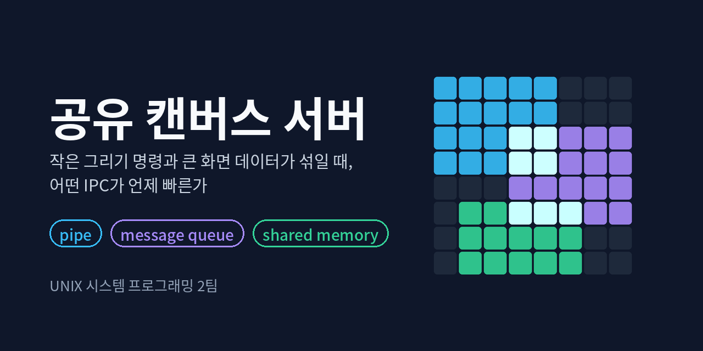

# 다중 그림판 공유 캔버스 서버



UNIX 시스템 프로그래밍 2팀


여러 사람이 한 컴퓨터 안에서 같은 그림판에 동시에 그리는 협업 그림판 서버다. 서버는 그림판 여러 개를 두고, 클라이언트 최대 1024개가 작은 그리기 명령(DRAW)을 보내고 보는 영역의 그림(SNAPSHOT, 최대 64KB)을 받아 간다. 같은 응용을 pipe(FIFO), message queue, shared memory 3버전으로 구현해, 1단계 측정으로 세운 예측이 응용에서도 맞는지 검증하고 설계를 개선한다. 2026년 2학기 UNIX시스템프로그래밍 설계과제다.

> [!NOTE]
> 11/27에 2단계(응용 기획부터 제출물까지)를 처음부터 다시 수행했다. 1단계(벤치마크 구현, 측정, 해석)는 그대로다. 이유와 범위는 [요구사항](docs/requirements/README.md)의 머리말에 있다.

```text
canvas/
├── AGENTS.md         # 작업 지침
├── Makefile
├── readme.txt        # 제출용 readme
├── include/          # proto.h, transport.h, util.h, canvas.h, workload.h
├── src/
│   ├── transport/    # IPC별 전송 계층 (pipe, mq, shm, 벤치마크 전용 익명 pipe upipe)
│   ├── common/       # 그림판, 서버, 클라이언트, 그리기 클라이언트, 실행기, 검증기
│   ├── bench/        # 1단계 echo 벤치마크
│   └── test/         # 전송 계층 시험 도구
├── scripts/          # 검증·측정·그래프 스크립트
├── results/          # 측정 원자료 CSV
└── docs/             # 과제, 요구사항, 설계, 측정, 검증, 제출, 기록
```

## 역할 분담

IPC는 한 사람이 하나씩 맡고, 공통 코드·보고서·발표는 셋으로 나눈다. 자세한 것은 [구현 계획](docs/design/plan.md#역할-분담)에 있다.

| | A: pipe + 서버 | B: mq + 클라이언트 | C: shm + 측정 |
| --- | --- | --- | --- |
| 팀원 | 김병수 ([@pinoba](https://github.com/pinoba)) | 오현근 ([@hyungunoh321](https://github.com/hyungunoh321)) | 이동건 ([@Movinggun-bit](https://github.com/Movinggun-bit)) |
| IPC | `transport_pipe.c` | `transport_mq.c` | `transport_shm.c`, `transport_upipe.c` |
| 공통 코드 | `canvas.c`, `server.c` | `client.c`, `draw.c`, `verify.c`, `workload.c` | `loadgen.c`, `util.c`, `bench.c`, 측정 스크립트 |

## 기술 스택

C(gnu11), gcc, GNU make, POSIX 스레드. IPC는 FIFO, System V message queue, System V shared memory와 semaphore다. 외부 라이브러리는 쓰지 않는다. 측정 그래프에만 Python 3와 matplotlib를 쓴다.

## 시작하기

Linux에서 gcc와 make만 있으면 된다.

```bash
git clone https://github.com/unix-ipc-canvas/canvas.git
cd canvas
make            # 전체 빌드
make test       # 검증 (1~3분)
```

| 명령 | 동작 |
| --- | --- |
| `make` | 전체 빌드 |
| `make bench` | 1단계 벤치마크 4종 (`pipe`, `mq`, `shm`, 익명 `upipe`) |
| `make app` | 2단계 응용 3종(서버, 부하 클라이언트, 그리기 클라이언트)과 실행기·검증기 |
| `make pipe` / `make mq` / `make shm` | 그 IPC 버전만 |
| `make ipcclean` | 비정상 종료로 남은 IPC 자원과 FIFO 삭제 |
| `make dist` | 제출용 `osproject_2.tar` 만들기 |

## 사용 방법

`bin/`에 `bench_<ipc>`, `server_<ipc>`, `client_<ipc>`, `draw_<ipc>`, `loadgen`, `verify`가 생긴다(`<ipc>`는 `pipe`, `mq`, `shm`). 옵션의 뜻은 [설계 명세의 실행 옵션](docs/design/README.md#실행-옵션)에 있다.

### 1단계 벤치마크

한 번 실행하면 서버 1개와 클라이언트 N개를 띄워 조건 하나를 재고, 결과 한 줄을 화면(stderr)에 낸다. `-o`를 주면 CSV에 두 줄(client, server)을 덧붙인다. 측정 방법은 [1단계 벤치마크](docs/measurement/README.md#1단계-벤치마크)를 따른다.

```bash
make bench
./bin/bench_shm -c 4 -s 65536 -n 10000            # 클라이언트 4개, 64KB, 지연 (동시 요청 1)
./bin/bench_shm -c 4 -s 65536 -n 10000 -f 16      # 동시 요청 16개, 처리량
scripts/bench.sh                                  # 1단계 전체 측정 → results/
python3 scripts/plot-bench.py results/stage1-r20 docs/assets/bench/stage1-r20
```

### 2단계 서버

서버를 띄우면 Ctrl+C(SIGINT)나 SIGTERM을 받을 때까지 요청을 처리한다. 끝날 때 그림판별 체크섬(`checksum room=<k> <16진수>`)과 처리 건수를 출력하고, 그림판 0을 PGM으로 저장하고, 만든 IPC 자원을 모두 지운다. 멈춘 클라이언트 때문에 끝나지 않으면 한 번 더 보내면 기다리지 않고 자원만 지우고 끝낸다(종료 코드 1).

```bash
make app
./bin/server_shm                         # 그림판 8개, 워커 4, 타일 rwlock 64 × 64
./bin/server_pipe -K 1 -l room -w 8      # 그림판 1개, 그림판 전체 mutex, 워커 8
./bin/server_mq -v                       # 1초마다 통계
```

옵션은 [설계 명세의 실행 옵션](docs/design/README.md#실행-옵션)에 있다(`-K` 그림판 수, `-w` 워커 수, `-l` 락 방식, `-t` 타일, `-N` 받을 클라이언트 수, `-p` PGM, `-O` CSV). 같은 IPC의 서버는 하나만 뜬다.

### 부하 클라이언트

```bash
./bin/client_shm -i 0                    # 기준 워크로드(DRAW 90% 16 × 16, SNAPSHOT 256 × 256) 10,000개, 지연 (동시 요청 1)
./bin/client_shm -i 1 -k 3 -d 5 -f 16    # 그림판 3에 5초 동안, 동시 요청 16 (처리량)
./bin/client_pipe -i 2 -m 100 -H 67      # DRAW만, 초당 67개 (사람 속도)
```

끝나면 지연(전체·DRAW·SNAPSHOT), 구간별 시간, 처리량, CPU 시간, 컨텍스트 스위치를 출력한다. `-o`를 주면 CSV에 한 줄을 남긴다. 같은 번호가 실행 중이거나 서버가 없으면 종료 코드 1로 끝난다.

### 실행기와 검증기

실행기는 부하 클라이언트 N개를 띄워 그림판에 번호 순으로 나누고(번호 mod `-K`), 모두 워밍업을 마치면 함께 시작시키고, 끝나면 모든 클라이언트의 표본을 합쳐 지연 분포와 처리량을 낸다. `--` 뒤는 클라이언트 명령이다. 검증기는 실행기가 남긴 목록(`-M`)으로 요청열을 다시 그려 서버와 같은 형식의 정답 체크섬을 낸다.

```bash
./bin/server_pipe -K 8 &
./bin/loadgen -N 1024 -K 8 -M /tmp/man.txt -- ./bin/client_pipe -d 3 -w 50
kill -INT %1                             # 서버의 checksum 줄과
./bin/verify -K 8 -M /tmp/man.txt        # 정답이 같아야 한다
```

### 그리기 클라이언트

서버를 띄운 뒤 터미널마다 `draw_<ipc>`를 실행하면 여러 사람이 같은 그림판에 동시에 그린다. 마우스를 지원하는 터미널(Ptyxis, GNOME 터미널, xterm 등)에서 쓴다. 번호는 1023부터 비어 있는 것을 고른다.

```bash
./bin/server_shm &
./bin/draw_shm -k 0          # 터미널 A
./bin/draw_shm -k 0          # 터미널 B: A가 그린 것이 보인다
./bin/loadgen -N 256 -K 8 -- ./bin/client_shm -d 60   # 다른 터미널: 부하 클라이언트 256개가 함께 그린다
```

| 조작 | 뜻 |
| --- | --- |
| 왼쪽 버튼 끌기 | 붓 모드면 칠하기, 사각형 모드면 끈 영역에 사각형 |
| `1`~`9` | 색(더할 값) |
| `b`, `r` | 붓 모드, 사각형 모드 |
| `[`, `]` | 붓 크기 |
| 휠, `+`, `-`, `0` | 확대, 축소, 처음 배율 |
| 방향키, `h` `j` `k` `l` | 보는 곳 옮기기 |
| `q`, Ctrl+C | 끝내기 |

- 응용의 연산 그대로 값을 더하므로(mod 256) 같은 곳에 겹쳐 그리면 색이 바뀐다. 한 획 안에서는 붓 칸마다 한 번만 칠한다.
- 보이는 영역을 150ms(`-I`)마다 256 × 256씩 나눠 SNAPSHOT으로 받아 그린다. 상태 줄에 접속 수와 DRAW 왕복 지연이 보인다.
- 표준 입력이 터미널이 아니면 명령 줄 모드다(`draw X Y W H V`, `snap X Y W H`, `room K`, `stats`, `badtype`, `sleep MS`, `quit`). 시험(T-12~T-19)이 쓴다.

### 2단계 측정

측정 방법은 [2단계 실험](docs/measurement/README.md#2단계-실험)에 있다. 측정 스크립트는 측정을 시작할 때 이 절에 적는다.

## 테스트

```bash
make test
```

문서 검사와 빌드·동작 검사를 실행하고 항목마다 PASS, FAIL, SKIP을 출력한다. 항목과 판정 기준은 [테스트 명세](docs/verification/README.md)를 따른다. 우리 서버가 떠 있지 않을 때 돌린다.

## 관련 문서

문서는 일의 순서대로 폴더를 나눴다: 과제 → 요구사항 → 설계 → 측정 → 검증 → 제출. 덧붙이기만 하는 기록은 `records`에 둔다. 작업 원칙은 [작업 지침](AGENTS.md)을 따른다.

| 문서 | 담당 내용 |
| --- | --- |
| [과제 핵심 정리](docs/assignment/README.md) | 과제 조건, 제출물, 배점 (원문 3개 포함) |
| [요구사항](docs/requirements/README.md) | 문제 정의, 범위, 기능·비기능 요구사항, 제약, 완료 기준 (보고서 1장) |
| [워크로드 명세와 성능 예측](docs/records/prediction.md) | 구현 전에 커밋한 워크로드와 예측 (보고서 3장) |
| [설계 명세](docs/design/README.md) | 구조, 채널, 스레드, 공유 자원과 동기화, 실행 옵션, 메모리 (보고서 4장) |
| [구현 계획](docs/design/plan.md) | 파일 책임, 역할, 일정, 리스크와 미결정 |
| [측정 방법](docs/measurement/README.md) | 타임스탬프 위치, 통계, 1·2단계 실험, 원자료 형식 |
| [1단계 측정 결과](docs/measurement/stage1.md) | 1단계 측정 기록, 결과, 해석 (보고서 2장) |
| [테스트 명세](docs/verification/README.md) | 검증 항목과 판정 기준 |
| [제출 준비](docs/submission/README.md) | 제출물, 보고서 절별 출처, 캡처 목록 |
| [AI 활용 기록](docs/records/ai-log.md) | AI 사용 내용, AI가 틀린 사례, AI 코드의 결함 (보고서 8.2절) |
| [작업 시간](docs/records/worklog.csv) | 날짜, 이름, 한 일, 시간 |
| [이슈·PR 작성 규칙](docs/CONTRIBUTING.md) | 커밋·브랜치·이슈·PR 형식 |
