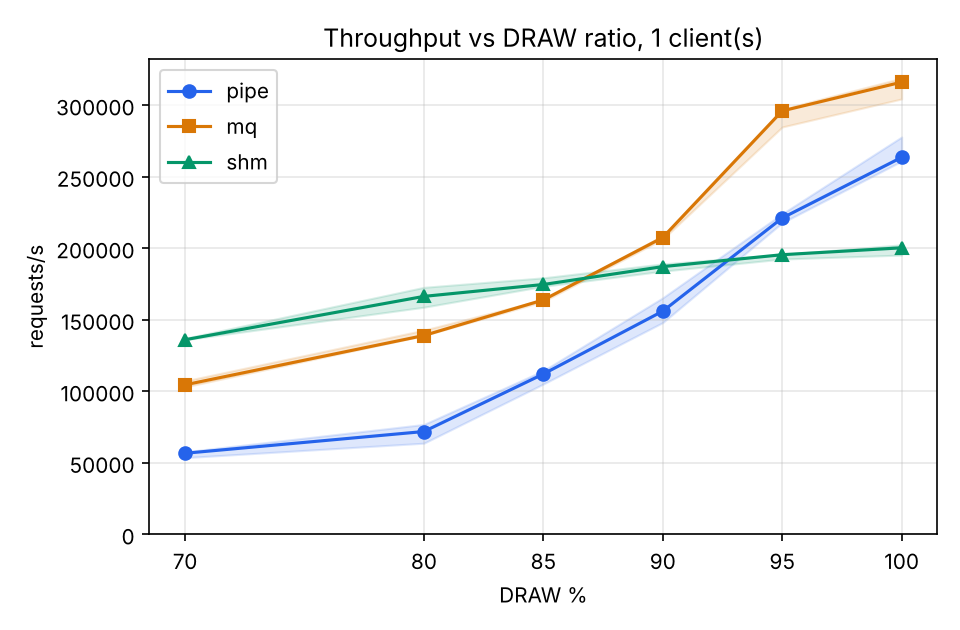

# 2단계 측정 요약

`scripts/plot-app.py` 가 `results/exp-app-ecore-mix/` 에서 만든 표다. 손으로 고치지 않는다.

측정: date: 2026-11-20T21:40:47+09:00, commit: 5986da6, reps: 5, ipcs: pipe mq shm, experiments: base clients draw, workers: 1 2 4 8

## 기준 조건 (클라이언트 4, DRAW 90%, -S 256)

`results/app_base.csv`, 조건마다 5번 실행의 중앙값. 처리량은 초당 요청 수, 지연은 µs. 편차는 실행 사이의 (최대 - 최소) / 중앙값.

| 조건 | 지표 | pipe | mq | shm | 순위 | 편차 pipe / mq / shm |
| --- | --- | --- | --- | --- | --- | --- |
| inflight=1 | 지연 중앙값 | 24.43 | 24.38 | 24.55 | pipe ≈ mq ≈ shm | 6% / 75% / 19% |
| inflight=1 | 지연 상위 99% | 108.4 | 131.5 | 90.2 | pipe ≈ mq ≈ shm | 54% / 71% / 80% |
| inflight=16 | 처리량 | 152,649 | 114,338 | 64,980 | pipe > mq > shm | 20% / 15% / 7% |

구간별 시간 (µs, 요청 하나의 평균. 요청 전송 / 큐 대기 / 락 대기 / 처리 / 응답 전송)과 CPU 시간(s, 클라이언트 합 / 서버)

| 조건 | IPC | 요청 | 큐 | 락 | 처리 | 응답 | CPU 클라이언트 | CPU 서버 |
| --- | --- | --- | --- | --- | --- | --- | --- | --- |
| inflight=1 | pipe | 8.4 | 6.1 | 2.7 | 2.2 | 12.8 | 1.29 | 1.45 |
| inflight=1 | mq | 8.1 | 6.9 | 3.3 | 2.6 | 12.5 | 1.40 | 1.65 |
| inflight=1 | shm | 9.1 | 6.1 | 2.7 | 2.2 | 10.4 | 1.27 | 1.40 |
| inflight=16 | pipe | 13.2 | 360.9 | 4.8 | 3.1 | 26.8 | 1.02 | 1.19 |
| inflight=16 | mq | 14.7 | 485.6 | 6.8 | 4.1 | 32.6 | 1.42 | 1.66 |
| inflight=16 | shm | 70.3 | 16.7 | 9.2 | 5.2 | 26.9 | 2.36 | 2.93 |

## DRAW 비율

`results/app_draw.csv`, 조건마다 5번 실행의 중앙값. 처리량은 초당 요청 수, 지연은 µs. 편차는 실행 사이의 (최대 - 최소) / 중앙값.

| 조건 | 지표 | pipe | mq | shm | 순위 | 편차 pipe / mq / shm |
| --- | --- | --- | --- | --- | --- | --- |
| clients=1, draw_pct=70 | 처리량 | 56,570 | 104,431 | 135,956 | shm > mq > pipe | 21% / 6% / 12% |
| clients=1, draw_pct=80 | 처리량 | 71,769 | 138,899 | 166,257 | shm > mq > pipe | 29% / 5% / 11% |
| clients=1, draw_pct=85 | 처리량 | 111,989 | 163,789 | 174,570 | shm > mq > pipe | 14% / 9% / 9% |
| clients=1, draw_pct=90 | 처리량 | 155,931 | 207,417 | 187,068 | mq > shm > pipe | 16% / 14% / 5% |
| clients=1, draw_pct=95 | 처리량 | 221,063 | 295,941 | 195,395 | mq > pipe > shm | 11% / 6% / 6% |
| clients=1, draw_pct=100 | 처리량 | 263,459 | 316,056 | 200,216 | mq > pipe > shm | 9% / 16% / 9% |
| clients=4, draw_pct=70 | 처리량 | 112,476 | 75,365 | 71,589 | pipe > mq ≈ shm | 32% / 28% / 16% |
| clients=4, draw_pct=80 | 처리량 | 140,057 | 98,987 | 64,470 | pipe > mq > shm | 13% / 17% / 28% |
| clients=4, draw_pct=85 | 처리량 | 154,326 | 103,502 | 66,828 | pipe > mq > shm | 13% / 37% / 18% |
| clients=4, draw_pct=90 | 처리량 | 159,865 | 121,722 | 66,305 | pipe > mq > shm | 39% / 19% / 11% |
| clients=4, draw_pct=95 | 처리량 | 160,557 | 149,074 | 67,197 | pipe > mq > shm | 19% / 5% / 52% |
| clients=4, draw_pct=100 | 처리량 | 461,313 | 501,898 | 68,767 | mq > pipe > shm | 11% / 11% / 7% |

구간별 시간 (µs, 요청 하나의 평균. 요청 전송 / 큐 대기 / 락 대기 / 처리 / 응답 전송)과 CPU 시간(s, 클라이언트 합 / 서버)

| 조건 | IPC | 요청 | 큐 | 락 | 처리 | 응답 | CPU 클라이언트 | CPU 서버 |
| --- | --- | --- | --- | --- | --- | --- | --- | --- |
| clients=1, draw_pct=70 | pipe | 7.8 | 192.5 | 3.2 | 5.9 | 67.3 | 0.34 | 0.48 |
| clients=1, draw_pct=70 | mq | 4.5 | 104.1 | 2.6 | 3.9 | 34.1 | 0.21 | 0.34 |
| clients=1, draw_pct=70 | shm | 5.9 | 71.6 | 12.1 | 4.8 | 18.9 | 0.17 | 0.32 |
| clients=1, draw_pct=80 | pipe | 8.4 | 147.5 | 4.3 | 4.7 | 52.3 | 0.28 | 0.42 |
| clients=1, draw_pct=80 | mq | 4.4 | 75.9 | 3.3 | 3.0 | 24.6 | 0.16 | 0.28 |
| clients=1, draw_pct=80 | shm | 5.6 | 57.2 | 6.7 | 3.2 | 19.4 | 0.14 | 0.27 |
| clients=1, draw_pct=85 | pipe | 6.5 | 92.2 | 3.3 | 3.0 | 33.6 | 0.19 | 0.29 |
| clients=1, draw_pct=85 | mq | 4.4 | 62.8 | 3.4 | 2.5 | 20.7 | 0.14 | 0.25 |
| clients=1, draw_pct=85 | shm | 5.5 | 54.4 | 5.3 | 2.7 | 19.2 | 0.14 | 0.25 |
| clients=1, draw_pct=90 | pipe | 6.1 | 63.2 | 3.0 | 2.1 | 24.5 | 0.14 | 0.23 |
| clients=1, draw_pct=90 | mq | 4.5 | 47.8 | 3.2 | 2.0 | 16.1 | 0.11 | 0.21 |
| clients=1, draw_pct=90 | shm | 5.4 | 50.6 | 3.3 | 1.9 | 19.8 | 0.13 | 0.22 |
| clients=1, draw_pct=95 | pipe | 6.7 | 39.6 | 2.3 | 1.4 | 19.1 | 0.11 | 0.20 |
| clients=1, draw_pct=95 | mq | 4.3 | 30.8 | 2.3 | 1.3 | 11.6 | 0.09 | 0.17 |
| clients=1, draw_pct=95 | shm | 5.6 | 48.4 | 1.8 | 1.2 | 20.6 | 0.13 | 0.20 |
| clients=1, draw_pct=100 | pipe | 20.8 | 13.1 | 0.4 | 0.6 | 21.1 | 0.13 | 0.26 |
| clients=1, draw_pct=100 | mq | 9.8 | 17.3 | 0.6 | 0.8 | 14.0 | 0.11 | 0.23 |
| clients=1, draw_pct=100 | shm | 6.2 | 46.5 | 0.1 | 0.3 | 21.7 | 0.13 | 0.18 |
| clients=4, draw_pct=70 | pipe | 8.6 | 512.1 | 6.2 | 5.0 | 29.5 | 1.29 | 1.54 |
| clients=4, draw_pct=70 | mq | 10.5 | 768.8 | 8.7 | 6.8 | 43.5 | 2.11 | 2.59 |
| clients=4, draw_pct=70 | shm | 49.7 | 555.6 | 32.8 | 10.1 | 28.9 | 2.24 | 2.68 |
| clients=4, draw_pct=80 | pipe | 9.1 | 405.4 | 5.0 | 3.7 | 25.6 | 1.07 | 1.26 |
| clients=4, draw_pct=80 | mq | 10.7 | 578.4 | 7.1 | 5.0 | 34.6 | 1.60 | 1.94 |
| clients=4, draw_pct=80 | shm | 71.7 | 40.9 | 20.4 | 8.6 | 30.8 | 2.44 | 3.06 |
| clients=4, draw_pct=85 | pipe | 10.0 | 363.3 | 4.5 | 3.2 | 24.7 | 0.98 | 1.14 |
| clients=4, draw_pct=85 | mq | 12.6 | 547.0 | 7.2 | 4.7 | 34.1 | 1.56 | 1.84 |
| clients=4, draw_pct=85 | shm | 68.5 | 21.9 | 13.6 | 6.7 | 28.0 | 2.33 | 2.93 |
| clients=4, draw_pct=90 | pipe | 12.8 | 343.8 | 4.5 | 2.9 | 25.8 | 0.97 | 1.13 |
| clients=4, draw_pct=90 | mq | 14.9 | 457.8 | 6.4 | 3.9 | 31.0 | 1.35 | 1.57 |
| clients=4, draw_pct=90 | shm | 68.7 | 16.4 | 8.9 | 5.1 | 26.6 | 2.31 | 2.89 |
| clients=4, draw_pct=95 | pipe | 20.1 | 327.8 | 4.7 | 2.8 | 29.4 | 1.03 | 1.20 |
| clients=4, draw_pct=95 | mq | 17.6 | 359.7 | 5.2 | 3.1 | 29.3 | 1.16 | 1.34 |
| clients=4, draw_pct=95 | shm | 67.5 | 14.3 | 4.8 | 3.4 | 24.3 | 2.26 | 2.76 |
| clients=4, draw_pct=100 | pipe | 39.8 | 56.5 | 0.4 | 0.5 | 20.1 | 0.49 | 0.61 |
| clients=4, draw_pct=100 | mq | 18.5 | 81.3 | 0.4 | 0.5 | 16.4 | 0.46 | 0.53 |
| clients=4, draw_pct=100 | shm | 65.0 | 12.7 | 0.5 | 0.9 | 21.0 | 2.22 | 2.52 |

## 클라이언트 수 (-f 16)

`results/app_clients.csv`, 조건마다 5번 실행의 중앙값. 처리량은 초당 요청 수, 지연은 µs. 편차는 실행 사이의 (최대 - 최소) / 중앙값.

| 조건 | 지표 | pipe | mq | shm | 순위 | 편차 pipe / mq / shm |
| --- | --- | --- | --- | --- | --- | --- |
| clients=1 | 처리량 | 149,592 | 210,223 | 184,422 | mq > shm > pipe | 27% / 23% / 36% |
| clients=2 | 처리량 | 185,629 | 157,122 | 86,471 | pipe ≈ mq > shm | 18% / 66% / 16% |
| clients=4 | 처리량 | 159,847 | 109,749 | 65,306 | pipe > mq > shm | 29% / 19% / 6% |
| clients=8 | 처리량 | 177,039 | 184,250 | 60,203 | pipe ≈ mq > shm | 14% / 14% / 32% |

구간별 시간 (µs, 요청 하나의 평균. 요청 전송 / 큐 대기 / 락 대기 / 처리 / 응답 전송)과 CPU 시간(s, 클라이언트 합 / 서버)

| 조건 | IPC | 요청 | 큐 | 락 | 처리 | 응답 | CPU 클라이언트 | CPU 서버 |
| --- | --- | --- | --- | --- | --- | --- | --- | --- |
| clients=1 | pipe | 6.5 | 65.7 | 3.1 | 2.2 | 25.5 | 0.15 | 0.24 |
| clients=1 | mq | 4.3 | 47.0 | 3.2 | 2.0 | 15.8 | 0.11 | 0.21 |
| clients=1 | shm | 5.4 | 51.5 | 3.4 | 1.9 | 20.1 | 0.14 | 0.23 |
| clients=2 | pipe | 8.8 | 130.3 | 3.2 | 2.2 | 21.1 | 0.32 | 0.46 |
| clients=2 | mq | 9.3 | 156.9 | 4.8 | 2.9 | 21.9 | 0.40 | 0.58 |
| clients=2 | shm | 32.2 | 84.0 | 10.3 | 5.2 | 33.6 | 0.84 | 1.20 |
| clients=4 | pipe | 12.5 | 344.7 | 4.6 | 3.0 | 25.6 | 0.98 | 1.13 |
| clients=4 | mq | 15.7 | 506.9 | 7.0 | 4.3 | 34.2 | 1.48 | 1.73 |
| clients=4 | shm | 69.7 | 16.8 | 9.2 | 5.3 | 26.7 | 2.35 | 2.92 |
| clients=8 | pipe | 13.1 | 663.2 | 4.4 | 2.8 | 25.4 | 2.16 | 2.16 |
| clients=8 | mq | 10.2 | 641.7 | 4.0 | 2.5 | 23.4 | 2.13 | 2.16 |
| clients=8 | shm | 141.3 | 15.2 | 8.0 | 5.1 | 26.4 | 5.20 | 6.09 |

## 그림

