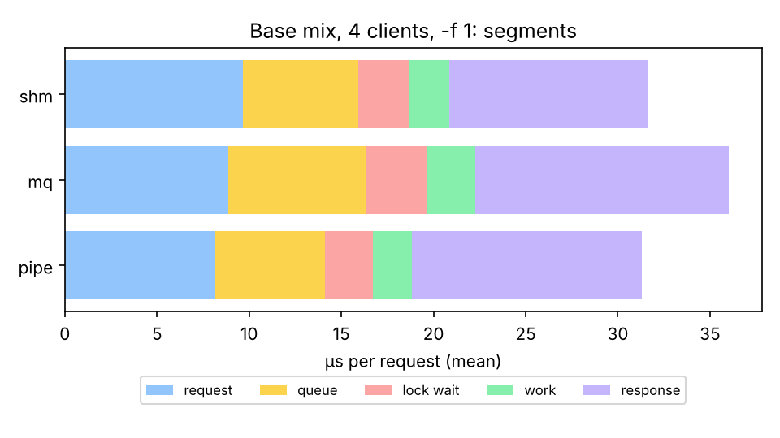
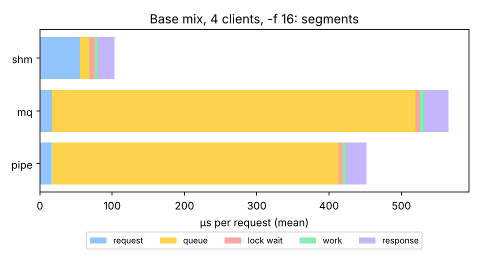
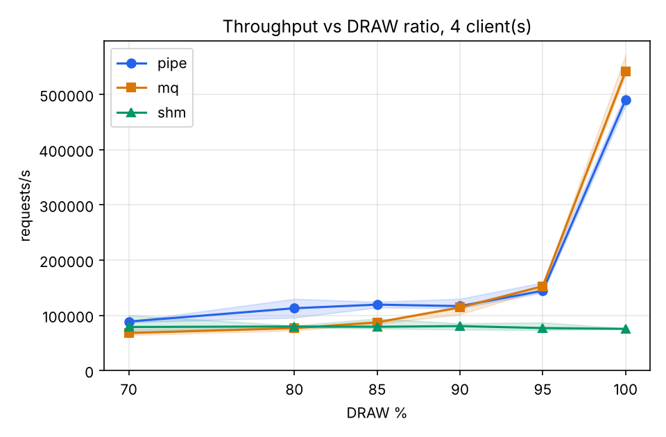
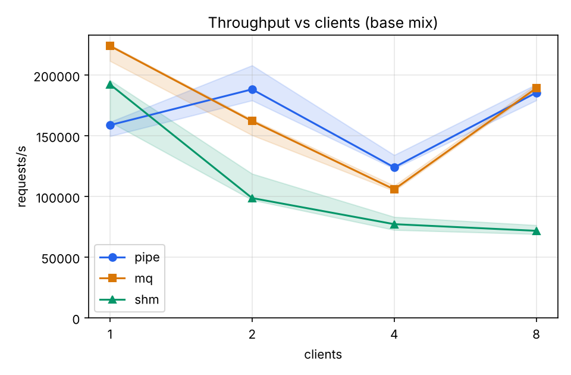

# 2단계 측정 요약

`scripts/plot-app.py` 가 `results/exp-app-ecore-mix/` 에서 만든 표다. 손으로 고치지 않는다.

측정: date: 2026-11-20T18:12:41+09:00, commit: 71c2074, reps: 5, ipcs: pipe mq shm, experiments: base clients draw, workers: 1 2 4 8

## 기준 조건 (클라이언트 4, DRAW 90%, -S 256)

`results/app_base.csv`, 조건마다 5번 실행의 중앙값. 처리량은 초당 요청 수, 지연은 µs. 편차는 실행 사이의 (최대 - 최소) / 중앙값.

| 조건 | 지표 | pipe | mq | shm | 순위 | 편차 pipe / mq / shm |
| --- | --- | --- | --- | --- | --- | --- |
| inflight=1 | 지연 중앙값 | 23.78 | 27.78 | 25.52 | pipe < shm < mq | 19% / 48% / 104% |
| inflight=1 | 지연 상위 99% | 109.9 | 137.0 | 96.1 | shm < pipe ≈ mq | 43% / 30% / 89% |
| inflight=16 | 처리량 | 137,780 | 110,124 | 82,837 | pipe > mq > shm | 52% / 103% / 90% |

구간별 시간 (µs, 요청 하나의 평균. 요청 전송 / 큐 대기 / 락 대기 / 처리 / 응답 전송)과 CPU 시간(s, 클라이언트 합 / 서버)

| 조건 | IPC | 요청 | 큐 | 락 | 처리 | 응답 | CPU 클라이언트 | CPU 서버 |
| --- | --- | --- | --- | --- | --- | --- | --- | --- |
| inflight=1 | pipe | 8.1 | 6.0 | 2.6 | 2.1 | 12.5 | 1.25 | 1.40 |
| inflight=1 | mq | 8.9 | 7.5 | 3.3 | 2.6 | 13.7 | 1.52 | 1.78 |
| inflight=1 | shm | 9.7 | 6.3 | 2.7 | 2.2 | 10.7 | 1.32 | 1.44 |
| inflight=16 | pipe | 15.2 | 398.2 | 5.1 | 3.3 | 30.1 | 1.13 | 1.30 |
| inflight=16 | mq | 16.6 | 502.8 | 6.8 | 4.2 | 34.7 | 1.48 | 1.72 |
| inflight=16 | shm | 55.4 | 13.4 | 7.0 | 3.9 | 23.8 | 1.83 | 2.25 |

## DRAW 비율

`results/app_draw.csv`, 조건마다 5번 실행의 중앙값. 처리량은 초당 요청 수, 지연은 µs. 편차는 실행 사이의 (최대 - 최소) / 중앙값.

| 조건 | 지표 | pipe | mq | shm | 순위 | 편차 pipe / mq / shm |
| --- | --- | --- | --- | --- | --- | --- |
| clients=1, draw_pct=70 | 처리량 | 51,779 | 106,261 | 135,871 | shm > mq > pipe | 11% / 16% / 25% |
| clients=1, draw_pct=80 | 처리량 | 80,041 | 141,822 | 165,664 | shm > mq > pipe | 31% / 13% / 44% |
| clients=1, draw_pct=85 | 처리량 | 94,598 | 169,592 | 177,340 | mq ≈ shm > pipe | 24% / 8% / 8% |
| clients=1, draw_pct=90 | 처리량 | 160,685 | 218,155 | 180,491 | mq > shm > pipe | 17% / 8% / 25% |
| clients=1, draw_pct=95 | 처리량 | 203,300 | 267,065 | 187,556 | mq > pipe ≈ shm | 31% / 35% / 12% |
| clients=1, draw_pct=100 | 처리량 | 235,991 | 276,602 | 199,770 | mq > pipe > shm | 13% / 31% / 41% |
| clients=4, draw_pct=70 | 처리량 | 88,645 | 67,883 | 78,825 | pipe ≈ mq ≈ shm | 35% / 43% / 46% |
| clients=4, draw_pct=80 | 처리량 | 112,775 | 76,701 | 79,719 | pipe > shm > mq | 52% / 10% / 60% |
| clients=4, draw_pct=85 | 처리량 | 119,327 | 87,205 | 79,228 | pipe > mq ≈ shm | 18% / 100% / 40% |
| clients=4, draw_pct=90 | 처리량 | 116,655 | 114,084 | 80,426 | pipe ≈ mq > shm | 23% / 22% / 87% |
| clients=4, draw_pct=95 | 처리량 | 144,381 | 152,691 | 76,890 | pipe ≈ mq > shm | 26% / 14% / 61% |
| clients=4, draw_pct=100 | 처리량 | 489,833 | 541,668 | 75,416 | mq > pipe > shm | 10% / 27% / 102% |

구간별 시간 (µs, 요청 하나의 평균. 요청 전송 / 큐 대기 / 락 대기 / 처리 / 응답 전송)과 CPU 시간(s, 클라이언트 합 / 서버)

| 조건 | IPC | 요청 | 큐 | 락 | 처리 | 응답 | CPU 클라이언트 | CPU 서버 |
| --- | --- | --- | --- | --- | --- | --- | --- | --- |
| clients=1, draw_pct=70 | pipe | 8.6 | 210.5 | 3.5 | 6.5 | 73.6 | 0.37 | 0.53 |
| clients=1, draw_pct=70 | mq | 4.6 | 101.9 | 2.6 | 3.9 | 33.0 | 0.20 | 0.34 |
| clients=1, draw_pct=70 | shm | 6.6 | 71.6 | 12.4 | 4.8 | 18.4 | 0.17 | 0.33 |
| clients=1, draw_pct=80 | pipe | 7.6 | 132.0 | 3.5 | 4.1 | 47.4 | 0.26 | 0.38 |
| clients=1, draw_pct=80 | mq | 4.5 | 74.2 | 3.2 | 3.0 | 24.0 | 0.16 | 0.28 |
| clients=1, draw_pct=80 | shm | 5.6 | 57.5 | 7.1 | 3.2 | 19.0 | 0.15 | 0.27 |
| clients=1, draw_pct=85 | pipe | 8.1 | 108.9 | 4.0 | 3.6 | 39.5 | 0.22 | 0.34 |
| clients=1, draw_pct=85 | mq | 4.5 | 60.4 | 3.3 | 2.4 | 20.1 | 0.14 | 0.24 |
| clients=1, draw_pct=85 | shm | 5.5 | 53.6 | 5.4 | 2.6 | 20.1 | 0.14 | 0.26 |
| clients=1, draw_pct=90 | pipe | 6.2 | 61.1 | 2.8 | 2.0 | 23.7 | 0.14 | 0.23 |
| clients=1, draw_pct=90 | mq | 4.5 | 45.0 | 3.0 | 1.9 | 15.3 | 0.11 | 0.20 |
| clients=1, draw_pct=90 | shm | 5.8 | 51.2 | 3.5 | 2.0 | 20.2 | 0.14 | 0.23 |
| clients=1, draw_pct=95 | pipe | 7.4 | 43.5 | 2.4 | 1.5 | 20.2 | 0.12 | 0.21 |
| clients=1, draw_pct=95 | mq | 4.9 | 34.1 | 2.3 | 1.4 | 13.1 | 0.09 | 0.18 |
| clients=1, draw_pct=95 | shm | 5.8 | 50.3 | 1.9 | 1.2 | 21.3 | 0.14 | 0.21 |
| clients=1, draw_pct=100 | pipe | 23.4 | 15.3 | 0.4 | 0.7 | 22.9 | 0.14 | 0.28 |
| clients=1, draw_pct=100 | mq | 9.7 | 22.5 | 0.5 | 0.8 | 16.3 | 0.12 | 0.25 |
| clients=1, draw_pct=100 | shm | 6.2 | 45.3 | 0.1 | 0.2 | 21.4 | 0.13 | 0.18 |
| clients=4, draw_pct=70 | pipe | 10.9 | 647.3 | 7.5 | 6.2 | 38.3 | 1.60 | 1.93 |
| clients=4, draw_pct=70 | mq | 13.5 | 839.4 | 8.9 | 7.2 | 50.5 | 2.14 | 2.69 |
| clients=4, draw_pct=70 | shm | 43.7 | 505.4 | 30.1 | 9.1 | 26.7 | 2.00 | 2.39 |
| clients=4, draw_pct=80 | pipe | 11.8 | 502.3 | 5.9 | 4.5 | 32.5 | 1.30 | 1.52 |
| clients=4, draw_pct=80 | mq | 15.5 | 742.8 | 8.9 | 6.3 | 45.2 | 2.06 | 2.47 |
| clients=4, draw_pct=80 | shm | 57.9 | 34.7 | 16.1 | 6.7 | 25.7 | 1.94 | 2.43 |
| clients=4, draw_pct=85 | pipe | 13.0 | 471.0 | 5.8 | 4.1 | 31.8 | 1.27 | 1.47 |
| clients=4, draw_pct=85 | mq | 15.7 | 645.7 | 8.2 | 5.4 | 41.3 | 1.82 | 2.15 |
| clients=4, draw_pct=85 | shm | 59.1 | 19.6 | 10.9 | 5.4 | 25.3 | 1.95 | 2.43 |
| clients=4, draw_pct=90 | pipe | 18.3 | 467.6 | 5.7 | 3.8 | 37.1 | 1.29 | 1.48 |
| clients=4, draw_pct=90 | mq | 18.0 | 486.8 | 6.5 | 4.0 | 36.4 | 1.44 | 1.66 |
| clients=4, draw_pct=90 | shm | 58.4 | 14.6 | 6.9 | 3.9 | 24.7 | 1.88 | 2.30 |
| clients=4, draw_pct=95 | pipe | 23.9 | 360.4 | 4.8 | 2.9 | 34.2 | 1.16 | 1.34 |
| clients=4, draw_pct=95 | mq | 18.4 | 348.2 | 4.7 | 2.8 | 30.2 | 1.12 | 1.29 |
| clients=4, draw_pct=95 | shm | 58.9 | 12.1 | 4.0 | 2.7 | 21.6 | 2.00 | 2.36 |
| clients=4, draw_pct=100 | pipe | 47.0 | 50.9 | 0.3 | 0.4 | 20.4 | 0.47 | 0.55 |
| clients=4, draw_pct=100 | mq | 16.6 | 73.0 | 0.3 | 0.4 | 15.5 | 0.42 | 0.47 |
| clients=4, draw_pct=100 | shm | 59.6 | 11.5 | 0.4 | 0.7 | 18.9 | 2.05 | 2.28 |

## 클라이언트 수 (-f 16)

`results/app_clients.csv`, 조건마다 5번 실행의 중앙값. 처리량은 초당 요청 수, 지연은 µs. 편차는 실행 사이의 (최대 - 최소) / 중앙값.

| 조건 | 지표 | pipe | mq | shm | 순위 | 편차 pipe / mq / shm |
| --- | --- | --- | --- | --- | --- | --- |
| clients=1 | 처리량 | 158,897 | 224,160 | 192,472 | mq > shm > pipe | 28% / 57% / 42% |
| clients=2 | 처리량 | 188,398 | 162,201 | 98,798 | pipe > mq > shm | 57% / 62% / 108% |
| clients=4 | 처리량 | 124,094 | 105,969 | 77,290 | pipe > mq > shm | 37% / 48% / 73% |
| clients=8 | 처리량 | 185,693 | 189,395 | 71,811 | pipe ≈ mq > shm | 9% / 9% / 27% |

구간별 시간 (µs, 요청 하나의 평균. 요청 전송 / 큐 대기 / 락 대기 / 처리 / 응답 전송)과 CPU 시간(s, 클라이언트 합 / 서버)

| 조건 | IPC | 요청 | 큐 | 락 | 처리 | 응답 | CPU 클라이언트 | CPU 서버 |
| --- | --- | --- | --- | --- | --- | --- | --- | --- |
| clients=1 | pipe | 6.2 | 61.8 | 2.9 | 2.0 | 24.1 | 0.14 | 0.23 |
| clients=1 | mq | 4.3 | 43.5 | 2.9 | 1.9 | 15.0 | 0.11 | 0.20 |
| clients=1 | shm | 5.4 | 48.6 | 3.4 | 1.9 | 19.0 | 0.13 | 0.22 |
| clients=2 | pipe | 9.0 | 126.8 | 3.1 | 2.1 | 20.6 | 0.32 | 0.44 |
| clients=2 | mq | 9.0 | 152.3 | 4.5 | 2.8 | 21.2 | 0.40 | 0.57 |
| clients=2 | shm | 26.4 | 86.0 | 9.2 | 4.4 | 29.7 | 0.71 | 1.00 |
| clients=4 | pipe | 18.4 | 441.9 | 5.6 | 3.7 | 33.6 | 1.25 | 1.44 |
| clients=4 | mq | 17.3 | 522.6 | 6.9 | 4.3 | 36.6 | 1.52 | 1.79 |
| clients=4 | shm | 59.0 | 15.0 | 7.4 | 4.2 | 25.1 | 1.95 | 2.39 |
| clients=8 | pipe | 13.1 | 632.0 | 4.0 | 2.5 | 25.1 | 2.08 | 2.06 |
| clients=8 | mq | 10.3 | 621.3 | 3.7 | 2.3 | 22.3 | 2.07 | 2.09 |
| clients=8 | shm | 119.6 | 12.3 | 5.9 | 3.8 | 22.6 | 4.36 | 4.92 |

## 그림

