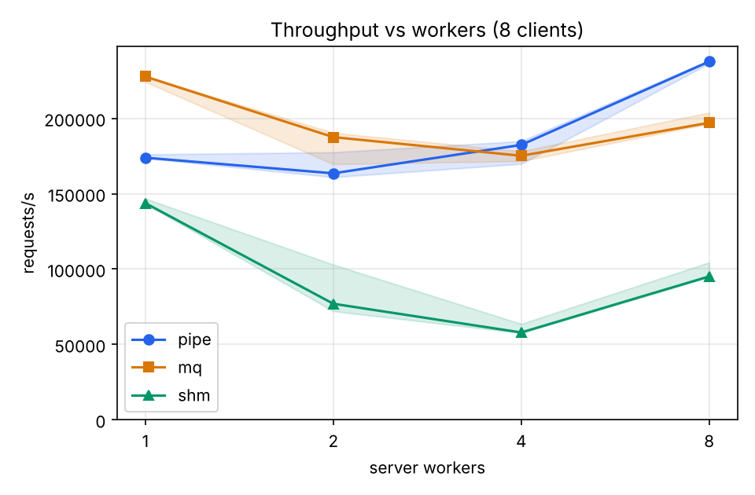

# 2단계 측정 요약

`scripts/plot-app.py` 가 `results/exp-app-ecore/` 에서 만든 표다. 손으로 고치지 않는다.

측정: date: 2026-11-20T21:38:01+09:00, commit: 5986da6, reps: 5, ipcs: pipe mq shm, experiments: workers, workers: 1 2 4 8

## 워커 수 (클라이언트 8, -f 16)

`results/app_workers.csv`, 조건마다 5번 실행의 중앙값. 처리량은 초당 요청 수, 지연은 µs. 편차는 실행 사이의 (최대 - 최소) / 중앙값.

| 조건 | 지표 | pipe | mq | shm | 순위 | 편차 pipe / mq / shm |
| --- | --- | --- | --- | --- | --- | --- |
| workers=1 | 처리량 | 173,882 | 227,706 | 143,698 | mq > pipe > shm | 9% / 2% / 8% |
| workers=2 | 처리량 | 163,519 | 187,536 | 76,950 | pipe ≈ mq > shm | 12% / 23% / 57% |
| workers=4 | 처리량 | 182,364 | 175,164 | 57,881 | pipe ≈ mq > shm | 13% / 6% / 32% |
| workers=8 | 처리량 | 237,670 | 197,038 | 95,070 | pipe > mq > shm | 5% / 7% / 13% |

구간별 시간 (µs, 요청 하나의 평균. 요청 전송 / 큐 대기 / 락 대기 / 처리 / 응답 전송)과 CPU 시간(s, 클라이언트 합 / 서버)

| 조건 | IPC | 요청 | 큐 | 락 | 처리 | 응답 | CPU 클라이언트 | CPU 서버 |
| --- | --- | --- | --- | --- | --- | --- | --- | --- |
| workers=1 | pipe | 7.2 | 710.1 | 0.0 | 1.3 | 11.7 | 1.07 | 1.00 |
| workers=1 | mq | 4.5 | 543.2 | 0.0 | 1.1 | 8.5 | 0.95 | 0.89 |
| workers=1 | shm | 58.7 | 13.4 | 0.1 | 1.3 | 9.6 | 2.27 | 1.56 |
| workers=2 | pipe | 10.1 | 744.3 | 1.2 | 2.0 | 16.2 | 1.59 | 1.47 |
| workers=2 | mq | 7.3 | 651.6 | 1.3 | 1.9 | 12.9 | 1.63 | 1.50 |
| workers=2 | shm | 112.0 | 17.4 | 2.5 | 3.5 | 20.4 | 4.22 | 3.85 |
| workers=4 | pipe | 12.8 | 644.4 | 4.4 | 2.7 | 24.6 | 2.11 | 2.11 |
| workers=4 | mq | 10.4 | 674.7 | 4.3 | 2.6 | 23.5 | 2.25 | 2.30 |
| workers=4 | shm | 147.0 | 15.9 | 8.2 | 5.2 | 27.3 | 5.39 | 6.29 |
| workers=8 | pipe | 14.3 | 464.4 | 11.1 | 2.9 | 30.1 | 1.90 | 2.16 |
| workers=8 | mq | 11.1 | 574.4 | 8.3 | 2.8 | 38.3 | 2.19 | 2.54 |
| workers=8 | shm | 88.9 | 8.4 | 4.9 | 3.0 | 16.3 | 3.21 | 4.21 |

## 그림

