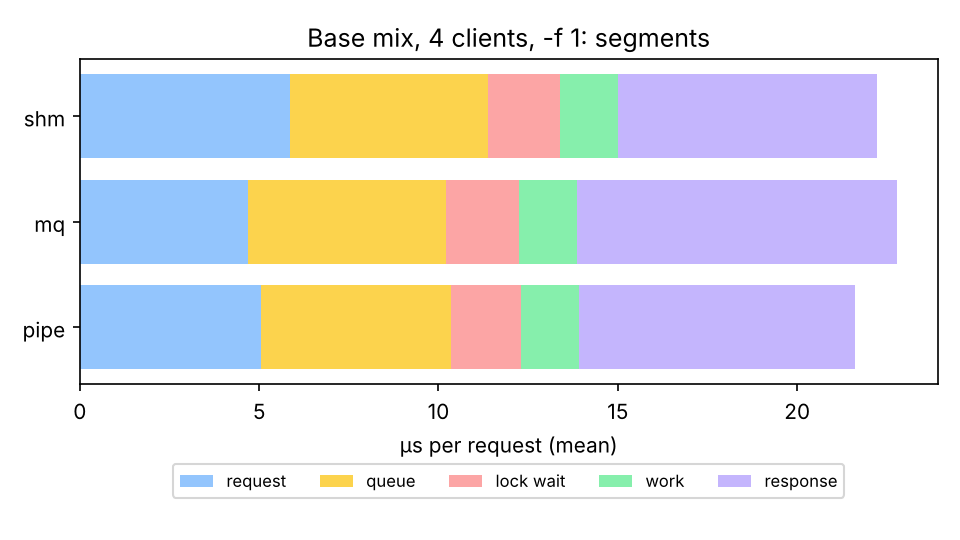
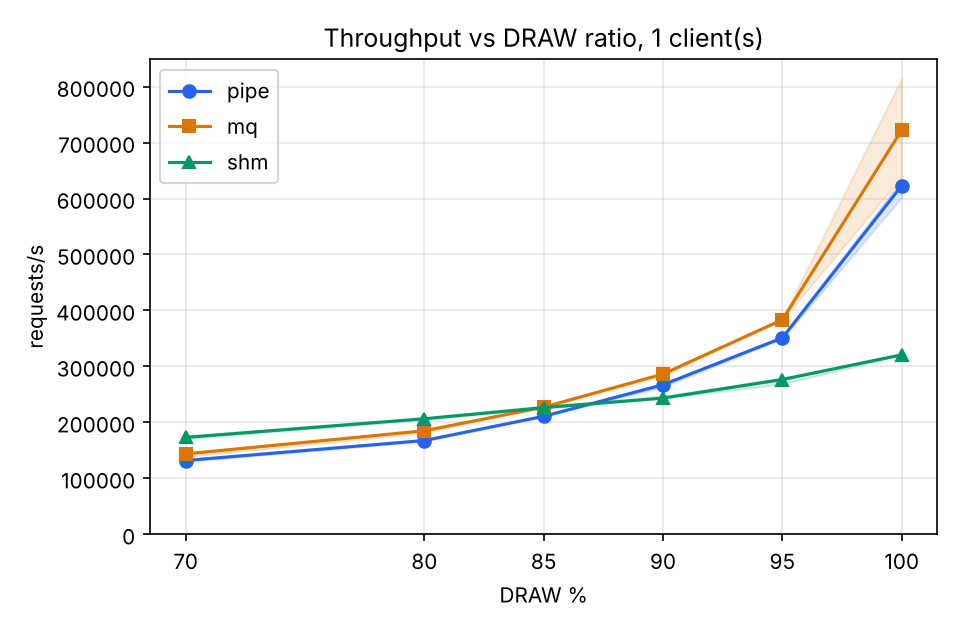
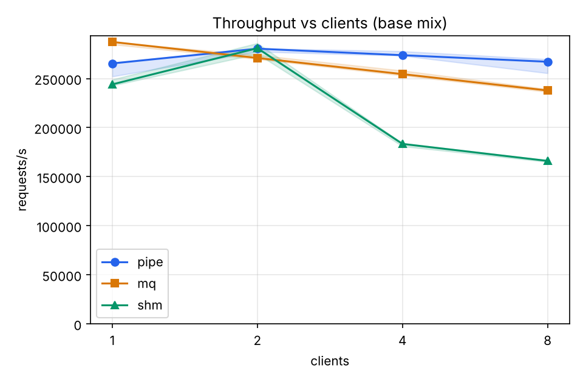

# 2단계 측정 요약

`scripts/plot-app.py` 가 `results/exp-app-pcore-mix/` 에서 만든 표다. 손으로 고치지 않는다.

측정: date: 2026-11-20T18:15:27+09:00, commit: 71c2074, reps: 5, ipcs: pipe mq shm, experiments: base clients draw, workers: 1 2 4 8

## 기준 조건 (클라이언트 4, DRAW 90%, -S 256)

`results/app_base.csv`, 조건마다 5번 실행의 중앙값. 처리량은 초당 요청 수, 지연은 µs. 편차는 실행 사이의 (최대 - 최소) / 중앙값.

| 조건 | 지표 | pipe | mq | shm | 순위 | 편차 pipe / mq / shm |
| --- | --- | --- | --- | --- | --- | --- |
| inflight=1 | 지연 중앙값 | 17.62 | 17.58 | 19.36 | pipe ≈ mq < shm | 3% / 1% / 1% |
| inflight=1 | 지연 상위 99% | 62.1 | 77.6 | 53.5 | shm < pipe < mq | 4% / 1% / 3% |
| inflight=16 | 처리량 | 276,581 | 257,328 | 185,332 | pipe > mq > shm | 2% / 2% / 7% |

구간별 시간 (µs, 요청 하나의 평균. 요청 전송 / 큐 대기 / 락 대기 / 처리 / 응답 전송)과 CPU 시간(s, 클라이언트 합 / 서버)

| 조건 | IPC | 요청 | 큐 | 락 | 처리 | 응답 | CPU 클라이언트 | CPU 서버 |
| --- | --- | --- | --- | --- | --- | --- | --- | --- |
| inflight=1 | pipe | 5.1 | 5.3 | 2.0 | 1.6 | 7.7 | 0.68 | 0.93 |
| inflight=1 | mq | 4.7 | 5.5 | 2.0 | 1.6 | 8.9 | 0.68 | 0.95 |
| inflight=1 | shm | 5.9 | 5.5 | 2.0 | 1.6 | 7.2 | 0.69 | 0.90 |
| inflight=16 | pipe | 8.0 | 190.9 | 2.4 | 1.8 | 18.5 | 0.40 | 0.50 |
| inflight=16 | mq | 6.7 | 210.7 | 2.3 | 1.8 | 17.5 | 0.42 | 0.53 |
| inflight=16 | shm | 26.0 | 12.2 | 3.2 | 1.9 | 11.0 | 0.57 | 0.77 |

## DRAW 비율

`results/app_draw.csv`, 조건마다 5번 실행의 중앙값. 처리량은 초당 요청 수, 지연은 µs. 편차는 실행 사이의 (최대 - 최소) / 중앙값.

| 조건 | 지표 | pipe | mq | shm | 순위 | 편차 pipe / mq / shm |
| --- | --- | --- | --- | --- | --- | --- |
| clients=1, draw_pct=70 | 처리량 | 131,647 | 143,466 | 173,051 | shm > mq > pipe | 22% / 10% / 6% |
| clients=1, draw_pct=80 | 처리량 | 167,386 | 184,867 | 206,256 | shm > mq > pipe | 8% / 2% / 5% |
| clients=1, draw_pct=85 | 처리량 | 210,679 | 227,033 | 226,247 | mq ≈ shm > pipe | 2% / 2% / 6% |
| clients=1, draw_pct=90 | 처리량 | 267,101 | 286,287 | 243,262 | mq > pipe > shm | 5% / 3% / 4% |
| clients=1, draw_pct=95 | 처리량 | 350,914 | 383,333 | 276,442 | mq > pipe > shm | 3% / 2% / 12% |
| clients=1, draw_pct=100 | 처리량 | 622,840 | 722,152 | 320,616 | mq > pipe > shm | 9% / 29% / 1% |
| clients=4, draw_pct=70 | 처리량 | 152,020 | 126,818 | 175,821 | shm > pipe > mq | 1% / 2% / 4% |
| clients=4, draw_pct=80 | 처리량 | 189,260 | 166,952 | 196,941 | shm > pipe > mq | 2% / 1% / 14% |
| clients=4, draw_pct=85 | 처리량 | 224,720 | 202,065 | 184,069 | pipe > mq > shm | 10% / 12% / 2% |
| clients=4, draw_pct=90 | 처리량 | 279,082 | 259,433 | 183,267 | pipe > mq > shm | 1% / 2% / 2% |
| clients=4, draw_pct=95 | 처리량 | 372,306 | 367,502 | 188,503 | pipe ≈ mq > shm | 7% / 3% / 3% |
| clients=4, draw_pct=100 | 처리량 | 680,579 | 858,839 | 201,537 | mq > pipe > shm | 5% / 4% / 2% |

구간별 시간 (µs, 요청 하나의 평균. 요청 전송 / 큐 대기 / 락 대기 / 처리 / 응답 전송)과 CPU 시간(s, 클라이언트 합 / 서버)

| 조건 | IPC | 요청 | 큐 | 락 | 처리 | 응답 | CPU 클라이언트 | CPU 서버 |
| --- | --- | --- | --- | --- | --- | --- | --- | --- |
| clients=1, draw_pct=70 | pipe | 4.8 | 80.2 | 2.6 | 4.2 | 26.0 | 0.14 | 0.23 |
| clients=1, draw_pct=70 | mq | 5.7 | 71.3 | 3.9 | 4.4 | 21.1 | 0.14 | 0.24 |
| clients=1, draw_pct=70 | shm | 5.3 | 53.8 | 12.4 | 4.3 | 12.1 | 0.09 | 0.20 |
| clients=1, draw_pct=80 | pipe | 5.5 | 59.2 | 2.5 | 3.0 | 20.7 | 0.11 | 0.18 |
| clients=1, draw_pct=80 | mq | 5.6 | 52.5 | 3.6 | 3.1 | 16.5 | 0.11 | 0.19 |
| clients=1, draw_pct=80 | shm | 5.2 | 42.6 | 7.9 | 3.1 | 13.6 | 0.08 | 0.17 |
| clients=1, draw_pct=85 | pipe | 6.0 | 43.8 | 2.3 | 2.3 | 16.8 | 0.09 | 0.15 |
| clients=1, draw_pct=85 | mq | 5.6 | 40.4 | 3.0 | 2.3 | 13.9 | 0.09 | 0.15 |
| clients=1, draw_pct=85 | shm | 5.1 | 38.2 | 5.7 | 2.4 | 14.6 | 0.08 | 0.16 |
| clients=1, draw_pct=90 | pipe | 7.0 | 31.0 | 1.8 | 1.6 | 13.9 | 0.07 | 0.12 |
| clients=1, draw_pct=90 | mq | 5.9 | 29.3 | 2.3 | 1.7 | 11.7 | 0.07 | 0.12 |
| clients=1, draw_pct=90 | shm | 5.3 | 34.2 | 3.6 | 1.7 | 15.9 | 0.08 | 0.14 |
| clients=1, draw_pct=95 | pipe | 8.6 | 18.4 | 1.1 | 0.9 | 11.8 | 0.06 | 0.10 |
| clients=1, draw_pct=95 | mq | 6.6 | 18.0 | 1.3 | 0.9 | 9.8 | 0.05 | 0.10 |
| clients=1, draw_pct=95 | shm | 5.0 | 30.1 | 1.8 | 0.9 | 16.0 | 0.08 | 0.12 |
| clients=1, draw_pct=100 | pipe | 7.2 | 3.8 | 0.1 | 0.1 | 11.5 | 0.04 | 0.07 |
| clients=1, draw_pct=100 | mq | 5.4 | 6.8 | 0.1 | 0.1 | 6.7 | 0.03 | 0.06 |
| clients=1, draw_pct=100 | shm | 4.2 | 26.1 | 0.1 | 0.2 | 15.6 | 0.07 | 0.10 |
| clients=4, draw_pct=70 | pipe | 6.0 | 375.0 | 6.4 | 4.7 | 21.3 | 0.68 | 0.94 |
| clients=4, draw_pct=70 | mq | 5.9 | 455.4 | 4.8 | 4.6 | 26.6 | 0.82 | 1.14 |
| clients=4, draw_pct=70 | shm | 10.6 | 276.4 | 15.3 | 4.1 | 21.0 | 0.56 | 0.67 |
| clients=4, draw_pct=80 | pipe | 6.5 | 295.0 | 4.4 | 3.3 | 20.3 | 0.55 | 0.73 |
| clients=4, draw_pct=80 | mq | 6.0 | 340.5 | 3.7 | 3.2 | 21.8 | 0.63 | 0.84 |
| clients=4, draw_pct=80 | shm | 19.8 | 141.5 | 10.8 | 3.4 | 19.3 | 0.59 | 0.65 |
| clients=4, draw_pct=85 | pipe | 7.2 | 244.6 | 3.5 | 2.6 | 18.9 | 0.47 | 0.62 |
| clients=4, draw_pct=85 | mq | 6.4 | 277.7 | 3.0 | 2.5 | 19.4 | 0.53 | 0.69 |
| clients=4, draw_pct=85 | shm | 26.0 | 35.7 | 5.9 | 2.8 | 14.3 | 0.58 | 0.75 |
| clients=4, draw_pct=90 | pipe | 7.9 | 190.4 | 2.4 | 1.8 | 18.1 | 0.40 | 0.50 |
| clients=4, draw_pct=90 | mq | 6.7 | 209.9 | 2.3 | 1.8 | 17.3 | 0.42 | 0.53 |
| clients=4, draw_pct=90 | shm | 26.8 | 10.6 | 3.1 | 1.9 | 9.7 | 0.58 | 0.77 |
| clients=4, draw_pct=95 | pipe | 11.7 | 129.1 | 1.3 | 1.0 | 18.6 | 0.31 | 0.37 |
| clients=4, draw_pct=95 | mq | 8.3 | 137.0 | 1.3 | 1.0 | 16.4 | 0.30 | 0.37 |
| clients=4, draw_pct=95 | shm | 27.1 | 8.2 | 1.5 | 1.1 | 8.5 | 0.56 | 0.74 |
| clients=4, draw_pct=100 | pipe | 34.9 | 18.9 | 0.1 | 0.2 | 23.1 | 0.20 | 0.24 |
| clients=4, draw_pct=100 | mq | 19.6 | 24.9 | 0.1 | 0.1 | 15.1 | 0.16 | 0.18 |
| clients=4, draw_pct=100 | shm | 24.0 | 6.5 | 0.1 | 0.2 | 7.1 | 0.55 | 0.70 |

## 클라이언트 수 (-f 16)

`results/app_clients.csv`, 조건마다 5번 실행의 중앙값. 처리량은 초당 요청 수, 지연은 µs. 편차는 실행 사이의 (최대 - 최소) / 중앙값.

| 조건 | 지표 | pipe | mq | shm | 순위 | 편차 pipe / mq / shm |
| --- | --- | --- | --- | --- | --- | --- |
| clients=1 | 처리량 | 265,424 | 287,348 | 244,078 | mq > pipe > shm | 6% / 9% / 4% |
| clients=2 | 처리량 | 280,464 | 270,990 | 280,954 | pipe ≈ shm > mq | 9% / 5% / 12% |
| clients=4 | 처리량 | 273,827 | 254,535 | 183,432 | pipe > mq > shm | 4% / 13% / 3% |
| clients=8 | 처리량 | 267,134 | 237,860 | 166,102 | pipe > mq > shm | 9% / 1% / 6% |

구간별 시간 (µs, 요청 하나의 평균. 요청 전송 / 큐 대기 / 락 대기 / 처리 / 응답 전송)과 CPU 시간(s, 클라이언트 합 / 서버)

| 조건 | IPC | 요청 | 큐 | 락 | 처리 | 응답 | CPU 클라이언트 | CPU 서버 |
| --- | --- | --- | --- | --- | --- | --- | --- | --- |
| clients=1 | pipe | 7.1 | 31.5 | 1.8 | 1.6 | 14.0 | 0.08 | 0.12 |
| clients=1 | mq | 5.8 | 29.1 | 2.3 | 1.6 | 11.6 | 0.07 | 0.12 |
| clients=1 | shm | 5.2 | 34.3 | 3.4 | 1.7 | 16.1 | 0.08 | 0.14 |
| clients=2 | pipe | 7.7 | 79.0 | 2.3 | 1.7 | 16.6 | 0.17 | 0.24 |
| clients=2 | mq | 6.7 | 84.5 | 2.3 | 1.8 | 15.0 | 0.17 | 0.25 |
| clients=2 | shm | 10.0 | 56.9 | 4.2 | 1.8 | 13.8 | 0.17 | 0.25 |
| clients=4 | pipe | 8.1 | 192.7 | 2.4 | 1.8 | 18.4 | 0.39 | 0.50 |
| clients=4 | mq | 6.9 | 211.4 | 2.2 | 1.8 | 17.6 | 0.42 | 0.53 |
| clients=4 | shm | 26.7 | 11.3 | 3.1 | 1.9 | 9.5 | 0.58 | 0.78 |
| clients=8 | pipe | 10.1 | 431.0 | 2.4 | 1.9 | 20.2 | 0.93 | 1.02 |
| clients=8 | mq | 7.0 | 495.6 | 2.2 | 1.9 | 20.1 | 1.02 | 1.14 |
| clients=8 | shm | 52.8 | 10.1 | 3.1 | 2.0 | 12.1 | 1.32 | 1.68 |

## 그림

