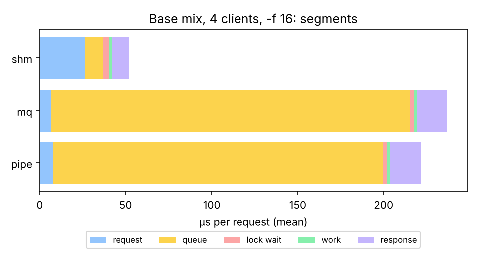
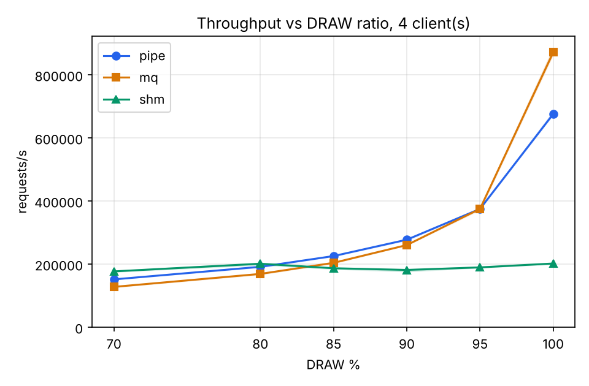

# 2단계 측정 요약

`scripts/plot-app.py` 가 `results/exp-app-pcore-mix/` 에서 만든 표다. 손으로 고치지 않는다.

측정: date: 2026-11-20T21:43:37+09:00, commit: 5986da6, reps: 5, ipcs: pipe mq shm, experiments: base clients draw, workers: 1 2 4 8

## 기준 조건 (클라이언트 4, DRAW 90%, -S 256)

`results/app_base.csv`, 조건마다 5번 실행의 중앙값. 처리량은 초당 요청 수, 지연은 µs. 편차는 실행 사이의 (최대 - 최소) / 중앙값.

| 조건 | 지표 | pipe | mq | shm | 순위 | 편차 pipe / mq / shm |
| --- | --- | --- | --- | --- | --- | --- |
| inflight=1 | 지연 중앙값 | 17.42 | 17.53 | 19.42 | pipe ≈ mq < shm | 3% / 1% / 1% |
| inflight=1 | 지연 상위 99% | 62.3 | 76.8 | 53.7 | shm < pipe < mq | 7% / 3% / 2% |
| inflight=16 | 처리량 | 277,392 | 260,917 | 183,124 | pipe > mq > shm | 2% / 3% / 2% |

구간별 시간 (µs, 요청 하나의 평균. 요청 전송 / 큐 대기 / 락 대기 / 처리 / 응답 전송)과 CPU 시간(s, 클라이언트 합 / 서버)

| 조건 | IPC | 요청 | 큐 | 락 | 처리 | 응답 | CPU 클라이언트 | CPU 서버 |
| --- | --- | --- | --- | --- | --- | --- | --- | --- |
| inflight=1 | pipe | 5.0 | 5.2 | 1.9 | 1.6 | 7.6 | 0.67 | 0.92 |
| inflight=1 | mq | 4.6 | 5.5 | 2.1 | 1.6 | 8.9 | 0.68 | 0.95 |
| inflight=1 | shm | 5.9 | 5.5 | 2.0 | 1.6 | 7.3 | 0.69 | 0.91 |
| inflight=16 | pipe | 7.9 | 191.5 | 2.4 | 1.8 | 18.1 | 0.40 | 0.50 |
| inflight=16 | mq | 6.6 | 208.5 | 2.3 | 1.8 | 17.3 | 0.42 | 0.52 |
| inflight=16 | shm | 26.2 | 10.5 | 3.1 | 1.9 | 10.2 | 0.57 | 0.77 |

## DRAW 비율

`results/app_draw.csv`, 조건마다 5번 실행의 중앙값. 처리량은 초당 요청 수, 지연은 µs. 편차는 실행 사이의 (최대 - 최소) / 중앙값.

| 조건 | 지표 | pipe | mq | shm | 순위 | 편차 pipe / mq / shm |
| --- | --- | --- | --- | --- | --- | --- |
| clients=1, draw_pct=70 | 처리량 | 129,679 | 145,294 | 171,356 | shm > mq > pipe | 3% / 0% / 4% |
| clients=1, draw_pct=80 | 처리량 | 167,565 | 185,863 | 207,003 | shm > mq > pipe | 2% / 4% / 4% |
| clients=1, draw_pct=85 | 처리량 | 208,488 | 231,206 | 227,061 | mq ≈ shm > pipe | 6% / 6% / 3% |
| clients=1, draw_pct=90 | 처리량 | 263,957 | 289,076 | 241,768 | mq > pipe > shm | 1% / 7% / 13% |
| clients=1, draw_pct=95 | 처리량 | 351,908 | 387,627 | 270,008 | mq > pipe > shm | 2% / 2% / 16% |
| clients=1, draw_pct=100 | 처리량 | 638,142 | 655,093 | 308,790 | pipe ≈ mq > shm | 8% / 33% / 7% |
| clients=4, draw_pct=70 | 처리량 | 151,844 | 128,050 | 177,111 | shm > pipe > mq | 1% / 2% / 7% |
| clients=4, draw_pct=80 | 처리량 | 191,675 | 169,205 | 201,492 | shm > pipe > mq | 3% / 2% / 3% |
| clients=4, draw_pct=85 | 처리량 | 225,766 | 204,297 | 187,149 | pipe > mq > shm | 2% / 1% / 2% |
| clients=4, draw_pct=90 | 처리량 | 277,608 | 260,617 | 181,755 | pipe > mq > shm | 5% / 5% / 7% |
| clients=4, draw_pct=95 | 처리량 | 375,187 | 375,312 | 189,865 | pipe ≈ mq > shm | 3% / 2% / 2% |
| clients=4, draw_pct=100 | 처리량 | 676,058 | 871,355 | 202,166 | mq > pipe > shm | 4% / 4% / 1% |

구간별 시간 (µs, 요청 하나의 평균. 요청 전송 / 큐 대기 / 락 대기 / 처리 / 응답 전송)과 CPU 시간(s, 클라이언트 합 / 서버)

| 조건 | IPC | 요청 | 큐 | 락 | 처리 | 응답 | CPU 클라이언트 | CPU 서버 |
| --- | --- | --- | --- | --- | --- | --- | --- | --- |
| clients=1, draw_pct=70 | pipe | 4.7 | 81.5 | 2.4 | 4.1 | 26.6 | 0.14 | 0.23 |
| clients=1, draw_pct=70 | mq | 5.5 | 70.4 | 4.1 | 4.3 | 20.5 | 0.14 | 0.24 |
| clients=1, draw_pct=70 | shm | 5.3 | 54.1 | 12.3 | 4.4 | 12.5 | 0.09 | 0.20 |
| clients=1, draw_pct=80 | pipe | 5.4 | 59.3 | 2.5 | 3.0 | 20.7 | 0.11 | 0.18 |
| clients=1, draw_pct=80 | mq | 5.4 | 52.2 | 3.7 | 3.1 | 16.3 | 0.11 | 0.19 |
| clients=1, draw_pct=80 | shm | 5.3 | 42.6 | 7.9 | 3.1 | 13.9 | 0.08 | 0.17 |
| clients=1, draw_pct=85 | pipe | 5.7 | 45.3 | 2.3 | 2.3 | 17.0 | 0.09 | 0.15 |
| clients=1, draw_pct=85 | mq | 5.5 | 39.8 | 3.1 | 2.4 | 13.3 | 0.09 | 0.15 |
| clients=1, draw_pct=85 | shm | 5.2 | 37.7 | 5.7 | 2.4 | 14.6 | 0.08 | 0.16 |
| clients=1, draw_pct=90 | pipe | 6.9 | 31.7 | 1.7 | 1.6 | 14.1 | 0.08 | 0.12 |
| clients=1, draw_pct=90 | mq | 5.7 | 29.0 | 2.3 | 1.6 | 11.5 | 0.07 | 0.12 |
| clients=1, draw_pct=90 | shm | 5.3 | 34.3 | 3.6 | 1.7 | 16.4 | 0.08 | 0.15 |
| clients=1, draw_pct=95 | pipe | 8.4 | 18.7 | 1.1 | 0.9 | 11.7 | 0.06 | 0.10 |
| clients=1, draw_pct=95 | mq | 6.4 | 18.0 | 1.3 | 0.9 | 9.5 | 0.05 | 0.09 |
| clients=1, draw_pct=95 | shm | 4.9 | 30.2 | 1.6 | 1.0 | 16.4 | 0.08 | 0.13 |
| clients=1, draw_pct=100 | pipe | 6.9 | 3.7 | 0.1 | 0.1 | 11.3 | 0.04 | 0.06 |
| clients=1, draw_pct=100 | mq | 6.3 | 5.9 | 0.1 | 0.2 | 7.5 | 0.03 | 0.07 |
| clients=1, draw_pct=100 | shm | 4.6 | 25.9 | 0.1 | 0.2 | 15.6 | 0.07 | 0.11 |
| clients=4, draw_pct=70 | pipe | 6.0 | 374.2 | 6.4 | 4.7 | 21.3 | 0.68 | 0.94 |
| clients=4, draw_pct=70 | mq | 5.8 | 450.1 | 4.8 | 4.6 | 26.2 | 0.81 | 1.13 |
| clients=4, draw_pct=70 | shm | 10.7 | 284.5 | 15.1 | 4.2 | 16.7 | 0.57 | 0.68 |
| clients=4, draw_pct=80 | pipe | 6.5 | 292.2 | 4.4 | 3.3 | 20.0 | 0.55 | 0.73 |
| clients=4, draw_pct=80 | mq | 6.0 | 336.4 | 3.7 | 3.2 | 21.5 | 0.62 | 0.83 |
| clients=4, draw_pct=80 | shm | 19.7 | 137.6 | 10.6 | 3.2 | 19.2 | 0.59 | 0.63 |
| clients=4, draw_pct=85 | pipe | 6.9 | 244.0 | 3.4 | 2.6 | 19.0 | 0.48 | 0.62 |
| clients=4, draw_pct=85 | mq | 6.1 | 274.4 | 3.1 | 2.5 | 19.2 | 0.52 | 0.68 |
| clients=4, draw_pct=85 | shm | 25.1 | 32.5 | 6.0 | 2.7 | 13.0 | 0.58 | 0.74 |
| clients=4, draw_pct=90 | pipe | 8.0 | 191.2 | 2.4 | 1.8 | 18.1 | 0.40 | 0.50 |
| clients=4, draw_pct=90 | mq | 6.6 | 208.4 | 2.3 | 1.8 | 17.2 | 0.42 | 0.52 |
| clients=4, draw_pct=90 | shm | 26.3 | 11.0 | 3.1 | 2.0 | 9.6 | 0.58 | 0.78 |
| clients=4, draw_pct=95 | pipe | 11.5 | 129.1 | 1.3 | 1.0 | 18.5 | 0.31 | 0.37 |
| clients=4, draw_pct=95 | mq | 8.3 | 134.3 | 1.3 | 1.0 | 15.8 | 0.30 | 0.37 |
| clients=4, draw_pct=95 | shm | 25.4 | 7.7 | 1.5 | 1.1 | 8.2 | 0.57 | 0.74 |
| clients=4, draw_pct=100 | pipe | 34.9 | 19.5 | 0.1 | 0.2 | 22.8 | 0.20 | 0.24 |
| clients=4, draw_pct=100 | mq | 19.6 | 24.3 | 0.1 | 0.1 | 15.3 | 0.16 | 0.18 |
| clients=4, draw_pct=100 | shm | 23.9 | 6.4 | 0.1 | 0.2 | 7.1 | 0.55 | 0.69 |

## 클라이언트 수 (-f 16)

`results/app_clients.csv`, 조건마다 5번 실행의 중앙값. 처리량은 초당 요청 수, 지연은 µs. 편차는 실행 사이의 (최대 - 최소) / 중앙값.

| 조건 | 지표 | pipe | mq | shm | 순위 | 편차 pipe / mq / shm |
| --- | --- | --- | --- | --- | --- | --- |
| clients=1 | 처리량 | 262,336 | 289,184 | 247,133 | mq > pipe > shm | 33% / 6% / 8% |
| clients=2 | 처리량 | 279,160 | 274,046 | 280,980 | pipe ≈ mq ≈ shm | 1% / 6% / 6% |
| clients=4 | 처리량 | 273,076 | 260,436 | 183,152 | pipe > mq > shm | 3% / 0% / 2% |
| clients=8 | 처리량 | 270,713 | 240,499 | 168,200 | pipe > mq > shm | 1% / 1% / 2% |

구간별 시간 (µs, 요청 하나의 평균. 요청 전송 / 큐 대기 / 락 대기 / 처리 / 응답 전송)과 CPU 시간(s, 클라이언트 합 / 서버)

| 조건 | IPC | 요청 | 큐 | 락 | 처리 | 응답 | CPU 클라이언트 | CPU 서버 |
| --- | --- | --- | --- | --- | --- | --- | --- | --- |
| clients=1 | pipe | 6.9 | 32.0 | 1.7 | 1.6 | 14.3 | 0.08 | 0.12 |
| clients=1 | mq | 5.7 | 29.2 | 2.3 | 1.6 | 11.5 | 0.07 | 0.12 |
| clients=1 | shm | 5.2 | 34.0 | 3.6 | 1.7 | 15.7 | 0.08 | 0.14 |
| clients=2 | pipe | 7.6 | 79.2 | 2.3 | 1.8 | 16.6 | 0.17 | 0.24 |
| clients=2 | mq | 6.4 | 84.1 | 2.4 | 1.8 | 14.9 | 0.17 | 0.25 |
| clients=2 | shm | 9.2 | 56.3 | 4.2 | 1.8 | 14.1 | 0.17 | 0.25 |
| clients=4 | pipe | 8.0 | 194.2 | 2.4 | 1.8 | 18.6 | 0.40 | 0.50 |
| clients=4 | mq | 6.6 | 208.9 | 2.3 | 1.8 | 17.2 | 0.42 | 0.53 |
| clients=4 | shm | 26.4 | 11.2 | 3.1 | 2.0 | 9.6 | 0.58 | 0.77 |
| clients=8 | pipe | 9.7 | 427.4 | 2.4 | 1.9 | 19.8 | 0.93 | 1.01 |
| clients=8 | mq | 6.9 | 490.7 | 2.2 | 1.8 | 20.0 | 1.01 | 1.13 |
| clients=8 | shm | 51.8 | 9.4 | 3.1 | 2.0 | 10.1 | 1.30 | 1.67 |

## 그림

