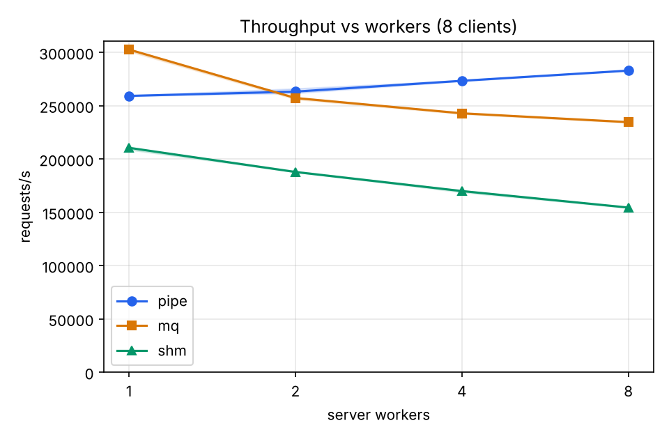

# 2단계 측정 요약

`scripts/plot-app.py` 가 `results/exp-app-pcore/` 에서 만든 표다. 손으로 고치지 않는다.

측정: date: 2026-11-20T21:39:23+09:00, commit: 5986da6, reps: 5, ipcs: pipe mq shm, experiments: workers, workers: 1 2 4 8

## 워커 수 (클라이언트 8, -f 16)

`results/app_workers.csv`, 조건마다 5번 실행의 중앙값. 처리량은 초당 요청 수, 지연은 µs. 편차는 실행 사이의 (최대 - 최소) / 중앙값.

| 조건 | 지표 | pipe | mq | shm | 순위 | 편차 pipe / mq / shm |
| --- | --- | --- | --- | --- | --- | --- |
| workers=1 | 처리량 | 259,191 | 302,725 | 210,526 | mq > pipe > shm | 1% / 1% / 1% |
| workers=2 | 처리량 | 263,219 | 257,210 | 187,812 | pipe > mq > shm | 5% / 2% / 2% |
| workers=4 | 처리량 | 273,351 | 242,873 | 169,936 | pipe > mq > shm | 1% / 2% / 2% |
| workers=8 | 처리량 | 282,913 | 234,586 | 154,460 | pipe > mq > shm | 1% / 1% / 0% |

구간별 시간 (µs, 요청 하나의 평균. 요청 전송 / 큐 대기 / 락 대기 / 처리 / 응답 전송)과 CPU 시간(s, 클라이언트 합 / 서버)

| 조건 | IPC | 요청 | 큐 | 락 | 처리 | 응답 | CPU 클라이언트 | CPU 서버 |
| --- | --- | --- | --- | --- | --- | --- | --- | --- |
| workers=1 | pipe | 5.0 | 469.2 | 0.0 | 1.2 | 11.2 | 0.67 | 0.64 |
| workers=1 | mq | 5.1 | 403.5 | 0.0 | 1.1 | 7.4 | 0.71 | 0.62 |
| workers=1 | shm | 40.5 | 23.1 | 0.0 | 1.3 | 10.6 | 1.32 | 1.00 |
| workers=2 | pipe | 7.7 | 454.5 | 0.9 | 1.5 | 12.4 | 0.85 | 0.86 |
| workers=2 | mq | 5.7 | 471.0 | 0.9 | 1.5 | 11.1 | 0.88 | 0.92 |
| workers=2 | shm | 45.7 | 12.5 | 1.0 | 1.6 | 9.8 | 1.32 | 1.26 |
| workers=4 | pipe | 9.6 | 424.1 | 2.4 | 1.9 | 19.6 | 0.92 | 1.00 |
| workers=4 | mq | 6.9 | 487.5 | 2.2 | 1.8 | 19.8 | 1.01 | 1.12 |
| workers=4 | shm | 51.2 | 9.0 | 3.1 | 2.0 | 9.9 | 1.29 | 1.67 |
| workers=8 | pipe | 13.2 | 383.7 | 6.1 | 2.4 | 32.3 | 0.90 | 1.10 |
| workers=8 | mq | 8.5 | 480.8 | 4.3 | 2.2 | 37.2 | 1.05 | 1.28 |
| workers=8 | shm | 57.9 | 9.2 | 4.4 | 2.2 | 10.7 | 1.30 | 2.11 |

## 그림

