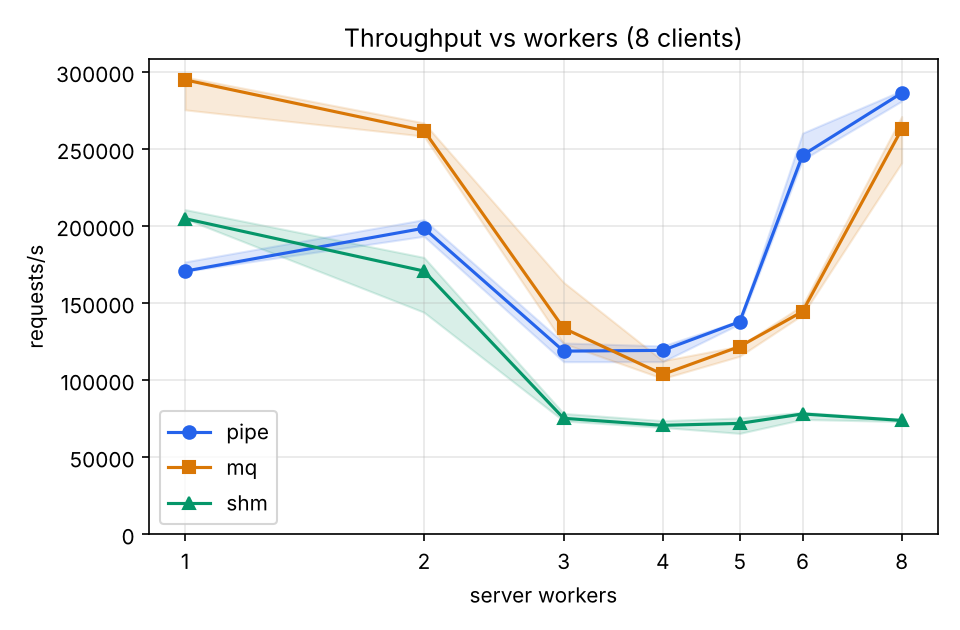

# 2단계 측정 요약

`scripts/plot-app.py` 가 `results/exp-app-wsteps/` 에서 만든 표다. 손으로 고치지 않는다.

측정: date: 2026-11-20T21:35:33+09:00, commit: 5986da6, reps: 5, ipcs: pipe mq shm, experiments: workers, workers: 1 2 3 4 5 6 8

## 워커 수 (클라이언트 8, -f 16)

`results/app_workers.csv`, 조건마다 5번 실행의 중앙값. 처리량은 초당 요청 수, 지연은 µs. 편차는 실행 사이의 (최대 - 최소) / 중앙값.

| 조건 | 지표 | pipe | mq | shm | 순위 | 편차 pipe / mq / shm |
| --- | --- | --- | --- | --- | --- | --- |
| workers=1 | 처리량 | 170,707 | 294,831 | 204,747 | mq > shm > pipe | 6% / 9% / 8% |
| workers=2 | 처리량 | 198,559 | 261,952 | 170,770 | mq > pipe > shm | 16% / 12% / 39% |
| workers=3 | 처리량 | 118,784 | 133,652 | 75,195 | pipe ≈ mq > shm | 13% / 44% / 12% |
| workers=4 | 처리량 | 119,285 | 103,710 | 70,633 | pipe ≈ mq > shm | 13% / 16% / 19% |
| workers=5 | 처리량 | 137,858 | 121,783 | 71,892 | pipe > mq > shm | 3% / 32% / 18% |
| workers=6 | 처리량 | 245,925 | 144,476 | 78,018 | pipe > mq > shm | 35% / 17% / 25% |
| workers=8 | 처리량 | 286,270 | 262,727 | 73,812 | pipe > mq > shm | 3% / 16% / 13% |

구간별 시간 (µs, 요청 하나의 평균. 요청 전송 / 큐 대기 / 락 대기 / 처리 / 응답 전송)과 CPU 시간(s, 클라이언트 합 / 서버)

| 조건 | IPC | 요청 | 큐 | 락 | 처리 | 응답 | CPU 클라이언트 | CPU 서버 |
| --- | --- | --- | --- | --- | --- | --- | --- | --- |
| workers=1 | pipe | 7.4 | 725.1 | 0.1 | 1.3 | 11.1 | 1.09 | 1.02 |
| workers=1 | mq | 3.9 | 416.0 | 0.0 | 1.0 | 7.0 | 0.87 | 0.62 |
| workers=1 | shm | 40.9 | 9.3 | 0.0 | 1.1 | 5.9 | 1.55 | 1.03 |
| workers=2 | pipe | 7.5 | 616.9 | 1.1 | 1.7 | 12.4 | 1.33 | 1.30 |
| workers=2 | mq | 4.2 | 468.8 | 1.0 | 1.4 | 8.8 | 1.12 | 1.01 |
| workers=2 | shm | 49.3 | 6.4 | 1.2 | 1.7 | 7.8 | 1.90 | 1.62 |
| workers=3 | pipe | 16.8 | 1,013.8 | 4.4 | 3.8 | 27.6 | 2.94 | 2.75 |
| workers=3 | mq | 9.7 | 907.9 | 4.3 | 3.4 | 21.9 | 2.55 | 2.50 |
| workers=3 | shm | 116.1 | 16.5 | 5.9 | 4.4 | 20.6 | 4.22 | 4.26 |
| workers=4 | pipe | 20.0 | 972.0 | 7.6 | 4.4 | 35.6 | 3.25 | 3.15 |
| workers=4 | mq | 15.3 | 1,153.8 | 9.2 | 5.0 | 34.7 | 3.75 | 3.83 |
| workers=4 | shm | 120.0 | 14.9 | 8.8 | 4.9 | 21.1 | 4.66 | 5.20 |
| workers=5 | pipe | 19.7 | 844.6 | 9.8 | 4.2 | 34.5 | 3.11 | 3.11 |
| workers=5 | mq | 14.2 | 970.9 | 11.7 | 4.8 | 33.7 | 3.62 | 3.79 |
| workers=5 | shm | 116.6 | 11.9 | 9.7 | 4.9 | 20.6 | 4.55 | 5.36 |
| workers=6 | pipe | 12.1 | 463.8 | 7.5 | 2.5 | 21.3 | 1.83 | 1.95 |
| workers=6 | mq | 13.4 | 808.2 | 12.8 | 4.1 | 33.3 | 3.15 | 3.42 |
| workers=6 | shm | 110.0 | 10.9 | 9.2 | 4.3 | 20.0 | 4.07 | 4.90 |
| workers=8 | pipe | 12.3 | 389.8 | 11.8 | 2.5 | 20.8 | 1.70 | 1.88 |
| workers=8 | mq | 8.4 | 433.1 | 11.0 | 2.5 | 22.5 | 1.81 | 2.10 |
| workers=8 | shm | 113.8 | 10.6 | 10.5 | 4.7 | 20.2 | 4.40 | 5.59 |

## 그림

