# 2단계 측정 요약

`scripts/plot-app.py` 가 `results/app/*.csv` 에서 만든 파일이다. 손으로 고치지 않는다. 같은 조건을 여러 번 잰 값은 실행마다의 값의 중앙값이다. 지연 단위는 µs, 처리량은 서버 전체의 초당 요청 수(req/s)와 응답 MB/s(1MB = 10^6B). 순위는 실행별 값에서 좋은 쪽과 나쁜 쪽을 4분의 1씩 뺀 가운데 범위가 겹치면 ≈ 로 묶는다. 문맥 교환은 자발적 컨텍스트 스위치(모든 클라이언트 + 서버)를 받은 응답 수로 나눈 값이다.

측정 환경 (`app_env.txt` 의 처음)

```text
=== 2026-11-28T00:31:58+09:00 commit 4b74c25, EXPS="type thr scale lock target cause-procs imp-mq-q imp-mq-req imp-scale imp-target mem-shm", REPS=30, IPCS="pipe mq shm"
CPU(s):                                  12
Model name:                              Intel(R) Core(TM) 5 120U
Thread(s) per core:                      2
Core(s) per socket:                      10
Socket(s):                               1
CPU(s) scaling MHz:                      25%
CPU max MHz:                             5000.0000
CPU min MHz:                             400.0000
```

요약에 쓴 실행 4140번, 뺀 실행(체크섬 다름·오류) 0번.


## 요청 종류별 (클라이언트 1, 동시 요청 1, 그림판 1) — P1, P2, P7

| 조건 | IPC | 실행 | 처리량 req/s | MB/s | 전체 p50 | 전체 p99 | DRAW p50 | DRAW p99 | SNAPSHOT p50 | SNAPSHOT p99 | 문맥 교환 /요청 | 서버 문맥 교환 /요청 | CPU µs /요청 | 실행 사이 편차(처리량) |
| --- | --- | ---: | ---: | ---: | ---: | ---: | ---: | ---: | ---: | ---: | ---: | ---: | ---: | ---: |
| SNAPSHOT만 16², 클라이언트 1, 동시 1, 그림판 1 | pipe | 30 | 47,847 | 13.8 | 16.3 | 28.8 | - | - | 16.3 | 28.8 | 4.00 | 2.00 | 20.21 | 88% |
| SNAPSHOT만 16², 클라이언트 1, 동시 1, 그림판 1 | mq | 30 | 54,226 | 15.6 | 13.3 | 24.9 | - | - | 13.3 | 24.9 | 4.00 | 2.00 | 17.40 | 107% |
| SNAPSHOT만 16², 클라이언트 1, 동시 1, 그림판 1 | shm | 30 | 55,867 | 16.1 | 13.4 | 28.2 | - | - | 13.4 | 28.2 | 4.00 | 2.00 | 17.28 | 95% |
| SNAPSHOT만 16², 클라이언트 1, 동시 1, 그림판 1 | 순위 | | shm ≈ mq ≈ pipe | | mq ≈ shm ≈ pipe | mq ≈ shm ≈ pipe |  |  | mq ≈ shm ≈ pipe | mq ≈ shm ≈ pipe | | | | |
| SNAPSHOT만 64², 클라이언트 1, 동시 1, 그림판 1 | pipe | 30 | 46,695 | 192.8 | 16.7 | 30.6 | - | - | 16.7 | 30.6 | 4.00 | 2.00 | 20.81 | 103% |
| SNAPSHOT만 64², 클라이언트 1, 동시 1, 그림판 1 | mq | 30 | 53,634 | 221.4 | 14.4 | 28.6 | - | - | 14.4 | 28.6 | 4.00 | 2.00 | 17.65 | 85% |
| SNAPSHOT만 64², 클라이언트 1, 동시 1, 그림판 1 | shm | 30 | 51,928 | 214.4 | 14.2 | 29.3 | - | - | 14.2 | 29.3 | 4.00 | 2.00 | 18.65 | 91% |
| SNAPSHOT만 64², 클라이언트 1, 동시 1, 그림판 1 | 순위 | | mq ≈ shm ≈ pipe | | shm ≈ mq ≈ pipe | mq ≈ shm ≈ pipe |  |  | shm ≈ mq ≈ pipe | mq ≈ shm ≈ pipe | | | | |
| SNAPSHOT만 128², 클라이언트 1, 동시 1, 그림판 1 | pipe | 30 | 34,132 | 560.3 | 23.3 | 53.4 | - | - | 23.3 | 53.4 | 4.00 | 2.00 | 28.48 | 105% |
| SNAPSHOT만 128², 클라이언트 1, 동시 1, 그림판 1 | mq | 30 | 47,744 | 783.8 | 15.2 | 36.5 | - | - | 15.2 | 36.5 | 4.00 | 2.00 | 22.06 | 78% |
| SNAPSHOT만 128², 클라이언트 1, 동시 1, 그림판 1 | shm | 30 | 40,538 | 665.5 | 19.1 | 34.4 | - | - | 19.1 | 34.4 | 4.00 | 2.00 | 23.76 | 110% |
| SNAPSHOT만 128², 클라이언트 1, 동시 1, 그림판 1 | 순위 | | mq ≈ shm ≈ pipe | | mq ≈ shm ≈ pipe | shm ≈ mq ≈ pipe |  |  | mq ≈ shm ≈ pipe | shm ≈ mq ≈ pipe | | | | |
| SNAPSHOT만 256², 클라이언트 1, 동시 1, 그림판 1 | pipe | 30 | 15,417 | 1,011 | 55.5 | 160.2 | - | - | 55.5 | 160.2 | 6.00 | 3.00 | 62.66 | 56% |
| SNAPSHOT만 256², 클라이언트 1, 동시 1, 그림판 1 | mq | 30 | 30,508 | 2,000 | 23.8 | 65.7 | - | - | 23.8 | 65.7 | 5.72 | 3.25 | 42.66 | 69% |
| SNAPSHOT만 256², 클라이언트 1, 동시 1, 그림판 1 | shm | 30 | 30,716 | 2,014 | 26.5 | 52.8 | - | - | 26.5 | 52.8 | 4.00 | 2.00 | 31.77 | 98% |
| SNAPSHOT만 256², 클라이언트 1, 동시 1, 그림판 1 | 순위 | | shm ≈ mq > pipe | | mq ≈ shm < pipe | shm ≈ mq < pipe |  |  | mq ≈ shm < pipe | shm ≈ mq < pipe | | | | |
| DRAW만 16², 클라이언트 1, 동시 1, 그림판 1 | pipe | 30 | 47,709 | 1.5 | 16.1 | 29.0 | 16.1 | 29.0 | - | - | 4.00 | 2.00 | 20.50 | 107% |
| DRAW만 16², 클라이언트 1, 동시 1, 그림판 1 | mq | 30 | 55,617 | 1.8 | 13.5 | 25.2 | 13.5 | 25.2 | - | - | 4.00 | 2.00 | 16.97 | 102% |
| DRAW만 16², 클라이언트 1, 동시 1, 그림판 1 | shm | 30 | 53,954 | 1.7 | 13.1 | 28.6 | 13.1 | 28.6 | - | - | 4.00 | 2.00 | 17.82 | 99% |
| DRAW만 16², 클라이언트 1, 동시 1, 그림판 1 | 순위 | | mq ≈ shm ≈ pipe | | shm ≈ mq ≈ pipe | mq ≈ shm ≈ pipe | shm ≈ mq ≈ pipe | mq ≈ shm ≈ pipe |  |  | | | | |

## 요청 종류별 구간별 시간

왕복 지연을 요청 전송(t_recv − t0), 큐 대기(t_deq − t_recv), 락 대기(t_lock − t_deq), 처리(t_send − t_lock), 응답 전송(t5 − t_send)으로 나눈 평균(µs).

| 조건 | IPC | 요청 전송 | 큐 대기 | 락 대기 | 처리 | 응답 전송 | 합 | 락 대기 비율 |
| --- | --- | ---: | ---: | ---: | ---: | ---: | ---: | ---: |
| SNAPSHOT만 16², 클라이언트 1, 동시 1, 그림판 1 | pipe | 4.98 | 4.68 | 0.14 | 0.25 | 6.50 | 16.5 | 0.8% |
| SNAPSHOT만 16², 클라이언트 1, 동시 1, 그림판 1 | mq | 4.33 | 4.65 | 0.16 | 0.25 | 4.78 | 14.2 | 1.1% |
| SNAPSHOT만 16², 클라이언트 1, 동시 1, 그림판 1 | shm | 4.61 | 4.19 | 0.14 | 0.23 | 5.18 | 14.4 | 1.0% |
| SNAPSHOT만 64², 클라이언트 1, 동시 1, 그림판 1 | pipe | 4.93 | 4.54 | 0.18 | 0.49 | 7.07 | 17.2 | 1.1% |
| SNAPSHOT만 64², 클라이언트 1, 동시 1, 그림판 1 | mq | 4.15 | 4.23 | 0.20 | 0.49 | 5.81 | 14.9 | 1.4% |
| SNAPSHOT만 64², 클라이언트 1, 동시 1, 그림판 1 | shm | 4.82 | 4.40 | 0.20 | 0.51 | 5.96 | 15.9 | 1.3% |
| SNAPSHOT만 128², 클라이언트 1, 동시 1, 그림판 1 | pipe | 5.12 | 4.87 | 0.28 | 1.60 | 12.64 | 24.5 | 1.1% |
| SNAPSHOT만 128², 클라이언트 1, 동시 1, 그림판 1 | mq | 3.53 | 3.66 | 0.25 | 1.12 | 8.88 | 17.4 | 1.4% |
| SNAPSHOT만 128², 클라이언트 1, 동시 1, 그림판 1 | shm | 5.56 | 4.79 | 0.28 | 1.27 | 8.25 | 20.1 | 1.4% |
| SNAPSHOT만 256², 클라이언트 1, 동시 1, 그림판 1 | pipe | 6.27 | 5.96 | 0.69 | 5.99 | 40.53 | 59.4 | 1.2% |
| SNAPSHOT만 256², 클라이언트 1, 동시 1, 그림판 1 | mq | 3.56 | 3.25 | 0.33 | 3.16 | 18.63 | 28.9 | 1.1% |
| SNAPSHOT만 256², 클라이언트 1, 동시 1, 그림판 1 | shm | 5.52 | 4.53 | 0.53 | 4.24 | 13.56 | 28.4 | 1.9% |
| DRAW만 16², 클라이언트 1, 동시 1, 그림판 1 | pipe | 5.17 | 4.83 | 0.18 | 0.27 | 6.37 | 16.8 | 1.1% |
| DRAW만 16², 클라이언트 1, 동시 1, 그림판 1 | mq | 4.22 | 4.54 | 0.16 | 0.24 | 4.80 | 13.9 | 1.1% |
| DRAW만 16², 클라이언트 1, 동시 1, 그림판 1 | shm | 4.78 | 4.26 | 0.15 | 0.26 | 4.95 | 14.4 | 1.1% |

## 처리량 (클라이언트 1, 동시 요청 16, 기준 혼합) — P3

| 조건 | IPC | 실행 | 처리량 req/s | MB/s | 전체 p50 | 전체 p99 | DRAW p50 | DRAW p99 | SNAPSHOT p50 | SNAPSHOT p99 | 문맥 교환 /요청 | 서버 문맥 교환 /요청 | CPU µs /요청 | 실행 사이 편차(처리량) |
| --- | --- | ---: | ---: | ---: | ---: | ---: | ---: | ---: | ---: | ---: | ---: | ---: | ---: | ---: |
| 혼합 DRAW 90%, 클라이언트 1, 동시 16, 그림판 1 | pipe | 30 | 191,365 | 1,250 | 69.9 | 258.2 | 65.3 | 236.5 | 117.3 | 340.8 | 1.53 | 1.03 | 14.68 | 23% |
| 혼합 DRAW 90%, 클라이언트 1, 동시 16, 그림판 1 | mq | 30 | 273,704 | 1,794 | 48.4 | 163.9 | 45.7 | 150.4 | 81.8 | 213.0 | 1.66 | 0.89 | 11.23 | 15% |
| 혼합 DRAW 90%, 클라이언트 1, 동시 16, 그림판 1 | shm | 30 | 224,527 | 1,469 | 64.9 | 148.4 | 64.0 | 146.3 | 76.6 | 172.1 | 2.32 | 1.42 | 13.03 | 39% |
| 혼합 DRAW 90%, 클라이언트 1, 동시 16, 그림판 1 | 순위 | | mq > shm > pipe | | mq < shm < pipe | shm ≈ mq < pipe | mq < shm ≈ pipe | shm ≈ mq < pipe | shm < mq < pipe | shm ≈ mq < pipe | | | | |

## 처리량 실험의 구간별 시간

왕복 지연을 요청 전송(t_recv − t0), 큐 대기(t_deq − t_recv), 락 대기(t_lock − t_deq), 처리(t_send − t_lock), 응답 전송(t5 − t_send)으로 나눈 평균(µs).

| 조건 | IPC | 요청 전송 | 큐 대기 | 락 대기 | 처리 | 응답 전송 | 합 | 락 대기 비율 |
| --- | --- | ---: | ---: | ---: | ---: | ---: | ---: | ---: |
| 혼합 DRAW 90%, 클라이언트 1, 동시 16, 그림판 1 | pipe | 4.63 | 50.06 | 0.31 | 1.00 | 24.31 | 80.3 | 0.4% |
| 혼합 DRAW 90%, 클라이언트 1, 동시 16, 그림판 1 | mq | 3.61 | 36.38 | 0.27 | 0.80 | 14.53 | 55.6 | 0.5% |
| 혼합 DRAW 90%, 클라이언트 1, 동시 16, 그림판 1 | shm | 4.38 | 43.51 | 0.24 | 0.78 | 19.46 | 68.4 | 0.4% |

## 클라이언트 수 (동시 요청 1, 그림판 8) — P4, P5

| 조건 | IPC | 실행 | 처리량 req/s | MB/s | 전체 p50 | 전체 p99 | DRAW p50 | DRAW p99 | SNAPSHOT p50 | SNAPSHOT p99 | 문맥 교환 /요청 | 서버 문맥 교환 /요청 | CPU µs /요청 | 실행 사이 편차(처리량) |
| --- | --- | ---: | ---: | ---: | ---: | ---: | ---: | ---: | ---: | ---: | ---: | ---: | ---: | ---: |
| DRAW만 16², 클라이언트 1, 동시 1, 그림판 8 | pipe | 30 | 40,286 | 1.3 | 18.0 | 38.7 | 18.0 | 38.7 | - | - | 4.00 | 2.00 | 23.86 | 57% |
| DRAW만 16², 클라이언트 1, 동시 1, 그림판 8 | mq | 30 | 47,102 | 1.5 | 15.2 | 33.0 | 15.2 | 33.0 | - | - | 4.00 | 2.00 | 19.94 | 60% |
| DRAW만 16², 클라이언트 1, 동시 1, 그림판 8 | shm | 30 | 44,017 | 1.4 | 16.8 | 37.3 | 16.8 | 37.3 | - | - | 4.00 | 2.00 | 21.66 | 51% |
| DRAW만 16², 클라이언트 1, 동시 1, 그림판 8 | 순위 | | mq ≈ shm ≈ pipe | | mq < shm ≈ pipe | mq ≈ shm ≈ pipe | mq < shm ≈ pipe | mq ≈ shm ≈ pipe |  |  | | | | |
| 혼합 DRAW 90%, 클라이언트 1, 동시 1, 그림판 8 | pipe | 30 | 34,416 | 222.9 | 18.6 | 89.4 | 17.8 | 41.6 | 59.2 | 152.6 | 4.20 | 2.10 | 27.94 | 43% |
| 혼합 DRAW 90%, 클라이언트 1, 동시 1, 그림판 8 | mq | 30 | 41,725 | 270.1 | 15.6 | 71.1 | 15.1 | 35.0 | 43.7 | 98.0 | 4.13 | 2.06 | 24.34 | 37% |
| 혼합 DRAW 90%, 클라이언트 1, 동시 1, 그림판 8 | shm | 30 | 39,556 | 256.1 | 18.1 | 59.2 | 17.6 | 38.2 | 33.9 | 76.7 | 4.00 | 2.00 | 24.23 | 60% |
| 혼합 DRAW 90%, 클라이언트 1, 동시 1, 그림판 8 | 순위 | | mq ≈ shm ≈ pipe | | mq < shm ≈ pipe | shm < mq < pipe | mq ≈ shm ≈ pipe | mq ≈ shm ≈ pipe | shm < mq < pipe | shm < mq < pipe | | | | |
| DRAW만 16², 클라이언트 4, 동시 1, 그림판 8 | pipe | 30 | 82,506 | 2.6 | 36.0 | 68.1 | 36.0 | 68.1 | - | - | 3.63 | 1.63 | 45.74 | 31% |
| DRAW만 16², 클라이언트 4, 동시 1, 그림판 8 | mq | 30 | 87,212 | 2.8 | 33.1 | 64.3 | 33.1 | 64.3 | - | - | 3.60 | 1.60 | 42.66 | 31% |
| DRAW만 16², 클라이언트 4, 동시 1, 그림판 8 | shm | 30 | 75,376 | 2.4 | 39.8 | 79.3 | 39.8 | 79.3 | - | - | 3.83 | 1.65 | 50.76 | 29% |
| DRAW만 16², 클라이언트 4, 동시 1, 그림판 8 | 순위 | | mq > pipe > shm | | mq < pipe < shm | mq ≈ pipe < shm | mq < pipe < shm | mq ≈ pipe < shm |  |  | | | | |
| 혼합 DRAW 90%, 클라이언트 4, 동시 1, 그림판 8 | pipe | 30 | 60,464 | 399.5 | 44.8 | 168.0 | 43.3 | 84.6 | 130.5 | 210.3 | 3.84 | 1.74 | 62.47 | 43% |
| 혼합 DRAW 90%, 클라이언트 4, 동시 1, 그림판 8 | mq | 30 | 64,583 | 427.7 | 39.1 | 176.1 | 37.7 | 85.7 | 127.5 | 239.0 | 3.98 | 1.93 | 62.50 | 50% |
| 혼합 DRAW 90%, 클라이언트 4, 동시 1, 그림판 8 | shm | 30 | 67,166 | 443.4 | 42.8 | 114.4 | 41.5 | 84.1 | 84.5 | 145.7 | 3.83 | 1.67 | 57.54 | 40% |
| 혼합 DRAW 90%, 클라이언트 4, 동시 1, 그림판 8 | 순위 | | shm ≈ mq > pipe | | mq < shm < pipe | shm < pipe < mq | mq < shm < pipe | shm ≈ pipe ≈ mq | shm < mq ≈ pipe | shm < pipe < mq | | | | |
| DRAW만 16², 클라이언트 16, 동시 1, 그림판 8 | pipe | 30 | 360,105 | 11.5 | 35.0 | 81.0 | 35.0 | 81.0 | - | - | 2.85 | 0.85 | 21.12 | 6% |
| DRAW만 16², 클라이언트 16, 동시 1, 그림판 8 | mq | 30 | 429,284 | 13.7 | 26.3 | 68.2 | 26.3 | 68.2 | - | - | 2.52 | 0.52 | 18.71 | 15% |
| DRAW만 16², 클라이언트 16, 동시 1, 그림판 8 | shm | 30 | 59,287 | 1.9 | 254.2 | 389.3 | 254.2 | 389.3 | - | - | 4.67 | 1.68 | 76.39 | 17% |
| DRAW만 16², 클라이언트 16, 동시 1, 그림판 8 | 순위 | | mq > pipe > shm | | mq < pipe < shm | mq < pipe < shm | mq < pipe < shm | mq < pipe < shm |  |  | | | | |
| 혼합 DRAW 90%, 클라이언트 16, 동시 1, 그림판 8 | pipe | 30 | 334,278 | 2,212 | 32.4 | 113.2 | 30.8 | 82.3 | 75.4 | 179.7 | 2.62 | 0.53 | 23.85 | 14% |
| 혼합 DRAW 90%, 클라이언트 16, 동시 1, 그림판 8 | mq | 30 | 288,509 | 1,908 | 36.9 | 152.8 | 34.7 | 108.2 | 91.7 | 250.9 | 3.07 | 0.92 | 26.34 | 9% |
| 혼합 DRAW 90%, 클라이언트 16, 동시 1, 그림판 8 | shm | 30 | 58,530 | 392.0 | 254.2 | 413.6 | 250.8 | 401.6 | 296.1 | 464.8 | 4.63 | 1.63 | 82.58 | 41% |
| 혼합 DRAW 90%, 클라이언트 16, 동시 1, 그림판 8 | 순위 | | pipe > mq > shm | | pipe < mq < shm | pipe < mq < shm | pipe < mq < shm | pipe < mq < shm | pipe < mq < shm | pipe < mq < shm | | | | |
| DRAW만 16², 클라이언트 64, 동시 1, 그림판 8 | pipe | 30 | 540,214 | 17.3 | 90.9 | 275.0 | 90.9 | 275.0 | - | - | 2.09 | 0.10 | 19.39 | 8% |
| DRAW만 16², 클라이언트 64, 동시 1, 그림판 8 | mq | 30 | 592,462 | 19.0 | 84.8 | 229.0 | 84.8 | 229.0 | - | - | 2.06 | 0.07 | 18.01 | 4% |
| DRAW만 16², 클라이언트 64, 동시 1, 그림판 8 | shm | 30 | 48,459 | 1.6 | 1,400 | 2,158 | 1,400 | 2,158 | - | - | 4.48 | 1.48 | 79.63 | 72% |
| DRAW만 16², 클라이언트 64, 동시 1, 그림판 8 | 순위 | | mq > pipe > shm | | mq < pipe < shm | mq < pipe < shm | mq < pipe < shm | mq < pipe < shm |  |  | | | | |
| 혼합 DRAW 90%, 클라이언트 64, 동시 1, 그림판 8 | pipe | 30 | 365,272 | 2,407 | 150.8 | 293.4 | 147.0 | 269.6 | 203.2 | 356.4 | 2.28 | 0.19 | 25.25 | 17% |
| 혼합 DRAW 90%, 클라이언트 64, 동시 1, 그림판 8 | mq | 30 | 268,586 | 1,778 | 213.2 | 441.3 | 207.6 | 409.2 | 280.5 | 541.7 | 2.95 | 0.80 | 30.06 | 22% |
| 혼합 DRAW 90%, 클라이언트 64, 동시 1, 그림판 8 | shm | 30 | 36,604 | 240.9 | 1,767 | 2,506 | 1,762 | 2,492 | 1,822 | 2,586 | 4.43 | 1.43 | 111.29 | 43% |
| 혼합 DRAW 90%, 클라이언트 64, 동시 1, 그림판 8 | 순위 | | pipe > mq > shm | | pipe < mq < shm | pipe < mq < shm | pipe < mq < shm | pipe < mq < shm | pipe < mq < shm | pipe < mq < shm | | | | |
| DRAW만 16², 클라이언트 256, 동시 1, 그림판 8 | pipe | 30 | 430,696 | 13.8 | 538.9 | 1,249 | 538.9 | 1,249 | - | - | 2.02 | 0.02 | 24.67 | 18% |
| DRAW만 16², 클라이언트 256, 동시 1, 그림판 8 | mq | 30 | 482,442 | 15.4 | 481.6 | 1,077 | 481.6 | 1,077 | - | - | 2.03 | 0.03 | 22.53 | 15% |
| DRAW만 16², 클라이언트 256, 동시 1, 그림판 8 | shm | 30 | 47,204 | 1.5 | 5,330 | 9,515 | 5,330 | 9,515 | - | - | 4.02 | 1.02 | 76.69 | 61% |
| DRAW만 16², 클라이언트 256, 동시 1, 그림판 8 | 순위 | | mq > pipe > shm | | mq < pipe < shm | mq < pipe < shm | mq < pipe < shm | mq < pipe < shm |  |  | | | | |
| 혼합 DRAW 90%, 클라이언트 256, 동시 1, 그림판 8 | pipe | 30 | 272,133 | 1,796 | 899.1 | 1,291 | 892.5 | 1,278 | 962.2 | 1,368 | 2.31 | 0.22 | 35.29 | 11% |
| 혼합 DRAW 90%, 클라이언트 256, 동시 1, 그림판 8 | mq | 30 | 72,670 | 476.5 | 3,436 | 5,912 | 3,409 | 5,857 | 3,687 | 6,246 | 2.76 | 0.61 | 115.32 | 62% |
| 혼합 DRAW 90%, 클라이언트 256, 동시 1, 그림판 8 | shm | 30 | 42,885 | 283.1 | 5,742 | 11,589 | 5,739 | 11,584 | 5,763 | 11,673 | 4.05 | 1.05 | 83.52 | 47% |
| 혼합 DRAW 90%, 클라이언트 256, 동시 1, 그림판 8 | 순위 | | pipe > mq > shm | | pipe < mq < shm | pipe < mq < shm | pipe < mq < shm | pipe < mq < shm | pipe < mq < shm | pipe < mq < shm | | | | |
| DRAW만 16², 클라이언트 1024, 동시 1, 그림판 8 | pipe | 30 | 332,014 | 10.6 | 2,972 | 4,354 | 2,972 | 4,354 | - | - | 2.03 | 0.03 | 32.02 | 13% |
| DRAW만 16², 클라이언트 1024, 동시 1, 그림판 8 | mq | 30 | 4,449 | 0.1 | 9,718 | 1,238,977 | 9,718 | 1,238,977 | - | - | 325.63 | 0.67 | 1,229 | 127% |
| DRAW만 16², 클라이언트 1024, 동시 1, 그림판 8 | shm | 30 | 43,239 | 1.4 | 23,158 | 40,813 | 23,158 | 40,813 | - | - | 4.01 | 1.01 | 89.54 | 36% |
| DRAW만 16², 클라이언트 1024, 동시 1, 그림판 8 | 순위 | | pipe > shm > mq | | pipe < mq ≈ shm | pipe < shm < mq | pipe < mq ≈ shm | pipe < shm < mq |  |  | | | | |
| 혼합 DRAW 90%, 클라이언트 1024, 동시 1, 그림판 8 | pipe | 30 | 242,051 | 1,595 | 4,141 | 5,159 | 4,133 | 5,151 | 4,216 | 5,214 | 2.55 | 0.36 | 38.75 | 12% |
| 혼합 DRAW 90%, 클라이언트 1024, 동시 1, 그림판 8 | mq | 30 | 15,194 | 99.4 | 55,364 | 153,267 | 55,144 | 153,057 | 57,578 | 155,065 | 3.15 | 0.68 | 533.26 | 105% |
| 혼합 DRAW 90%, 클라이언트 1024, 동시 1, 그림판 8 | shm | 30 | 40,656 | 266.5 | 24,212 | 47,028 | 24,208 | 47,168 | 24,250 | 45,647 | 4.02 | 1.02 | 96.24 | 37% |
| 혼합 DRAW 90%, 클라이언트 1024, 동시 1, 그림판 8 | 순위 | | pipe > shm > mq | | pipe < shm < mq | pipe < shm < mq | pipe < shm < mq | pipe < shm < mq | pipe < shm < mq | pipe < shm < mq | | | | |

## 클라이언트 수별 구간별 시간

왕복 지연을 요청 전송(t_recv − t0), 큐 대기(t_deq − t_recv), 락 대기(t_lock − t_deq), 처리(t_send − t_lock), 응답 전송(t5 − t_send)으로 나눈 평균(µs).

| 조건 | IPC | 요청 전송 | 큐 대기 | 락 대기 | 처리 | 응답 전송 | 합 | 락 대기 비율 |
| --- | --- | ---: | ---: | ---: | ---: | ---: | ---: | ---: |
| DRAW만 16², 클라이언트 1, 동시 1, 그림판 8 | pipe | 5.99 | 5.66 | 0.21 | 0.34 | 7.55 | 19.8 | 1.1% |
| DRAW만 16², 클라이언트 1, 동시 1, 그림판 8 | mq | 5.12 | 5.40 | 0.20 | 0.32 | 5.41 | 16.5 | 1.2% |
| DRAW만 16², 클라이언트 1, 동시 1, 그림판 8 | shm | 6.14 | 5.22 | 0.19 | 0.32 | 6.44 | 18.3 | 1.1% |
| 혼합 DRAW 90%, 클라이언트 1, 동시 1, 그림판 8 | pipe | 6.18 | 5.81 | 0.31 | 1.16 | 10.44 | 23.9 | 1.3% |
| 혼합 DRAW 90%, 클라이언트 1, 동시 1, 그림판 8 | mq | 5.19 | 5.29 | 0.28 | 1.04 | 7.58 | 19.4 | 1.4% |
| 혼합 DRAW 90%, 클라이언트 1, 동시 1, 그림판 8 | shm | 6.16 | 5.43 | 0.29 | 1.04 | 7.67 | 20.6 | 1.4% |
| DRAW만 16², 클라이언트 4, 동시 1, 그림판 8 | pipe | 12.90 | 10.50 | 0.45 | 0.72 | 12.85 | 37.4 | 1.2% |
| DRAW만 16², 클라이언트 4, 동시 1, 그림판 8 | mq | 11.72 | 10.28 | 0.38 | 0.68 | 11.45 | 34.5 | 1.1% |
| DRAW만 16², 클라이언트 4, 동시 1, 그림판 8 | shm | 15.38 | 10.32 | 0.40 | 0.70 | 14.93 | 41.7 | 0.9% |
| 혼합 DRAW 90%, 클라이언트 4, 동시 1, 그림판 8 | pipe | 13.42 | 11.75 | 0.70 | 2.83 | 25.18 | 53.9 | 1.3% |
| 혼합 DRAW 90%, 클라이언트 4, 동시 1, 그림판 8 | mq | 12.71 | 11.29 | 0.61 | 2.74 | 21.91 | 49.3 | 1.2% |
| 혼합 DRAW 90%, 클라이언트 4, 동시 1, 그림판 8 | shm | 15.55 | 10.66 | 0.59 | 2.61 | 18.06 | 47.5 | 1.2% |
| DRAW만 16², 클라이언트 16, 동시 1, 그림판 8 | pipe | 22.29 | 3.72 | 0.17 | 0.35 | 9.61 | 36.1 | 0.5% |
| DRAW만 16², 클라이언트 16, 동시 1, 그림판 8 | mq | 13.57 | 4.42 | 0.14 | 0.33 | 9.97 | 28.4 | 0.5% |
| DRAW만 16², 클라이언트 16, 동시 1, 그림판 8 | shm | 218.34 | 12.24 | 0.44 | 0.71 | 22.40 | 254.1 | 0.2% |
| 혼합 DRAW 90%, 클라이언트 16, 동시 1, 그림판 8 | pipe | 14.63 | 8.02 | 0.26 | 1.30 | 14.07 | 38.3 | 0.7% |
| 혼합 DRAW 90%, 클라이언트 16, 동시 1, 그림판 8 | mq | 10.79 | 16.94 | 0.23 | 1.24 | 16.52 | 45.7 | 0.5% |
| 혼합 DRAW 90%, 클라이언트 16, 동시 1, 그림판 8 | shm | 215.11 | 12.48 | 0.63 | 2.68 | 25.52 | 256.4 | 0.2% |
| DRAW만 16², 클라이언트 64, 동시 1, 그림판 8 | pipe | 40.30 | 37.29 | 0.13 | 0.35 | 23.03 | 101.1 | 0.1% |
| DRAW만 16², 클라이언트 64, 동시 1, 그림판 8 | mq | 25.25 | 44.47 | 0.11 | 0.34 | 21.15 | 91.3 | 0.1% |
| DRAW만 16², 클라이언트 64, 동시 1, 그림판 8 | shm | 1,281 | 9.70 | 0.42 | 0.65 | 16.19 | 1,308 | 0.0% |
| 혼합 DRAW 90%, 클라이언트 64, 동시 1, 그림판 8 | pipe | 26.77 | 106.77 | 0.28 | 1.44 | 23.13 | 158.4 | 0.2% |
| 혼합 DRAW 90%, 클라이언트 64, 동시 1, 그림판 8 | mq | 13.74 | 184.09 | 0.26 | 1.37 | 24.39 | 223.9 | 0.1% |
| 혼합 DRAW 90%, 클라이언트 64, 동시 1, 그림판 8 | shm | 1,689 | 12.73 | 0.74 | 3.25 | 24.73 | 1,731 | 0.0% |
| DRAW만 16², 클라이언트 256, 동시 1, 그림판 8 | pipe | 118.85 | 395.71 | 0.16 | 0.42 | 52.17 | 567.3 | 0.0% |
| DRAW만 16², 클라이언트 256, 동시 1, 그림판 8 | mq | 97.17 | 359.06 | 0.14 | 0.40 | 47.06 | 503.8 | 0.0% |
| DRAW만 16², 클라이언트 256, 동시 1, 그림판 8 | shm | 5,393 | 5.47 | 0.28 | 0.40 | 10.50 | 5,410 | 0.0% |
| 혼합 DRAW 90%, 클라이언트 256, 동시 1, 그림판 8 | pipe | 33.31 | 841.62 | 0.34 | 1.71 | 40.40 | 917.4 | 0.0% |
| 혼합 DRAW 90%, 클라이언트 256, 동시 1, 그림판 8 | mq | 38.28 | 3,344 | 0.61 | 2.66 | 97.21 | 3,483 | 0.0% |
| 혼합 DRAW 90%, 클라이언트 256, 동시 1, 그림판 8 | shm | 5,935 | 5.51 | 0.38 | 1.61 | 12.99 | 5,955 | 0.0% |
| DRAW만 16², 클라이언트 1024, 동시 1, 그림판 8 | pipe | 505.43 | 2,445 | 0.17 | 0.45 | 98.12 | 3,049 | 0.0% |
| DRAW만 16², 클라이언트 1024, 동시 1, 그림판 8 | mq | 212,123 | 1,824 | 0.29 | 0.48 | 101.58 | 214,049 | 0.0% |
| DRAW만 16², 클라이언트 1024, 동시 1, 그림판 8 | shm | 23,536 | 5.45 | 0.28 | 0.40 | 13.13 | 23,556 | 0.0% |
| 혼합 DRAW 90%, 클라이언트 1024, 동시 1, 그림판 8 | pipe | 32.41 | 4,108 | 0.33 | 1.70 | 47.36 | 4,190 | 0.0% |
| 혼합 DRAW 90%, 클라이언트 1024, 동시 1, 그림판 8 | mq | 44.02 | 65,807 | 0.60 | 2.74 | 321.50 | 66,175 | 0.0% |
| 혼합 DRAW 90%, 클라이언트 1024, 동시 1, 그림판 8 | shm | 25,029 | 5.47 | 0.37 | 1.60 | 15.08 | 25,052 | 0.0% |

## 클라이언트 수별 메모리 — P7, N-5

서버 줄의 값. IPC 버퍼 용량은 pipe: 연 FIFO 버퍼 합, mq: 큐 용량 합, shm: 공유 메모리 크기. 실제 사용은 shm 만 안다(`/proc/sysvipc/shm` rss). 가장 작은 응답 채널은 pipe 의 F_GETPIPE_SZ 최솟값, mq 응답 큐 용량, shm 응답 링 크기.

| 조건 | IPC | 서버 VmHWM kB | IPC 버퍼 용량 kB | shm 실제 kB | 가장 작은 응답 채널 B | 클라이언트 VmHWM kB(가장 큰 것) |
| --- | --- | ---: | ---: | ---: | ---: | ---: |
| DRAW만 16², 클라이언트 1, 동시 1, 그림판 8 | pipe | 10,656 | 128 | 0 | 65,536 | 2,424 |
| DRAW만 16², 클라이언트 1, 동시 1, 그림판 8 | mq | 10,776 | 32 | 0 | 16,384 | 2,624 |
| DRAW만 16², 클라이언트 1, 동시 1, 그림판 8 | shm | 10,860 | 139,392 | 204 | 139,264 | 2,454 |
| 혼합 DRAW 90%, 클라이언트 1, 동시 1, 그림판 8 | pipe | 10,892 | 128 | 0 | 65,536 | 2,438 |
| 혼합 DRAW 90%, 클라이언트 1, 동시 1, 그림판 8 | mq | 11,028 | 32 | 0 | 16,384 | 2,644 |
| 혼합 DRAW 90%, 클라이언트 1, 동시 1, 그림판 8 | shm | 11,100 | 139,392 | 208 | 139,264 | 2,476 |
| DRAW만 16², 클라이언트 4, 동시 1, 그림판 8 | pipe | 10,652 | 320 | 0 | 65,536 | 2,272 |
| DRAW만 16², 클라이언트 4, 동시 1, 그림판 8 | mq | 10,788 | 32 | 0 | 16,384 | 2,428 |
| DRAW만 16², 클라이언트 4, 동시 1, 그림판 8 | shm | 11,268 | 139,392 | 612 | 139,264 | 2,260 |
| 혼합 DRAW 90%, 클라이언트 4, 동시 1, 그림판 8 | pipe | 10,896 | 320 | 0 | 65,536 | 2,288 |
| 혼합 DRAW 90%, 클라이언트 4, 동시 1, 그림판 8 | mq | 11,052 | 32 | 0 | 16,384 | 2,448 |
| 혼합 DRAW 90%, 클라이언트 4, 동시 1, 그림판 8 | shm | 11,508 | 139,392 | 616 | 139,264 | 2,304 |
| DRAW만 16², 클라이언트 16, 동시 1, 그림판 8 | pipe | 10,652 | 1,088 | 0 | 65,536 | 2,292 |
| DRAW만 16², 클라이언트 16, 동시 1, 그림판 8 | mq | 10,836 | 32 | 0 | 16,384 | 2,468 |
| DRAW만 16², 클라이언트 16, 동시 1, 그림판 8 | shm | 12,900 | 139,392 | 2,244 | 139,264 | 2,144 |
| 혼합 DRAW 90%, 클라이언트 16, 동시 1, 그림판 8 | pipe | 10,894 | 1,088 | 0 | 65,536 | 2,336 |
| 혼합 DRAW 90%, 클라이언트 16, 동시 1, 그림판 8 | mq | 11,148 | 32 | 0 | 16,384 | 2,460 |
| 혼합 DRAW 90%, 클라이언트 16, 동시 1, 그림판 8 | shm | 13,140 | 139,392 | 2,248 | 139,264 | 2,200 |
| DRAW만 16², 클라이언트 64, 동시 1, 그림판 8 | pipe | 10,652 | 4,160 | 0 | 65,536 | 2,180 |
| DRAW만 16², 클라이언트 64, 동시 1, 그림판 8 | mq | 11,028 | 32 | 0 | 16,384 | 2,332 |
| DRAW만 16², 클라이언트 64, 동시 1, 그림판 8 | shm | 19,430 | 139,392 | 8,776 | 139,264 | 2,120 |
| 혼합 DRAW 90%, 클라이언트 64, 동시 1, 그림판 8 | pipe | 10,892 | 4,160 | 0 | 65,536 | 2,220 |
| 혼합 DRAW 90%, 클라이언트 64, 동시 1, 그림판 8 | mq | 11,528 | 32 | 0 | 16,384 | 2,352 |
| 혼합 DRAW 90%, 클라이언트 64, 동시 1, 그림판 8 | shm | 19,670 | 139,392 | 8,776 | 139,264 | 2,180 |
| DRAW만 16², 클라이언트 256, 동시 1, 그림판 8 | pipe | 10,652 | 16,448 | 0 | 65,536 | 2,136 |
| DRAW만 16², 클라이언트 256, 동시 1, 그림판 8 | mq | 11,824 | 32 | 0 | 16,384 | 2,280 |
| DRAW만 16², 클라이언트 256, 동시 1, 그림판 8 | shm | 45,556 | 139,392 | 34,900 | 139,264 | 2,116 |
| 혼합 DRAW 90%, 클라이언트 256, 동시 1, 그림판 8 | pipe | 10,892 | 16,448 | 0 | 65,536 | 2,184 |
| 혼합 DRAW 90%, 클라이언트 256, 동시 1, 그림판 8 | mq | 13,068 | 32 | 0 | 16,384 | 2,324 |
| 혼합 DRAW 90%, 클라이언트 256, 동시 1, 그림판 8 | shm | 45,796 | 139,392 | 34,900 | 139,264 | 2,188 |
| DRAW만 16², 클라이언트 1024, 동시 1, 그림판 8 | pipe | 10,652 | 56,976 | 0 | 8,192 | 2,116 |
| DRAW만 16², 클라이언트 1024, 동시 1, 그림판 8 | mq | 14,980 | 32 | 0 | 16,384 | 2,260 |
| DRAW만 16², 클라이언트 1024, 동시 1, 그림판 8 | shm | 150,048 | 139,392 | 139,396 | 139,264 | 2,130 |
| 혼합 DRAW 90%, 클라이언트 1024, 동시 1, 그림판 8 | pipe | 10,892 | 56,976 | 0 | 8,192 | 2,176 |
| 혼합 DRAW 90%, 클라이언트 1024, 동시 1, 그림판 8 | mq | 19,222 | 32 | 0 | 16,384 | 2,324 |
| 혼합 DRAW 90%, 클라이언트 1024, 동시 1, 그림판 8 | shm | 150,288 | 139,392 | 139,396 | 139,264 | 2,192 |

## 락 방식 (그림판 1, 기준 혼합) — P6

| 조건 | IPC | 실행 | 처리량 req/s | MB/s | 전체 p50 | 전체 p99 | DRAW p50 | DRAW p99 | SNAPSHOT p50 | SNAPSHOT p99 | 문맥 교환 /요청 | 서버 문맥 교환 /요청 | CPU µs /요청 | 실행 사이 편차(처리량) |
| --- | --- | ---: | ---: | ---: | ---: | ---: | ---: | ---: | ---: | ---: | ---: | ---: | ---: | ---: |
| 혼합 DRAW 90%, 클라이언트 16, 동시 1, 그림판 1, 락 room | pipe | 30 | 312,780 | 2,069 | 37.3 | 115.3 | 35.5 | 92.8 | 74.1 | 181.0 | 2.78 | 0.69 | 23.48 | 9% |
| 혼합 DRAW 90%, 클라이언트 16, 동시 1, 그림판 1, 락 room | mq | 30 | 280,085 | 1,854 | 41.7 | 142.8 | 39.3 | 109.4 | 83.8 | 217.2 | 3.20 | 1.08 | 25.71 | 15% |
| 혼합 DRAW 90%, 클라이언트 16, 동시 1, 그림판 1, 락 room | shm | 30 | 61,581 | 412.0 | 242.0 | 404.8 | 238.8 | 392.0 | 276.8 | 456.1 | 4.64 | 1.65 | 80.47 | 71% |
| 혼합 DRAW 90%, 클라이언트 16, 동시 1, 그림판 1, 락 room | 순위 | | pipe > mq > shm | | pipe < mq < shm | pipe < mq < shm | pipe < mq < shm | pipe < mq < shm | pipe < mq < shm | pipe < mq < shm | | | | |
| 혼합 DRAW 90%, 클라이언트 16, 동시 1, 그림판 1 | pipe | 30 | 340,366 | 2,251 | 32.5 | 107.7 | 31.0 | 80.0 | 71.0 | 168.2 | 2.66 | 0.56 | 23.33 | 12% |
| 혼합 DRAW 90%, 클라이언트 16, 동시 1, 그림판 1 | mq | 30 | 294,126 | 1,946 | 36.8 | 146.0 | 34.7 | 102.8 | 88.5 | 231.0 | 3.10 | 0.95 | 25.80 | 18% |
| 혼합 DRAW 90%, 클라이언트 16, 동시 1, 그림판 1 | shm | 30 | 61,968 | 414.8 | 241.2 | 384.8 | 238.2 | 374.3 | 276.1 | 430.1 | 4.65 | 1.65 | 77.31 | 44% |
| 혼합 DRAW 90%, 클라이언트 16, 동시 1, 그림판 1 | 순위 | | pipe > mq > shm | | pipe < mq < shm | pipe < mq < shm | pipe < mq < shm | pipe < mq < shm | pipe < mq < shm | pipe < mq < shm | | | | |
| 혼합 DRAW 90%, 클라이언트 64, 동시 1, 그림판 1, 락 room | pipe | 30 | 354,040 | 2,335 | 163.8 | 269.4 | 160.5 | 250.5 | 204.3 | 313.0 | 2.47 | 0.37 | 24.02 | 13% |
| 혼합 DRAW 90%, 클라이언트 64, 동시 1, 그림판 1, 락 room | mq | 30 | 276,001 | 1,826 | 212.1 | 379.4 | 207.7 | 357.0 | 261.1 | 442.9 | 3.05 | 0.92 | 28.09 | 15% |
| 혼합 DRAW 90%, 클라이언트 64, 동시 1, 그림판 1, 락 room | shm | 30 | 39,843 | 261.3 | 1,645 | 2,421 | 1,641 | 2,415 | 1,692 | 2,489 | 4.50 | 1.50 | 100.58 | 73% |
| 혼합 DRAW 90%, 클라이언트 64, 동시 1, 그림판 1, 락 room | 순위 | | pipe > mq > shm | | pipe < mq < shm | pipe < mq < shm | pipe < mq < shm | pipe < mq < shm | pipe < mq < shm | pipe < mq < shm | | | | |
| 혼합 DRAW 90%, 클라이언트 64, 동시 1, 그림판 1 | pipe | 30 | 388,906 | 2,567 | 142.3 | 266.8 | 139.0 | 245.1 | 188.2 | 322.0 | 2.29 | 0.20 | 23.93 | 16% |
| 혼합 DRAW 90%, 클라이언트 64, 동시 1, 그림판 1 | mq | 30 | 282,308 | 1,867 | 202.7 | 404.2 | 197.6 | 372.6 | 263.9 | 493.7 | 2.96 | 0.80 | 28.60 | 23% |
| 혼합 DRAW 90%, 클라이언트 64, 동시 1, 그림판 1 | shm | 30 | 40,926 | 269.3 | 1,614 | 2,404 | 1,610 | 2,394 | 1,662 | 2,456 | 4.45 | 1.45 | 98.34 | 70% |
| 혼합 DRAW 90%, 클라이언트 64, 동시 1, 그림판 1 | 순위 | | pipe > mq > shm | | pipe < mq < shm | pipe < mq < shm | pipe < mq < shm | pipe < mq < shm | pipe < mq < shm | pipe < mq < shm | | | | |
| 혼합 DRAW 90%, 클라이언트 256, 동시 1, 그림판 1, 락 room | pipe | 30 | 269,191 | 1,770 | 917.1 | 1,235 | 911.9 | 1,227 | 965.6 | 1,285 | 2.48 | 0.38 | 33.70 | 19% |
| 혼합 DRAW 90%, 클라이언트 256, 동시 1, 그림판 1, 락 room | mq | 30 | 108,323 | 710.7 | 2,248 | 4,112 | 2,234 | 4,087 | 2,382 | 4,288 | 2.85 | 0.74 | 74.79 | 109% |
| 혼합 DRAW 90%, 클라이언트 256, 동시 1, 그림판 1, 락 room | shm | 30 | 44,587 | 295.1 | 5,607 | 9,372 | 5,604 | 9,367 | 5,630 | 9,424 | 4.04 | 1.04 | 80.63 | 72% |
| 혼합 DRAW 90%, 클라이언트 256, 동시 1, 그림판 1, 락 room | 순위 | | pipe > mq > shm | | pipe < mq < shm | pipe < mq < shm | pipe < mq < shm | pipe < mq < shm | pipe < mq < shm | pipe < mq < shm | | | | |
| 혼합 DRAW 90%, 클라이언트 256, 동시 1, 그림판 1 | pipe | 30 | 291,308 | 1,914 | 839.1 | 1,189 | 833.1 | 1,176 | 896.5 | 1,261 | 2.31 | 0.22 | 33.05 | 19% |
| 혼합 DRAW 90%, 클라이언트 256, 동시 1, 그림판 1 | mq | 30 | 87,336 | 573.2 | 2,800 | 5,025 | 2,778 | 4,988 | 2,998 | 5,253 | 2.77 | 0.64 | 94.56 | 90% |
| 혼합 DRAW 90%, 클라이언트 256, 동시 1, 그림판 1 | shm | 30 | 44,185 | 292.4 | 5,591 | 10,318 | 5,589 | 10,315 | 5,613 | 10,318 | 4.04 | 1.04 | 81.52 | 58% |
| 혼합 DRAW 90%, 클라이언트 256, 동시 1, 그림판 1 | 순위 | | pipe > mq > shm | | pipe < mq < shm | pipe < mq < shm | pipe < mq < shm | pipe < mq < shm | pipe < mq < shm | pipe < mq < shm | | | | |

## 락 방식별 구간별 시간

왕복 지연을 요청 전송(t_recv − t0), 큐 대기(t_deq − t_recv), 락 대기(t_lock − t_deq), 처리(t_send − t_lock), 응답 전송(t5 − t_send)으로 나눈 평균(µs).

| 조건 | IPC | 요청 전송 | 큐 대기 | 락 대기 | 처리 | 응답 전송 | 합 | 락 대기 비율 |
| --- | --- | ---: | ---: | ---: | ---: | ---: | ---: | ---: |
| 혼합 DRAW 90%, 클라이언트 16, 동시 1, 그림판 1, 락 room | pipe | 13.84 | 11.96 | 2.03 | 1.21 | 13.22 | 42.3 | 4.8% |
| 혼합 DRAW 90%, 클라이언트 16, 동시 1, 그림판 1, 락 room | mq | 9.84 | 19.93 | 2.11 | 1.21 | 14.98 | 48.1 | 4.4% |
| 혼합 DRAW 90%, 클라이언트 16, 동시 1, 그림판 1, 락 room | shm | 199.34 | 12.97 | 2.44 | 2.55 | 25.98 | 243.3 | 1.0% |
| 혼합 DRAW 90%, 클라이언트 16, 동시 1, 그림판 1 | pipe | 14.77 | 7.74 | 0.46 | 1.02 | 13.65 | 37.6 | 1.2% |
| 혼합 DRAW 90%, 클라이언트 16, 동시 1, 그림판 1 | mq | 10.48 | 16.78 | 0.44 | 0.99 | 16.24 | 44.9 | 1.0% |
| 혼합 DRAW 90%, 클라이언트 16, 동시 1, 그림판 1 | shm | 205.86 | 11.52 | 0.73 | 2.30 | 23.28 | 243.7 | 0.3% |
| 혼합 DRAW 90%, 클라이언트 64, 동시 1, 그림판 1, 락 room | pipe | 16.43 | 129.90 | 2.56 | 1.28 | 18.09 | 168.3 | 1.5% |
| 혼합 DRAW 90%, 클라이언트 64, 동시 1, 그림판 1, 락 room | mq | 10.72 | 185.66 | 2.53 | 1.26 | 19.80 | 220.0 | 1.2% |
| 혼합 DRAW 90%, 클라이언트 64, 동시 1, 그림판 1, 락 room | shm | 1,552 | 11.80 | 0.93 | 2.61 | 22.72 | 1,590 | 0.1% |
| 혼합 DRAW 90%, 클라이언트 64, 동시 1, 그림판 1 | pipe | 25.09 | 100.56 | 0.55 | 1.02 | 21.82 | 149.0 | 0.4% |
| 혼합 DRAW 90%, 클라이언트 64, 동시 1, 그림판 1 | mq | 12.61 | 175.73 | 0.49 | 1.00 | 23.03 | 212.9 | 0.2% |
| 혼합 DRAW 90%, 클라이언트 64, 동시 1, 그림판 1 | shm | 1,512 | 11.49 | 0.68 | 2.55 | 22.93 | 1,550 | 0.0% |
| 혼합 DRAW 90%, 클라이언트 256, 동시 1, 그림판 1, 락 room | pipe | 21.78 | 873.38 | 3.09 | 1.42 | 30.68 | 930.3 | 0.3% |
| 혼합 DRAW 90%, 클라이언트 256, 동시 1, 그림판 1, 락 room | mq | 23.42 | 2,247 | 4.20 | 1.95 | 57.75 | 2,334 | 0.2% |
| 혼합 DRAW 90%, 클라이언트 256, 동시 1, 그림판 1, 락 room | shm | 5,705 | 5.37 | 0.22 | 1.09 | 12.46 | 5,724 | 0.0% |
| 혼합 DRAW 90%, 클라이언트 256, 동시 1, 그림판 1 | pipe | 33.90 | 783.33 | 0.66 | 1.13 | 37.30 | 856.3 | 0.1% |
| 혼합 DRAW 90%, 클라이언트 256, 동시 1, 그림판 1 | mq | 32.41 | 2,780 | 1.12 | 2.04 | 80.09 | 2,895 | 0.0% |
| 혼합 DRAW 90%, 클라이언트 256, 동시 1, 그림판 1 | shm | 5,757 | 5.40 | 0.31 | 1.13 | 12.59 | 5,777 | 0.0% |

## 목표 부하 (클라이언트 1024개가 초당 67개씩, 동시 4) — P8, N-2

| 조건 | IPC | 실행 | 처리량 req/s | MB/s | 전체 p50 | 전체 p99 | DRAW p50 | DRAW p99 | SNAPSHOT p50 | SNAPSHOT p99 | 문맥 교환 /요청 | 서버 문맥 교환 /요청 | CPU µs /요청 | 실행 사이 편차(처리량) |
| --- | --- | ---: | ---: | ---: | ---: | ---: | ---: | ---: | ---: | ---: | ---: | ---: | ---: | ---: |
| 혼합 DRAW 90%, 클라이언트 1024, 동시 4, 67/s, 그림판 8 | pipe | 30 | 68,336 | 448.5 | 5,196 | 8,332 | 5,179 | 8,316 | 5,349 | 8,474 | 2.43 | 0.23 | 104.23 | 1% |
| 혼합 DRAW 90%, 클라이언트 1024, 동시 4, 67/s, 그림판 8 | mq | 30 | 16,946 | 111.3 | 233,867 | 398,094 | 233,829 | 398,102 | 232,143 | 398,188 | 3.09 | 0.66 | 494.94 | 121% |
| 혼합 DRAW 90%, 클라이언트 1024, 동시 4, 67/s, 그림판 8 | shm | 30 | 11,101 | 72.7 | 184,434 | 209,531 | 184,434 | 209,523 | 184,415 | 209,736 | 3.11 | 1.04 | 206.33 | 11% |
| 혼합 DRAW 90%, 클라이언트 1024, 동시 4, 67/s, 그림판 8 | 순위 | | pipe > mq > shm | | pipe < shm < mq | pipe < shm < mq | pipe < shm < mq | pipe < shm < mq | pipe < shm < mq | pipe < shm < mq | | | | |

## 목표 부하의 구간별 시간

왕복 지연을 요청 전송(t_recv − t0), 큐 대기(t_deq − t_recv), 락 대기(t_lock − t_deq), 처리(t_send − t_lock), 응답 전송(t5 − t_send)으로 나눈 평균(µs).

| 조건 | IPC | 요청 전송 | 큐 대기 | 락 대기 | 처리 | 응답 전송 | 합 | 락 대기 비율 |
| --- | --- | ---: | ---: | ---: | ---: | ---: | ---: | ---: |
| 혼합 DRAW 90%, 클라이언트 1024, 동시 4, 67/s, 그림판 8 | pipe | 770.56 | 3,900 | 1.06 | 5.06 | 95.03 | 4,772 | 0.0% |
| 혼합 DRAW 90%, 클라이언트 1024, 동시 4, 67/s, 그림판 8 | mq | 42.14 | 231,959 | 0.48 | 2.40 | 271.15 | 232,275 | 0.0% |
| 혼합 DRAW 90%, 클라이언트 1024, 동시 4, 67/s, 그림판 8 | shm | 180,337 | 6.00 | 0.36 | 1.51 | 15.24 | 180,360 | 0.0% |

## 원인 확인: 띄운 요청 수(1024)는 같고 클라이언트 프로세스 수만 다름 (기준 혼합, 그림판 8)

| 조건 | IPC | 실행 | 처리량 req/s | MB/s | 전체 p50 | 전체 p99 | DRAW p50 | DRAW p99 | SNAPSHOT p50 | SNAPSHOT p99 | 문맥 교환 /요청 | 서버 문맥 교환 /요청 | CPU µs /요청 | 실행 사이 편차(처리량) |
| --- | --- | ---: | ---: | ---: | ---: | ---: | ---: | ---: | ---: | ---: | ---: | ---: | ---: | ---: |
| 혼합 DRAW 90%, 클라이언트 64, 동시 16, 그림판 8 | pipe | 30 | 222,930 | 1,471 | 4,366 | 8,525 | 4,359 | 8,518 | 4,428 | 8,581 | 1.52 | 0.44 | 27.77 | 37% |
| 혼합 DRAW 90%, 클라이언트 64, 동시 16, 그림판 8 | mq | 30 | 26,770 | 175.6 | 14,861 | 24,735 | 14,970 | 24,870 | 14,048 | 21,224 | 60.84 | 1.14 | 220.56 | 848% |
| 혼합 DRAW 90%, 클라이언트 64, 동시 16, 그림판 8 | shm | 30 | 90,054 | 593.5 | 653.4 | 1,697 | 650.9 | 1,691 | 674.3 | 1,745 | 3.57 | 1.57 | 35.64 | 45% |
| 혼합 DRAW 90%, 클라이언트 64, 동시 16, 그림판 8 | 순위 | | pipe > shm > mq | | shm < pipe < mq | shm < pipe < mq | shm < pipe < mq | shm < pipe < mq | shm < pipe < mq | shm < pipe < mq | | | | |
| 혼합 DRAW 90%, 클라이언트 256, 동시 4, 그림판 8 | pipe | 30 | 332,253 | 2,193 | 2,978 | 5,143 | 2,974 | 5,134 | 3,018 | 5,216 | 1.61 | 0.39 | 22.29 | 15% |
| 혼합 DRAW 90%, 클라이언트 256, 동시 4, 그림판 8 | mq | 30 | 42,554 | 280.9 | 24,870 | 30,731 | 24,836 | 30,683 | 25,192 | 31,078 | 2.60 | 0.73 | 178.94 | 138% |
| 혼합 DRAW 90%, 클라이언트 256, 동시 4, 그림판 8 | shm | 30 | 43,759 | 288.6 | 21,646 | 28,387 | 21,643 | 28,343 | 21,667 | 28,976 | 3.60 | 1.01 | 76.34 | 57% |
| 혼합 DRAW 90%, 클라이언트 256, 동시 4, 그림판 8 | 순위 | | pipe > shm ≈ mq | | pipe < shm ≈ mq | pipe < shm ≈ mq | pipe < shm ≈ mq | pipe < shm ≈ mq | pipe < shm ≈ mq | pipe < shm ≈ mq | | | | |
| 혼합 DRAW 90%, 클라이언트 1024, 동시 1, 그림판 8 | pipe | 30 | 240,473 | 1,585 | 4,156 | 5,249 | 4,148 | 5,243 | 4,232 | 5,296 | 2.55 | 0.36 | 38.86 | 15% |
| 혼합 DRAW 90%, 클라이언트 1024, 동시 1, 그림판 8 | mq | 30 | 15,583 | 101.9 | 53,325 | 148,246 | 53,223 | 147,988 | 53,811 | 150,416 | 3.13 | 0.68 | 527.06 | 120% |
| 혼합 DRAW 90%, 클라이언트 1024, 동시 1, 그림판 8 | shm | 30 | 41,471 | 271.4 | 24,082 | 46,727 | 24,080 | 46,878 | 24,098 | 45,925 | 4.02 | 1.02 | 94.97 | 39% |
| 혼합 DRAW 90%, 클라이언트 1024, 동시 1, 그림판 8 | 순위 | | pipe > shm > mq | | pipe < shm < mq | pipe < shm < mq | pipe < shm < mq | pipe < shm < mq | pipe < shm < mq | pipe < shm < mq | | | | |

## 원인 확인(프로세스 수)의 구간별 시간

왕복 지연을 요청 전송(t_recv − t0), 큐 대기(t_deq − t_recv), 락 대기(t_lock − t_deq), 처리(t_send − t_lock), 응답 전송(t5 − t_send)으로 나눈 평균(µs).

| 조건 | IPC | 요청 전송 | 큐 대기 | 락 대기 | 처리 | 응답 전송 | 합 | 락 대기 비율 |
| --- | --- | ---: | ---: | ---: | ---: | ---: | ---: | ---: |
| 혼합 DRAW 90%, 클라이언트 64, 동시 16, 그림판 8 | pipe | 25.33 | 4,520 | 0.51 | 1.89 | 28.58 | 4,576 | 0.0% |
| 혼합 DRAW 90%, 클라이언트 64, 동시 16, 그림판 8 | mq | 15,365 | 16.26 | 0.37 | 1.66 | 17.41 | 15,401 | 0.0% |
| 혼합 DRAW 90%, 클라이언트 64, 동시 16, 그림판 8 | shm | 716.22 | 4.60 | 0.29 | 1.38 | 9.53 | 732.0 | 0.0% |
| 혼합 DRAW 90%, 클라이언트 256, 동시 4, 그림판 8 | pipe | 18.03 | 3,021 | 0.34 | 1.55 | 23.62 | 3,064 | 0.0% |
| 혼합 DRAW 90%, 클라이언트 256, 동시 4, 그림판 8 | mq | 45.31 | 20,542 | 0.65 | 3.04 | 107.80 | 20,699 | 0.0% |
| 혼합 DRAW 90%, 클라이언트 256, 동시 4, 그림판 8 | shm | 20,729 | 6.35 | 0.36 | 1.56 | 14.14 | 20,751 | 0.0% |
| 혼합 DRAW 90%, 클라이언트 1024, 동시 1, 그림판 8 | pipe | 32.56 | 4,140 | 0.33 | 1.71 | 48.02 | 4,223 | 0.0% |
| 혼합 DRAW 90%, 클라이언트 1024, 동시 1, 그림판 8 | mq | 40.65 | 63,989 | 0.58 | 2.64 | 301.15 | 64,334 | 0.0% |
| 혼합 DRAW 90%, 클라이언트 1024, 동시 1, 그림판 8 | shm | 24,540 | 5.46 | 0.37 | 1.58 | 15.02 | 24,562 | 0.0% |

## 원인 확인·개선 1: mq 응답 큐 수 Q (클라이언트 1024, 기준 혼합, 동시 1)

| 조건 | IPC | 실행 | 처리량 req/s | MB/s | 전체 p50 | 전체 p99 | DRAW p50 | DRAW p99 | SNAPSHOT p50 | SNAPSHOT p99 | 문맥 교환 /요청 | 서버 문맥 교환 /요청 | CPU µs /요청 | 실행 사이 편차(처리량) |
| --- | --- | ---: | ---: | ---: | ---: | ---: | ---: | ---: | ---: | ---: | ---: | ---: | ---: | ---: |
| 혼합 DRAW 90%, 클라이언트 1024, 동시 1, 그림판 8, 응답 큐 1개 | mq | 30 | 15,681 | 102.6 | 55,195 | 146,337 | 55,074 | 145,902 | 56,575 | 148,505 | 3.14 | 0.68 | 520.04 | 103% |
| 혼합 DRAW 90%, 클라이언트 1024, 동시 1, 그림판 8, 응답 큐 2개 | mq | 30 | 40,240 | 263.4 | 26,195 | 36,279 | 26,143 | 36,169 | 26,715 | 37,016 | 2.77 | 0.49 | 211.01 | 132% |
| 혼합 DRAW 90%, 클라이언트 1024, 동시 1, 그림판 8, 응답 큐 4개 | mq | 30 | 140,909 | 931.7 | 6,747 | 11,087 | 6,735 | 11,067 | 6,862 | 11,249 | 2.55 | 0.39 | 58.96 | 133% |
| 혼합 DRAW 90%, 클라이언트 1024, 동시 1, 그림판 8, 응답 큐 8개 | mq | 30 | 131,935 | 871.0 | 4,673 | 13,655 | 4,664 | 13,638 | 4,749 | 13,809 | 6.65 | 0.38 | 57.78 | 179% |

## mq 응답 큐 수별 구간별 시간

왕복 지연을 요청 전송(t_recv − t0), 큐 대기(t_deq − t_recv), 락 대기(t_lock − t_deq), 처리(t_send − t_lock), 응답 전송(t5 − t_send)으로 나눈 평균(µs).

| 조건 | IPC | 요청 전송 | 큐 대기 | 락 대기 | 처리 | 응답 전송 | 합 | 락 대기 비율 |
| --- | --- | ---: | ---: | ---: | ---: | ---: | ---: | ---: |
| 혼합 DRAW 90%, 클라이언트 1024, 동시 1, 그림판 8, 응답 큐 1개 | mq | 42.56 | 63,320 | 0.58 | 2.67 | 309.19 | 63,675 | 0.0% |
| 혼합 DRAW 90%, 클라이언트 1024, 동시 1, 그림판 8, 응답 큐 2개 | mq | 50.59 | 24,781 | 0.69 | 3.01 | 171.31 | 25,007 | 0.0% |
| 혼합 DRAW 90%, 클라이언트 1024, 동시 1, 그림판 8, 응답 큐 4개 | mq | 28.62 | 6,781 | 0.42 | 1.85 | 65.75 | 6,877 | 0.0% |
| 혼합 DRAW 90%, 클라이언트 1024, 동시 1, 그림판 8, 응답 큐 8개 | mq | 2,572 | 4,694 | 0.37 | 1.76 | 49.46 | 7,318 | 0.0% |

## mq 응답 큐 수별 메모리

서버 줄의 값. IPC 버퍼 용량은 pipe: 연 FIFO 버퍼 합, mq: 큐 용량 합, shm: 공유 메모리 크기. 실제 사용은 shm 만 안다(`/proc/sysvipc/shm` rss). 가장 작은 응답 채널은 pipe 의 F_GETPIPE_SZ 최솟값, mq 응답 큐 용량, shm 응답 링 크기.

| 조건 | IPC | 서버 VmHWM kB | IPC 버퍼 용량 kB | shm 실제 kB | 가장 작은 응답 채널 B | 클라이언트 VmHWM kB(가장 큰 것) |
| --- | --- | ---: | ---: | ---: | ---: | ---: |
| 혼합 DRAW 90%, 클라이언트 1024, 동시 1, 그림판 8, 응답 큐 1개 | mq | 19,220 | 32 | 0 | 16,384 | 2,324 |
| 혼합 DRAW 90%, 클라이언트 1024, 동시 1, 그림판 8, 응답 큐 2개 | mq | 19,224 | 48 | 0 | 16,384 | 2,324 |
| 혼합 DRAW 90%, 클라이언트 1024, 동시 1, 그림판 8, 응답 큐 4개 | mq | 19,224 | 80 | 0 | 16,384 | 2,324 |
| 혼합 DRAW 90%, 클라이언트 1024, 동시 1, 그림판 8, 응답 큐 8개 | mq | 19,224 | 144 | 0 | 16,384 | 2,324 |

## 원인 확인·개선 2: mq 요청 큐 용량과 입장 제한 (응답 큐 8개, 기준 혼합, 동시 1)

| 조건 | IPC | 실행 | 처리량 req/s | MB/s | 전체 p50 | 전체 p99 | DRAW p50 | DRAW p99 | SNAPSHOT p50 | SNAPSHOT p99 | 문맥 교환 /요청 | 서버 문맥 교환 /요청 | CPU µs /요청 | 실행 사이 편차(처리량) |
| --- | --- | ---: | ---: | ---: | ---: | ---: | ---: | ---: | ---: | ---: | ---: | ---: | ---: | ---: |
| 혼합 DRAW 90%, 클라이언트 256, 동시 1, 그림판 8, 응답 큐 8개 | mq | 30 | 280,280 | 1,849 | 878.5 | 1,396 | 872.6 | 1,388 | 938.9 | 1,464 | 2.54 | 0.42 | 33.59 | 35% |
| 혼합 DRAW 90%, 클라이언트 1024, 동시 1, 그림판 8, 응답 큐 8개 + 입장 제한 | mq | 30 | 236,374 | 1,558 | 4,234 | 6,153 | 4,226 | 6,147 | 4,303 | 6,200 | 2.46 | 0.32 | 40.28 | 37% |
| 혼합 DRAW 90%, 클라이언트 256, 동시 1, 그림판 8, 응답 큐 8개 + 요청 큐 8,192B | mq | 30 | 86,928 | 569.2 | 939.5 | 19,792 | 931.8 | 20,181 | 1,004 | 13,817 | 16.07 | 0.55 | 78.00 | 295% |
| 혼합 DRAW 90%, 클라이언트 256, 동시 1, 그림판 8, 응답 큐 8개 + 요청 큐 8,192B + 입장 제한 | mq | 30 | 272,121 | 1,795 | 905.1 | 1,418 | 899.1 | 1,410 | 967.0 | 1,491 | 2.50 | 0.38 | 34.88 | 25% |

## mq 요청 큐 실험의 구간별 시간

왕복 지연을 요청 전송(t_recv − t0), 큐 대기(t_deq − t_recv), 락 대기(t_lock − t_deq), 처리(t_send − t_lock), 응답 전송(t5 − t_send)으로 나눈 평균(µs).

| 조건 | IPC | 요청 전송 | 큐 대기 | 락 대기 | 처리 | 응답 전송 | 합 | 락 대기 비율 |
| --- | --- | ---: | ---: | ---: | ---: | ---: | ---: | ---: |
| 혼합 DRAW 90%, 클라이언트 256, 동시 1, 그림판 8, 응답 큐 8개 | mq | 18.03 | 844.58 | 0.32 | 1.62 | 30.79 | 895.3 | 0.0% |
| 혼합 DRAW 90%, 클라이언트 1024, 동시 1, 그림판 8, 응답 큐 8개 + 입장 제한 | mq | 27.56 | 4,224 | 0.33 | 1.61 | 40.73 | 4,294 | 0.0% |
| 혼합 DRAW 90%, 클라이언트 256, 동시 1, 그림판 8, 응답 큐 8개 + 요청 큐 8,192B | mq | 2,178 | 735.85 | 0.34 | 1.67 | 30.14 | 2,946 | 0.0% |
| 혼합 DRAW 90%, 클라이언트 256, 동시 1, 그림판 8, 응답 큐 8개 + 요청 큐 8,192B + 입장 제한 | mq | 28.06 | 860.39 | 0.32 | 1.65 | 31.89 | 922.3 | 0.0% |

## 개선 전후: 처음 설계(클라이언트 1024) / 개선한 설계(클라이언트 1~1024), 기준 혼합, 동시 1, 그림판 8

| 조건 | IPC | 실행 | 처리량 req/s | MB/s | 전체 p50 | 전체 p99 | DRAW p50 | DRAW p99 | SNAPSHOT p50 | SNAPSHOT p99 | 문맥 교환 /요청 | 서버 문맥 교환 /요청 | CPU µs /요청 | 실행 사이 편차(처리량) |
| --- | --- | ---: | ---: | ---: | ---: | ---: | ---: | ---: | ---: | ---: | ---: | ---: | ---: | ---: |
| 혼합 DRAW 90%, 클라이언트 1024, 동시 1, 그림판 8 | mq | 30 | 16,606 | 108.8 | 46,411 | 143,221 | 46,254 | 142,804 | 47,958 | 145,151 | 3.10 | 0.68 | 501.18 | 101% |
| 혼합 DRAW 90%, 클라이언트 1024, 동시 1, 그림판 8 | shm | 30 | 43,418 | 283.6 | 22,824 | 42,746 | 22,820 | 42,761 | 22,852 | 41,217 | 4.01 | 1.01 | 91.19 | 36% |
| 혼합 DRAW 90%, 클라이언트 1024, 동시 1, 그림판 8 | 순위 | | shm > mq | | shm < mq | shm < mq | shm < mq | shm < mq | shm < mq | shm < mq | | | | |
| 혼합 DRAW 90%, 클라이언트 1, 동시 1, 그림판 8, 개선한 설계 | mq | 30 | 54,248 | 351.4 | 11.6 | 59.2 | 11.0 | 29.0 | 34.2 | 82.2 | 4.16 | 2.08 | 18.97 | 74% |
| 혼합 DRAW 90%, 클라이언트 1, 동시 1, 그림판 8, 개선한 설계 | shm | 30 | 51,742 | 335.4 | 13.7 | 44.0 | 13.1 | 33.0 | 24.5 | 61.5 | 4.00 | 2.00 | 20.77 | 78% |
| 혼합 DRAW 90%, 클라이언트 1, 동시 1, 그림판 8, 개선한 설계 | 순위 | | mq ≈ shm | | mq ≈ shm | shm ≈ mq | mq ≈ shm | mq ≈ shm | shm ≈ mq | shm ≈ mq | | | | |
| 혼합 DRAW 90%, 클라이언트 64, 동시 1, 그림판 8, 개선한 설계 | mq | 30 | 363,437 | 2,396 | 155.4 | 293.5 | 151.9 | 268.3 | 203.9 | 352.6 | 2.45 | 0.34 | 25.69 | 16% |
| 혼합 DRAW 90%, 클라이언트 64, 동시 1, 그림판 8, 개선한 설계 | shm | 30 | 429,330 | 2,830 | 116.8 | 373.1 | 114.5 | 366.1 | 140.6 | 430.7 | 2.02 | 0.03 | 25.42 | 17% |
| 혼합 DRAW 90%, 클라이언트 64, 동시 1, 그림판 8, 개선한 설계 | 순위 | | shm > mq | | shm < mq | mq ≈ shm | shm < mq | mq ≈ shm | shm < mq | mq ≈ shm | | | | |
| 혼합 DRAW 90%, 클라이언트 256, 동시 1, 그림판 8, 개선한 설계 | mq | 30 | 273,507 | 1,805 | 899.0 | 1,457 | 892.9 | 1,443 | 960.8 | 1,546 | 2.49 | 0.38 | 34.69 | 20% |
| 혼합 DRAW 90%, 클라이언트 256, 동시 1, 그림판 8, 개선한 설계 | shm | 30 | 309,669 | 2,043 | 770.8 | 1,646 | 767.5 | 1,649 | 801.1 | 1,637 | 2.03 | 0.03 | 34.82 | 15% |
| 혼합 DRAW 90%, 클라이언트 256, 동시 1, 그림판 8, 개선한 설계 | 순위 | | shm > mq | | shm < mq | mq ≈ shm | shm < mq | mq ≈ shm | shm < mq | mq ≈ shm | | | | |
| 혼합 DRAW 90%, 클라이언트 1024, 동시 1, 그림판 8, 개선한 설계 | mq | 30 | 234,109 | 1,544 | 4,290 | 6,140 | 4,283 | 6,129 | 4,359 | 6,217 | 2.46 | 0.32 | 40.68 | 28% |
| 혼합 DRAW 90%, 클라이언트 1024, 동시 1, 그림판 8, 개선한 설계 | shm | 30 | 276,971 | 1,825 | 3,605 | 5,141 | 3,602 | 5,140 | 3,635 | 5,131 | 2.03 | 0.03 | 38.75 | 10% |
| 혼합 DRAW 90%, 클라이언트 1024, 동시 1, 그림판 8, 개선한 설계 | 순위 | | shm > mq | | shm < mq | shm < mq | shm < mq | shm < mq | shm < mq | shm < mq | | | | |

## 개선 전후의 구간별 시간

왕복 지연을 요청 전송(t_recv − t0), 큐 대기(t_deq − t_recv), 락 대기(t_lock − t_deq), 처리(t_send − t_lock), 응답 전송(t5 − t_send)으로 나눈 평균(µs).

| 조건 | IPC | 요청 전송 | 큐 대기 | 락 대기 | 처리 | 응답 전송 | 합 | 락 대기 비율 |
| --- | --- | ---: | ---: | ---: | ---: | ---: | ---: | ---: |
| 혼합 DRAW 90%, 클라이언트 1024, 동시 1, 그림판 8 | mq | 35.58 | 60,507 | 0.52 | 2.51 | 283.81 | 60,830 | 0.0% |
| 혼합 DRAW 90%, 클라이언트 1024, 동시 1, 그림판 8 | shm | 23,449 | 5.40 | 0.36 | 1.49 | 14.59 | 23,471 | 0.0% |
| 혼합 DRAW 90%, 클라이언트 1, 동시 1, 그림판 8, 개선한 설계 | mq | 4.60 | 3.87 | 0.20 | 0.70 | 5.77 | 15.1 | 1.3% |
| 혼합 DRAW 90%, 클라이언트 1, 동시 1, 그림판 8, 개선한 설계 | shm | 5.95 | 3.79 | 0.20 | 0.68 | 5.54 | 16.2 | 1.2% |
| 혼합 DRAW 90%, 클라이언트 64, 동시 1, 그림판 8, 개선한 설계 | mq | 21.95 | 118.00 | 0.26 | 1.30 | 20.54 | 162.1 | 0.2% |
| 혼합 DRAW 90%, 클라이언트 64, 동시 1, 그림판 8, 개선한 설계 | shm | 24.92 | 71.40 | 0.59 | 1.31 | 32.42 | 130.6 | 0.5% |
| 혼합 DRAW 90%, 클라이언트 256, 동시 1, 그림판 8, 개선한 설계 | mq | 25.56 | 856.76 | 0.32 | 1.63 | 31.67 | 916.0 | 0.0% |
| 혼합 DRAW 90%, 클라이언트 256, 동시 1, 그림판 8, 개선한 설계 | shm | 76.63 | 667.63 | 0.61 | 1.67 | 66.40 | 812.9 | 0.1% |
| 혼합 DRAW 90%, 클라이언트 1024, 동시 1, 그림판 8, 개선한 설계 | mq | 31.82 | 4,270 | 0.34 | 1.63 | 41.03 | 4,345 | 0.0% |
| 혼합 DRAW 90%, 클라이언트 1024, 동시 1, 그림판 8, 개선한 설계 | shm | 168.44 | 3,445 | 0.69 | 1.65 | 93.98 | 3,710 | 0.0% |

## 개선 전후의 메모리

서버 줄의 값. IPC 버퍼 용량은 pipe: 연 FIFO 버퍼 합, mq: 큐 용량 합, shm: 공유 메모리 크기. 실제 사용은 shm 만 안다(`/proc/sysvipc/shm` rss). 가장 작은 응답 채널은 pipe 의 F_GETPIPE_SZ 최솟값, mq 응답 큐 용량, shm 응답 링 크기.

| 조건 | IPC | 서버 VmHWM kB | IPC 버퍼 용량 kB | shm 실제 kB | 가장 작은 응답 채널 B | 클라이언트 VmHWM kB(가장 큰 것) |
| --- | --- | ---: | ---: | ---: | ---: | ---: |
| 혼합 DRAW 90%, 클라이언트 1024, 동시 1, 그림판 8 | mq | 19,224 | 32 | 0 | 16,384 | 2,324 |
| 혼합 DRAW 90%, 클라이언트 1024, 동시 1, 그림판 8 | shm | 150,288 | 139,392 | 139,396 | 139,264 | 2,192 |
| 혼합 DRAW 90%, 클라이언트 1, 동시 1, 그림판 8, 개선한 설계 | mq | 11,024 | 144 | 0 | 16,384 | 2,742 |
| 혼합 DRAW 90%, 클라이언트 1, 동시 1, 그림판 8, 개선한 설계 | shm | 12,148 | 140,416 | 1,228 | 139,264 | 2,570 |
| 혼합 DRAW 90%, 클라이언트 64, 동시 1, 그림판 8, 개선한 설계 | mq | 11,528 | 144 | 0 | 16,384 | 2,368 |
| 혼합 DRAW 90%, 클라이언트 64, 동시 1, 그림판 8, 개선한 설계 | shm | 20,716 | 140,416 | 9,796 | 139,264 | 2,228 |
| 혼합 DRAW 90%, 클라이언트 256, 동시 1, 그림판 8, 개선한 설계 | mq | 13,068 | 144 | 0 | 16,384 | 2,332 |
| 혼합 DRAW 90%, 클라이언트 256, 동시 1, 그림판 8, 개선한 설계 | shm | 46,844 | 140,416 | 35,920 | 139,264 | 2,192 |
| 혼합 DRAW 90%, 클라이언트 1024, 동시 1, 그림판 8, 개선한 설계 | mq | 19,226 | 144 | 0 | 16,384 | 2,324 |
| 혼합 DRAW 90%, 클라이언트 1024, 동시 1, 그림판 8, 개선한 설계 | shm | 151,340 | 140,416 | 140,420 | 139,264 | 2,192 |

## 개선 뒤 목표 부하 (클라이언트 1024개가 초당 67개씩, 동시 4) — N-2

| 조건 | IPC | 실행 | 처리량 req/s | MB/s | 전체 p50 | 전체 p99 | DRAW p50 | DRAW p99 | SNAPSHOT p50 | SNAPSHOT p99 | 문맥 교환 /요청 | 서버 문맥 교환 /요청 | CPU µs /요청 | 실행 사이 편차(처리량) |
| --- | --- | ---: | ---: | ---: | ---: | ---: | ---: | ---: | ---: | ---: | ---: | ---: | ---: | ---: |
| 혼합 DRAW 90%, 클라이언트 1024, 동시 4, 67/s, 그림판 8, 개선한 설계 | mq | 30 | 68,299 | 448.3 | 6,034 | 16,238 | 6,015 | 16,204 | 6,213 | 16,609 | 2.60 | 0.14 | 117.90 | 1% |
| 혼합 DRAW 90%, 클라이언트 1024, 동시 4, 67/s, 그림판 8, 개선한 설계 | shm | 30 | 67,756 | 444.7 | 149.4 | 2,546 | 142.6 | 2,560 | 212.2 | 2,308 | 2.62 | 0.61 | 104.97 | 1% |
| 혼합 DRAW 90%, 클라이언트 1024, 동시 4, 67/s, 그림판 8, 개선한 설계 | 순위 | | mq > shm | | shm < mq | shm < mq | shm < mq | shm < mq | shm < mq | shm < mq | | | | |

## 개선 뒤 목표 부하의 구간별 시간

왕복 지연을 요청 전송(t_recv − t0), 큐 대기(t_deq − t_recv), 락 대기(t_lock − t_deq), 처리(t_send − t_lock), 응답 전송(t5 − t_send)으로 나눈 평균(µs).

| 조건 | IPC | 요청 전송 | 큐 대기 | 락 대기 | 처리 | 응답 전송 | 합 | 락 대기 비율 |
| --- | --- | ---: | ---: | ---: | ---: | ---: | ---: | ---: |
| 혼합 DRAW 90%, 클라이언트 1024, 동시 4, 67/s, 그림판 8, 개선한 설계 | mq | 2,200 | 3,496 | 0.91 | 4.17 | 103.71 | 5,805 | 0.0% |
| 혼합 DRAW 90%, 클라이언트 1024, 동시 4, 67/s, 그림판 8, 개선한 설계 | shm | 61.57 | 118.59 | 0.89 | 3.72 | 88.09 | 272.9 | 0.3% |

## 메모리 절감: shm 응답 링 칸 수 34 / 17 × 동시 요청 1·4 (클라이언트 1024, 클라이언트별 요청 링)

| 조건 | IPC | 실행 | 처리량 req/s | MB/s | 전체 p50 | 전체 p99 | DRAW p50 | DRAW p99 | SNAPSHOT p50 | SNAPSHOT p99 | 문맥 교환 /요청 | 서버 문맥 교환 /요청 | CPU µs /요청 | 실행 사이 편차(처리량) |
| --- | --- | ---: | ---: | ---: | ---: | ---: | ---: | ---: | ---: | ---: | ---: | ---: | ---: | ---: |
| 혼합 DRAW 90%, 클라이언트 1024, 동시 1, 그림판 8, 클라이언트별 요청 링 + 응답 링 17칸 | shm | 30 | 283,177 | 1,866 | 3,506 | 5,055 | 3,503 | 5,057 | 3,535 | 5,044 | 2.03 | 0.03 | 38.03 | 7% |
| 혼합 DRAW 90%, 클라이언트 1024, 동시 4, 그림판 8, 클라이언트별 요청 링 + 응답 링 17칸 | shm | 30 | 97,420 | 642.8 | 37,706 | 91,423 | 37,694 | 91,242 | 37,853 | 91,161 | 2.02 | 0.05 | 108.03 | 116% |
| 혼합 DRAW 90%, 클라이언트 1024, 동시 1, 그림판 8, 클라이언트별 요청 링 + 응답 링 34칸 | shm | 30 | 291,301 | 1,918 | 3,417 | 4,895 | 3,414 | 4,899 | 3,445 | 4,873 | 2.03 | 0.03 | 37.05 | 9% |
| 혼합 DRAW 90%, 클라이언트 1024, 동시 4, 그림판 8, 클라이언트별 요청 링 + 응답 링 34칸 | shm | 30 | 250,566 | 1,653 | 15,158 | 27,167 | 15,154 | 27,163 | 15,191 | 27,180 | 1.97 | 0.04 | 41.69 | 16% |

## shm 응답 링 칸 수별 메모리 — N-5

서버 줄의 값. IPC 버퍼 용량은 pipe: 연 FIFO 버퍼 합, mq: 큐 용량 합, shm: 공유 메모리 크기. 실제 사용은 shm 만 안다(`/proc/sysvipc/shm` rss). 가장 작은 응답 채널은 pipe 의 F_GETPIPE_SZ 최솟값, mq 응답 큐 용량, shm 응답 링 크기.

| 조건 | IPC | 서버 VmHWM kB | IPC 버퍼 용량 kB | shm 실제 kB | 가장 작은 응답 채널 B | 클라이언트 VmHWM kB(가장 큰 것) |
| --- | --- | ---: | ---: | ---: | ---: | ---: |
| 혼합 DRAW 90%, 클라이언트 1024, 동시 1, 그림판 8, 클라이언트별 요청 링 + 응답 링 17칸 | shm | 81,710 | 70,784 | 70,788 | 69,632 | 2,176 |
| 혼합 DRAW 90%, 클라이언트 1024, 동시 4, 그림판 8, 클라이언트별 요청 링 + 응답 링 17칸 | shm | 81,708 | 70,784 | 70,788 | 69,632 | 2,176 |
| 혼합 DRAW 90%, 클라이언트 1024, 동시 1, 그림판 8, 클라이언트별 요청 링 + 응답 링 34칸 | shm | 151,344 | 140,416 | 140,420 | 139,264 | 2,192 |
| 혼합 DRAW 90%, 클라이언트 1024, 동시 4, 그림판 8, 클라이언트별 요청 링 + 응답 링 34칸 | shm | 151,342 | 140,416 | 140,420 | 139,264 | 2,192 |

## 원인 확인: 서버 워커 수 (클라이언트 1, 동시 요청 16, 기준 혼합, 그림판 1) — P3

| 조건 | IPC | 실행 | 처리량 req/s | MB/s | 전체 p50 | 전체 p99 | DRAW p50 | DRAW p99 | SNAPSHOT p50 | SNAPSHOT p99 | 문맥 교환 /요청 | 서버 문맥 교환 /요청 | CPU µs /요청 | 실행 사이 편차(처리량) |
| --- | --- | ---: | ---: | ---: | ---: | ---: | ---: | ---: | ---: | ---: | ---: | ---: | ---: | ---: |
| 혼합 DRAW 90%, 클라이언트 1, 동시 16, 그림판 1, 워커 1 | pipe | 30 | 309,834 | 2,033 | 42.3 | 162.5 | 40.5 | 157.6 | 57.8 | 192.6 | 0.64 | 0.29 | 7.47 | 33% |
| 혼합 DRAW 90%, 클라이언트 1, 동시 16, 그림판 1, 워커 1 | mq | 30 | 468,120 | 3,067 | 26.7 | 87.8 | 24.1 | 85.3 | 37.1 | 106.0 | 0.51 | 0.28 | 5.83 | 22% |
| 혼합 DRAW 90%, 클라이언트 1, 동시 16, 그림판 1, 워커 1 | shm | 30 | 402,138 | 2,630 | 32.7 | 81.1 | 32.0 | 79.3 | 39.4 | 96.8 | 0.36 | 0.19 | 7.50 | 19% |
| 혼합 DRAW 90%, 클라이언트 1, 동시 16, 그림판 1, 워커 1 | 순위 | | mq > shm > pipe | | mq < shm < pipe | shm ≈ mq < pipe | mq < shm < pipe | shm ≈ mq < pipe | mq ≈ shm < pipe | shm ≈ mq < pipe | | | | |
| 혼합 DRAW 90%, 클라이언트 1, 동시 16, 그림판 1, 워커 2 | pipe | 30 | 190,386 | 1,244 | 71.7 | 243.9 | 67.3 | 229.8 | 112.5 | 319.5 | 1.11 | 0.72 | 13.64 | 4% |
| 혼합 DRAW 90%, 클라이언트 1, 동시 16, 그림판 1, 워커 2 | mq | 30 | 331,174 | 2,170 | 41.9 | 108.7 | 39.6 | 100.8 | 63.8 | 133.2 | 1.27 | 0.67 | 8.72 | 36% |
| 혼합 DRAW 90%, 클라이언트 1, 동시 16, 그림판 1, 워커 2 | shm | 30 | 204,897 | 1,337 | 74.6 | 130.8 | 73.8 | 129.7 | 82.2 | 137.3 | 1.89 | 1.18 | 16.44 | 50% |
| 혼합 DRAW 90%, 클라이언트 1, 동시 16, 그림판 1, 워커 2 | 순위 | | mq > shm > pipe | | mq < pipe ≈ shm | mq < shm < pipe | mq < pipe ≈ shm | mq < shm < pipe | mq < shm < pipe | mq ≈ shm < pipe | | | | |
| 혼합 DRAW 90%, 클라이언트 1, 동시 16, 그림판 1 | pipe | 30 | 199,796 | 1,303 | 67.4 | 245.5 | 63.1 | 226.3 | 113.2 | 319.4 | 1.57 | 1.05 | 14.01 | 14% |
| 혼합 DRAW 90%, 클라이언트 1, 동시 16, 그림판 1 | mq | 30 | 293,865 | 1,928 | 45.2 | 151.3 | 43.0 | 137.8 | 76.4 | 193.4 | 1.69 | 0.89 | 10.51 | 15% |
| 혼합 DRAW 90%, 클라이언트 1, 동시 16, 그림판 1 | shm | 30 | 240,744 | 1,574 | 62.7 | 104.1 | 61.8 | 101.4 | 73.5 | 118.2 | 2.44 | 1.47 | 12.02 | 17% |
| 혼합 DRAW 90%, 클라이언트 1, 동시 16, 그림판 1 | 순위 | | mq > shm > pipe | | mq < shm < pipe | shm < mq < pipe | mq < shm ≈ pipe | shm < mq < pipe | shm ≈ mq < pipe | shm < mq < pipe | | | | |
| 혼합 DRAW 90%, 클라이언트 1, 동시 16, 그림판 1, 워커 8 | pipe | 30 | 152,801 | 992.2 | 71.4 | 480.2 | 66.7 | 452.0 | 150.1 | 617.5 | 1.71 | 1.15 | 19.17 | 35% |
| 혼합 DRAW 90%, 클라이언트 1, 동시 16, 그림판 1, 워커 8 | mq | 30 | 284,842 | 1,868 | 36.5 | 241.1 | 34.8 | 227.5 | 81.5 | 304.4 | 1.83 | 1.01 | 11.23 | 13% |
| 혼합 DRAW 90%, 클라이언트 1, 동시 16, 그림판 1, 워커 8 | shm | 30 | 216,234 | 1,411 | 70.6 | 109.4 | 69.8 | 107.7 | 81.3 | 126.6 | 2.58 | 1.50 | 13.00 | 17% |
| 혼합 DRAW 90%, 클라이언트 1, 동시 16, 그림판 1, 워커 8 | 순위 | | mq > shm > pipe | | mq < shm ≈ pipe | shm < mq < pipe | mq < pipe ≈ shm | shm < mq < pipe | shm ≈ mq < pipe | shm < mq < pipe | | | | |

## 워커 수별 구간별 시간

왕복 지연을 요청 전송(t_recv − t0), 큐 대기(t_deq − t_recv), 락 대기(t_lock − t_deq), 처리(t_send − t_lock), 응답 전송(t5 − t_send)으로 나눈 평균(µs).

| 조건 | IPC | 요청 전송 | 큐 대기 | 락 대기 | 처리 | 응답 전송 | 합 | 락 대기 비율 |
| --- | --- | ---: | ---: | ---: | ---: | ---: | ---: | ---: |
| 혼합 DRAW 90%, 클라이언트 1, 동시 16, 그림판 1, 워커 1 | pipe | 7.63 | 32.14 | 0.10 | 0.33 | 6.96 | 47.2 | 0.2% |
| 혼합 DRAW 90%, 클라이언트 1, 동시 16, 그림판 1, 워커 1 | mq | 4.14 | 20.20 | 0.09 | 0.30 | 4.33 | 29.1 | 0.3% |
| 혼합 DRAW 90%, 클라이언트 1, 동시 16, 그림판 1, 워커 1 | shm | 4.41 | 17.84 | 0.09 | 0.33 | 10.67 | 33.3 | 0.3% |
| 혼합 DRAW 90%, 클라이언트 1, 동시 16, 그림판 1, 워커 2 | pipe | 5.14 | 59.36 | 0.23 | 0.74 | 15.14 | 80.6 | 0.3% |
| 혼합 DRAW 90%, 클라이언트 1, 동시 16, 그림판 1, 워커 2 | mq | 3.72 | 33.75 | 0.21 | 0.60 | 6.45 | 44.7 | 0.5% |
| 혼합 DRAW 90%, 클라이언트 1, 동시 16, 그림판 1, 워커 2 | shm | 4.64 | 53.88 | 0.20 | 0.62 | 16.88 | 76.2 | 0.3% |
| 혼합 DRAW 90%, 클라이언트 1, 동시 16, 그림판 1 | pipe | 3.92 | 48.86 | 0.29 | 0.94 | 23.52 | 77.5 | 0.4% |
| 혼합 DRAW 90%, 클라이언트 1, 동시 16, 그림판 1 | mq | 3.55 | 33.70 | 0.25 | 0.72 | 13.37 | 51.6 | 0.5% |
| 혼합 DRAW 90%, 클라이언트 1, 동시 16, 그림판 1 | shm | 3.89 | 41.20 | 0.23 | 0.71 | 17.98 | 64.0 | 0.4% |
| 혼합 DRAW 90%, 클라이언트 1, 동시 16, 그림판 1, 워커 8 | pipe | 5.03 | 39.23 | 0.44 | 1.32 | 55.92 | 101.9 | 0.4% |
| 혼합 DRAW 90%, 클라이언트 1, 동시 16, 그림판 1, 워커 8 | mq | 3.86 | 21.23 | 0.27 | 0.76 | 27.55 | 53.7 | 0.5% |
| 혼합 DRAW 90%, 클라이언트 1, 동시 16, 그림판 1, 워커 8 | shm | 3.95 | 28.41 | 0.24 | 0.75 | 38.33 | 71.7 | 0.3% |

## 원인 확인: 그림판 전체 mutex에서 서버 워커 수 (그림판 1, 클라이언트 64, 동시 요청 1) — P6

| 조건 | IPC | 실행 | 처리량 req/s | MB/s | 전체 p50 | 전체 p99 | DRAW p50 | DRAW p99 | SNAPSHOT p50 | SNAPSHOT p99 | 문맥 교환 /요청 | 서버 문맥 교환 /요청 | CPU µs /요청 | 실행 사이 편차(처리량) |
| --- | --- | ---: | ---: | ---: | ---: | ---: | ---: | ---: | ---: | ---: | ---: | ---: | ---: | ---: |
| 혼합 DRAW 90%, 클라이언트 64, 동시 1, 그림판 1, 락 room, 워커 1 | pipe | 30 | 147,135 | 967.1 | 379.7 | 1,006 | 376.0 | 997.8 | 412.6 | 1,062 | 2.41 | 0.31 | 27.40 | 35% |
| 혼합 DRAW 90%, 클라이언트 64, 동시 1, 그림판 1, 락 room, 워커 1 | mq | 30 | 229,431 | 1,515 | 248.5 | 725.9 | 245.9 | 719.5 | 269.8 | 781.4 | 2.46 | 0.45 | 20.98 | 33% |
| 혼합 DRAW 90%, 클라이언트 64, 동시 1, 그림판 1, 락 room, 워커 1 | shm | 30 | 93,371 | 615.7 | 603.7 | 1,330 | 602.1 | 1,326 | 616.8 | 1,363 | 4.19 | 1.19 | 38.50 | 27% |
| 혼합 DRAW 90%, 클라이언트 64, 동시 1, 그림판 1, 락 room, 워커 1 | 순위 | | mq > pipe > shm | | mq < pipe < shm | mq < pipe < shm | mq < pipe < shm | mq < pipe < shm | mq < pipe < shm | mq < pipe < shm | | | | |
| 혼합 DRAW 90%, 클라이언트 64, 동시 1, 그림판 1, 락 room | pipe | 30 | 365,309 | 2,408 | 160.1 | 255.0 | 157.0 | 236.8 | 199.4 | 295.1 | 2.47 | 0.37 | 23.70 | 5% |
| 혼합 DRAW 90%, 클라이언트 64, 동시 1, 그림판 1, 락 room | mq | 30 | 291,195 | 1,923 | 205.7 | 338.2 | 201.5 | 318.6 | 252.6 | 390.1 | 3.04 | 0.91 | 27.55 | 1% |
| 혼합 DRAW 90%, 클라이언트 64, 동시 1, 그림판 1, 락 room | shm | 30 | 53,084 | 350.3 | 1,301 | 1,690 | 1,297 | 1,683 | 1,335 | 1,739 | 4.50 | 1.50 | 76.90 | 38% |
| 혼합 DRAW 90%, 클라이언트 64, 동시 1, 그림판 1, 락 room | 순위 | | pipe > mq > shm | | pipe < mq < shm | pipe < mq < shm | pipe < mq < shm | pipe < mq < shm | pipe < mq < shm | pipe < mq < shm | | | | |
| 혼합 DRAW 90%, 클라이언트 64, 동시 1, 그림판 1, 락 room, 워커 16 | pipe | 30 | 262,666 | 1,737 | 250.8 | 356.8 | 248.7 | 331.8 | 294.3 | 424.0 | 4.14 | 2.05 | 32.78 | 3% |
| 혼합 DRAW 90%, 클라이언트 64, 동시 1, 그림판 1, 락 room, 워커 16 | mq | 30 | 231,713 | 1,531 | 221.3 | 876.7 | 211.3 | 419.8 | 610.0 | 1,154 | 4.55 | 2.11 | 42.58 | 13% |
| 혼합 DRAW 90%, 클라이언트 64, 동시 1, 그림판 1, 락 room, 워커 16 | shm | 30 | 48,331 | 318.4 | 1,368 | 1,729 | 1,364 | 1,723 | 1,408 | 1,779 | 4.46 | 1.46 | 85.46 | 37% |
| 혼합 DRAW 90%, 클라이언트 64, 동시 1, 그림판 1, 락 room, 워커 16 | 순위 | | pipe > mq > shm | | mq < pipe < shm | pipe < mq < shm | mq < pipe < shm | pipe < mq < shm | pipe < mq < shm | pipe < mq < shm | | | | |

## 그림판 전체 mutex, 워커 수별 구간별 시간

왕복 지연을 요청 전송(t_recv − t0), 큐 대기(t_deq − t_recv), 락 대기(t_lock − t_deq), 처리(t_send − t_lock), 응답 전송(t5 − t_send)으로 나눈 평균(µs).

| 조건 | IPC | 요청 전송 | 큐 대기 | 락 대기 | 처리 | 응답 전송 | 합 | 락 대기 비율 |
| --- | --- | ---: | ---: | ---: | ---: | ---: | ---: | ---: |
| 혼합 DRAW 90%, 클라이언트 64, 동시 1, 그림판 1, 락 room, 워커 1 | pipe | 10.64 | 400.42 | 0.06 | 0.75 | 13.67 | 425.5 | 0.0% |
| 혼합 DRAW 90%, 클라이언트 64, 동시 1, 그림판 1, 락 room, 워커 1 | mq | 7.71 | 251.75 | 0.04 | 0.49 | 9.53 | 269.5 | 0.0% |
| 혼합 DRAW 90%, 클라이언트 64, 동시 1, 그림판 1, 락 room, 워커 1 | shm | 665.21 | 4.50 | 0.07 | 0.67 | 9.10 | 679.5 | 0.0% |
| 혼합 DRAW 90%, 클라이언트 64, 동시 1, 그림판 1, 락 room | pipe | 15.60 | 127.18 | 2.52 | 1.26 | 16.80 | 163.4 | 1.5% |
| 혼합 DRAW 90%, 클라이언트 64, 동시 1, 그림판 1, 락 room | mq | 9.74 | 177.87 | 2.45 | 1.23 | 18.18 | 209.5 | 1.2% |
| 혼합 DRAW 90%, 클라이언트 64, 동시 1, 그림판 1, 락 room | shm | 1,165 | 9.14 | 0.64 | 1.94 | 17.05 | 1,194 | 0.1% |
| 혼합 DRAW 90%, 클라이언트 64, 동시 1, 그림판 1, 락 room, 워커 16 | pipe | 182.84 | 18.19 | 7.91 | 1.86 | 20.44 | 231.2 | 3.4% |
| 혼합 DRAW 90%, 클라이언트 64, 동시 1, 그림판 1, 락 room, 워커 16 | mq | 17.97 | 156.13 | 8.48 | 1.93 | 73.99 | 258.5 | 3.3% |
| 혼합 DRAW 90%, 클라이언트 64, 동시 1, 그림판 1, 락 room, 워커 16 | shm | 1,280 | 9.99 | 0.75 | 2.27 | 18.82 | 1,311 | 0.1% |

## 원인 확인: 요청 종류만 바꿈 — DRAW만 / SNAPSHOT만 (클라이언트 1, 동시 요청 16, 그림판 1) — P3

| 조건 | IPC | 실행 | 처리량 req/s | MB/s | 전체 p50 | 전체 p99 | DRAW p50 | DRAW p99 | SNAPSHOT p50 | SNAPSHOT p99 | 문맥 교환 /요청 | 서버 문맥 교환 /요청 | CPU µs /요청 | 실행 사이 편차(처리량) |
| --- | --- | ---: | ---: | ---: | ---: | ---: | ---: | ---: | ---: | ---: | ---: | ---: | ---: | ---: |
| SNAPSHOT만 256², 클라이언트 1, 동시 16, 그림판 1 | pipe | 30 | 26,769 | 1,755 | 557.5 | 979.8 | - | - | 557.5 | 979.8 | 5.55 | 2.99 | 62.95 | 18% |
| SNAPSHOT만 256², 클라이언트 1, 동시 16, 그림판 1 | mq | 30 | 60,650 | 3,977 | 188.1 | 770.9 | - | - | 188.1 | 770.9 | 5.56 | 2.96 | 38.50 | 25% |
| SNAPSHOT만 256², 클라이언트 1, 동시 16, 그림판 1 | shm | 30 | 121,403 | 7,960 | 128.4 | 202.9 | - | - | 128.4 | 202.9 | 3.21 | 1.82 | 24.91 | 20% |
| SNAPSHOT만 256², 클라이언트 1, 동시 16, 그림판 1 | 순위 | | shm > mq > pipe | | shm < mq < pipe | shm < mq < pipe |  |  | shm < mq < pipe | shm < mq < pipe | | | | |
| DRAW만 16², 클라이언트 1, 동시 16, 그림판 1 | pipe | 30 | 519,651 | 16.6 | 26.0 | 77.0 | 26.0 | 77.0 | - | - | 1.40 | 1.03 | 9.04 | 27% |
| DRAW만 16², 클라이언트 1, 동시 16, 그림판 1 | mq | 30 | 684,504 | 21.9 | 18.8 | 57.2 | 18.8 | 57.2 | - | - | 1.14 | 0.82 | 6.94 | 18% |
| DRAW만 16², 클라이언트 1, 동시 16, 그림판 1 | shm | 30 | 262,169 | 8.4 | 58.2 | 89.0 | 58.2 | 89.0 | - | - | 2.58 | 1.49 | 10.77 | 12% |
| DRAW만 16², 클라이언트 1, 동시 16, 그림판 1 | 순위 | | mq > pipe > shm | | mq < pipe < shm | mq < pipe < shm | mq < pipe < shm | mq < pipe < shm |  |  | | | | |

## 요청 종류별 구간별 시간

왕복 지연을 요청 전송(t_recv − t0), 큐 대기(t_deq − t_recv), 락 대기(t_lock − t_deq), 처리(t_send − t_lock), 응답 전송(t5 − t_send)으로 나눈 평균(µs).

| 조건 | IPC | 요청 전송 | 큐 대기 | 락 대기 | 처리 | 응답 전송 | 합 | 락 대기 비율 |
| --- | --- | ---: | ---: | ---: | ---: | ---: | ---: | ---: |
| SNAPSHOT만 256², 클라이언트 1, 동시 16, 그림판 1 | pipe | 5.96 | 434.80 | 0.44 | 6.47 | 144.63 | 592.3 | 0.1% |
| SNAPSHOT만 256², 클라이언트 1, 동시 16, 그림판 1 | mq | 4.25 | 188.53 | 0.29 | 2.78 | 63.93 | 259.8 | 0.1% |
| SNAPSHOT만 256², 클라이언트 1, 동시 16, 그림판 1 | shm | 4.80 | 84.82 | 0.47 | 4.03 | 34.70 | 128.8 | 0.4% |
| DRAW만 16², 클라이언트 1, 동시 16, 그림판 1 | pipe | 6.00 | 9.49 | 0.13 | 0.23 | 10.98 | 26.8 | 0.5% |
| DRAW만 16², 클라이언트 1, 동시 16, 그림판 1 | mq | 3.47 | 10.62 | 0.12 | 0.22 | 6.59 | 21.0 | 0.6% |
| DRAW만 16², 클라이언트 1, 동시 16, 그림판 1 | shm | 3.68 | 38.40 | 0.11 | 0.21 | 16.46 | 58.9 | 0.2% |

## 원인 확인: shm 응답 링 칸 수만 바꿈 34 / 68 / 136 (클라이언트 1, 동시 요청 16, 기준 혼합) — P3

| 조건 | IPC | 실행 | 처리량 req/s | MB/s | 전체 p50 | 전체 p99 | DRAW p50 | DRAW p99 | SNAPSHOT p50 | SNAPSHOT p99 | 문맥 교환 /요청 | 서버 문맥 교환 /요청 | CPU µs /요청 | 실행 사이 편차(처리량) |
| --- | --- | ---: | ---: | ---: | ---: | ---: | ---: | ---: | ---: | ---: | ---: | ---: | ---: | ---: |
| 혼합 DRAW 90%, 클라이언트 1, 동시 16, 그림판 1, 응답 링 136칸 | shm | 30 | 245,185 | 1,604 | 62.2 | 102.2 | 61.2 | 100.3 | 71.4 | 112.2 | 2.39 | 1.45 | 12.09 | 23% |
| 혼합 DRAW 90%, 클라이언트 1, 동시 16, 그림판 1, 응답 링 34칸 | shm | 30 | 242,267 | 1,585 | 62.3 | 105.9 | 61.3 | 104.2 | 73.0 | 120.1 | 2.45 | 1.46 | 11.96 | 14% |
| 혼합 DRAW 90%, 클라이언트 1, 동시 16, 그림판 1, 응답 링 68칸 | shm | 30 | 237,719 | 1,554 | 63.6 | 108.9 | 62.7 | 107.8 | 73.3 | 124.8 | 2.46 | 1.46 | 12.19 | 28% |

## shm 응답 링 칸 수별 메모리

서버 줄의 값. IPC 버퍼 용량은 pipe: 연 FIFO 버퍼 합, mq: 큐 용량 합, shm: 공유 메모리 크기. 실제 사용은 shm 만 안다(`/proc/sysvipc/shm` rss). 가장 작은 응답 채널은 pipe 의 F_GETPIPE_SZ 최솟값, mq 응답 큐 용량, shm 응답 링 크기.

| 조건 | IPC | 서버 VmHWM kB | IPC 버퍼 용량 kB | shm 실제 kB | 가장 작은 응답 채널 B | 클라이언트 VmHWM kB(가장 큰 것) |
| --- | --- | ---: | ---: | ---: | ---: | ---: |
| 혼합 DRAW 90%, 클라이언트 1, 동시 16, 그림판 1, 응답 링 136칸 | shm | 4,244 | 557,184 | 616 | 557,056 | 3,152 |
| 혼합 DRAW 90%, 클라이언트 1, 동시 16, 그림판 1, 응답 링 34칸 | shm | 3,836 | 139,392 | 208 | 139,264 | 3,122 |
| 혼합 DRAW 90%, 클라이언트 1, 동시 16, 그림판 1, 응답 링 68칸 | shm | 3,974 | 278,656 | 344 | 278,528 | 3,102 |

## 그림

막대의 가는 선은 실행별 값의 가운데 범위(좋은 쪽과 나쁜 쪽 4분의 1을 뺀 범위)다.


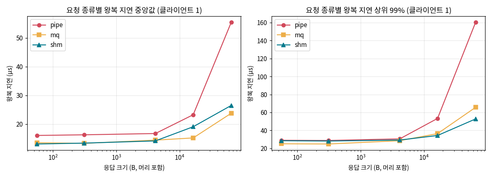


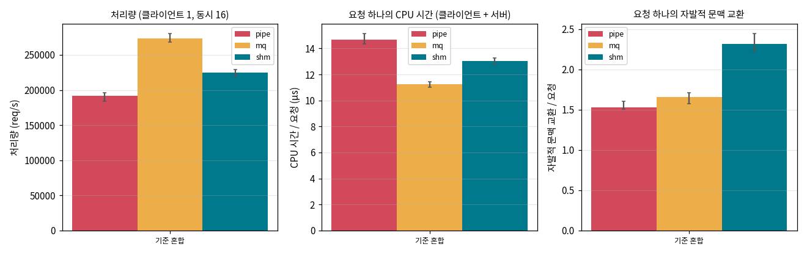


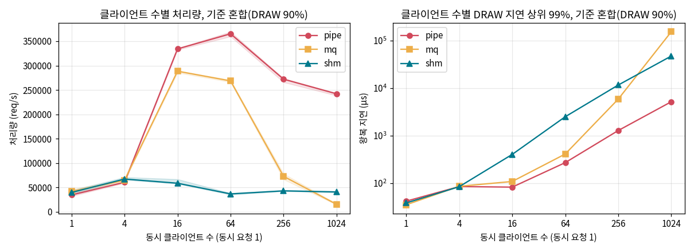


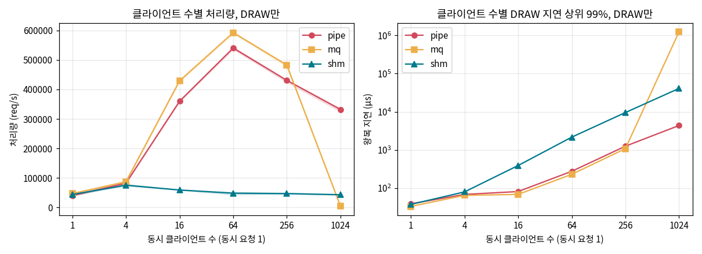


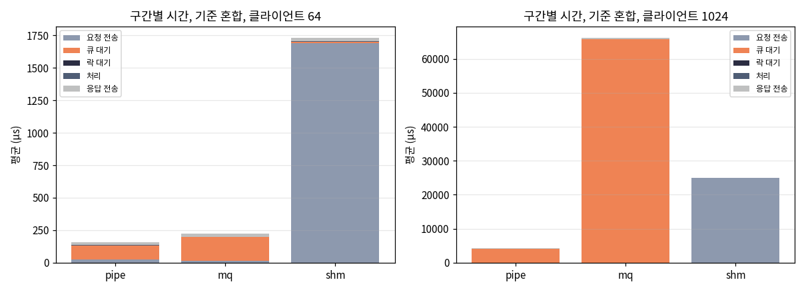


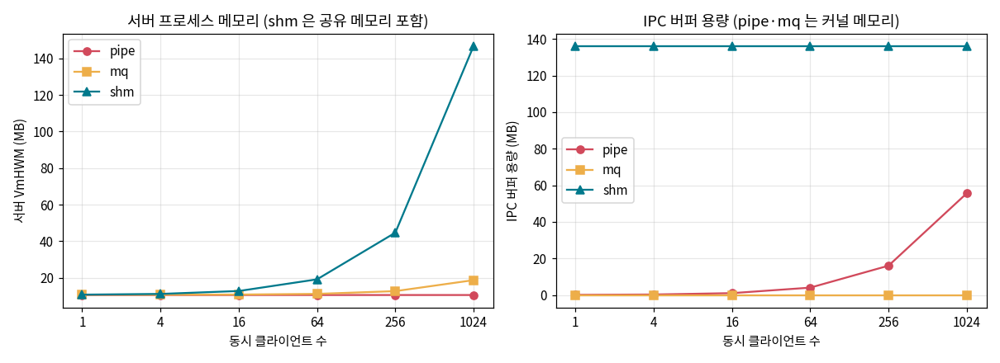


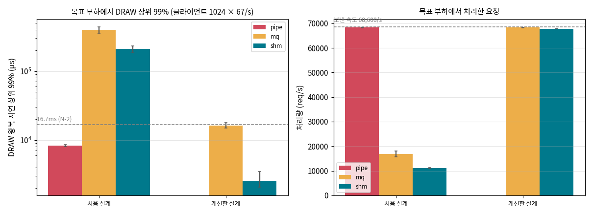


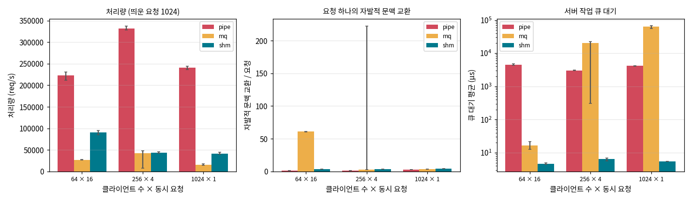


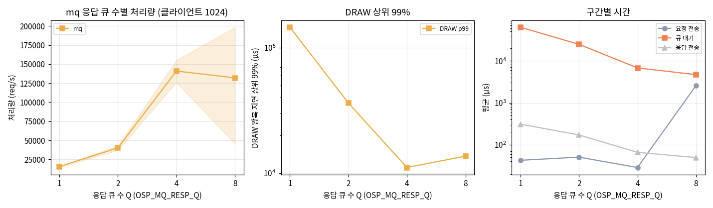


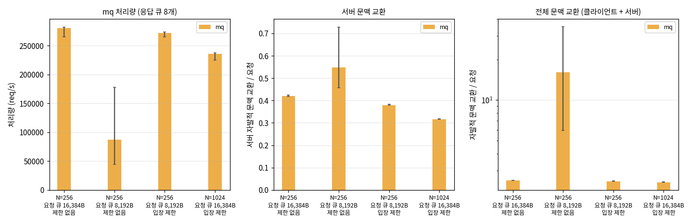


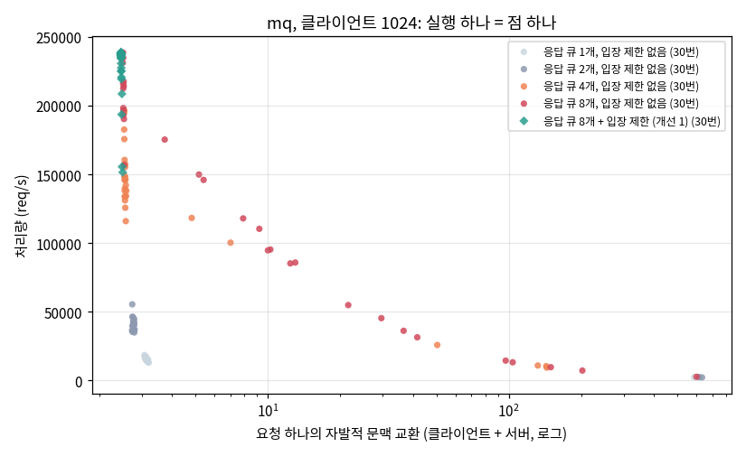


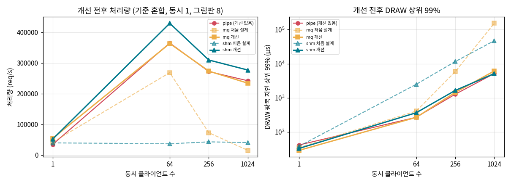


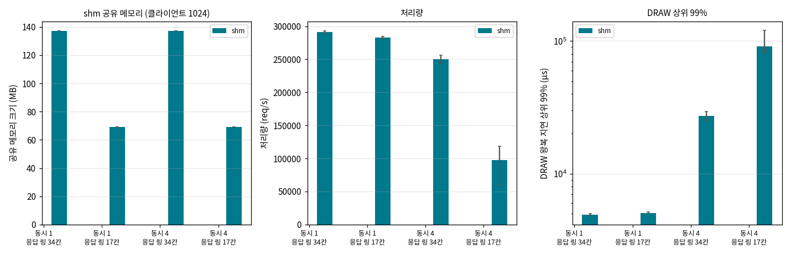


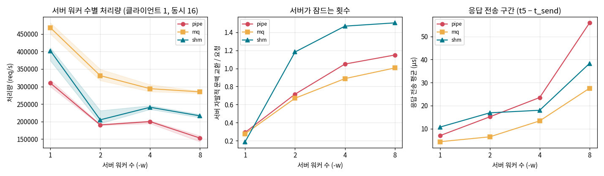


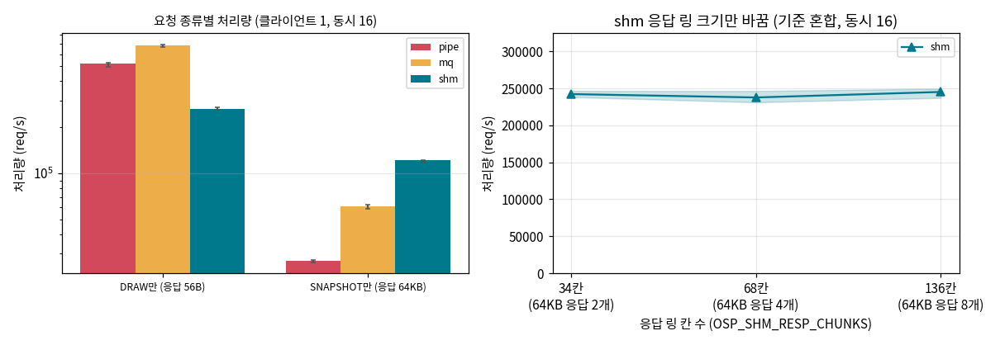


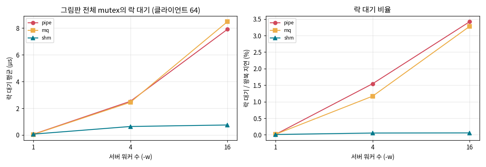

