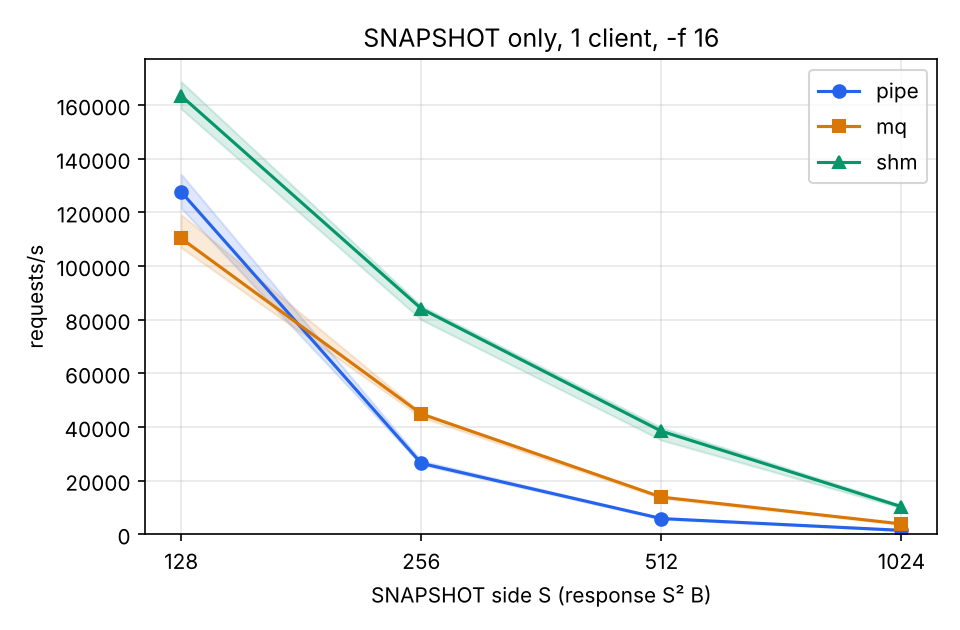
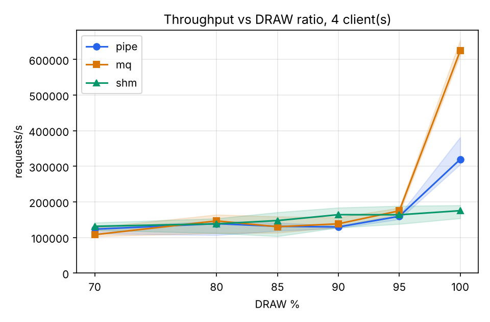
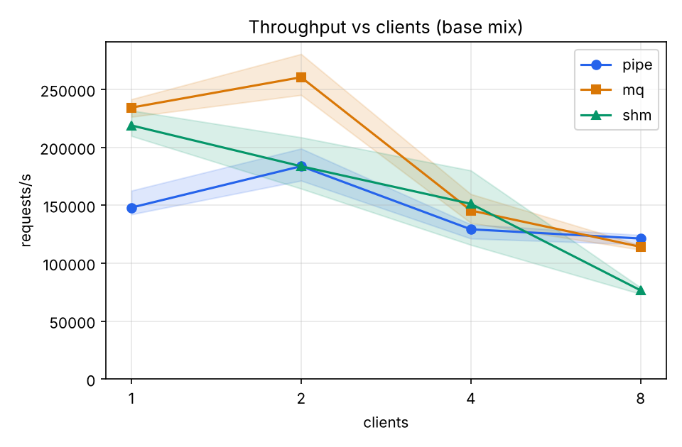
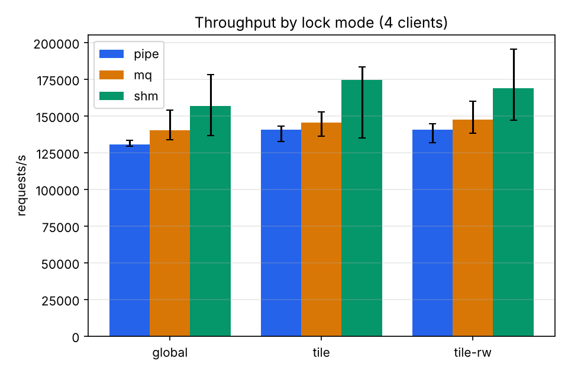
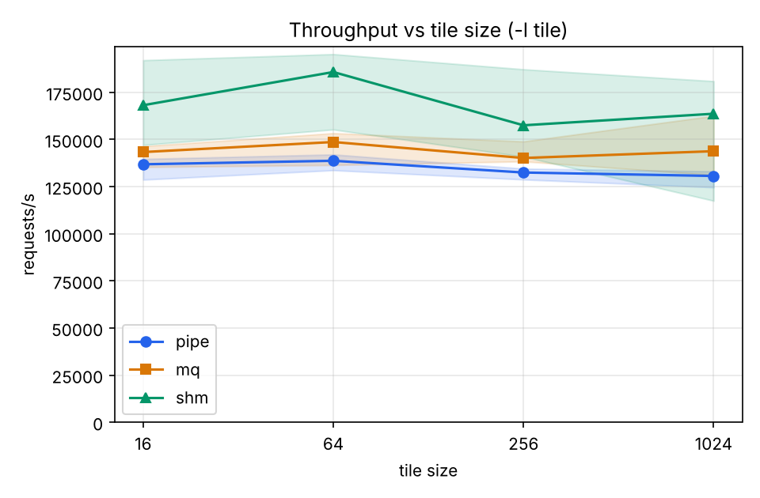

# 2단계 측정 요약

`scripts/plot-app.py` 가 `results/` 에서 만든 표다. 손으로 고치지 않는다.

측정: date: 2026-11-20T21:12:29+09:00, commit: 5986da6, reps: 20, ipcs: pipe mq shm, experiments: base type draw clients workers lock tile, workers: 1 2 4 8

## 기준 조건 (클라이언트 4, DRAW 90%, -S 256)

`results/app_base.csv`, 조건마다 20번 실행의 중앙값. 처리량은 초당 요청 수, 지연은 µs. 편차는 실행 사이의 (최대 - 최소) / 중앙값.

| 조건 | 지표 | pipe | mq | shm | 순위 | 편차 pipe / mq / shm |
| --- | --- | --- | --- | --- | --- | --- |
| inflight=1 | 지연 중앙값 | 30.07 | 23.26 | 26.73 | pipe ≈ mq ≈ shm | 64% / 98% / 66% |
| inflight=1 | 지연 상위 99% | 124.8 | 115.8 | 88.4 | shm < pipe ≈ mq | 68% / 90% / 94% |
| inflight=16 | 처리량 | 132,961 | 145,503 | 167,438 | pipe ≈ mq ≈ shm | 18% / 64% / 56% |

구간별 시간 (µs, 요청 하나의 평균. 요청 전송 / 큐 대기 / 락 대기 / 처리 / 응답 전송)과 CPU 시간(s, 클라이언트 합 / 서버)

| 조건 | IPC | 요청 | 큐 | 락 | 처리 | 응답 | CPU 클라이언트 | CPU 서버 |
| --- | --- | --- | --- | --- | --- | --- | --- | --- |
| inflight=1 | pipe | 8.2 | 7.2 | 3.6 | 2.9 | 16.4 | 1.57 | 1.78 |
| inflight=1 | mq | 6.8 | 6.3 | 3.7 | 2.7 | 11.5 | 1.24 | 1.58 |
| inflight=1 | shm | 9.1 | 6.0 | 3.5 | 2.6 | 10.1 | 1.31 | 1.46 |
| inflight=16 | pipe | 13.6 | 421.2 | 6.0 | 3.6 | 28.9 | 1.17 | 1.36 |
| inflight=16 | mq | 8.6 | 390.7 | 6.7 | 3.6 | 22.4 | 1.12 | 1.33 |
| inflight=16 | shm | 26.2 | 11.6 | 5.2 | 2.5 | 10.1 | 0.98 | 1.22 |

## 요청 종류별 비용 (클라이언트 1)

`results/app_type.csv`, 조건마다 20번 실행의 중앙값. 처리량은 초당 요청 수, 지연은 µs. 편차는 실행 사이의 (최대 - 최소) / 중앙값.

| 조건 | 지표 | pipe | mq | shm | 순위 | 편차 pipe / mq / shm |
| --- | --- | --- | --- | --- | --- | --- |
| inflight=1, draw_pct=0, snap=128 | 지연 중앙값 | 25.01 | 20.11 | 19.18 | pipe ≈ mq ≈ shm | 84% / 78% / 82% |
| inflight=1, draw_pct=0, snap=128 | 지연 상위 99% | 58.2 | 41.9 | 41.7 | pipe ≈ mq ≈ shm | 110% / 114% / 76% |
| inflight=1, draw_pct=0, snap=256 | 지연 중앙값 | 59.62 | 29.14 | 27.61 | mq ≈ shm < pipe | 76% / 59% / 100% |
| inflight=1, draw_pct=0, snap=256 | 지연 상위 99% | 186.6 | 96.4 | 86.7 | mq ≈ shm < pipe | 59% / 62% / 82% |
| inflight=1, draw_pct=0, snap=512 | 지연 중앙값 | 158.84 | 70.25 | 66.77 | mq ≈ shm < pipe | 85% / 47% / 103% |
| inflight=1, draw_pct=0, snap=512 | 지연 상위 99% | 364.2 | 287.4 | 252.7 | pipe ≈ mq ≈ shm | 108% / 71% / 83% |
| inflight=1, draw_pct=0, snap=1024 | 지연 중앙값 | 638.55 | 201.48 | 150.26 | mq ≈ shm < pipe | 77% / 8% / 136% |
| inflight=1, draw_pct=0, snap=1024 | 지연 상위 99% | 1,216.6 | 738.2 | 695.4 | mq ≈ shm < pipe | 61% / 58% / 70% |
| inflight=1, draw_pct=100, snap=256 | 지연 중앙값 | 15.40 | 12.43 | 13.70 | pipe ≈ mq ≈ shm | 106% / 94% / 72% |
| inflight=1, draw_pct=100, snap=256 | 지연 상위 99% | 31.2 | 25.8 | 30.9 | mq < pipe ≈ shm | 132% / 104% / 95% |
| inflight=16, draw_pct=0, snap=128 | 처리량 | 127,614 | 110,281 | 163,442 | shm > pipe > mq | 19% / 39% / 19% |
| inflight=16, draw_pct=0, snap=256 | 처리량 | 26,414 | 44,845 | 84,072 | shm > mq > pipe | 29% / 28% / 44% |
| inflight=16, draw_pct=0, snap=512 | 처리량 | 5,822 | 13,824 | 38,403 | shm > mq > pipe | 33% / 23% / 27% |
| inflight=16, draw_pct=0, snap=1024 | 처리량 | 1,422 | 3,816 | 10,246 | shm > mq > pipe | 26% / 20% / 23% |
| inflight=16, draw_pct=100, snap=256 | 처리량 | 273,675 | 362,701 | 252,600 | mq > pipe ≈ shm | 36% / 99% / 35% |

구간별 시간 (µs, 요청 하나의 평균. 요청 전송 / 큐 대기 / 락 대기 / 처리 / 응답 전송)과 CPU 시간(s, 클라이언트 합 / 서버)

| 조건 | IPC | 요청 | 큐 | 락 | 처리 | 응답 | CPU 클라이언트 | CPU 서버 |
| --- | --- | --- | --- | --- | --- | --- | --- | --- |
| inflight=1, draw_pct=0, snap=128 | pipe | 5.2 | 4.3 | 0.1 | 4.6 | 11.7 | 0.25 | 0.36 |
| inflight=1, draw_pct=0, snap=128 | mq | 4.2 | 3.9 | 0.1 | 4.4 | 9.7 | 0.23 | 0.33 |
| inflight=1, draw_pct=0, snap=128 | shm | 5.2 | 4.1 | 0.1 | 4.2 | 7.4 | 0.19 | 0.30 |
| inflight=1, draw_pct=0, snap=256 | pipe | 6.2 | 5.7 | 0.1 | 11.3 | 40.6 | 0.27 | 0.41 |
| inflight=1, draw_pct=0, snap=256 | mq | 3.8 | 3.6 | 0.1 | 8.4 | 19.0 | 0.20 | 0.30 |
| inflight=1, draw_pct=0, snap=256 | shm | 5.6 | 4.0 | 0.1 | 9.8 | 13.1 | 0.13 | 0.23 |
| inflight=1, draw_pct=0, snap=512 | pipe | 7.1 | 6.6 | 0.2 | 29.9 | 124.8 | 0.27 | 0.42 |
| inflight=1, draw_pct=0, snap=512 | mq | 4.5 | 4.9 | 0.1 | 21.4 | 57.0 | 0.23 | 0.32 |
| inflight=1, draw_pct=0, snap=512 | shm | 8.5 | 8.8 | 0.2 | 27.5 | 40.6 | 0.12 | 0.23 |
| inflight=1, draw_pct=0, snap=1024 | pipe | 22.7 | 10.2 | 0.3 | 64.5 | 530.7 | 0.56 | 0.68 |
| inflight=1, draw_pct=0, snap=1024 | mq | 7.7 | 7.1 | 0.1 | 30.5 | 195.2 | 0.38 | 0.45 |
| inflight=1, draw_pct=0, snap=1024 | shm | 12.7 | 10.1 | 0.2 | 38.7 | 135.6 | 0.16 | 0.25 |
| inflight=1, draw_pct=100, snap=256 | pipe | 4.6 | 4.4 | 0.1 | 0.3 | 6.4 | 0.19 | 0.21 |
| inflight=1, draw_pct=100, snap=256 | mq | 4.0 | 4.4 | 0.1 | 0.2 | 4.4 | 0.15 | 0.18 |
| inflight=1, draw_pct=100, snap=256 | shm | 5.2 | 4.1 | 0.1 | 0.3 | 5.2 | 0.17 | 0.20 |
| inflight=16, draw_pct=0, snap=128 | pipe | 4.8 | 82.6 | 0.5 | 3.8 | 31.2 | 0.19 | 0.32 |
| inflight=16, draw_pct=0, snap=128 | mq | 4.3 | 99.6 | 0.1 | 3.7 | 34.4 | 0.18 | 0.32 |
| inflight=16, draw_pct=0, snap=128 | shm | 5.1 | 61.6 | 17.3 | 4.4 | 6.4 | 0.15 | 0.24 |
| inflight=16, draw_pct=0, snap=256 | pipe | 6.3 | 439.3 | 0.2 | 8.8 | 144.2 | 0.31 | 0.39 |
| inflight=16, draw_pct=0, snap=256 | mq | 4.6 | 258.6 | 0.1 | 8.3 | 81.4 | 0.20 | 0.34 |
| inflight=16, draw_pct=0, snap=256 | shm | 6.0 | 126.0 | 31.8 | 9.3 | 13.2 | 0.12 | 0.22 |
| inflight=16, draw_pct=0, snap=512 | pipe | 11.3 | 2,035.4 | 0.3 | 29.2 | 658.9 | 0.33 | 0.56 |
| inflight=16, draw_pct=0, snap=512 | mq | 5.0 | 856.5 | 0.2 | 21.0 | 269.3 | 0.24 | 0.39 |
| inflight=16, draw_pct=0, snap=512 | shm | 7.5 | 281.0 | 61.7 | 23.5 | 44.2 | 0.10 | 0.21 |
| inflight=16, draw_pct=0, snap=1024 | pipe | 25.6 | 8,316.3 | 0.9 | 92.8 | 2,719.1 | 0.65 | 1.00 |
| inflight=16, draw_pct=0, snap=1024 | mq | 13.1 | 3,105.7 | 0.7 | 33.6 | 1,014.2 | 0.42 | 0.57 |
| inflight=16, draw_pct=0, snap=1024 | shm | 12.0 | 1,060.7 | 5.2 | 55.1 | 410.0 | 0.18 | 0.31 |
| inflight=16, draw_pct=100, snap=256 | pipe | 17.1 | 11.6 | 0.3 | 0.5 | 21.8 | 0.12 | 0.25 |
| inflight=16, draw_pct=100, snap=256 | mq | 7.4 | 17.4 | 0.4 | 0.7 | 13.2 | 0.09 | 0.19 |
| inflight=16, draw_pct=100, snap=256 | shm | 5.4 | 37.3 | 0.1 | 0.2 | 17.4 | 0.10 | 0.14 |

## DRAW 비율

`results/app_draw.csv`, 조건마다 20번 실행의 중앙값. 처리량은 초당 요청 수, 지연은 µs. 편차는 실행 사이의 (최대 - 최소) / 중앙값.

| 조건 | 지표 | pipe | mq | shm | 순위 | 편차 pipe / mq / shm |
| --- | --- | --- | --- | --- | --- | --- |
| clients=1, draw_pct=70 | 처리량 | 65,788 | 121,280 | 156,963 | shm > mq > pipe | 41% / 13% / 53% |
| clients=1, draw_pct=80 | 처리량 | 84,276 | 156,049 | 191,557 | shm > mq > pipe | 50% / 18% / 44% |
| clients=1, draw_pct=85 | 처리량 | 109,714 | 190,658 | 208,196 | shm > mq > pipe | 44% / 20% / 48% |
| clients=1, draw_pct=90 | 처리량 | 147,144 | 233,030 | 214,251 | mq > shm > pipe | 48% / 31% / 50% |
| clients=1, draw_pct=95 | 처리량 | 231,018 | 317,071 | 226,423 | mq > pipe ≈ shm | 54% / 29% / 41% |
| clients=1, draw_pct=100 | 처리량 | 266,697 | 361,825 | 239,634 | mq > pipe ≈ shm | 56% / 32% / 34% |
| clients=4, draw_pct=70 | 처리량 | 123,191 | 107,810 | 131,364 | pipe ≈ mq ≈ shm | 57% / 87% / 50% |
| clients=4, draw_pct=80 | 처리량 | 138,678 | 146,524 | 138,179 | pipe ≈ mq ≈ shm | 45% / 60% / 96% |
| clients=4, draw_pct=85 | 처리량 | 131,261 | 130,112 | 147,434 | pipe ≈ mq ≈ shm | 87% / 89% / 89% |
| clients=4, draw_pct=90 | 처리량 | 129,408 | 138,297 | 163,961 | pipe ≈ mq ≈ shm | 67% / 119% / 73% |
| clients=4, draw_pct=95 | 처리량 | 159,431 | 174,850 | 163,659 | pipe ≈ mq ≈ shm | 21% / 148% / 65% |
| clients=4, draw_pct=100 | 처리량 | 319,583 | 624,546 | 175,166 | mq > pipe > shm | 78% / 43% / 71% |

구간별 시간 (µs, 요청 하나의 평균. 요청 전송 / 큐 대기 / 락 대기 / 처리 / 응답 전송)과 CPU 시간(s, 클라이언트 합 / 서버)

| 조건 | IPC | 요청 | 큐 | 락 | 처리 | 응답 | CPU 클라이언트 | CPU 서버 |
| --- | --- | --- | --- | --- | --- | --- | --- | --- |
| clients=1, draw_pct=70 | pipe | 6.8 | 165.2 | 2.9 | 5.2 | 58.0 | 0.29 | 0.42 |
| clients=1, draw_pct=70 | mq | 4.3 | 90.6 | 2.8 | 3.8 | 27.7 | 0.16 | 0.30 |
| clients=1, draw_pct=70 | shm | 5.1 | 62.7 | 12.1 | 4.4 | 13.9 | 0.13 | 0.27 |
| clients=1, draw_pct=80 | pipe | 6.8 | 125.6 | 3.7 | 4.1 | 44.9 | 0.24 | 0.36 |
| clients=1, draw_pct=80 | mq | 4.2 | 68.5 | 3.1 | 2.8 | 20.8 | 0.13 | 0.25 |
| clients=1, draw_pct=80 | shm | 5.1 | 48.4 | 7.7 | 3.1 | 14.6 | 0.12 | 0.23 |
| clients=1, draw_pct=85 | pipe | 6.7 | 94.1 | 3.4 | 3.1 | 34.9 | 0.19 | 0.29 |
| clients=1, draw_pct=85 | mq | 4.1 | 54.8 | 3.1 | 2.2 | 16.8 | 0.11 | 0.21 |
| clients=1, draw_pct=85 | shm | 4.9 | 46.3 | 5.7 | 2.4 | 14.8 | 0.11 | 0.21 |
| clients=1, draw_pct=90 | pipe | 6.2 | 66.9 | 3.1 | 2.2 | 26.7 | 0.15 | 0.24 |
| clients=1, draw_pct=90 | mq | 4.3 | 43.5 | 3.0 | 1.7 | 13.6 | 0.09 | 0.18 |
| clients=1, draw_pct=90 | shm | 4.8 | 44.9 | 3.6 | 1.7 | 15.7 | 0.11 | 0.19 |
| clients=1, draw_pct=95 | pipe | 5.9 | 38.3 | 2.1 | 1.3 | 19.2 | 0.11 | 0.18 |
| clients=1, draw_pct=95 | mq | 4.4 | 29.5 | 2.1 | 1.1 | 10.5 | 0.07 | 0.15 |
| clients=1, draw_pct=95 | shm | 4.7 | 42.7 | 1.9 | 1.0 | 17.0 | 0.11 | 0.17 |
| clients=1, draw_pct=100 | pipe | 16.0 | 14.0 | 0.3 | 0.6 | 23.9 | 0.13 | 0.25 |
| clients=1, draw_pct=100 | mq | 7.5 | 18.1 | 0.4 | 0.6 | 12.8 | 0.09 | 0.19 |
| clients=1, draw_pct=100 | shm | 5.0 | 39.9 | 0.1 | 0.2 | 18.0 | 0.10 | 0.15 |
| clients=4, draw_pct=70 | pipe | 6.6 | 471.6 | 6.0 | 4.7 | 26.2 | 1.09 | 1.40 |
| clients=4, draw_pct=70 | mq | 5.6 | 541.0 | 7.5 | 5.4 | 27.0 | 1.33 | 1.76 |
| clients=4, draw_pct=70 | shm | 13.3 | 410.4 | 18.9 | 5.8 | 12.6 | 1.08 | 1.35 |
| clients=4, draw_pct=80 | pipe | 7.8 | 413.2 | 5.4 | 3.8 | 24.9 | 1.02 | 1.24 |
| clients=4, draw_pct=80 | mq | 6.2 | 395.2 | 6.2 | 3.8 | 21.0 | 1.03 | 1.31 |
| clients=4, draw_pct=80 | shm | 32.2 | 86.4 | 13.3 | 4.8 | 13.2 | 1.21 | 1.43 |
| clients=4, draw_pct=85 | pipe | 10.4 | 433.5 | 5.8 | 3.8 | 27.6 | 1.13 | 1.32 |
| clients=4, draw_pct=85 | mq | 7.4 | 441.9 | 7.2 | 4.2 | 24.0 | 1.19 | 1.47 |
| clients=4, draw_pct=85 | shm | 29.7 | 24.7 | 8.8 | 3.7 | 11.8 | 1.12 | 1.38 |
| clients=4, draw_pct=90 | pipe | 14.2 | 432.1 | 6.2 | 3.7 | 29.7 | 1.20 | 1.38 |
| clients=4, draw_pct=90 | mq | 8.9 | 410.6 | 7.1 | 3.8 | 23.6 | 1.17 | 1.40 |
| clients=4, draw_pct=90 | shm | 27.0 | 9.5 | 5.0 | 2.5 | 9.7 | 0.99 | 1.21 |
| clients=4, draw_pct=95 | pipe | 20.1 | 335.9 | 5.2 | 2.9 | 27.0 | 1.09 | 1.25 |
| clients=4, draw_pct=95 | mq | 10.9 | 318.2 | 5.5 | 2.9 | 20.7 | 1.03 | 1.20 |
| clients=4, draw_pct=95 | shm | 27.5 | 6.2 | 2.6 | 1.6 | 9.6 | 1.00 | 1.18 |
| clients=4, draw_pct=100 | pipe | 179.3 | 9.4 | 0.2 | 0.4 | 8.6 | 0.52 | 0.79 |
| clients=4, draw_pct=100 | mq | 11.7 | 72.3 | 0.4 | 0.5 | 9.7 | 0.44 | 0.50 |
| clients=4, draw_pct=100 | shm | 28.1 | 4.0 | 0.1 | 0.3 | 6.8 | 0.87 | 0.91 |

## 클라이언트 수 (-f 16)

`results/app_clients.csv`, 조건마다 20번 실행의 중앙값. 처리량은 초당 요청 수, 지연은 µs. 편차는 실행 사이의 (최대 - 최소) / 중앙값.

| 조건 | 지표 | pipe | mq | shm | 순위 | 편차 pipe / mq / shm |
| --- | --- | --- | --- | --- | --- | --- |
| clients=1 | 처리량 | 147,986 | 234,310 | 218,945 | mq ≈ shm > pipe | 34% / 25% / 30% |
| clients=2 | 처리량 | 183,715 | 260,526 | 183,668 | mq > pipe ≈ shm | 55% / 45% / 49% |
| clients=4 | 처리량 | 129,242 | 145,506 | 151,242 | pipe ≈ mq ≈ shm | 28% / 73% / 78% |
| clients=8 | 처리량 | 121,304 | 114,105 | 76,560 | pipe > mq > shm | 68% / 47% / 39% |

구간별 시간 (µs, 요청 하나의 평균. 요청 전송 / 큐 대기 / 락 대기 / 처리 / 응답 전송)과 CPU 시간(s, 클라이언트 합 / 서버)

| 조건 | IPC | 요청 | 큐 | 락 | 처리 | 응답 | CPU 클라이언트 | CPU 서버 |
| --- | --- | --- | --- | --- | --- | --- | --- | --- |
| clients=1 | pipe | 6.1 | 66.3 | 3.1 | 2.2 | 26.5 | 0.15 | 0.24 |
| clients=1 | mq | 4.2 | 42.4 | 2.9 | 1.7 | 13.6 | 0.09 | 0.18 |
| clients=1 | shm | 4.8 | 41.8 | 3.7 | 1.8 | 16.2 | 0.11 | 0.19 |
| clients=2 | pipe | 7.5 | 137.0 | 3.6 | 2.2 | 20.8 | 0.32 | 0.44 |
| clients=2 | mq | 4.4 | 97.6 | 3.4 | 1.8 | 12.2 | 0.24 | 0.35 |
| clients=2 | shm | 13.7 | 37.5 | 6.2 | 2.7 | 12.9 | 0.43 | 0.60 |
| clients=4 | pipe | 14.4 | 431.6 | 6.2 | 3.7 | 29.9 | 1.19 | 1.38 |
| clients=4 | mq | 8.4 | 390.6 | 6.5 | 3.6 | 22.7 | 1.11 | 1.32 |
| clients=4 | shm | 29.8 | 11.6 | 5.5 | 2.7 | 11.1 | 1.09 | 1.32 |
| clients=8 | pipe | 17.8 | 980.1 | 7.6 | 4.5 | 32.4 | 3.29 | 3.17 |
| clients=8 | mq | 13.8 | 1,050.8 | 8.7 | 4.7 | 30.7 | 3.54 | 3.58 |
| clients=8 | shm | 110.2 | 12.7 | 7.8 | 4.5 | 19.8 | 4.27 | 4.80 |

## 워커 수 (클라이언트 8, -f 16)

`results/app_workers.csv`, 조건마다 20번 실행의 중앙값. 처리량은 초당 요청 수, 지연은 µs. 편차는 실행 사이의 (최대 - 최소) / 중앙값.

| 조건 | 지표 | pipe | mq | shm | 순위 | 편차 pipe / mq / shm |
| --- | --- | --- | --- | --- | --- | --- |
| workers=1 | 처리량 | 173,573 | 289,021 | 205,554 | mq > shm > pipe | 26% / 13% / 33% |
| workers=2 | 처리량 | 206,988 | 260,915 | 148,354 | mq > pipe > shm | 16% / 27% / 67% |
| workers=4 | 처리량 | 122,395 | 112,699 | 75,016 | pipe > mq > shm | 69% / 30% / 20% |
| workers=8 | 처리량 | 285,206 | 263,519 | 71,541 | pipe > mq > shm | 7% / 18% / 19% |

구간별 시간 (µs, 요청 하나의 평균. 요청 전송 / 큐 대기 / 락 대기 / 처리 / 응답 전송)과 CPU 시간(s, 클라이언트 합 / 서버)

| 조건 | IPC | 요청 | 큐 | 락 | 처리 | 응답 | CPU 클라이언트 | CPU 서버 |
| --- | --- | --- | --- | --- | --- | --- | --- | --- |
| workers=1 | pipe | 7.6 | 711.9 | 0.1 | 1.3 | 11.2 | 1.06 | 1.01 |
| workers=1 | mq | 4.2 | 426.1 | 0.0 | 1.0 | 7.0 | 0.88 | 0.63 |
| workers=1 | shm | 40.7 | 11.6 | 0.0 | 1.1 | 6.1 | 1.58 | 1.02 |
| workers=2 | pipe | 7.1 | 591.6 | 1.1 | 1.6 | 11.8 | 1.30 | 1.25 |
| workers=2 | mq | 4.2 | 471.1 | 1.0 | 1.4 | 8.9 | 1.12 | 1.02 |
| workers=2 | shm | 57.1 | 8.1 | 1.5 | 2.0 | 9.0 | 2.18 | 1.91 |
| workers=4 | pipe | 17.7 | 971.4 | 7.6 | 4.5 | 31.7 | 3.25 | 3.16 |
| workers=4 | mq | 13.4 | 1,063.0 | 8.8 | 4.8 | 30.7 | 3.57 | 3.61 |
| workers=4 | shm | 113.1 | 13.2 | 8.0 | 4.6 | 19.9 | 4.38 | 4.88 |
| workers=8 | pipe | 12.2 | 392.4 | 12.0 | 2.5 | 20.4 | 1.71 | 1.89 |
| workers=8 | mq | 8.7 | 432.9 | 11.1 | 2.5 | 22.0 | 1.83 | 2.12 |
| workers=8 | shm | 118.0 | 10.8 | 10.9 | 4.9 | 21.1 | 4.54 | 5.70 |

## 락 방식 (클라이언트 4, -f 16)

`results/app_lock.csv`, 조건마다 20번 실행의 중앙값. 처리량은 초당 요청 수, 지연은 µs. 편차는 실행 사이의 (최대 - 최소) / 중앙값.

| 조건 | 지표 | pipe | mq | shm | 순위 | 편차 pipe / mq / shm |
| --- | --- | --- | --- | --- | --- | --- |
| lock=global | 처리량 | 130,459 | 140,109 | 157,000 | mq ≈ shm > pipe | 18% / 115% / 76% |
| lock=tile | 처리량 | 140,776 | 145,537 | 174,605 | pipe ≈ mq ≈ shm | 30% / 76% / 58% |
| lock=tile-rw | 처리량 | 140,839 | 147,451 | 168,986 | pipe ≈ mq ≈ shm | 52% / 64% / 74% |

구간별 시간 (µs, 요청 하나의 평균. 요청 전송 / 큐 대기 / 락 대기 / 처리 / 응답 전송)과 CPU 시간(s, 클라이언트 합 / 서버)

| 조건 | IPC | 요청 | 큐 | 락 | 처리 | 응답 | CPU 클라이언트 | CPU 서버 |
| --- | --- | --- | --- | --- | --- | --- | --- | --- |
| lock=global | pipe | 13.9 | 428.1 | 6.1 | 3.7 | 29.4 | 1.19 | 1.37 |
| lock=global | mq | 8.5 | 406.5 | 6.9 | 3.8 | 23.1 | 1.16 | 1.38 |
| lock=global | shm | 28.2 | 9.9 | 4.9 | 2.5 | 10.1 | 1.03 | 1.22 |
| lock=tile | pipe | 18.5 | 387.5 | 1.9 | 3.9 | 33.6 | 1.36 | 1.46 |
| lock=tile | mq | 10.5 | 384.1 | 2.0 | 3.9 | 27.9 | 1.37 | 1.55 |
| lock=tile | shm | 25.4 | 4.1 | 0.7 | 2.0 | 9.0 | 0.92 | 1.15 |
| lock=tile-rw | pipe | 18.5 | 384.7 | 1.6 | 3.9 | 33.6 | 1.37 | 1.47 |
| lock=tile-rw | mq | 10.3 | 380.1 | 1.6 | 3.9 | 28.0 | 1.36 | 1.53 |
| lock=tile-rw | shm | 26.4 | 4.2 | 0.6 | 2.0 | 9.1 | 0.89 | 1.13 |

## 타일 크기 (-l tile, 클라이언트 4, -f 16)

`results/app_tile.csv`, 조건마다 20번 실행의 중앙값. 처리량은 초당 요청 수, 지연은 µs. 편차는 실행 사이의 (최대 - 최소) / 중앙값.

| 조건 | 지표 | pipe | mq | shm | 순위 | 편차 pipe / mq / shm |
| --- | --- | --- | --- | --- | --- | --- |
| tile=16 | 처리량 | 136,847 | 143,333 | 168,182 | shm > pipe ≈ mq | 90% / 68% / 75% |
| tile=64 | 처리량 | 138,712 | 148,669 | 185,794 | shm > pipe ≈ mq | 97% / 37% / 58% |
| tile=256 | 처리량 | 132,488 | 140,186 | 157,530 | mq ≈ shm > pipe | 14% / 31% / 69% |
| tile=1024 | 처리량 | 130,650 | 143,794 | 163,667 | pipe ≈ mq ≈ shm | 21% / 51% / 70% |

구간별 시간 (µs, 요청 하나의 평균. 요청 전송 / 큐 대기 / 락 대기 / 처리 / 응답 전송)과 CPU 시간(s, 클라이언트 합 / 서버)

| 조건 | IPC | 요청 | 큐 | 락 | 처리 | 응답 | CPU 클라이언트 | CPU 서버 |
| --- | --- | --- | --- | --- | --- | --- | --- | --- |
| tile=16 | pipe | 18.1 | 400.3 | 2.9 | 4.5 | 32.4 | 1.36 | 1.58 |
| tile=16 | mq | 10.3 | 391.4 | 2.9 | 4.5 | 27.2 | 1.37 | 1.64 |
| tile=16 | shm | 26.5 | 4.4 | 1.2 | 2.4 | 9.6 | 0.97 | 1.23 |
| tile=64 | pipe | 18.7 | 391.5 | 2.0 | 4.0 | 33.9 | 1.37 | 1.47 |
| tile=64 | mq | 10.0 | 378.1 | 2.0 | 3.9 | 27.2 | 1.35 | 1.52 |
| tile=64 | shm | 24.0 | 3.8 | 0.6 | 1.9 | 8.2 | 0.88 | 1.07 |
| tile=256 | pipe | 17.6 | 414.4 | 3.3 | 4.1 | 33.1 | 1.37 | 1.49 |
| tile=256 | mq | 10.4 | 401.3 | 3.5 | 4.0 | 27.4 | 1.37 | 1.54 |
| tile=256 | shm | 28.0 | 4.6 | 1.3 | 2.2 | 9.5 | 1.01 | 1.23 |
| tile=1024 | pipe | 14.0 | 428.2 | 6.0 | 3.7 | 29.4 | 1.19 | 1.37 |
| tile=1024 | mq | 8.6 | 393.5 | 6.6 | 3.6 | 22.9 | 1.12 | 1.34 |
| tile=1024 | shm | 26.9 | 9.7 | 4.7 | 2.4 | 9.6 | 0.98 | 1.19 |

## 그림

