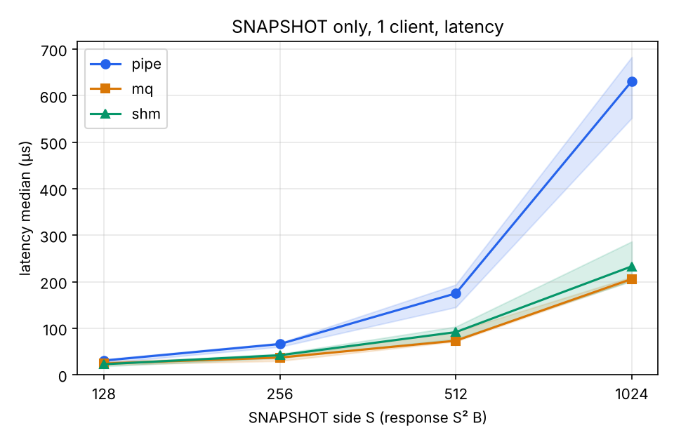
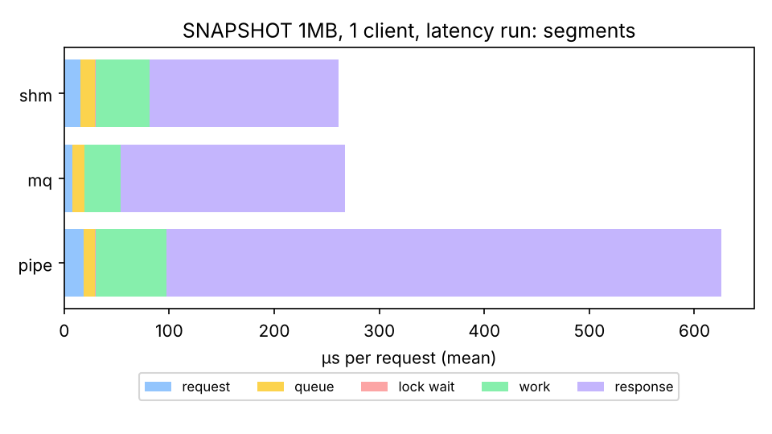
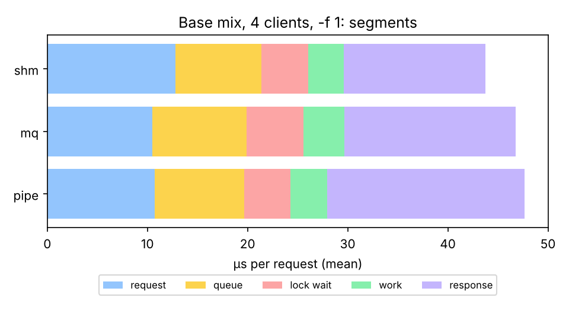
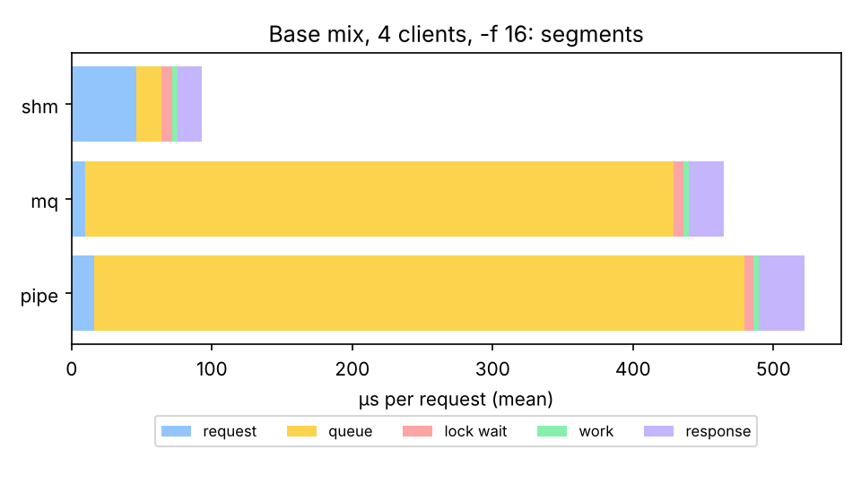
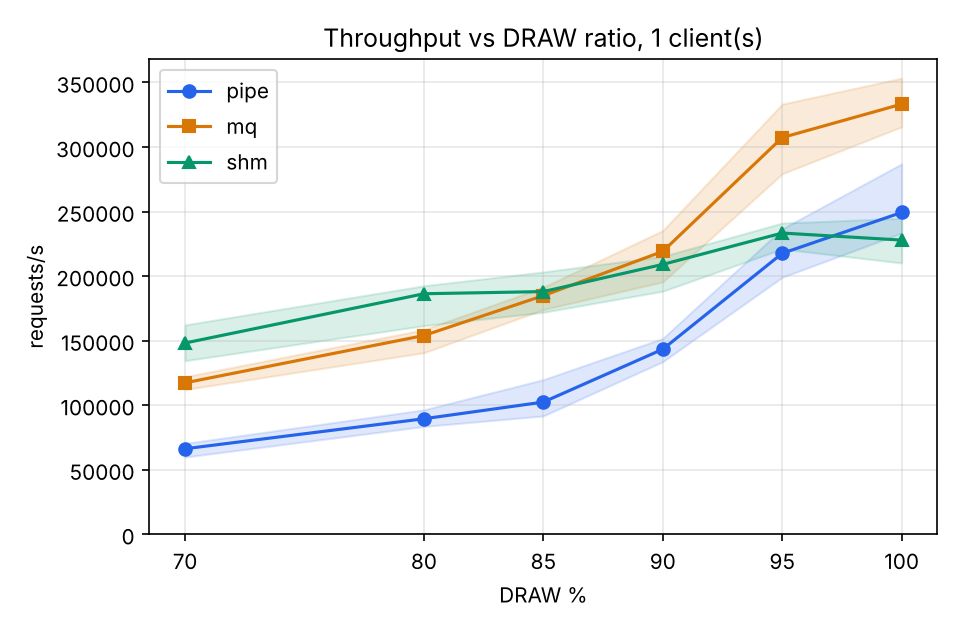
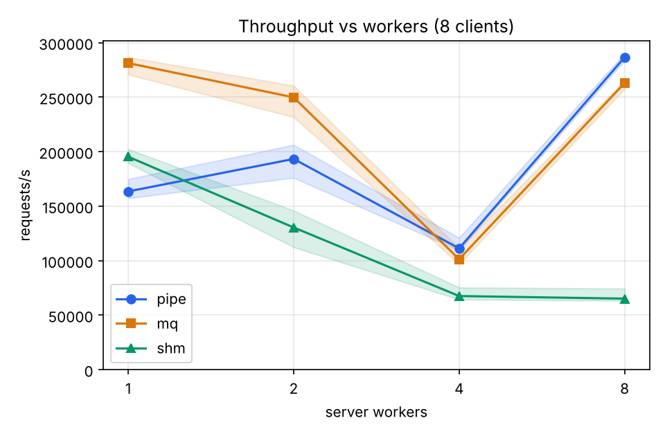

# 2단계 측정 요약

`scripts/plot-app.py` 가 `results/` 에서 만든 표다. 손으로 고치지 않는다.

측정: date: 2026-11-20T17:34:32+09:00, commit: 9f546d9, reps: 20, ipcs: pipe mq shm, experiments: base type draw clients workers lock tile

## 기준 조건 (클라이언트 4, DRAW 90%, -S 256)

`results/app_base.csv`, 조건마다 20번 실행의 중앙값. 처리량은 초당 요청 수, 지연은 µs. 편차는 실행 사이의 (최대 - 최소) / 중앙값.

| 조건 | 지표 | pipe | mq | shm | 순위 | 편차 pipe / mq / shm |
| --- | --- | --- | --- | --- | --- | --- |
| inflight=1 | 지연 중앙값 | 37.53 | 34.09 | 37.42 | pipe ≈ mq ≈ shm | 72% / 67% / 71% |
| inflight=1 | 지연 상위 99% | 162.4 | 171.8 | 128.8 | shm < pipe ≈ mq | 204% / 157% / 387% |
| inflight=16 | 처리량 | 120,187 | 133,091 | 105,634 | pipe ≈ mq ≈ shm | 123% / 128% / 114% |

구간별 시간 (µs, 요청 하나의 평균. 요청 전송 / 큐 대기 / 락 대기 / 처리 / 응답 전송)과 CPU 시간(s, 클라이언트 합 / 서버)

| 조건 | IPC | 요청 | 큐 | 락 | 처리 | 응답 | CPU 클라이언트 | CPU 서버 |
| --- | --- | --- | --- | --- | --- | --- | --- | --- |
| inflight=1 | pipe | 10.8 | 8.9 | 4.6 | 3.6 | 19.7 | 1.90 | 2.18 |
| inflight=1 | mq | 10.5 | 9.4 | 5.7 | 4.1 | 17.1 | 1.87 | 2.31 |
| inflight=1 | shm | 12.8 | 8.5 | 4.7 | 3.6 | 14.1 | 1.75 | 1.95 |
| inflight=16 | pipe | 15.8 | 463.4 | 6.6 | 4.0 | 32.1 | 1.27 | 1.47 |
| inflight=16 | mq | 9.4 | 419.7 | 7.1 | 3.8 | 24.6 | 1.18 | 1.40 |
| inflight=16 | shm | 46.1 | 17.7 | 7.7 | 3.7 | 17.7 | 1.49 | 1.81 |

## 요청 종류별 비용 (클라이언트 1)

`results/app_type.csv`, 조건마다 20번 실행의 중앙값. 처리량은 초당 요청 수, 지연은 µs. 편차는 실행 사이의 (최대 - 최소) / 중앙값.

| 조건 | 지표 | pipe | mq | shm | 순위 | 편차 pipe / mq / shm |
| --- | --- | --- | --- | --- | --- | --- |
| inflight=1, draw_pct=0, snap=128 | 지연 중앙값 | 30.53 | 24.25 | 22.68 | pipe ≈ mq ≈ shm | 76% / 77% / 80% |
| inflight=1, draw_pct=0, snap=128 | 지연 상위 99% | 74.6 | 50.2 | 47.0 | mq ≈ shm < pipe | 2,555% / 2,000% / 1,873% |
| inflight=1, draw_pct=0, snap=256 | 지연 중앙값 | 66.05 | 36.97 | 41.95 | mq ≈ shm < pipe | 60% / 65% / 55% |
| inflight=1, draw_pct=0, snap=256 | 지연 상위 99% | 151.2 | 96.5 | 87.5 | mq ≈ shm < pipe | 81% / 1,055% / 97% |
| inflight=1, draw_pct=0, snap=512 | 지연 중앙값 | 174.91 | 73.19 | 91.69 | mq ≈ shm < pipe | 77% / 356% / 84% |
| inflight=1, draw_pct=0, snap=512 | 지연 상위 99% | 362.4 | 249.3 | 223.3 | mq ≈ shm < pipe | 1,300% / 2,315% / 911% |
| inflight=1, draw_pct=0, snap=1024 | 지연 중앙값 | 631.05 | 205.91 | 233.05 | mq ≈ shm < pipe | 94% / 297% / 107% |
| inflight=1, draw_pct=0, snap=1024 | 지연 상위 99% | 1,154.7 | 727.9 | 653.1 | mq ≈ shm < pipe | 132% / 105% / 399% |
| inflight=1, draw_pct=100, snap=256 | 지연 중앙값 | 17.91 | 13.48 | 14.65 | pipe ≈ mq ≈ shm | 65% / 61% / 105% |
| inflight=1, draw_pct=100, snap=256 | 지연 상위 99% | 36.9 | 29.3 | 36.1 | mq < pipe ≈ shm | 165% / 71% / 53% |
| inflight=16, draw_pct=0, snap=128 | 처리량 | 114,017 | 108,511 | 156,048 | shm > pipe ≈ mq | 86% / 61% / 61% |
| inflight=16, draw_pct=0, snap=256 | 처리량 | 25,213 | 42,639 | 80,437 | shm > mq > pipe | 40% / 66% / 89% |
| inflight=16, draw_pct=0, snap=512 | 처리량 | 5,581 | 13,276 | 34,827 | shm > mq > pipe | 80% / 56% / 79% |
| inflight=16, draw_pct=0, snap=1024 | 처리량 | 1,332 | 3,384 | 8,883 | shm > mq > pipe | 63% / 38% / 72% |
| inflight=16, draw_pct=100, snap=256 | 처리량 | 245,738 | 308,338 | 228,536 | mq > pipe ≈ shm | 97% / 80% / 80% |

구간별 시간 (µs, 요청 하나의 평균. 요청 전송 / 큐 대기 / 락 대기 / 처리 / 응답 전송)과 CPU 시간(s, 클라이언트 합 / 서버)

| 조건 | IPC | 요청 | 큐 | 락 | 처리 | 응답 | CPU 클라이언트 | CPU 서버 |
| --- | --- | --- | --- | --- | --- | --- | --- | --- |
| inflight=1, draw_pct=0, snap=128 | pipe | 6.6 | 5.5 | 0.1 | 5.0 | 14.7 | 0.30 | 0.41 |
| inflight=1, draw_pct=0, snap=128 | mq | 5.2 | 4.9 | 0.1 | 4.5 | 12.0 | 0.27 | 0.38 |
| inflight=1, draw_pct=0, snap=128 | shm | 5.9 | 4.8 | 0.1 | 4.5 | 8.7 | 0.22 | 0.33 |
| inflight=1, draw_pct=0, snap=256 | pipe | 6.9 | 6.2 | 0.1 | 12.3 | 41.9 | 0.28 | 0.44 |
| inflight=1, draw_pct=0, snap=256 | mq | 4.5 | 4.2 | 0.1 | 8.9 | 22.8 | 0.23 | 0.34 |
| inflight=1, draw_pct=0, snap=256 | shm | 7.3 | 5.8 | 0.1 | 11.4 | 17.5 | 0.18 | 0.30 |
| inflight=1, draw_pct=0, snap=512 | pipe | 7.9 | 7.8 | 0.2 | 31.1 | 132.2 | 0.28 | 0.45 |
| inflight=1, draw_pct=0, snap=512 | mq | 4.8 | 5.2 | 0.1 | 21.5 | 60.1 | 0.23 | 0.34 |
| inflight=1, draw_pct=0, snap=512 | shm | 9.4 | 8.4 | 0.2 | 30.6 | 47.5 | 0.13 | 0.27 |
| inflight=1, draw_pct=0, snap=1024 | pipe | 18.7 | 10.8 | 0.2 | 67.6 | 528.0 | 0.56 | 0.71 |
| inflight=1, draw_pct=0, snap=1024 | mq | 8.1 | 11.0 | 0.1 | 34.8 | 213.4 | 0.40 | 0.50 |
| inflight=1, draw_pct=0, snap=1024 | shm | 15.7 | 13.8 | 0.2 | 51.6 | 180.2 | 0.20 | 0.32 |
| inflight=1, draw_pct=100, snap=256 | pipe | 5.8 | 5.4 | 0.1 | 0.3 | 7.4 | 0.21 | 0.24 |
| inflight=1, draw_pct=100, snap=256 | mq | 4.6 | 4.9 | 0.1 | 0.3 | 4.8 | 0.17 | 0.19 |
| inflight=1, draw_pct=100, snap=256 | shm | 5.7 | 4.7 | 0.1 | 0.3 | 5.9 | 0.19 | 0.21 |
| inflight=16, draw_pct=0, snap=128 | pipe | 5.4 | 91.3 | 0.6 | 4.0 | 35.1 | 0.22 | 0.34 |
| inflight=16, draw_pct=0, snap=128 | mq | 4.3 | 100.5 | 0.1 | 3.8 | 35.2 | 0.19 | 0.32 |
| inflight=16, draw_pct=0, snap=128 | shm | 5.4 | 64.4 | 17.7 | 4.6 | 7.5 | 0.16 | 0.25 |
| inflight=16, draw_pct=0, snap=256 | pipe | 7.0 | 461.2 | 0.1 | 9.7 | 150.9 | 0.31 | 0.42 |
| inflight=16, draw_pct=0, snap=256 | mq | 4.8 | 271.5 | 0.1 | 8.4 | 86.5 | 0.21 | 0.35 |
| inflight=16, draw_pct=0, snap=256 | shm | 6.0 | 131.0 | 32.5 | 9.6 | 14.5 | 0.13 | 0.23 |
| inflight=16, draw_pct=0, snap=512 | pipe | 10.8 | 2,125.0 | 0.2 | 30.6 | 688.1 | 0.34 | 0.58 |
| inflight=16, draw_pct=0, snap=512 | mq | 5.6 | 890.0 | 0.2 | 21.2 | 280.8 | 0.25 | 0.41 |
| inflight=16, draw_pct=0, snap=512 | shm | 7.9 | 306.7 | 66.4 | 25.7 | 44.5 | 0.10 | 0.23 |
| inflight=16, draw_pct=0, snap=1024 | pipe | 23.1 | 8,919.7 | 0.9 | 97.2 | 2,904.3 | 0.68 | 1.09 |
| inflight=16, draw_pct=0, snap=1024 | mq | 13.6 | 3,506.4 | 0.7 | 40.5 | 1,141.0 | 0.47 | 0.66 |
| inflight=16, draw_pct=0, snap=1024 | shm | 12.3 | 1,227.1 | 5.8 | 61.3 | 478.1 | 0.20 | 0.34 |
| inflight=16, draw_pct=100, snap=256 | pipe | 19.8 | 16.6 | 0.3 | 0.5 | 20.3 | 0.13 | 0.26 |
| inflight=16, draw_pct=100, snap=256 | mq | 10.5 | 18.0 | 0.5 | 0.7 | 14.4 | 0.11 | 0.22 |
| inflight=16, draw_pct=100, snap=256 | shm | 4.9 | 41.8 | 0.1 | 0.2 | 18.8 | 0.11 | 0.16 |

## DRAW 비율

`results/app_draw.csv`, 조건마다 20번 실행의 중앙값. 처리량은 초당 요청 수, 지연은 µs. 편차는 실행 사이의 (최대 - 최소) / 중앙값.

| 조건 | 지표 | pipe | mq | shm | 순위 | 편차 pipe / mq / shm |
| --- | --- | --- | --- | --- | --- | --- |
| clients=1, draw_pct=70 | 처리량 | 66,190 | 117,255 | 148,120 | shm > mq > pipe | 57% / 67% / 66% |
| clients=1, draw_pct=80 | 처리량 | 89,423 | 153,906 | 186,276 | shm > mq > pipe | 60% / 77% / 56% |
| clients=1, draw_pct=85 | 처리량 | 102,351 | 184,843 | 187,958 | mq ≈ shm > pipe | 66% / 90% / 71% |
| clients=1, draw_pct=90 | 처리량 | 143,303 | 219,088 | 209,023 | mq ≈ shm > pipe | 88% / 104% / 82% |
| clients=1, draw_pct=95 | 처리량 | 217,586 | 307,301 | 233,313 | mq > pipe ≈ shm | 87% / 96% / 84% |
| clients=1, draw_pct=100 | 처리량 | 249,260 | 333,194 | 227,859 | mq > pipe ≈ shm | 157% / 136% / 117% |
| clients=4, draw_pct=70 | 처리량 | 102,171 | 83,339 | 104,302 | pipe ≈ mq ≈ shm | 69% / 117% / 80% |
| clients=4, draw_pct=80 | 처리량 | 104,643 | 92,430 | 95,202 | pipe ≈ mq ≈ shm | 67% / 101% / 89% |
| clients=4, draw_pct=85 | 처리량 | 100,962 | 105,035 | 88,486 | pipe ≈ mq ≈ shm | 98% / 129% / 143% |
| clients=4, draw_pct=90 | 처리량 | 119,535 | 115,888 | 102,190 | pipe ≈ mq ≈ shm | 39% / 123% / 100% |
| clients=4, draw_pct=95 | 처리량 | 147,397 | 152,329 | 112,840 | pipe ≈ mq ≈ shm | 156% / 68% / 113% |
| clients=4, draw_pct=100 | 처리량 | 338,038 | 591,338 | 131,617 | mq > pipe > shm | 187% / 132% / 79% |

구간별 시간 (µs, 요청 하나의 평균. 요청 전송 / 큐 대기 / 락 대기 / 처리 / 응답 전송)과 CPU 시간(s, 클라이언트 합 / 서버)

| 조건 | IPC | 요청 | 큐 | 락 | 처리 | 응답 | CPU 클라이언트 | CPU 서버 |
| --- | --- | --- | --- | --- | --- | --- | --- | --- |
| clients=1, draw_pct=70 | pipe | 6.8 | 164.8 | 2.8 | 5.2 | 57.7 | 0.28 | 0.41 |
| clients=1, draw_pct=70 | mq | 4.1 | 93.8 | 2.7 | 3.9 | 29.2 | 0.18 | 0.31 |
| clients=1, draw_pct=70 | shm | 5.3 | 65.2 | 12.4 | 4.6 | 15.0 | 0.14 | 0.29 |
| clients=1, draw_pct=80 | pipe | 6.7 | 116.7 | 3.3 | 3.8 | 42.6 | 0.22 | 0.34 |
| clients=1, draw_pct=80 | mq | 4.2 | 69.3 | 3.2 | 2.8 | 21.0 | 0.14 | 0.25 |
| clients=1, draw_pct=80 | shm | 5.1 | 52.3 | 7.7 | 3.1 | 15.2 | 0.12 | 0.24 |
| clients=1, draw_pct=85 | pipe | 6.8 | 95.9 | 3.5 | 3.3 | 37.1 | 0.19 | 0.29 |
| clients=1, draw_pct=85 | mq | 4.1 | 56.9 | 3.2 | 2.3 | 17.6 | 0.12 | 0.22 |
| clients=1, draw_pct=85 | shm | 5.3 | 51.4 | 5.8 | 2.6 | 15.9 | 0.12 | 0.23 |
| clients=1, draw_pct=90 | pipe | 6.9 | 66.2 | 3.1 | 2.3 | 27.6 | 0.16 | 0.25 |
| clients=1, draw_pct=90 | mq | 4.1 | 46.3 | 2.9 | 1.8 | 14.4 | 0.10 | 0.19 |
| clients=1, draw_pct=90 | shm | 5.0 | 44.6 | 3.9 | 1.9 | 17.1 | 0.11 | 0.20 |
| clients=1, draw_pct=95 | pipe | 6.8 | 39.2 | 2.2 | 1.3 | 20.1 | 0.11 | 0.19 |
| clients=1, draw_pct=95 | mq | 4.2 | 29.2 | 2.1 | 1.2 | 11.2 | 0.08 | 0.15 |
| clients=1, draw_pct=95 | shm | 5.1 | 39.3 | 1.9 | 1.1 | 16.7 | 0.11 | 0.17 |
| clients=1, draw_pct=100 | pipe | 17.2 | 13.6 | 0.3 | 0.5 | 20.5 | 0.13 | 0.26 |
| clients=1, draw_pct=100 | mq | 7.5 | 20.1 | 0.4 | 0.6 | 13.2 | 0.10 | 0.20 |
| clients=1, draw_pct=100 | shm | 5.1 | 42.4 | 0.1 | 0.2 | 18.8 | 0.11 | 0.16 |
| clients=4, draw_pct=70 | pipe | 8.1 | 568.3 | 6.9 | 5.6 | 31.6 | 1.29 | 1.63 |
| clients=4, draw_pct=70 | mq | 7.8 | 695.3 | 9.3 | 6.9 | 36.2 | 1.65 | 2.16 |
| clients=4, draw_pct=70 | shm | 20.3 | 476.5 | 22.4 | 7.2 | 18.0 | 1.32 | 1.60 |
| clients=4, draw_pct=80 | pipe | 11.3 | 547.6 | 6.6 | 4.8 | 33.3 | 1.27 | 1.55 |
| clients=4, draw_pct=80 | mq | 9.7 | 626.0 | 9.1 | 5.7 | 33.1 | 1.57 | 1.96 |
| clients=4, draw_pct=80 | shm | 49.4 | 178.5 | 20.1 | 6.9 | 22.7 | 1.73 | 2.05 |
| clients=4, draw_pct=85 | pipe | 14.8 | 561.6 | 7.6 | 5.0 | 35.7 | 1.44 | 1.71 |
| clients=4, draw_pct=85 | mq | 10.4 | 541.1 | 8.4 | 5.0 | 30.8 | 1.44 | 1.76 |
| clients=4, draw_pct=85 | shm | 51.1 | 49.6 | 15.1 | 6.2 | 21.9 | 1.87 | 2.24 |
| clients=4, draw_pct=90 | pipe | 15.8 | 467.4 | 6.6 | 4.0 | 32.4 | 1.28 | 1.48 |
| clients=4, draw_pct=90 | mq | 11.6 | 489.4 | 8.1 | 4.4 | 28.6 | 1.37 | 1.65 |
| clients=4, draw_pct=90 | shm | 46.5 | 17.8 | 7.9 | 3.9 | 18.6 | 1.57 | 1.91 |
| clients=4, draw_pct=95 | pipe | 22.6 | 360.4 | 5.4 | 3.0 | 30.8 | 1.15 | 1.32 |
| clients=4, draw_pct=95 | mq | 13.0 | 357.0 | 6.0 | 3.2 | 24.5 | 1.14 | 1.34 |
| clients=4, draw_pct=95 | shm | 40.8 | 9.4 | 3.8 | 2.3 | 14.7 | 1.41 | 1.69 |
| clients=4, draw_pct=100 | pipe | 155.4 | 17.4 | 0.2 | 0.3 | 9.5 | 0.50 | 0.74 |
| clients=4, draw_pct=100 | mq | 13.2 | 72.7 | 0.4 | 0.5 | 11.2 | 0.47 | 0.54 |
| clients=4, draw_pct=100 | shm | 36.4 | 5.7 | 0.2 | 0.4 | 10.3 | 1.11 | 1.17 |

## 클라이언트 수 (-f 16)

`results/app_clients.csv`, 조건마다 20번 실행의 중앙값. 처리량은 초당 요청 수, 지연은 µs. 편차는 실행 사이의 (최대 - 최소) / 중앙값.

| 조건 | 지표 | pipe | mq | shm | 순위 | 편차 pipe / mq / shm |
| --- | --- | --- | --- | --- | --- | --- |
| clients=1 | 처리량 | 142,506 | 227,510 | 206,070 | mq > shm > pipe | 62% / 101% / 65% |
| clients=2 | 처리량 | 170,564 | 238,329 | 149,221 | mq > pipe ≈ shm | 58% / 76% / 93% |
| clients=4 | 처리량 | 125,783 | 122,842 | 114,424 | pipe ≈ mq ≈ shm | 54% / 74% / 117% |
| clients=8 | 처리량 | 112,761 | 100,423 | 69,845 | pipe ≈ mq > shm | 78% / 162% / 121% |

구간별 시간 (µs, 요청 하나의 평균. 요청 전송 / 큐 대기 / 락 대기 / 처리 / 응답 전송)과 CPU 시간(s, 클라이언트 합 / 서버)

| 조건 | IPC | 요청 | 큐 | 락 | 처리 | 응답 | CPU 클라이언트 | CPU 서버 |
| --- | --- | --- | --- | --- | --- | --- | --- | --- |
| clients=1 | pipe | 6.5 | 67.9 | 3.1 | 2.2 | 27.8 | 0.15 | 0.24 |
| clients=1 | mq | 4.3 | 43.5 | 2.7 | 1.8 | 14.4 | 0.10 | 0.19 |
| clients=1 | shm | 4.8 | 46.5 | 3.9 | 1.9 | 16.8 | 0.11 | 0.21 |
| clients=2 | pipe | 7.4 | 147.1 | 3.8 | 2.4 | 22.5 | 0.34 | 0.47 |
| clients=2 | mq | 4.6 | 106.6 | 3.7 | 2.0 | 13.7 | 0.26 | 0.39 |
| clients=2 | shm | 16.8 | 45.7 | 7.5 | 3.2 | 16.8 | 0.50 | 0.70 |
| clients=4 | pipe | 15.6 | 444.3 | 6.3 | 3.8 | 32.6 | 1.21 | 1.41 |
| clients=4 | mq | 10.8 | 434.0 | 7.3 | 4.0 | 27.3 | 1.24 | 1.48 |
| clients=4 | shm | 42.7 | 15.8 | 6.9 | 3.4 | 16.4 | 1.40 | 1.69 |
| clients=8 | pipe | 20.0 | 1,031.9 | 7.7 | 4.5 | 35.9 | 3.36 | 3.27 |
| clients=8 | mq | 15.6 | 1,191.0 | 9.5 | 5.2 | 35.1 | 3.95 | 3.99 |
| clients=8 | shm | 122.4 | 15.2 | 8.4 | 4.7 | 22.5 | 4.58 | 5.02 |

## 워커 수 (클라이언트 8, -f 16)

`results/app_workers.csv`, 조건마다 20번 실행의 중앙값. 처리량은 초당 요청 수, 지연은 µs. 편차는 실행 사이의 (최대 - 최소) / 중앙값.

| 조건 | 지표 | pipe | mq | shm | 순위 | 편차 pipe / mq / shm |
| --- | --- | --- | --- | --- | --- | --- |
| workers=1 | 처리량 | 163,553 | 281,310 | 195,394 | mq > shm > pipe | 33% / 32% / 31% |
| workers=2 | 처리량 | 193,371 | 249,866 | 130,487 | mq > pipe > shm | 45% / 45% / 85% |
| workers=4 | 처리량 | 111,294 | 101,365 | 67,565 | pipe ≈ mq > shm | 81% / 65% / 52% |
| workers=8 | 처리량 | 286,610 | 263,004 | 65,179 | pipe > mq > shm | 23% / 16% / 69% |

구간별 시간 (µs, 요청 하나의 평균. 요청 전송 / 큐 대기 / 락 대기 / 처리 / 응답 전송)과 CPU 시간(s, 클라이언트 합 / 서버)

| 조건 | IPC | 요청 | 큐 | 락 | 처리 | 응답 | CPU 클라이언트 | CPU 서버 |
| --- | --- | --- | --- | --- | --- | --- | --- | --- |
| workers=1 | pipe | 7.8 | 757.2 | 0.1 | 1.4 | 11.7 | 1.13 | 1.07 |
| workers=1 | mq | 4.8 | 436.3 | 0.0 | 1.0 | 7.3 | 0.90 | 0.66 |
| workers=1 | shm | 43.0 | 12.5 | 0.0 | 1.1 | 6.5 | 1.65 | 1.08 |
| workers=2 | pipe | 7.8 | 633.5 | 1.1 | 1.7 | 12.7 | 1.35 | 1.32 |
| workers=2 | mq | 4.9 | 491.5 | 1.0 | 1.5 | 9.3 | 1.18 | 1.09 |
| workers=2 | shm | 67.0 | 11.1 | 1.7 | 2.2 | 11.8 | 2.49 | 2.22 |
| workers=4 | pipe | 20.5 | 1,065.0 | 8.0 | 4.7 | 36.1 | 3.53 | 3.42 |
| workers=4 | mq | 15.9 | 1,176.2 | 9.3 | 5.1 | 35.7 | 3.87 | 3.92 |
| workers=4 | shm | 127.7 | 15.4 | 8.8 | 5.0 | 22.9 | 4.82 | 5.25 |
| workers=8 | pipe | 12.3 | 388.6 | 11.6 | 2.5 | 20.8 | 1.68 | 1.87 |
| workers=8 | mq | 8.9 | 431.1 | 10.8 | 2.4 | 22.7 | 1.81 | 2.12 |
| workers=8 | shm | 130.2 | 11.8 | 11.5 | 5.1 | 23.3 | 4.90 | 6.10 |

## 락 방식 (클라이언트 4, -f 16)

`results/app_lock.csv`, 조건마다 20번 실행의 중앙값. 처리량은 초당 요청 수, 지연은 µs. 편차는 실행 사이의 (최대 - 최소) / 중앙값.

| 조건 | 지표 | pipe | mq | shm | 순위 | 편차 pipe / mq / shm |
| --- | --- | --- | --- | --- | --- | --- |
| lock=global | 처리량 | 117,395 | 122,309 | 90,411 | pipe ≈ mq ≈ shm | 140% / 106% / 124% |
| lock=tile | 처리량 | 130,831 | 138,739 | 107,173 | pipe ≈ mq ≈ shm | 156% / 151% / 125% |
| lock=tile-rw | 처리량 | 128,733 | 145,278 | 108,526 | pipe ≈ mq ≈ shm | 87% / 157% / 131% |

구간별 시간 (µs, 요청 하나의 평균. 요청 전송 / 큐 대기 / 락 대기 / 처리 / 응답 전송)과 CPU 시간(s, 클라이언트 합 / 서버)

| 조건 | IPC | 요청 | 큐 | 락 | 처리 | 응답 | CPU 클라이언트 | CPU 서버 |
| --- | --- | --- | --- | --- | --- | --- | --- | --- |
| lock=global | pipe | 16.4 | 474.7 | 6.8 | 4.1 | 33.2 | 1.30 | 1.52 |
| lock=global | mq | 11.1 | 462.6 | 7.8 | 4.2 | 27.7 | 1.31 | 1.56 |
| lock=global | shm | 49.7 | 18.4 | 9.1 | 4.5 | 19.5 | 1.80 | 2.15 |
| lock=tile | pipe | 20.6 | 411.3 | 2.0 | 4.1 | 37.3 | 1.40 | 1.51 |
| lock=tile | mq | 13.1 | 399.9 | 2.1 | 4.1 | 30.2 | 1.41 | 1.59 |
| lock=tile | shm | 42.4 | 7.9 | 1.1 | 3.1 | 15.5 | 1.47 | 1.80 |
| lock=tile-rw | pipe | 20.7 | 420.6 | 1.7 | 4.2 | 37.7 | 1.48 | 1.59 |
| lock=tile-rw | mq | 12.2 | 385.0 | 1.6 | 3.9 | 29.7 | 1.38 | 1.53 |
| lock=tile-rw | shm | 42.3 | 7.0 | 0.9 | 3.1 | 14.8 | 1.45 | 1.78 |

## 타일 크기 (-l tile, 클라이언트 4, -f 16)

`results/app_tile.csv`, 조건마다 20번 실행의 중앙값. 처리량은 초당 요청 수, 지연은 µs. 편차는 실행 사이의 (최대 - 최소) / 중앙값.

| 조건 | 지표 | pipe | mq | shm | 순위 | 편차 pipe / mq / shm |
| --- | --- | --- | --- | --- | --- | --- |
| tile=16 | 처리량 | 122,238 | 133,135 | 114,037 | pipe ≈ mq ≈ shm | 72% / 97% / 91% |
| tile=64 | 처리량 | 127,108 | 130,887 | 109,120 | pipe ≈ mq ≈ shm | 58% / 58% / 101% |
| tile=256 | 처리량 | 128,329 | 128,850 | 101,975 | pipe ≈ mq ≈ shm | 50% / 99% / 102% |
| tile=1024 | 처리량 | 125,042 | 120,733 | 97,434 | pipe ≈ mq ≈ shm | 96% / 119% / 144% |

구간별 시간 (µs, 요청 하나의 평균. 요청 전송 / 큐 대기 / 락 대기 / 처리 / 응답 전송)과 CPU 시간(s, 클라이언트 합 / 서버)

| 조건 | IPC | 요청 | 큐 | 락 | 처리 | 응답 | CPU 클라이언트 | CPU 서버 |
| --- | --- | --- | --- | --- | --- | --- | --- | --- |
| tile=16 | pipe | 21.1 | 441.0 | 3.1 | 4.9 | 36.8 | 1.48 | 1.70 |
| tile=16 | mq | 12.9 | 419.3 | 3.0 | 4.7 | 30.0 | 1.47 | 1.74 |
| tile=16 | shm | 42.1 | 7.2 | 1.7 | 3.5 | 16.1 | 1.40 | 1.75 |
| tile=64 | pipe | 21.4 | 425.7 | 2.1 | 4.2 | 37.9 | 1.47 | 1.57 |
| tile=64 | mq | 13.4 | 423.9 | 2.2 | 4.2 | 32.0 | 1.47 | 1.65 |
| tile=64 | shm | 41.0 | 6.9 | 1.1 | 3.2 | 13.9 | 1.44 | 1.79 |
| tile=256 | pipe | 19.2 | 426.0 | 3.4 | 4.1 | 35.0 | 1.40 | 1.52 |
| tile=256 | mq | 12.4 | 433.8 | 3.7 | 4.2 | 31.4 | 1.45 | 1.63 |
| tile=256 | shm | 44.1 | 7.6 | 2.1 | 3.5 | 15.0 | 1.56 | 1.93 |
| tile=1024 | pipe | 14.7 | 447.2 | 6.3 | 3.8 | 30.9 | 1.25 | 1.44 |
| tile=1024 | mq | 11.4 | 465.7 | 7.6 | 4.2 | 28.7 | 1.31 | 1.56 |
| tile=1024 | shm | 45.7 | 15.9 | 8.5 | 4.2 | 17.1 | 1.67 | 2.08 |

## 그림

