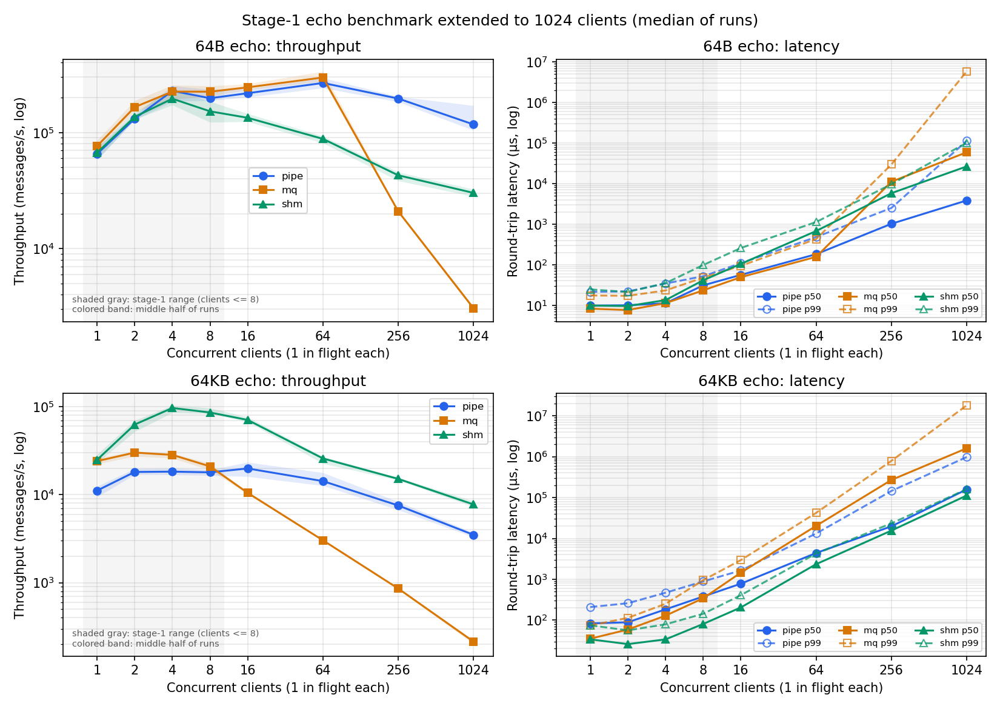

# 1단계 보강 측정 요약 (클라이언트 수 확장)

`scripts/plot-clients.py` 가 `results/exp-clients/bench_latency.csv` 에서 만든 파일이다. 손으로 고치지 않는다. 모든 실행은 동시 요청 1이고, 처리량은 같은 실행의 (잰 메시지 수) / (걸린 시간)이다. 값은 실행마다의 값의 중앙값이다. 순위는 실행별 값에서 좋은 쪽과 나쁜 쪽을 4분의 1씩 뺀 범위가 겹치면 ≈ 로 묶는다. 문맥 교환은 클라이언트 전체와 서버의 자발적 문맥 교환을 더해 잰 메시지 수로 나눈 값이다.

측정 환경 (`results/exp-clients/bench_env.txt` 에서 일부)

```text
date: 2026-11-28T16:33:58+09:00
commit: b44b78c
reps: 30, ipcs: pipe mq shm, sizes: 64 65536, clients: 1 2 4 8 16 64 256 1024, inflight: 16, modes: latency
power: ADP1 online=1 BAT1 Not charging 100%, profile balanced
CPU(s):                                  12
Model name:                              Intel(R) Core(TM) 5 120U
## 측정 끝: 2026-11-28T17:12:38+09:00, 2319초, 실행 1440 번, 실패 0 번, 전원 ADP1 online=1 BAT1 Not charging 100%
## 측정 끝 때 CPU 를 쓰는 프로세스
```

조건·IPC 마다 실행 30~30번, 모든 줄 2880개.


## 64B

| 클라이언트 | 처리량 pipe / mq / shm (msg/s) | 처리량 순위 | 지연 중앙값 pipe / mq / shm | 상위 99% pipe / mq / shm | 문맥 교환/메시지 pipe / mq / shm |
| ---: | --- | --- | --- | --- | --- |
| 1 | 65.5k / 76.5k / 67.1k | pipe ≈ mq ≈ shm | 9.8µs / 8.2µs / 9.9µs | 21.4µs / 17.5µs / 24.6µs | 3.0 / 3.0 / 3.0 |
| 2 | 131.7k / 165.7k / 136.6k | mq > pipe ≈ shm | 10.0µs / 7.6µs / 9.6µs | 22.0µs / 17.1µs / 21.4µs | 2.5 / 2.6 / 2.7 |
| 4 | 228.8k / 225.4k / 195.7k | pipe ≈ mq ≈ shm | 11.2µs / 11.3µs / 13.4µs | 34.4µs / 23.2µs / 35.1µs | 2.2 / 2.3 / 2.8 |
| 8 | 197.6k / 224.9k / 152.4k | pipe ≈ mq > shm | 31.0µs / 23.3µs / 41.4µs | 52.0µs / 47.8µs / 98.6µs | 2.0 / 2.0 / 3.6 |
| 16 | 218.3k / 245.2k / 134.0k | pipe ≈ mq > shm | 56.2µs / 49.4µs / 104.9µs | 109.3µs / 94.2µs / 258.2µs | 2.0 / 2.0 / 3.6 |
| 64 | 267.5k / 298.2k / 88.2k | pipe ≈ mq > shm | 182.1µs / 156.5µs / 677.6µs | 481.6µs / 427.8µs / 1.1ms | 2.0 / 2.0 / 3.6 |
| 256 | 196.4k / 20.9k / 42.8k | pipe > shm > mq | 1.0ms / 11.1ms / 5.8ms | 2.5ms / 29.7ms / 9.7ms | 2.0 / 77.6 / 3.0 |
| 1024 | 117.4k / 3,061 / 30.2k | pipe > shm > mq | 3.8ms / 59.3ms / 26.5ms | 113.4ms / 5.87s / 101.5ms | 2.1 / 451.2 / 3.1 |

## 64KB

| 클라이언트 | 처리량 pipe / mq / shm (msg/s) | 처리량 순위 | 지연 중앙값 pipe / mq / shm | 상위 99% pipe / mq / shm | 문맥 교환/메시지 pipe / mq / shm |
| ---: | --- | --- | --- | --- | --- |
| 1 | 11.1k / 24.1k / 24.9k | mq ≈ shm > pipe | 83.2µs / 35.1µs / 33.9µs | 209.2µs / 73.8µs / 74.6µs | 7.0 / 7.5 / 3.0 |
| 2 | 18.1k / 30.1k / 62.7k | shm > mq > pipe | 88.6µs / 58.9µs / 25.9µs | 259.2µs / 113.8µs / 56.2µs | 7.0 / 8.5 / 2.7 |
| 4 | 18.3k / 28.3k / 96.7k | shm > mq > pipe | 183.6µs / 128.7µs / 33.8µs | 469.0µs / 251.1µs / 79.0µs | 7.0 / 16.2 / 2.7 |
| 8 | 17.9k / 21.0k / 85.9k | shm > pipe ≈ mq | 378.8µs / 342.6µs / 80.6µs | 886.8µs / 950.6µs / 143.0µs | 7.0 / 39.1 / 3.0 |
| 16 | 19.9k / 10.5k / 70.7k | shm > pipe > mq | 779.9µs / 1.5ms / 204.3µs | 1.6ms / 3.0ms / 408.0µs | 7.4 / 113.4 / 3.3 |
| 64 | 14.3k / 3,030 / 25.8k | shm > pipe > mq | 4.4ms / 20.3ms / 2.3ms | 13.2ms / 42.3ms / 4.3ms | 9.5 / 500.1 / 3.4 |
| 256 | 7,538 / 858 / 15.1k | shm > pipe > mq | 19.8ms / 270.1ms / 15.6ms | 145.3ms / 791.9ms / 23.4ms | 20.1 / 1921.9 / 3.3 |
| 1024 | 3,500 / 214 / 7,748 | shm > pipe > mq | 158.4ms / 1.61s / 112.4ms | 981.3ms / 18.06s / 160.8ms | 27.6 / 6187.7 / 3.3 |

## 그림



