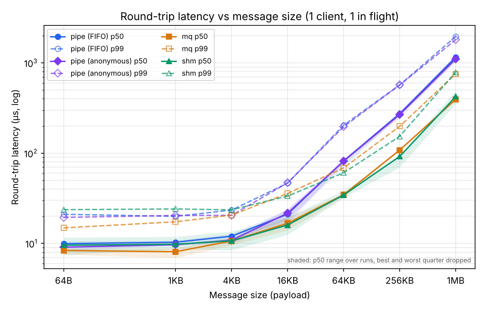
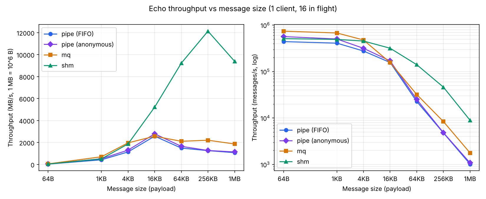
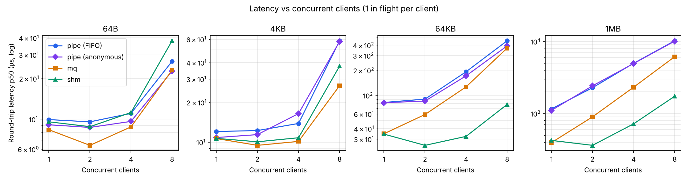
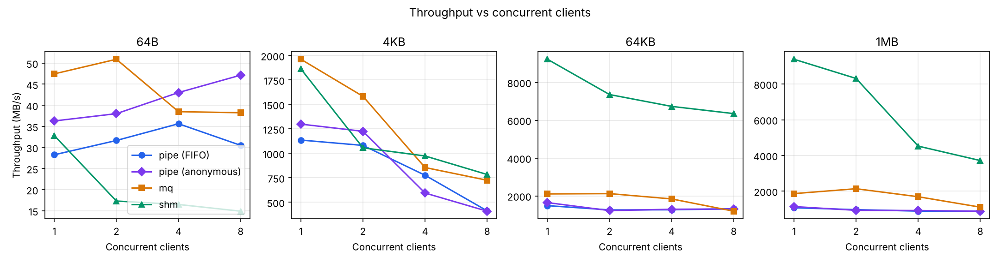
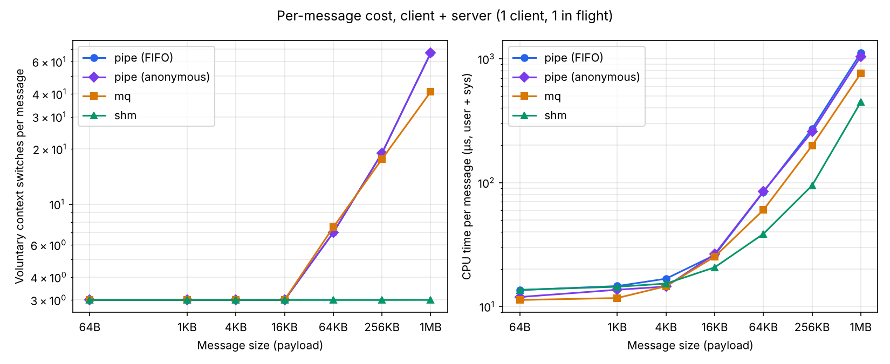

# 1단계 측정 요약

`scripts/plot-bench.py` 가 `results/stage1-r20/bench_*.csv` 에서 만든 파일이다. 손으로 고치지 않는다. 같은 조건을 여러 번 잰 값은 실행마다의 값의 중앙값이다. 지연 단위는 µs, 처리량은 MB/s (1 MB = 10^6 B). 순위는 pipe, mq, shm 사이에서만 매긴다. upipe(익명 pipe)는 FIFO 와 이름 유무만 다른 대조군이다. 순위를 매길 때는 실행별 값에서 좋은 쪽과 나쁜 쪽을 4분의 1씩 뺀 범위(20번이면 가운데 10번)를 보고, 두 IPC 의 범위가 겹치면 차이가 실행 사이의 흔들림보다 작은 것이므로 ≈ 로 묶어 같은 순위로 둔다.

측정 환경 (`results/stage1-r20/bench_env.txt` 에서 일부)

```text
date: 2026-11-19T22:28:22+09:00
commit: 7fcc799
reps: 20, ipcs: pipe upipe mq shm, sizes: 64 1024 4096 16384 65536 262144 1048576, clients: 1 2 4 8, inflight: 16
CPU(s):                                  12
Model name:                              Intel(R) Core(TM) 5 120U
Thread(s) per core:                      2
Core(s) per socket:                      10
Mem:            14Gi       6.8Gi       2.6Gi       1.3Gi       7.3Gi       8.0Gi
```

clock_gettime 한 번의 비용: 중앙값 23 ns, 평균 28.0 ns (20번 실행, 실행마다 1000000개)


## 지연, 클라이언트 1, 동시 요청 1 (20번 실행)

| 크기 | IPC | 평균 | 중앙값 | 상위 99% | 최대 | p50 순위 | 실행 사이 p50 편차 |
| --- | --- | ---: | ---: | ---: | ---: | :---: | ---: |
| 64B | pipe | 10.91 | 9.93 | 21.06 | 243.09 | 1 | 71% |
| 64B | upipe | 9.76 | 9.09 | 19.43 | 257.51 | - | 61% |
| 64B | mq | 8.56 | 8.36 | 14.89 | 166.78 | 1 | 63% |
| 64B | shm | 10.70 | 9.57 | 23.67 | 164.10 | 1 | 92% |
| 1KB | pipe | 11.57 | 10.33 | 19.95 | 236.52 | 1 | 54% |
| 1KB | upipe | 10.96 | 9.70 | 20.41 | 234.03 | - | 71% |
| 1KB | mq | 8.83 | 8.10 | 17.36 | 142.00 | 1 | 61% |
| 1KB | shm | 11.14 | 9.80 | 24.10 | 158.70 | 1 | 101% |
| 4KB | pipe | 13.14 | 12.04 | 23.42 | 255.25 | 1 | 59% |
| 4KB | upipe | 11.65 | 10.85 | 20.50 | 203.56 | - | 77% |
| 4KB | mq | 11.77 | 10.66 | 20.62 | 184.05 | 1 | 85% |
| 4KB | shm | 11.74 | 10.69 | 23.57 | 198.79 | 1 | 89% |
| 16KB | pipe | 22.88 | 21.12 | 46.60 | 334.73 | 1 | 93% |
| 16KB | upipe | 22.87 | 21.66 | 47.03 | 309.09 | - | 86% |
| 16KB | mq | 18.47 | 16.75 | 35.79 | 201.36 | 1 | 124% |
| 16KB | shm | 17.28 | 16.02 | 33.51 | 182.84 | 1 | 97% |
| 64KB | pipe | 82.51 | 82.34 | 204.07 | 683.31 | 3 | 63% |
| 64KB | upipe | 83.71 | 81.74 | 196.14 | 639.21 | - | 35% |
| 64KB | mq | 36.39 | 34.72 | 68.60 | 341.31 | 1 | 47% |
| 64KB | shm | 34.70 | 34.42 | 60.69 | 205.83 | 1 | 71% |
| 256KB | pipe | 281.26 | 273.46 | 570.29 | 1101.83 | 3 | 25% |
| 256KB | upipe | 262.70 | 267.65 | 568.43 | 1128.76 | - | 44% |
| 256KB | mq | 115.51 | 108.12 | 198.27 | 380.82 | 2 | 32% |
| 256KB | shm | 92.94 | 91.87 | 153.64 | 290.73 | 1 | 71% |
| 1MB | pipe | 1148.90 | 1158.99 | 1956.29 | 2367.32 | 3 | 47% |
| 1MB | upipe | 1083.47 | 1104.74 | 1801.02 | 2435.38 | - | 57% |
| 1MB | mq | 429.80 | 393.88 | 755.84 | 997.51 | 1 | 39% |
| 1MB | shm | 456.59 | 422.64 | 787.75 | 931.56 | 1 | 116% |

## 처리량, 클라이언트 1, 동시 요청 16

| 크기 | pipe MB/s | upipe MB/s | mq MB/s | shm MB/s | pipe msg/s | upipe msg/s | mq msg/s | shm msg/s | 순위 |
| --- | ---: | ---: | ---: | ---: | ---: | ---: | ---: | ---: | :---: |
| 64B | 28.3 | 36.3 | 47.5 | 32.8 | 441732 | 567018 | 741430 | 512523 | mq > shm > pipe |
| 1KB | 419.4 | 515.3 | 694.4 | 503.9 | 409568 | 503226 | 678114 | 492100 | mq > shm > pipe |
| 4KB | 1136.1 | 1299.0 | 1962.3 | 1863.1 | 277358 | 317135 | 479082 | 454869 | mq ≈ shm > pipe |
| 16KB | 2572.2 | 2785.0 | 2565.0 | 5216.5 | 156996 | 169983 | 156555 | 318393 | shm > pipe ≈ mq |
| 64KB | 1485.2 | 1645.8 | 2104.4 | 9220.9 | 22663 | 25113 | 32111 | 140700 | shm > mq > pipe |
| 256KB | 1255.1 | 1268.6 | 2202.3 | 12130.6 | 4788 | 4839 | 8401 | 46274 | shm > mq > pipe |
| 1MB | 1068.6 | 1135.0 | 1861.5 | 9387.7 | 1019 | 1082 | 1775 | 8953 | shm > mq > pipe |

## 클라이언트 수별 지연 중앙값 (µs, 동시 요청 1)

| 크기 | 클라이언트 | pipe | upipe | mq | shm | 순위 |
| --- | ---: | ---: | ---: | ---: | ---: | :---: |
| 64B | 1 | 9.93 | 9.09 | 8.36 | 9.57 | pipe ≈ mq ≈ shm |
| 64B | 2 | 9.56 | 8.69 | 6.40 | 8.80 | mq < pipe ≈ shm |
| 64B | 4 | 11.05 | 9.63 | 8.77 | 11.21 | pipe ≈ mq ≈ shm |
| 64B | 8 | 26.84 | 22.73 | 23.09 | 38.10 | pipe ≈ mq < shm |
| 1KB | 1 | 10.33 | 9.70 | 8.10 | 9.80 | pipe ≈ mq ≈ shm |
| 1KB | 2 | 9.79 | 8.57 | 7.60 | 8.60 | pipe ≈ mq ≈ shm |
| 1KB | 4 | 11.09 | 9.77 | 9.38 | 10.06 | pipe ≈ mq ≈ shm |
| 1KB | 8 | 31.78 | 28.25 | 25.16 | 37.30 | pipe ≈ mq < shm |
| 4KB | 1 | 12.04 | 10.85 | 10.66 | 10.69 | pipe ≈ mq ≈ shm |
| 4KB | 2 | 12.26 | 11.42 | 9.47 | 10.08 | mq ≈ shm < pipe |
| 4KB | 4 | 13.86 | 16.46 | 10.14 | 10.81 | mq ≈ shm < pipe |
| 4KB | 8 | 58.45 | 57.73 | 26.76 | 37.64 | mq < shm < pipe |
| 16KB | 1 | 21.12 | 21.66 | 16.75 | 16.02 | pipe ≈ mq ≈ shm |
| 16KB | 2 | 22.15 | 21.84 | 16.25 | 12.65 | shm < mq < pipe |
| 16KB | 4 | 26.31 | 24.96 | 27.18 | 17.02 | shm < pipe ≈ mq |
| 16KB | 8 | 57.53 | 63.32 | 93.23 | 42.90 | shm < pipe < mq |
| 64KB | 1 | 82.34 | 81.74 | 34.72 | 34.42 | mq ≈ shm < pipe |
| 64KB | 2 | 90.28 | 85.62 | 59.04 | 25.24 | shm < mq < pipe |
| 64KB | 4 | 192.03 | 171.49 | 126.56 | 32.31 | shm < mq < pipe |
| 64KB | 8 | 451.15 | 392.05 | 368.62 | 78.01 | shm < pipe ≈ mq |
| 256KB | 1 | 273.46 | 267.65 | 108.12 | 91.87 | shm < mq < pipe |
| 256KB | 2 | 519.87 | 496.29 | 193.30 | 68.82 | shm < mq < pipe |
| 256KB | 4 | 1041.45 | 1058.84 | 513.77 | 105.44 | shm < mq < pipe |
| 256KB | 8 | 2170.49 | 2150.97 | 1419.79 | 260.58 | shm < mq < pipe |
| 1MB | 1 | 1158.99 | 1104.74 | 393.88 | 422.64 | mq ≈ shm < pipe |
| 1MB | 2 | 2280.41 | 2424.13 | 897.90 | 360.90 | shm < mq < pipe |
| 1MB | 4 | 4978.17 | 4941.68 | 2317.18 | 717.91 | shm < mq < pipe |
| 1MB | 8 | 10233.49 | 10110.01 | 6148.27 | 1734.74 | shm < mq < pipe |

## 클라이언트 수별 처리량 (MB/s)

| 크기 | 클라이언트 | pipe | upipe | mq | shm | 순위 |
| --- | ---: | ---: | ---: | ---: | ---: | :---: |
| 64B | 1 | 28.3 | 36.3 | 47.5 | 32.8 | mq > shm > pipe |
| 64B | 2 | 31.7 | 38.0 | 50.9 | 17.3 | pipe ≈ mq > shm |
| 64B | 4 | 35.6 | 43.0 | 38.5 | 16.5 | pipe ≈ mq > shm |
| 64B | 8 | 30.5 | 47.1 | 38.2 | 14.9 | mq > pipe > shm |
| 1KB | 1 | 419.4 | 515.3 | 694.4 | 503.9 | mq > shm > pipe |
| 1KB | 2 | 529.8 | 573.0 | 466.1 | 268.1 | pipe ≈ mq > shm |
| 1KB | 4 | 462.8 | 477.6 | 231.3 | 255.7 | pipe > mq ≈ shm |
| 1KB | 8 | 534.1 | 520.6 | 204.4 | 217.8 | pipe > mq ≈ shm |
| 4KB | 1 | 1136.1 | 1299.0 | 1962.3 | 1863.1 | mq ≈ shm > pipe |
| 4KB | 2 | 1081.5 | 1225.8 | 1583.1 | 1057.0 | mq > pipe ≈ shm |
| 4KB | 4 | 776.2 | 594.6 | 855.4 | 973.5 | pipe ≈ mq ≈ shm |
| 4KB | 8 | 412.4 | 409.0 | 725.2 | 784.0 | mq ≈ shm > pipe |
| 16KB | 1 | 2572.2 | 2785.0 | 2565.0 | 5216.5 | shm > pipe ≈ mq |
| 16KB | 2 | 2376.3 | 2586.7 | 2213.2 | 3294.8 | shm > pipe > mq |
| 16KB | 4 | 2012.5 | 2201.2 | 1886.0 | 3135.2 | shm > pipe ≈ mq |
| 16KB | 8 | 1977.2 | 2062.3 | 1034.4 | 2810.6 | shm > pipe > mq |
| 64KB | 1 | 1485.2 | 1645.8 | 2104.4 | 9220.9 | shm > mq > pipe |
| 64KB | 2 | 1259.4 | 1223.8 | 2120.8 | 7356.1 | shm > mq > pipe |
| 64KB | 4 | 1266.5 | 1293.6 | 1840.2 | 6730.1 | shm > mq > pipe |
| 64KB | 8 | 1320.5 | 1311.0 | 1192.1 | 6349.2 | shm > pipe ≈ mq |
| 256KB | 1 | 1255.1 | 1268.6 | 2202.3 | 12130.6 | shm > mq > pipe |
| 256KB | 2 | 1063.5 | 1009.4 | 2445.4 | 10970.7 | shm > mq > pipe |
| 256KB | 4 | 1046.9 | 1022.8 | 1878.0 | 9569.6 | shm > mq > pipe |
| 256KB | 8 | 963.7 | 1001.9 | 1425.4 | 7435.1 | shm > mq > pipe |
| 1MB | 1 | 1068.6 | 1135.0 | 1861.5 | 9387.7 | shm > mq > pipe |
| 1MB | 2 | 963.7 | 926.7 | 2135.6 | 8312.5 | shm > mq > pipe |
| 1MB | 4 | 882.2 | 914.5 | 1687.2 | 4522.8 | shm > mq > pipe |
| 1MB | 8 | 878.2 | 877.4 | 1103.7 | 3714.0 | shm > mq > pipe |

## FIFO 와 익명 pipe (클라이언트 1)

이름이 있는지만 다르고 커널 안의 pipe 버퍼는 같다. 비율이 1 에 가까우면 이름(경로 탐색·open)은 송수신 비용에 영향이 없다.

| 크기 | pipe p50 (µs) | upipe p50 (µs) | upipe / pipe | pipe MB/s | upipe MB/s |
| --- | ---: | ---: | ---: | ---: | ---: |
| 64B | 9.93 | 9.09 | 0.92 | 28.3 | 36.3 |
| 1KB | 10.33 | 9.70 | 0.94 | 419.4 | 515.3 |
| 4KB | 12.04 | 10.85 | 0.90 | 1136.1 | 1299.0 |
| 16KB | 21.12 | 21.66 | 1.03 | 2572.2 | 2785.0 |
| 64KB | 82.34 | 81.74 | 0.99 | 1485.2 | 1645.8 |
| 256KB | 273.46 | 267.65 | 0.98 | 1255.1 | 1268.6 |
| 1MB | 1158.99 | 1104.74 | 0.95 | 1068.6 | 1135.0 |

## 순위가 바뀌는 지점 (클라이언트 1, 지연 중앙값)

크기별 순위 (≈ 는 가운데 범위가 겹쳐 구분하지 않은 것):

- 64B: pipe ≈ mq ≈ shm
- 1KB: pipe ≈ mq ≈ shm
- 4KB: pipe ≈ mq ≈ shm
- 16KB: pipe ≈ mq ≈ shm
- 64KB: mq ≈ shm < pipe
- 256KB: shm < mq < pipe
- 1MB: mq ≈ shm < pipe

바뀌는 곳:

- 16KB → 64KB: pipe ≈ mq ≈ shm 에서 mq ≈ shm < pipe 로
- 64KB → 256KB: mq ≈ shm < pipe 에서 shm < mq < pipe 로
- 256KB → 1MB: shm < mq < pipe 에서 mq ≈ shm < pipe 로

## 메시지당 자발적 컨텍스트 스위치 (클라이언트 1, 동시 요청 1)

클라이언트 프로세스와 서버 프로세스의 `nvcsw` 를 더해 잰 메시지 수로 나눈 값이다(실행별 값의 중앙값). 왕복 한 번에 막혀서 잠든 횟수로 볼 수 있다.

| 크기 | pipe | upipe | mq | shm |
| --- | ---: | ---: | ---: | ---: |
| 64B | 3.0 | 3.0 | 3.0 | 3.0 |
| 1KB | 3.0 | 3.0 | 3.0 | 3.0 |
| 4KB | 3.0 | 3.0 | 3.0 | 3.0 |
| 16KB | 3.0 | 3.0 | 3.0 | 3.0 |
| 64KB | 7.0 | 7.0 | 7.5 | 3.0 |
| 256KB | 19.0 | 19.0 | 17.6 | 3.0 |
| 1MB | 66.8 | 66.9 | 41.0 | 3.0 |

## 처리량 실행의 긴 꼬리 (동시 요청 16)

칸의 값은 최대 / 상위 99% (둘 다 실행별 값의 중앙값)와, 평균이 상위 99% 보다 큰 실행 수다. 평균이 상위 99% 보다 크면 1% 도 안 되는 요청이 평균을 끌어올릴 만큼 오래 기다린 것이다.

| 크기 | 클라이언트 | pipe | upipe | mq | shm |
| --- | ---: | ---: | ---: | ---: | ---: |
| 64B | 1 | 2.6배 (0/20) | 3.1배 (0/20) | 2.3배 (0/20) | 1.8배 (0/20) |
| 64B | 2 | 1.4배 (0/20) | 1.6배 (0/20) | 1.7배 (0/20) | 6.7배 (0/20) |
| 64B | 4 | 1.2배 (0/20) | 1.3배 (0/20) | 1.2배 (0/20) | 4.0배 (0/20) |
| 64B | 8 | 1.1배 (0/20) | 1.2배 (0/20) | 1.2배 (0/20) | 3.9배 (0/20) |
| 1KB | 1 | 2.7배 (0/20) | 3.7배 (0/20) | 2.7배 (0/20) | 2.1배 (0/20) |
| 1KB | 2 | 1.4배 (0/20) | 1.8배 (0/20) | 2.4배 (0/20) | 2.1배 (0/20) |
| 1KB | 4 | 1.7배 (0/20) | 1.8배 (0/20) | 3.4배 (0/20) | 4.6배 (0/20) |
| 1KB | 8 | 2.4배 (0/20) | 2.5배 (0/20) | 5.0배 (0/20) | 3.5배 (0/20) |
| 4KB | 1 | 3.1배 (0/20) | 3.5배 (0/20) | 5.1배 (0/20) | 2.1배 (0/20) |
| 4KB | 2 | 40.2배 (0/20) | 27.1배 (0/20) | 8.4배 (0/20) | 1.9배 (0/20) |
| 4KB | 4 | 5.0배 (0/20) | 5.4배 (0/20) | 8.6배 (0/20) | 1.7배 (0/20) |
| 4KB | 8 | 3.3배 (0/20) | 3.4배 (0/20) | 9.5배 (0/20) | 3.6배 (0/20) |
| 16KB | 1 | 3.7배 (0/20) | 3.8배 (0/20) | 5.7배 (0/20) | 1.8배 (0/20) |
| 16KB | 2 | 296.6배 (0/20) | 314.1배 (0/20) | 4.8배 (0/20) | 1.4배 (0/20) |
| 16KB | 4 | 8.7배 (0/20) | 5.6배 (0/20) | 3.6배 (0/20) | 1.3배 (0/20) |
| 16KB | 8 | 3.4배 (0/20) | 3.1배 (0/20) | 2.8배 (0/20) | 1.1배 (0/20) |
| 64KB | 1 | 2.9배 (0/20) | 3.0배 (0/20) | 3.4배 (0/20) | 1.2배 (0/20) |
| 64KB | 2 | 449.3배 (0/20) | 556.3배 (0/20) | 3.6배 (0/20) | 1.2배 (0/20) |
| 64KB | 4 | 683.5배 (6/20) | 784.0배 (13/20) | 2.3배 (0/20) | 1.0배 (0/20) |
| 64KB | 8 | 1613.2배 (20/20) | 1425.8배 (19/20) | 2.1배 (0/20) | 1.1배 (0/20) |
| 256KB | 1 | 1.6배 (0/20) | 1.6배 (0/20) | 1.6배 (0/20) | 1.1배 (0/20) |
| 256KB | 2 | 513.1배 (0/20) | 468.5배 (0/20) | 1.7배 (0/20) | 1.2배 (0/20) |
| 256KB | 4 | 607.7배 (20/20) | 640.8배 (19/20) | 1.6배 (0/20) | 1.1배 (0/20) |
| 256KB | 8 | 849.4배 (19/20) | 870.1배 (20/20) | 1.8배 (0/20) | 1.1배 (0/20) |
| 1MB | 1 | 1.3배 (0/20) | 1.3배 (0/20) | 1.3배 (0/20) | 1.2배 (0/20) |
| 1MB | 2 | 205.4배 (1/20) | 224.7배 (0/20) | 1.4배 (0/20) | 1.3배 (0/20) |
| 1MB | 4 | 302.2배 (19/20) | 282.4배 (19/20) | 1.3배 (0/20) | 1.1배 (0/20) |
| 1MB | 8 | 245.0배 (15/20) | 335.9배 (17/20) | 1.3배 (0/20) | 1.1배 (0/20) |

## 그림











