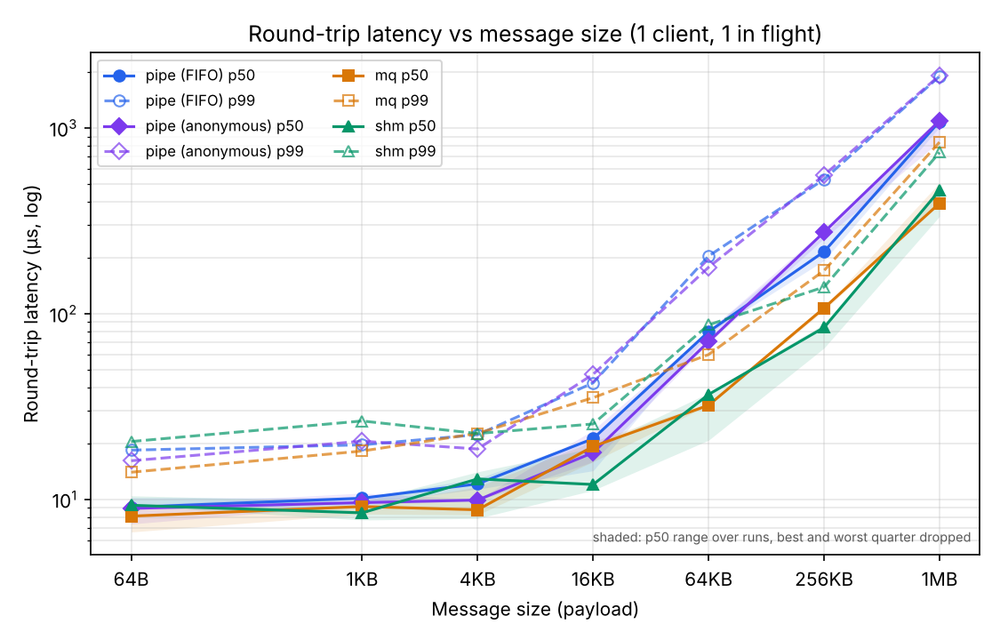
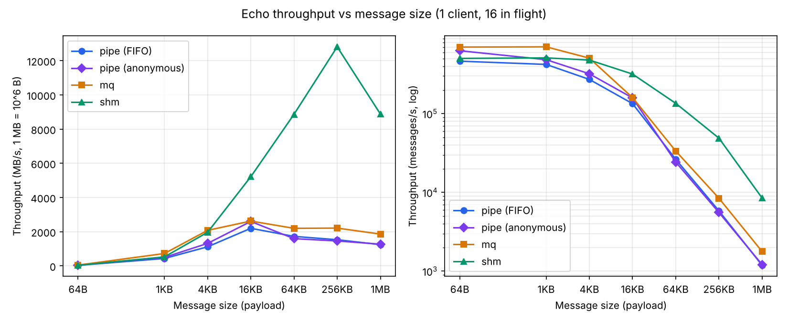
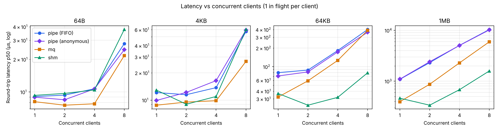
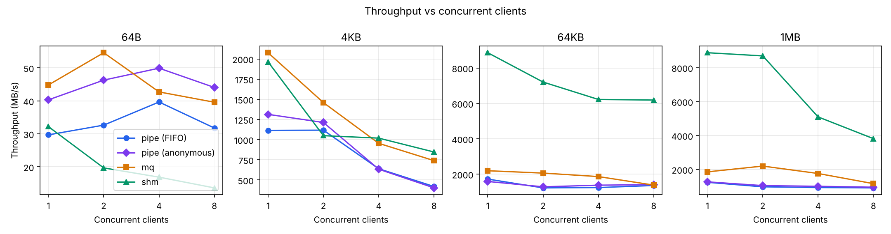
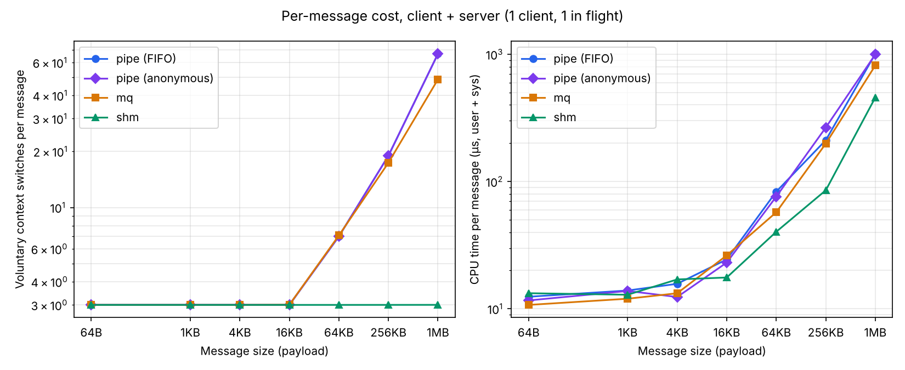

# 1단계 측정 요약

`scripts/plot-bench.py` 가 `results/bench_*.csv` 에서 만든 파일이다. 손으로 고치지 않는다. 같은 조건을 여러 번 잰 값은 실행마다의 값의 중앙값이다. 지연 단위는 µs, 처리량은 MB/s (1 MB = 10^6 B). 순위는 pipe, mq, shm 사이에서만 매긴다. upipe(익명 pipe)는 FIFO 와 이름 유무만 다른 대조군이다. 순위를 매길 때는 실행별 값에서 좋은 쪽과 나쁜 쪽을 4분의 1씩 뺀 범위(20번이면 가운데 10번)를 보고, 두 IPC 의 범위가 겹치면 차이가 실행 사이의 흔들림보다 작은 것이므로 ≈ 로 묶어 같은 순위로 둔다.

측정 환경 (`results/bench_env.txt` 에서 일부)

```text
date: 2026-11-18T05:14:04+09:00
commit: 4d29cb3
reps: 5, ipcs: pipe upipe mq shm, sizes: 64 1024 4096 16384 65536 262144 1048576, clients: 1 2 4 8, inflight: 16
CPU(s):                                  12
Model name:                              Intel(R) Core(TM) 5 120U
Thread(s) per core:                      2
Core(s) per socket:                      10
Mem:            14Gi       6.4Gi       2.5Gi       2.3Gi       8.6Gi       8.4Gi
```

clock_gettime 한 번의 비용: 중앙값 15 ns, 평균 22.0 ns (5번 실행, 실행마다 1000000개)


## 지연, 클라이언트 1, 동시 요청 1 (5번 실행)

| 크기 | IPC | 평균 | 중앙값 | 상위 99% | 최대 | p50 순위 | 실행 사이 p50 편차 |
| --- | --- | ---: | ---: | ---: | ---: | :---: | ---: |
| 64B | pipe | 9.52 | 9.07 | 18.43 | 266.26 | 1 | 20% |
| 64B | upipe | 9.45 | 8.95 | 16.16 | 181.63 | - | 52% |
| 64B | mq | 8.43 | 8.13 | 14.01 | 215.30 | 1 | 59% |
| 64B | shm | 10.37 | 9.30 | 20.50 | 155.11 | 1 | 25% |
| 1KB | pipe | 11.11 | 10.15 | 19.67 | 220.06 | 1 | 9% |
| 1KB | upipe | 10.88 | 9.61 | 20.60 | 284.61 | - | 46% |
| 1KB | mq | 9.66 | 9.16 | 18.22 | 325.49 | 1 | 36% |
| 1KB | shm | 11.27 | 8.47 | 26.45 | 216.28 | 1 | 49% |
| 4KB | pipe | 12.43 | 12.13 | 22.31 | 245.46 | 1 | 47% |
| 4KB | upipe | 10.38 | 9.92 | 18.69 | 201.44 | - | 48% |
| 4KB | mq | 10.93 | 8.79 | 22.68 | 184.94 | 1 | 73% |
| 4KB | shm | 13.75 | 12.89 | 22.64 | 254.66 | 1 | 85% |
| 16KB | pipe | 21.40 | 21.25 | 42.43 | 261.31 | 1 | 50% |
| 16KB | upipe | 20.13 | 17.86 | 47.19 | 759.68 | - | 60% |
| 16KB | mq | 19.29 | 19.30 | 35.29 | 212.07 | 1 | 47% |
| 16KB | shm | 13.34 | 12.03 | 25.49 | 219.63 | 1 | 73% |
| 64KB | pipe | 82.83 | 80.03 | 204.37 | 683.67 | 3 | 62% |
| 64KB | upipe | 74.57 | 70.71 | 177.92 | 648.98 | - | 39% |
| 64KB | mq | 35.56 | 32.14 | 60.27 | 362.18 | 1 | 54% |
| 64KB | shm | 37.98 | 36.75 | 87.11 | 231.11 | 1 | 54% |
| 256KB | pipe | 214.03 | 216.01 | 529.68 | 1115.09 | 3 | 52% |
| 256KB | upipe | 279.08 | 275.09 | 557.79 | 1663.02 | - | 42% |
| 256KB | mq | 111.64 | 107.33 | 170.80 | 852.84 | 2 | 27% |
| 256KB | shm | 85.08 | 84.31 | 139.26 | 268.31 | 1 | 42% |
| 1MB | pipe | 1033.19 | 1085.85 | 1899.31 | 2619.56 | 3 | 21% |
| 1MB | upipe | 1037.64 | 1094.43 | 1918.01 | 3213.31 | - | 29% |
| 1MB | mq | 486.36 | 393.39 | 839.40 | 1385.97 | 1 | 34% |
| 1MB | shm | 482.87 | 461.75 | 738.83 | 1150.51 | 1 | 60% |

## 처리량, 클라이언트 1, 동시 요청 16

| 크기 | pipe MB/s | upipe MB/s | mq MB/s | shm MB/s | pipe msg/s | upipe msg/s | mq msg/s | shm msg/s | 순위 |
| --- | ---: | ---: | ---: | ---: | ---: | ---: | ---: | ---: | :---: |
| 64B | 29.7 | 40.3 | 44.8 | 32.2 | 464034 | 629782 | 700173 | 503087 | mq > pipe ≈ shm |
| 1KB | 431.9 | 496.3 | 722.7 | 523.0 | 421796 | 484674 | 705744 | 510776 | mq > shm > pipe |
| 4KB | 1115.0 | 1313.4 | 2077.2 | 1964.0 | 272209 | 320652 | 507126 | 479486 | mq ≈ shm > pipe |
| 16KB | 2196.5 | 2595.8 | 2619.5 | 5214.2 | 134061 | 158434 | 159884 | 318250 | shm > mq > pipe |
| 64KB | 1724.4 | 1590.5 | 2195.8 | 8863.3 | 26312 | 24269 | 33505 | 135243 | shm > mq > pipe |
| 256KB | 1529.0 | 1456.4 | 2208.5 | 12809.3 | 5833 | 5556 | 8425 | 48864 | shm > mq > pipe |
| 1MB | 1241.6 | 1268.4 | 1857.9 | 8879.4 | 1184 | 1210 | 1772 | 8468 | shm > mq > pipe |

## 클라이언트 수별 지연 중앙값 (µs, 동시 요청 1)

| 크기 | 클라이언트 | pipe | upipe | mq | shm | 순위 |
| --- | ---: | ---: | ---: | ---: | ---: | :---: |
| 64B | 1 | 9.07 | 8.95 | 8.13 | 9.30 | pipe ≈ mq ≈ shm |
| 64B | 2 | 9.36 | 8.47 | 7.55 | 9.69 | mq < pipe ≈ shm |
| 64B | 4 | 10.70 | 10.68 | 7.78 | 10.43 | pipe ≈ mq ≈ shm |
| 64B | 8 | 27.94 | 24.54 | 21.66 | 37.74 | mq < pipe < shm |
| 1KB | 1 | 10.15 | 9.61 | 9.16 | 8.47 | pipe ≈ mq ≈ shm |
| 1KB | 2 | 10.14 | 9.58 | 6.74 | 8.48 | mq < shm < pipe |
| 1KB | 4 | 11.73 | 9.71 | 9.21 | 9.54 | pipe ≈ mq ≈ shm |
| 1KB | 8 | 32.77 | 26.04 | 25.31 | 37.32 | mq < pipe < shm |
| 4KB | 1 | 12.13 | 9.92 | 8.79 | 12.89 | pipe ≈ mq ≈ shm |
| 4KB | 2 | 11.48 | 12.17 | 9.52 | 9.01 | pipe ≈ mq ≈ shm |
| 4KB | 4 | 13.74 | 16.42 | 9.84 | 10.98 | mq ≈ shm < pipe |
| 4KB | 8 | 57.34 | 59.52 | 26.75 | 60.30 | mq < pipe ≈ shm |
| 16KB | 1 | 21.25 | 17.86 | 19.30 | 12.03 | pipe ≈ mq ≈ shm |
| 16KB | 2 | 22.86 | 21.84 | 16.21 | 13.37 | shm < mq < pipe |
| 16KB | 4 | 25.30 | 24.71 | 26.27 | 14.61 | shm < pipe ≈ mq |
| 16KB | 8 | 55.88 | 56.75 | 78.74 | 43.34 | shm < pipe < mq |
| 64KB | 1 | 80.03 | 70.71 | 32.14 | 36.75 | mq ≈ shm < pipe |
| 64KB | 2 | 88.06 | 82.21 | 59.01 | 23.74 | shm < mq < pipe |
| 64KB | 4 | 183.07 | 173.96 | 126.68 | 31.86 | shm < mq < pipe |
| 64KB | 8 | 400.66 | 362.31 | 388.40 | 79.63 | shm < pipe ≈ mq |
| 256KB | 1 | 216.01 | 275.09 | 107.33 | 84.31 | shm < mq < pipe |
| 256KB | 2 | 521.48 | 510.85 | 191.74 | 66.89 | shm < mq < pipe |
| 256KB | 4 | 1035.02 | 891.85 | 527.17 | 104.51 | shm < mq < pipe |
| 256KB | 8 | 2166.99 | 2146.18 | 1381.36 | 257.35 | shm < mq < pipe |
| 1MB | 1 | 1085.85 | 1094.43 | 393.39 | 461.75 | mq ≈ shm < pipe |
| 1MB | 2 | 2316.22 | 2411.31 | 867.98 | 336.03 | shm < mq < pipe |
| 1MB | 4 | 5067.15 | 5044.80 | 2289.75 | 679.47 | shm < mq < pipe |
| 1MB | 8 | 10400.86 | 10223.02 | 5956.38 | 1588.03 | shm < mq < pipe |

## 클라이언트 수별 처리량 (MB/s)

| 크기 | 클라이언트 | pipe | upipe | mq | shm | 순위 |
| --- | ---: | ---: | ---: | ---: | ---: | :---: |
| 64B | 1 | 29.7 | 40.3 | 44.8 | 32.2 | mq > pipe ≈ shm |
| 64B | 2 | 32.6 | 46.3 | 54.6 | 19.7 | mq > pipe > shm |
| 64B | 4 | 39.6 | 49.9 | 42.7 | 16.9 | mq > pipe > shm |
| 64B | 8 | 31.8 | 44.1 | 39.6 | 13.6 | pipe ≈ mq > shm |
| 1KB | 1 | 431.9 | 496.3 | 722.7 | 523.0 | mq > shm > pipe |
| 1KB | 2 | 414.5 | 530.6 | 480.9 | 280.0 | pipe ≈ mq > shm |
| 1KB | 4 | 459.0 | 520.9 | 232.5 | 281.9 | pipe > shm > mq |
| 1KB | 8 | 389.4 | 542.6 | 213.2 | 220.2 | pipe > mq ≈ shm |
| 4KB | 1 | 1115.0 | 1313.4 | 2077.2 | 1964.0 | mq ≈ shm > pipe |
| 4KB | 2 | 1117.4 | 1212.7 | 1458.9 | 1049.5 | pipe ≈ mq > shm |
| 4KB | 4 | 639.5 | 633.7 | 954.3 | 1018.9 | mq ≈ shm > pipe |
| 4KB | 8 | 419.0 | 402.0 | 739.8 | 846.8 | mq ≈ shm > pipe |
| 16KB | 1 | 2196.5 | 2595.8 | 2619.5 | 5214.2 | shm > mq > pipe |
| 16KB | 2 | 2169.2 | 2667.7 | 2206.5 | 3272.3 | shm > pipe ≈ mq |
| 16KB | 4 | 2012.6 | 2156.2 | 1868.5 | 3209.2 | shm > pipe > mq |
| 16KB | 8 | 1903.3 | 2115.5 | 929.1 | 2789.6 | shm > pipe > mq |
| 64KB | 1 | 1724.4 | 1590.5 | 2195.8 | 8863.3 | shm > mq > pipe |
| 64KB | 2 | 1225.9 | 1287.0 | 2062.9 | 7205.9 | shm > mq > pipe |
| 64KB | 4 | 1244.6 | 1380.0 | 1865.4 | 6222.4 | shm > mq > pipe |
| 64KB | 8 | 1362.4 | 1408.8 | 1384.2 | 6188.9 | shm > pipe ≈ mq |
| 256KB | 1 | 1529.0 | 1456.4 | 2208.5 | 12809.3 | shm > mq > pipe |
| 256KB | 2 | 1036.5 | 1152.8 | 2502.8 | 11386.3 | shm > mq > pipe |
| 256KB | 4 | 1154.1 | 1105.6 | 1993.8 | 9219.2 | shm > mq > pipe |
| 256KB | 8 | 995.3 | 988.5 | 1038.8 | 6883.8 | shm > pipe ≈ mq |
| 1MB | 1 | 1241.6 | 1268.4 | 1857.9 | 8879.4 | shm > mq > pipe |
| 1MB | 2 | 976.3 | 1048.7 | 2198.8 | 8692.5 | shm > mq > pipe |
| 1MB | 4 | 934.7 | 1006.1 | 1762.1 | 5096.4 | shm > mq > pipe |
| 1MB | 8 | 912.6 | 953.6 | 1163.1 | 3816.4 | shm > mq > pipe |

## FIFO 와 익명 pipe (클라이언트 1)

이름이 있는지만 다르고 커널 안의 pipe 버퍼는 같다. 비율이 1 에 가까우면 이름(경로 탐색·open)은 송수신 비용에 영향이 없다.

| 크기 | pipe p50 (µs) | upipe p50 (µs) | upipe / pipe | pipe MB/s | upipe MB/s |
| --- | ---: | ---: | ---: | ---: | ---: |
| 64B | 9.07 | 8.95 | 0.99 | 29.7 | 40.3 |
| 1KB | 10.15 | 9.61 | 0.95 | 431.9 | 496.3 |
| 4KB | 12.13 | 9.92 | 0.82 | 1115.0 | 1313.4 |
| 16KB | 21.25 | 17.86 | 0.84 | 2196.5 | 2595.8 |
| 64KB | 80.03 | 70.71 | 0.88 | 1724.4 | 1590.5 |
| 256KB | 216.01 | 275.09 | 1.27 | 1529.0 | 1456.4 |
| 1MB | 1085.85 | 1094.43 | 1.01 | 1241.6 | 1268.4 |

## 순위가 바뀌는 지점 (클라이언트 1, 지연 중앙값)

크기별 순위 (≈ 는 가운데 범위가 겹쳐 구분하지 않은 것):

- 64B: pipe ≈ mq ≈ shm
- 1KB: pipe ≈ mq ≈ shm
- 4KB: pipe ≈ mq ≈ shm
- 16KB: pipe ≈ mq ≈ shm
- 64KB: mq ≈ shm < pipe
- 256KB: shm < mq < pipe
- 1MB: mq ≈ shm < pipe

바뀌는 곳:

- 16KB → 64KB: pipe ≈ mq ≈ shm 에서 mq ≈ shm < pipe 로
- 64KB → 256KB: mq ≈ shm < pipe 에서 shm < mq < pipe 로
- 256KB → 1MB: shm < mq < pipe 에서 mq ≈ shm < pipe 로

## 메시지당 자발적 컨텍스트 스위치 (클라이언트 1, 동시 요청 1)

클라이언트 프로세스와 서버 프로세스의 `nvcsw` 를 더해 잰 메시지 수로 나눈 값이다(실행별 값의 중앙값). 왕복 한 번에 막혀서 잠든 횟수로 볼 수 있다.

| 크기 | pipe | upipe | mq | shm |
| --- | ---: | ---: | ---: | ---: |
| 64B | 3.0 | 3.0 | 3.0 | 3.0 |
| 1KB | 3.0 | 3.0 | 3.0 | 3.0 |
| 4KB | 3.0 | 3.0 | 3.0 | 3.0 |
| 16KB | 3.0 | 3.0 | 3.0 | 3.0 |
| 64KB | 7.0 | 7.0 | 7.1 | 3.0 |
| 256KB | 19.0 | 19.0 | 17.4 | 3.0 |
| 1MB | 66.8 | 66.9 | 48.8 | 3.0 |

## 처리량 실행의 긴 꼬리 (동시 요청 16)

칸의 값은 최대 / 상위 99% (둘 다 실행별 값의 중앙값)와, 평균이 상위 99% 보다 큰 실행 수다. 평균이 상위 99% 보다 크면 1% 도 안 되는 요청이 평균을 끌어올릴 만큼 오래 기다린 것이다.

| 크기 | 클라이언트 | pipe | upipe | mq | shm |
| --- | ---: | ---: | ---: | ---: | ---: |
| 64B | 1 | 2.8배 (0/5) | 3.1배 (0/5) | 2.2배 (0/5) | 2.1배 (0/5) |
| 64B | 2 | 2.1배 (0/5) | 1.5배 (0/5) | 1.7배 (0/5) | 1.9배 (0/5) |
| 64B | 4 | 1.3배 (0/5) | 1.5배 (0/5) | 1.2배 (0/5) | 4.5배 (0/5) |
| 64B | 8 | 1.2배 (0/5) | 1.9배 (0/5) | 1.5배 (0/5) | 3.5배 (0/5) |
| 1KB | 1 | 2.6배 (0/5) | 3.0배 (0/5) | 2.5배 (0/5) | 3.2배 (0/5) |
| 1KB | 2 | 1.8배 (0/5) | 1.9배 (0/5) | 2.5배 (0/5) | 2.5배 (0/5) |
| 1KB | 4 | 1.7배 (0/5) | 2.1배 (0/5) | 4.1배 (0/5) | 2.2배 (0/5) |
| 1KB | 8 | 2.1배 (0/5) | 3.0배 (0/5) | 3.8배 (0/5) | 3.1배 (0/5) |
| 4KB | 1 | 4.1배 (0/5) | 4.3배 (0/5) | 8.6배 (0/5) | 1.7배 (0/5) |
| 4KB | 2 | 32.6배 (0/5) | 46.1배 (0/5) | 5.4배 (0/5) | 3.7배 (0/5) |
| 4KB | 4 | 5.8배 (0/5) | 13.9배 (0/5) | 6.5배 (0/5) | 3.0배 (0/5) |
| 4KB | 8 | 4.2배 (0/5) | 3.7배 (0/5) | 11.5배 (0/5) | 3.4배 (0/5) |
| 16KB | 1 | 3.3배 (0/5) | 3.3배 (0/5) | 5.6배 (0/5) | 2.0배 (0/5) |
| 16KB | 2 | 262.8배 (0/5) | 289.1배 (0/5) | 5.0배 (0/5) | 4.4배 (0/5) |
| 16KB | 4 | 9.5배 (0/5) | 7.2배 (0/5) | 14.1배 (0/5) | 1.3배 (0/5) |
| 16KB | 8 | 3.8배 (0/5) | 2.9배 (0/5) | 2.7배 (0/5) | 1.0배 (0/5) |
| 64KB | 1 | 4.4배 (0/5) | 3.6배 (0/5) | 3.7배 (0/5) | 1.4배 (0/5) |
| 64KB | 2 | 447.0배 (0/5) | 579.7배 (0/5) | 3.9배 (0/5) | 1.9배 (0/5) |
| 64KB | 4 | 590.3배 (1/5) | 857.7배 (1/5) | 4.8배 (0/5) | 1.1배 (0/5) |
| 64KB | 8 | 1521.3배 (5/5) | 1735.7배 (5/5) | 2.1배 (0/5) | 1.1배 (0/5) |
| 256KB | 1 | 2.3배 (0/5) | 2.5배 (0/5) | 2.9배 (0/5) | 1.4배 (0/5) |
| 256KB | 2 | 358.6배 (0/5) | 440.5배 (0/5) | 2.3배 (0/5) | 1.1배 (0/5) |
| 256KB | 4 | 534.1배 (4/5) | 632.1배 (3/5) | 1.5배 (0/5) | 1.0배 (0/5) |
| 256KB | 8 | 959.6배 (5/5) | 773.6배 (4/5) | 1.3배 (0/5) | 1.2배 (0/5) |
| 1MB | 1 | 1.4배 (0/5) | 1.3배 (0/5) | 2.1배 (0/5) | 1.2배 (0/5) |
| 1MB | 2 | 217.2배 (1/5) | 221.0배 (0/5) | 1.8배 (0/5) | 1.1배 (0/5) |
| 1MB | 4 | 316.4배 (5/5) | 223.1배 (5/5) | 1.4배 (0/5) | 1.1배 (0/5) |
| 1MB | 8 | 302.4배 (5/5) | 309.4배 (5/5) | 1.3배 (0/5) | 1.1배 (0/5) |

## 그림











