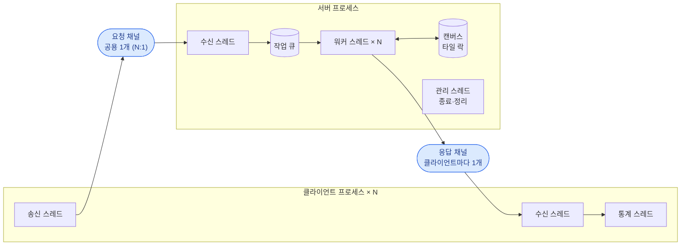

# 설계 명세 — 공유 캔버스 서버

[문서 안내](../../README.md#관련-문서)

[요구사항](../requirements/README.md)을 만족하는 구조, 스레드, 동기화, 실행 옵션을 정한다. 보고서 4장은 이 문서에서 옮긴다. 파일 책임과 일정은 [구현 계획](plan.md), 측정은 [측정 방법](../measurement/README.md)에 둔다.

> [!NOTE]
> 11월 18일에 두 헤더와 함께 확정했다(#4). 구현하면서 달라진 부분은 코드보다 이 문서를 먼저 고치고 [변경 기록](#변경-기록)에 남긴다.

## 구성

IPC 버전마다 바뀌는 것은 두 채널뿐이다. 프로세스 안쪽은 같은 코드다.

## 채널

세 버전 모두 요청 채널은 공용 1개, 응답 채널은 클라이언트마다 1개로 맞춘다. 구조가 같아야 차이가 IPC 메커니즘에서만 나온다.

| | 요청 채널 | 응답 채널 | 큰 응답 |
| --- | --- | --- | --- |
| pipe | `/tmp/osproject_2_req` FIFO | `/tmp/osproject_2_resp_<id>` FIFO | `write` 반복. 클라이언트별 송신 mutex로 섞임 방지 |
| mq | key 60020 큐 | key 60021 큐 하나, `mtype` = client_id + 1 | 조각으로 나눠 보내고 재조립. 클라이언트별 송신 mutex |
| shm | key 60022 영역의 링 버퍼 + 세마포어(key 60024) | key 60023 영역의 클라이언트별 링 버퍼 + 세마포어(key 60025) | 링에 통째로 한 번 복사. 조각내지 않는다 |

- 요청은 모두 4096B(`PIPE_BUF`) 이하다. 그래서 여러 클라이언트가 같은 FIFO에 동시에 써도 섞이지 않는다. 응답은 그보다 클 수 있어 송신 락이 필요하다.
- pipe 버전은 `PIPE_BUF`를 넘는 요청(1단계 벤치마크만 보낸다)을 여러 번의 write로 나눠 쓴다. 쓰는 도중에 클라이언트가 죽으면 요청 FIFO에 반쪽 메시지가 남아, 서버가 그 뒤의 요청을 제대로 읽지 못한다. 응용의 요청은 모두 작아 생기지 않는다. mq 버전은 조각을 클라이언트별로 붙이고, shm 버전은 다 쓴 메시지만 받는 쪽에 보여 생기지 않는다.
- pipe 버전은 상대가 죽으면 커널이 알려 준다. 읽는 쪽은 쓰는 쪽이 모두 닫혀 EOF를, 쓰는 쪽은 읽는 쪽이 없어 `EPIPE`를 받는다. 다만 클라이언트는 첫 응답을 받을 때까지 자기 응답 FIFO의 쓰기 끝(keeper)을 쥐고 있어 EOF가 오지 않는다. 그동안은 요청 FIFO의 쓰기 끝도 `poll`로 보고, 읽는 쪽(서버)이 사라져 `POLLERR`이 오면 서버가 끝난 것으로 본다.
- System V 메시지 하나는 기본 8192B(`msgmax`), 큐 하나는 기본 16384B(`msgmnb`)까지다. 1MB 응답은 나눠 보내야 한다. 조각 크기는 실행할 때 두 한도를 읽어 정하므로, 한도를 올리고 서버를 다시 띄우면 같은 실행 파일로 큰 조각을 잴 수 있다.
- mq의 응답 큐는 클라이언트마다 두지 않고 하나를 `mtype`으로 나눈다. key가 10개(60020~60029)뿐이라 클라이언트 16개에 큐를 하나씩 줄 수 없다.
- 메시지 큐는 상대가 죽어도 알려 주지 않는다. mq 버전은 잠금 파일 `/tmp/osproject_2_mq.lock`의 바이트별 잠금으로 서버와 클라이언트가 살아 있는지 표시하고, 전송 계층 안의 감시 스레드가 200ms마다 확인해 죽은 상대를 기다리는 송수신을 깨운다. 그래서 mq 버전은 프로세스마다 스레드가 하나 더 있다.
- shm 버전의 링 버퍼는 4096B 칸으로 나뉜다. 메시지 하나(머리 + payload)가 이어진 칸 여러 개를 쓰며, 요청 링은 가장 큰 메시지(머리 + `MAX_PAYLOAD`)를 4개, 클라이언트별 응답 링은 2개 담는다. 1단계 echo는 요청도 1MB까지라 요청 링도 큰 메시지를 담아야 한다. 칸 크기와 칸 수는 서버를 띄울 때 환경 변수로 바꿀 수 있다([실행 옵션](#실행-옵션)).
- shm 버전은 링마다 세마포어 3개(MUTEX, 빈 칸 수 FREE, 다 쓴 메시지 수 MSGS)를 쓴다. 보내는 쪽은 빈 칸과 MUTEX를 `semop` 한 번에 함께 얻고, 받는 쪽은 MSGS를 하나 얻어 읽은 뒤 빈 칸을 돌려준다. 받는 쪽은 링마다 하나뿐이라 읽는 위치에는 잠금이 없다.
- shm 버전도 mq 버전처럼 잠금 파일 `/tmp/osproject_2_shm.lock`의 바이트별 잠금으로 서로 살아 있는지 표시한다. 기다릴 때만 `semtimedop`으로 200ms마다 깨어나 상대를 확인하므로 감시 스레드가 없다. 서버가 `kill -9`로 죽으면 기다리던 클라이언트가 남은 자원을 지운다.
- 같은 번호의 클라이언트가 다시 접속하면 응답 링을 비우고 시작한다. 그 전에 서버가 처리하던 예전 클라이언트의 요청이 있었다면 그 응답이 새 클라이언트에게 갈 수 있다(FIFO 버전도 같다). 클라이언트는 `req_id` 시작값을 세션마다 다르게 하고, 띄워 두지 않은 `req_id`의 응답을 버린다.
- 1단계 벤치마크에는 강의 5장의 익명 pipe로 만든 버전(`transport_upipe.c`)도 있다. 조정 프로세스가 fork 하기 전에 만든 pipe를 서버와 클라이언트가 물려받는 것 말고는 FIFO 버전과 채널 구조가 같아, 두 결과의 차이는 이름이 있는지에서만 나온다. 2단계 응용은 서버와 클라이언트를 따로 띄우므로 익명 pipe를 쓸 수 없다.
- 메시지 형식은 [proto.h](../../include/proto.h), 전송 계층의 약속은 [transport.h](../../include/transport.h)가 원본이다. 첫 요청은 HELLO, `PIPE_BUF` 이하·초과 요청을 섞지 않기, 실패할 때의 errno, 닫는 순서가 transport.h에 있다.
- 가장 큰 payload(`MAX_PAYLOAD`)는 캔버스 전체 SNAPSHOT 응답인 1MB + 32B(서버 시각)다. 세 전송 계층 모두 이 크기를 보내고 받는다.

## 스레드

| 프로세스 | 스레드 | 역할 | 주요 함수(예정) |
| --- | --- | --- | --- |
| 서버 | 수신 1개 | 요청을 받아 수신 시각을 찍고 작업 큐에 넣는다 | `recv_thread` |
| 서버 | 워커 N개 | 큐에서 꺼내 락을 잡고 그리거나 응답 버퍼로 복사한 뒤 락을 놓고, 락 밖에서 응답을 보낸다 | `worker_thread` |
| 서버 | 관리 1개 | `sigwait`로 종료 신호를 받아 종료 절차를 진행한다 | `admin_thread` |
| 클라이언트 | 송신 | 시드로 요청을 만들어 송신 시각을 적고 보낸다. `req_id`는 세션마다 다른 값에서 시작한다(예: `getpid() << 32`) | `send_thread` |
| 클라이언트 | 수신 | 응답을 받아 구간별 시간을 계산해 기록한다. 띄워 두지 않은 `req_id`의 응답은 버린다 | `recv_thread` |
| 클라이언트 | 통계 | 기록을 모아 통계를 내고 끝날 때 `csv_append`(`util.c`)로 CSV에 한 줄 붙인다 | `stats_main` |
| 클라이언트 | 신호 | `sigwait`로 SIGINT, SIGTERM을 받아 새 요청을 멈추게 한다. `-G`의 시작 신호 SIGUSR2도 받는다 | `signal_main` |

| 대화형 클라이언트 (`draw.c`) | 입력 | 키·마우스(터미널이 아니면 명령 줄)를 읽어 DRAW를 보내고 화면 상태(보는 곳, 확대, 색, 붓)를 바꾼다 | `input_tty_main`, `input_cmd_main` |
| 대화형 클라이언트 | 수신 | 응답을 받는다. SNAPSHOT 응답은 보기 버퍼에 넣고 화면 스레드를 깨운다 | `recv_main` |
| 대화형 클라이언트 | 갱신 | 주기마다(`-I`, 기본 150ms) 보이는 영역의 SNAPSHOT을, 1초마다 STATS를 보낸다. SNAPSHOT은 한 번에 하나만 띄운다 | `refresh_main` |
| 대화형 클라이언트 | 화면 | 다시 그리라는 알림을 받으면 화면 전체를 한 번의 `write`로 그린다(위아래 반칸 문자 ▀로 칸 하나에 점 둘) | `screen_main` |
| 대화형 클라이언트 | 신호 | `sigwait`로 SIGINT·SIGTERM(끝내기), SIGWINCH(터미널 크기)를 받는다 | `signal_main` |

대화형 클라이언트의 공유 상태(보기 버퍼, 화면 상태, 띄운 요청 기록, 통계)는 mutex 하나로 보호하고, 다시 그리기와 응답 대기는 조건변수로 알린다. 화면을 그리는 `write`는 락 밖에서 한다. 마우스를 빨리 끌면 터미널이 보내는 위치 사이가 벌어지므로, 붓은 마지막으로 칠한 점부터 붓 크기의 절반 간격으로 이어 칠한다. DRAW가 더하기라 이어 칠한 정사각형이 겹친 곳은 두 번 더해지므로, 한 번 끄는 동안 칠한 화면 점을 기록해 두고 줄마다 아직 칠하지 않은 구간만 사각형으로 보낸다. 처음 화면은 캔버스 전체가 들어가는 가장 작은 정수 배율로 보인다. 응용의 연산이 더하기라 같은 곳을 겹쳐 그리면 값이 더해져 색이 바뀐다. 사람이 그린 요청은 시드로 정해지지 않으므로 정답은 검증기가 아니라 서버 종료 체크섬과 전체 SNAPSHOT으로 비교한다(T-19).

클라이언트의 송신 스레드는 HELLO(main이 보낸다) 뒤에 워밍업 → 측정 → STATS → BYE 순서로 보낸다. 수신 스레드는 STATS 응답을 마지막 응답으로 알고 끝나며, BYE의 응답은 기다리지 않는다. 함수 이름은 `send_main`, `recv_main`이다.

요청 하나는 송신 → 요청 채널 → 수신 → 작업 큐 → 워커 → 응답 채널 → 수신 순서로 흐른다. 각 단계의 시각은 [측정 방법](../measurement/README.md#타임스탬프-위치)을 따른다.

## 공유 자원과 동기화

| 공유 자원 | 접근하는 쪽 | 동기화 | 고른 이유 |
| --- | --- | --- | --- |
| 캔버스 | 워커들 | 타일 락. 방식과 타일 크기는 [실행 옵션](#실행-옵션). 락은 그리기·복사하는 동안만 쥔다 | 구역이 다르면 동시에 진행할 수 있다. 방식과 크기를 바꿔 가며 효과를 잰다 |
| 작업 큐 (유한 버퍼) | 수신 스레드 ↔ 워커들 | mutex 1개 + 조건변수 2개(비지 않음, 가득 차지 않음) | 기다리는 동안 CPU를 쓰지 않는다. 가득 차면 수신이 멈춰 요청이 무한히 쌓이지 않는다 |
| 응답 채널 | 워커들 (같은 클라이언트로) | 클라이언트별 송신 mutex. 전송 계층 안에 둔다 | 큰 응답이 여러 번의 쓰기로 나뉘므로 통째로 보호해야 섞이지 않는다 |
| 서버 통계 카운터 | 워커들, STATS 처리 | C11 원자적 변수 | 값 하나를 더하는 연산뿐이라 락이 필요 없다 |
| 요청 시각 표 | 클라이언트 송신 ↔ 수신 스레드 | 동시 요청 수만큼의 슬롯 + 세마포어(빈 슬롯 수) + mutex | 세마포어가 동시에 띄워 둘 요청 수를 그대로 제한한다 |
| 지연 기록 | 클라이언트 수신 ↔ 통계 스레드 | mutex + 조건변수. 송신·수신 스레드가 끝났다고 알린 뒤 통계 스레드가 한 번 읽는다 | 측정 중에는 수신 스레드만 쓰므로 측정 구간 안에서 잠그지 않는다 |
| shm 채널 | 서버와 클라이언트 프로세스들 | 링마다 System V 세마포어 3개(MUTEX, FREE, MSGS). 빈 칸과 MUTEX를 `semop` 한 번에 얻는다 | shared memory에는 알림 수단이 없다. 한 번에 얻으므로 기다리는 동안 아무것도 쥐지 않아 교착이 없고, `SEM_UNDO`로 보내다 죽은 프로세스가 쥔 것을 커널이 돌려준다. 프로세스 공유 mutex + 조건변수보다 시스템 콜이 많은 것이 대가다 |

경쟁 상태와 교착 상태가 생길 수 있는 지점은 다음과 같다.

- **칸 갱신 유실**: 두 워커가 같은 칸을 읽고 각자 더해 쓰면 한쪽이 사라진다. 타일 락으로 막는다.
- **타일 락 교착**: 여러 타일에 걸친 요청 둘이 서로의 락을 기다릴 수 있다. 항상 타일 번호 오름차순으로 잡아 막는다.
- **응답 섞임**: 워커 둘이 같은 클라이언트에 동시에 보내면 바이트나 조각이 섞인다. 송신 mutex로 막는다.
- **락을 쥔 채 전송**: 1MB SNAPSHOT을 캔버스 락을 쥔 채 보내면, 받는 쪽이 느릴 때 그 타일을 기다리는 워커가 모두 멈춘다. 워커마다 `MAX_PAYLOAD` 크기의 응답 버퍼를 시작할 때 잡아 두고, 락 안에서는 복사만 한 뒤 락을 놓고 보낸다.
- **채널이 가득 찬 상호 대기**: 클라이언트가 응답을 읽지 않고 요청만 쓰면, 서버는 응답을 못 쓰고 클라이언트는 요청을 못 써서 둘 다 멈춘다. 클라이언트의 수신 스레드가 송신과 독립으로 항상 읽게 해 막는다.
- **종료 시 멈춤**: 수신 스레드가 요청을 기다리며 막혀 있으면 끝나지 않는다. `tp_server_wake`로 깨운다.

## 캔버스와 락

- 1024 × 1024칸, 한 칸 1바이트. 타일 한 변 t는 서버 옵션 `-t`로 정한다(16~1024의 2의 거듭제곱, 기본 64 → 타일 256개). 타일 번호 = `(y / t) * (1024 / t) + (x / t)`. 기본값과 계산은 [canvas.h](../../include/canvas.h)에 있다.
- DRAW는 덮어쓰기가 아니라 **더하기(256으로 나눈 나머지)**다. 순서와 무관하게 결과가 같아야 정답 체크섬과 비교할 수 있다.
- 체크섬은 캔버스 1MB 전체에 대한 FNV-1a 64비트다. `canvas.c`의 `canvas_checksum` 하나를 서버와 `verify.c`가 함께 쓴다. 검증기는 `canvas_create(LOCK_NONE, ...)`로 만든 캔버스에 `canvas_draw`로 요청열을 재생한다. 빈 캔버스의 값은 `canvas.h`의 `CANVAS_EMPTY_CHECKSUM`이다.
- 여러 타일을 잡는 경로는 행 바깥, 열 안쪽 순서로 돌아 방문 순서가 곧 타일 번호 오름차순이다. `-t 16`에서 큰 SNAPSHOT은 한 스레드가 락을 수백 개 쥔다. ThreadSanitizer의 교착 검출기는 64개까지만 세어 멈추므로 TSan으로 돌릴 때는 `TSAN_OPTIONS=detect_deadlocks=0`을 준다(경쟁 상태 검출은 그대로 켜진다).
- 요청열은 `workload.c`의 생성기 하나가 만든다. 클라이언트와 검증기가 같은 시드로 같은 요청열을 만들어야 체크섬을 비교할 수 있다. **2단계 원자료(`results/app_*.csv`)를 재기 시작한 뒤에는 생성기의 수열(난수 알고리즘, 요청마다 꺼내는 난수의 수와 순서, 좌표·값을 정하는 식)을 바꾸지 않는다.** 바꾸면 같은 시드와 옵션이라도 요청열이 달라져 이미 잰 결과와 비교할 수 없다. 꼭 바꿔야 하면 이 문서의 변경 기록에 남기고 2단계를 처음부터 다시 잰다.

## 실행 옵션

원인 분석 실험은 옵션 하나만 바꿔 다시 돌리는 방식으로 한다. 옵션 이름은 초안이며 구현 때 README의 사용 방법에 확정해 적는다.

| 프로그램 | 옵션 | 의미 |
| --- | --- | --- |
| 서버 | `-w N` | 워커 수 |
| 서버 | `-l global\|tile\|tile-rw\|none` | 락 방식. 전역 mutex 1개 / 타일별 mutex / 타일별 rwlock(DRAW 쓰기, SNAPSHOT 읽기) / 없음(경쟁 상태 시연 전용) |
| 서버 | `-t SIZE` | 타일 한 변(16~1024의 2의 거듭제곱, 기본 64). 잠금 분할도 실험용. `-l tile`, `-l tile-rw`에서만 뜻이 있다 |
| 서버 | `-d` | 수신 스레드가 큐를 거치지 않고 직접 처리 (큐 비용 확인용). 워커를 만들지 않으며 STATS의 워커 수는 0이다 |
| 서버 | `-p FILE` | 끝날 때 저장할 PGM 경로(기본 현재 폴더의 `canvas_<ipc>.pgm`). `/tmp/osproject_2_`로 시작하는 이름은 남은 자원 검사(T-20)에 걸리므로 쓰지 않는다 |
| 서버 | `-O FILE`, `-e`, `-R`, `-C` | 끝날 때 서버 자원 사용량(CPU 시간, 컨텍스트 스위치, VmRSS·VmHWM)을 CSV에 한 줄(`role=server`)과 그 실험 이름, 반복 번호, 커밋 |
| 클라이언트 | `-i ID`, `-s SEED`, `-n N` | 클라이언트 번호, 시드, 요청 수 |
| 클라이언트 | `-m PCT` | DRAW 비율(%). 나머지는 SNAPSHOT |
| 클라이언트 | `-r SIZE`, `-S SIZE` | DRAW 사각형 한 변, SNAPSHOT 영역 한 변 |
| 클라이언트 | `-f N` | 동시에 띄워 둘 요청 수. 1이면 지연 측정, 크게 하면 처리량 측정 |
| 클라이언트 | `-w N` | 워밍업 요청 수. 측정 요청열과 다른 시드로 만들고 DRAW의 v를 0으로 보내 캔버스를 바꾸지 않는다 |
| 클라이언트 | `-o FILE` | 결과 CSV 경로 |
| 클라이언트 | `-G` | 워밍업 뒤 SIGUSR2를 받을 때까지 측정을 미룬다. 여러 클라이언트의 측정 시작을 맞춘다 |
| 클라이언트 | `-e`, `-R`, `-C`, `-c`, `-L`, `-T` | CSV의 실험 이름, 반복 번호, 커밋, clients·lock·tile 칸. 동작은 바꾸지 않는다. workers 칸은 끝날 때 STATS 응답으로 채운다 |
| 검증기 | `-s SEED`(여러 번), `-c K` | 재생할 클라이언트의 시드. `-s`는 하나에 클라이언트 하나이고, `-c K`는 클라이언트 기본 시드 1~K(번호 0~K-1)를 더한다. 둘 다 없으면 빈 캔버스 |
| 검증기 | `-n N`, `-m PCT`, `-r SIZE`, `-S SIZE` | 클라이언트와 같은 뜻. 모든 클라이언트가 같은 값으로 돌았다고 본다 |
| shm 서버 | 환경 변수 `OSP_SHM_CHUNK`, `OSP_SHM_REQ_CHUNKS`, `OSP_SHM_RESP_CHUNKS` | 링의 칸 크기(B, 64의 배수)와 요청 링·응답 링의 칸 수. 기본은 가장 큰 메시지를 요청 링에 4개, 응답 링(클라이언트마다)에 2개 담는 칸 수이고, 가장 작은 값은 1개 분량(칸 4096B면 257칸)이다. 메모리 사용량 실험용(N-5). 서버를 띄울 때 읽는다 |
| pipe 서버 | 환경 변수 `OSP_PIPE_SZ` | 요청 FIFO와 응답 FIFO의 버퍼 크기(B, 4096 이상). 없으면 커널 기본값 64KB. 관리자가 아니면 `/proc/sys/fs/pipe-max-size`(기본 1MB)까지다. 설계 개선 실험용. 서버를 띄울 때 읽고, 값이 잘못됐거나 커널이 거부하면 서버가 시작하지 않는다 |

## 종료와 자원 정리

- 서버는 시작할 때 모든 스레드에서 SIGINT, SIGTERM을 막고, 관리 스레드만 `sigwait`로 받는다.
- 종료 순서: 수신 스레드 깨우기 → 작업 큐 비우고 워커 종료 → 캔버스 PGM 저장과 체크섬 출력 → `tp_server_close`. 큐에 남은 요청은 버리지 않고 처리해 응답까지 보낸다. 받은 DRAW가 모두 체크섬에 들어가야 검증기와 비교할 수 있다.
- 서버는 끝날 때 stdout에 `checksum <16진수>`(검증기와 같은 형식), 처리 건수, 실행 전체의 CPU 시간·컨텍스트 스위치·VmRSS·VmHWM을 쓴다.
- 서버가 두 번째 SIGINT·SIGTERM을 받으면 남은 응답을 기다리지 않고 `tp_server_close`를 부른 뒤 바로 끝낸다(종료 코드 1, PGM 저장과 체크섬 출력 없음). 멈춘 클라이언트(`kill -STOP`, Ctrl+Z)에게 응답을 보내던 워커는 돌아오지 않아 첫 신호만으로는 끝나지 않기 때문이다. 이때는 송신 중인 워커가 남아 있으므로, pipe 버전의 `tp_server_close`는 송신 락을 기다리지 않고 잡을 수 있는 클라이언트만 정리한다(mq·shm은 자원을 먼저 지워 막힌 송신이 `EIDRM`으로 깨어난다).
- 클라이언트도 SIGINT, SIGTERM을 모든 스레드에서 막고 한 스레드만 `sigwait`로 받는다. 받으면 새 요청을 멈추고, 띄워 둔 요청의 응답을 다 받은 뒤(서버가 끝났으면 `ECONNRESET`) `tp_client_close`를 부른다. 두 번째 신호를 받으면 남은 응답을 기다리지 않고 `tp_client_close`를 부른 뒤 바로 끝낸다(종료 코드 1). 서버가 멈춘 채 살아 있으면 응답이 오지 않아 첫 신호만으로는 끝나지 않기 때문이다.
- 클라이언트는 정상·오류·신호 어느 경로로 끝나든 `tp_client_close`를 부른다. 자기 응답 채널을 거기서 지운다. pipe 버전은 부르지 않으면 `/tmp`에 응답 FIFO가 남는다.
- 비정상 종료로 남은 자원은 `make ipcclean`으로 지운다. 정상 종료 뒤에 자원이 남으면 버그다.

## 변경 기록

확정 뒤에 바꾼 것만 적는다.

| 날짜 | 바꾼 것 | 이유 |
| --- | --- | --- |
| 11/18 | shm 응답 채널을 클라이언트별 슬롯에서 클라이언트별 링 버퍼로 바꾸고, 알림을 System V 세마포어로 정했다 | 1단계 echo의 1MB 요청을 담고, 같은 클라이언트로 가는 응답을 2개까지 겹쳐 보내기 위해서다 |
| 11/18 | `MAX_PAYLOAD`를 1MB에서 1MB + 32B로 늘렸다 | 모든 응답 앞에 서버 시각(32B)이 붙어 캔버스 전체 SNAPSHOT 응답이 한도를 넘었다. shm 버전만 그 응답을 `EMSGSIZE`로 거부했다 |
| 11/18 | 타일 크기를 `proto.h`의 상수에서 서버 옵션 `-t`로 바꾸고 상수를 `canvas.h`로 옮겼다 | 서버 안쪽의 조절값이라 프로토콜에 둘 이유가 없고, 다시 빌드하지 않고 잠금 분할도를 바꿔 재야 한다(C-9) |
| 11/18 | 워커는 락 안에서 복사만 하고 응답은 락 밖에서 보낸다 | 큰 응답을 보내는 동안 다른 워커가 같은 락에서 멈추지 않게 한다 |
| 11/18 | 요청열을 `workload.c` 한 곳에서 만들고, 2단계 측정을 시작한 뒤에는 수열을 바꾸지 않기로 했다 | 클라이언트와 검증기의 요청열이 같아야 체크섬을 비교할 수 있고, 측정 사이에 요청열이 바뀌면 결과를 비교할 수 없다 |
| 11/18 | 클라이언트 지연 기록을 통계 스레드가 주기적으로 읽지 않고 끝난 뒤 한 번 읽게 했다. 클라이언트 옵션에 워밍업 `-w`와 CSV 칸 옵션을 더했다 | 측정 구간 안의 잠금을 없앤다. 워밍업은 측정 방법의 요건이고, v = 0 인 DRAW라 검증기의 체크섬과 어긋나지 않는다 |
| 11/19 | 클라이언트가 두 번째 SIGINT·SIGTERM을 받으면 남은 응답을 기다리지 않고 끝낸다 | 서버가 멈춘 채 살아 있으면(`kill -STOP` 등) 응답이 오지 않아 Ctrl+C로 끝낼 수 없었고, `kill -9`로 끝내면 pipe 버전의 응답 FIFO가 남았다 |
| 11/19 | pipe 클라이언트가 첫 응답을 기다리는 동안 요청 FIFO의 쓰기 끝을 `poll`로 보고 서버가 끝났는지 안다 | 서버가 HELLO에 응답하기 전에 죽으면 keeper 때문에 EOF가 오지 않아 클라이언트가 영원히 기다렸다(mq·shm은 감시로 끝남) |
| 11/20 | 서버 옵션에 PGM 경로 `-p`를 더하고, `-d`에서는 워커를 만들지 않기로 했다 | 세 버전의 PGM이 서로 덮어쓰지 않게 하고, `/tmp/osproject_2_`에 파일을 남기지 않는다. `-d`는 큐와 워커를 빼고 재는 실험이다 |
| 11/20 | 서버도 두 번째 SIGINT·SIGTERM을 받으면 남은 응답을 기다리지 않고 끝낸다. pipe 버전의 `tp_server_close`는 송신 락을 기다리지 않는다 | 클라이언트 하나가 멈춰 있으면 그 클라이언트에게 보내던 워커가 돌아오지 않아 서버가 Ctrl+C로 끝나지 않았다(세 버전 모두). pipe 버전은 닫기가 그 워커의 송신 락을 기다려 함께 멈췄다 |
| 11/20 | 서버에 자원 사용량 CSV 줄 `-O`를, 클라이언트에 측정 시작을 맞추는 `-G`를 더했다 | 측정 방법은 자원 사용량을 서버와 클라이언트 양쪽에서 재도록 정했다. 클라이언트 여럿을 따로 띄우면 시작 시각이 어긋나 전체 처리량을 낼 수 없다(측정 방법의 [2단계 실험](../measurement/README.md#2단계-실험)) |
| 11/21 | pipe 서버에 FIFO 버퍼 크기 환경 변수 `OSP_PIPE_SZ`를 더했다. 주지 않으면 이전과 같다 | 버퍼(64KB)보다 큰 응답은 버퍼 하나를 넘길 때마다 양쪽이 한 번씩 잠든다([1단계 측정](../measurement/stage1.md)). 2단계에서 1MB SNAPSHOT의 응답 전송이 pipe 530.7µs로 mq(195.2µs)의 2.7배였다. 버퍼를 키워 이 비용이 줄어드는지 전후를 잰다(T6) |
| 11/24 | 사람이 그리는 대화형 클라이언트 `draw_<ipc>`를 더했다(F-13). 서버·전송 계층·측정 클라이언트는 바꾸지 않았다 | 측정용 클라이언트는 시드로 만든 요청만 보내 사람이 직접 그릴 수 없었다. 응용을 실험 장치만이 아니라 실제로 여럿이 쓰는 공유 캔버스로 만들기 위해서다. 측정 결과에는 영향이 없다 |
