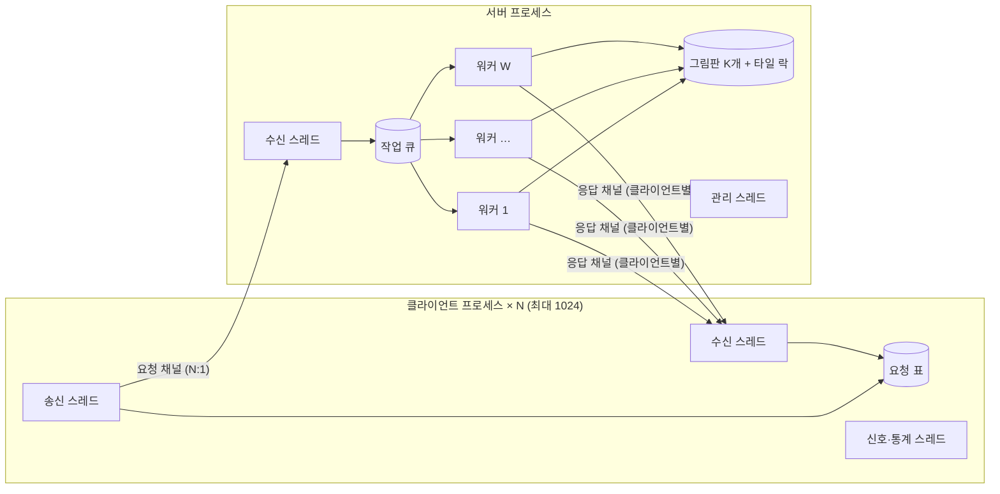

# 설계 명세 — 다중 그림판 공유 캔버스 서버

[문서 안내](../../README.md#관련-문서)

보고서 4장(시스템 설계)의 원본이다. 무엇을 만들지는 [요구사항](../requirements/README.md), 파일 책임과 일정은 [구현 계획](plan.md)에 있다. 이 문서는 구현 전에 쓰고, 구현하면서 바뀐 결정은 [변경 기록](#변경-기록)에 덧붙인다.

## 구조

- 세 버전은 전송 계층(`src/transport/transport_<ipc>.c`)만 다르다. 서버·클라이언트·그림판·검증기는 공통 코드이고 `include/transport.h`의 함수만 부른다(요구사항 C-7).
- 서버는 요청을 받는 스레드 하나와 처리하는 워커 W개를 작업 큐로 나눈다. 수신은 채널 하나를 차례로 읽어야 하고(pipe는 바이트 스트림이라 여럿이 읽으면 메시지가 섞인다), 처리는 그림판마다·타일마다 나눠 동시에 할 수 있기 때문이다.
- 그리기 클라이언트(`draw_<ipc>`)는 자동 그리기 클라이언트와 같은 채널을 쓰고 스레드 구성만 다르다([스레드 설계](#스레드-설계)).

### 버전별로 달라지는 부분 (통신 채널과 공유 영역)

1단계에서 만든 전송 계층의 채널 구조를 그대로 쓰고, 클라이언트 수만 1024개로 늘린다.

| | pipe (FIFO) | message queue (System V) | shared memory (System V + 세마포어) |
| --- | --- | --- | --- |
| 요청 채널 (N:1) | FIFO 하나 `/tmp/osproject_2_req`. 요청이 `PIPE_BUF` 이하라 `write` 한 번이 원자적이어서 잠금이 없다 | 큐 하나(key 60020). 클라이언트마다 mtype = 번호 + 1 | 공유 메모리 링 하나(key 60022, 세마포어 key 60024: MUTEX·빈 칸·메시지 수). 모든 클라이언트가 MUTEX를 다툰다 |
| 응답 채널 (1:N) | 클라이언트마다 FIFO `/tmp/osproject_2_resp_<번호>` | 큐 하나(key 60021)를 mtype = 번호 + 1로 나눠 쓴다. 8,192B(`msgmax`)를 넘는 응답은 조각낸다 | 클라이언트마다 링(공유 메모리 key 60023 한 덩어리를 나눔, 세마포어 key 60025에 링마다 3개) |
| 복사 | 사용자 → 커널 버퍼 → 사용자 (2번) | 사용자 → 조각 버퍼 → 커널 → 조각 버퍼 → 사용자 | 사용자 → 링 → 사용자 (2번, 커널을 거치지 않음) |
| 클라이언트 수가 늘 때 경쟁하는 곳 | 요청 FIFO의 커널 잠금, 사용자별 파이프 버퍼 한도 | 요청 큐와 **응답 큐 하나**(용량 16,384B) | **요청 링의 MUTEX 세마포어** |
| 상대가 죽은 것을 아는 방법 | EOF, EPIPE | 잠금 파일 `/tmp/osproject_2_mq.lock`의 바이트 잠금 | 잠금 파일 `/tmp/osproject_2_shm.lock`의 바이트 잠금 |
| 설계 개선 (11/28, 서버 환경 변수로 켬) | 워커가 응답 FIFO에서 클라이언트를 기다리지 않게 한다. ① 응답 FIFO 키우기(`OSP_PIPE_GROW=1`): 32KB보다 큰 응답을 보낼 때 그 FIFO를 `F_SETPIPE_SZ`로 128KB로 키운다(가장 큰 응답 65,592B가 통째로 들어간다, 클라이언트당 160KB 이하). 사용자별 파이프 버퍼 한도를 새 클라이언트 몫으로 남기려고, 붙은 클라이언트가 한도의 3/4 ÷ 128KB(기본 384개) 이하이고 0.1초 동안 새로 붙지 않았을 때만 키우고, 더 많이 붙으면 다음에 보낼 때 64KB로 되돌린다. ② 송신 스레드(`OSP_PIPE_ASYNC=1`): 워커는 막히지 않게 쓰고 못 쓴 나머지를 클라이언트별 자리에 옮긴 뒤 다음 요청으로 간다. 송신 스레드가 epoll로 자리가 나기를 기다려 나머지를 쓴다. 자리의 한도는 160KB − FIFO 크기(기본 96KB, 키운 FIFO면 32KB)라 FIFO와 합쳐 클라이언트당 160KB를 넘지 않고, 넘칠 때는 처음 설계처럼 워커가 기다린다. 원인 확인용으로 받기 버퍼(`OSP_PIPE_RBUF=1`)와 FIFO 크기 고정(`OSP_PIPE_RESP_SZ`)도 둔다 | ① 응답 큐를 Q개(key 60021~60028, `OSP_MQ_RESP_Q=Q`)로 나누고 클라이언트 번호 % Q로 고른다. ② 요청 큐 입장 제한(`OSP_MQ_ADMIT=1`): 세마포어(key 60029)를 요청 큐의 빈 자리 수로 두고, 보내는 쪽이 먼저 얻은 뒤 `msgsnd`, 서버가 꺼낸 만큼 돌려준다. 서버가 설정을 잠금 파일에 적고 클라이언트가 읽는다 | 요청 링을 클라이언트마다 하나(`OSP_SHM_REQ=per`)로 나눈다. 링마다 쓰는 쪽이 하나라 MUTEX가 없고, 세마포어 0번(초인종)이 "어딘가에 요청이 있다"를 알린다 |

## 프로토콜

`include/proto.h`가 정한다. 모든 메시지는 머리 24B(`msg_hdr_t`: 종류, 클라이언트 번호, 요청 번호, payload 길이, 그림판 번호) + payload다.

| 요청 | payload | 응답 payload | 처리 |
| --- | --- | --- | --- |
| HELLO | 없음 | 서버 시각 32B | 접속 수 + 1. 클라이언트의 첫 요청이다 |
| DRAW | x, y, w, h, v (16B) | 서버 시각 | 사각형의 각 칸에 v를 더한다(mod 256). 그 타일들의 쓰기 락 |
| SNAPSHOT | x, y, w, h (8B) | 서버 시각 + w × h 바이트(최대 65,536) | 영역을 응답 버퍼로 복사한다. 그 타일들의 읽기 락 |
| STATS | 없음 | 서버 시각 + 통계(DRAW·SNAPSHOT·오류 건수, 접속 수, 그림판 수, 워커 수) | 통계 칸을 더해 돌려준다 |
| BYE | 없음 | 서버 시각 | 접속 수 − 1 |
| (오류) | | 종류 `RESP_ERROR`, 서버 시각 + 오류 번호 | 요구사항 F-6의 경우. 그림판을 바꾸지 않는다 |

- 응답 머리의 요청 번호는 요청에서 그대로 복사한다. 클라이언트는 요청 번호의 아래 10비트에 요청 표의 칸 번호를 넣어, 순서가 바뀌어 오는 응답을 찾는다.
- **SNAPSHOT 한 번의 영역은 한 변 256칸(64KB) 이하**다. 응답 크기의 상한이 정해지면 shm 응답 링과 mq 조각 수가 그 크기로 정해져 클라이언트 1024개에서도 메모리가 제한된다([메모리](#메모리)). 더 넓은 영역(그리기 클라이언트의 축소 화면)은 여러 번 나눠 받는다.

## 스레드 설계

보고서 4.2절 표의 원본이다. 모든 프로세스가 스레드 3개 이상이다(요구사항 C-2).

| 프로세스 | 스레드 이름 | 역할 | 주요 함수 | 매개변수와 설명 |
| --- | --- | --- | --- | --- |
| 서버 | main | 옵션 해석, 그림판·작업 큐 만들기, 전송 계층 열기, 다른 스레드 만들고 거두기, 체크섬·PGM 저장, 자원 정리 | `main`, `tp_set_limits`, `tp_server_open`, `tp_server_close` | `-K` 그림판 수, `-w` 워커 수, `-l` 락 방식, `-t` 타일 크기 |
| 서버 | 수신 스레드 (1개) | 요청 채널에서 요청을 하나씩 받아 받은 시각(`t_recv`)을 붙여 작업 큐에 넣는다. 큐가 가득 차면 기다린다 | `recv_main`, `tp_recv_req`, `queue_push` | 작업 하나 = 머리 + payload(16B 이하) + `t_recv` |
| 서버 | 워커 (W개, 기본 4) | 큐에서 꺼내(`t_deq`) 타일 락을 잡고(`t_lock`) 그리기·복사를 한 뒤 락을 풀고 응답을 보낸다(`t_send`) | `worker_main`, `queue_pop`, `room_lock`, `canvas_draw`, `canvas_copy`, `tp_send_resp` | 워커마다 응답 버퍼 65,568B를 미리 잡아 둔다 |
| 서버 | 관리 스레드 (1개) | SIGINT·SIGTERM·SIGUSR1을 `sigwait`로 받는다. 종료 절차를 시작하고, 측정 시작·끝 표시(SIGUSR1)마다 자원 사용량을 기록한다. `-v`이면 1초마다 통계를 출력한다 | `mgr_main`, `sigwait`, `tp_server_wake`, `getrusage` | 두 번째 종료 신호는 강제 종료 |
| 자동 그리기 클라이언트 | main | 옵션 해석, 전송 계층 열기, HELLO, 스레드 만들고 거두기, BYE, 결과 출력과 CSV | `main`, `tp_client_open`, `tp_client_close` | `-i` 번호, `-k` 그림판, `-n`/`-d` 개수·시간, `-f` 동시 요청 수 |
| 자동 그리기 클라이언트 | 송신 스레드 | 요청열 생성기로 다음 요청을 만들고, 빈 칸(세마포어 `-f`개)을 얻어 보낸 시각(`t0`)을 요청 표에 적고 보낸다. `-H`가 있으면 그 속도로 보낸다 | `send_main`, `wl_next`, `sem_wait`, `tp_send_req` | 요청 표 칸 번호를 요청 번호에 넣는다 |
| 자동 그리기 클라이언트 | 수신 스레드 | 응답을 받아(`t5`) 요청 표에서 짝을 찾고 지연 표본과 구간별 시간을 남긴 뒤 칸을 돌려준다(`sem_post`). 응답 종류·길이·서버 시각 순서를 검사한다 | `recv_main`, `tp_recv_resp`, `sem_post` | 표본 배열은 미리 잡아 둔다(측정 구간에 `malloc` 없음) |
| 자동 그리기 클라이언트 | 신호·통계 스레드 | SIGINT·SIGTERM·SIGUSR2를 `sigwait`로 받는다. SIGUSR2를 받으면 측정을 시작시키고, 끝나면 표본으로 통계를 낸다 | `sig_main`, `sigwait`, `lat_stats` | 워밍업이 끝나면 실행기에 준비를 알린다 |
| 그리기 클라이언트 | 입력 스레드 | 터미널의 마우스·키 입력을 읽어 붓 자국을 DRAW로 보낸다 | `input_main`, `tp_send_req` | 원시(raw) 모드, SGR 마우스 보고 |
| 그리기 클라이언트 | 수신 스레드 | 응답을 받아 SNAPSHOT 내용을 화면 버퍼에 쓰고 지연을 기록한다 | `recv_main`, `tp_recv_resp` | 화면 버퍼는 mutex로 보호 |
| 그리기 클라이언트 | 갱신 스레드 | 150ms마다 보이는 영역을 SNAPSHOT으로 요청하고(256칸씩 나눔) 화면을 다시 그린다. 1초마다 STATS | `refresh_main`, `render` | 확대 비율에 맞춰 줄여 그린다 |
| 실행기 | main, 대기 스레드, 감시 스레드 | 클라이언트 N개를 `fork`·`exec`하고, 모두 준비되면 함께 시작시키고(SIGUSR2), 끝나면 표본을 합쳐 한 실행의 결과를 낸다 | `loadgen`, `waitpid` | 준비 알림은 상속한 익명 pipe로 받는다(측정 대상이 아닌 제어 통로) |

## 공유 자원과 동기화

보고서 4.3절의 원본이다.

| 공유 자원 | 접근하는 스레드·프로세스 | 동기화 | 선택 이유 |
| --- | --- | --- | --- |
| 그림판 K개(각 1MB) | 서버 워커 W개 | 타일마다 `pthread_rwlock_t`(쓰기 우선). DRAW는 쓰기 락, SNAPSHOT은 읽기 락. 실행 옵션 `-l`로 `mutex`(타일 mutex), `room`(그림판 전체 mutex 하나), `none`(락 없음, 경쟁 시연 전용)으로 바꾼다 | 읽기(SNAPSHOT)가 건드리는 칸이 전체의 97%라 읽기끼리 막지 않는 rwlock이 맞다. 쓰기 우선으로 둔 것은 DRAW(사용감을 정하는 요청)가 SNAPSHOT에 밀려 굶지 않게 하려는 것이다. 락 단위를 타일로 나눠 다른 곳을 그리는 DRAW끼리 동시에 진행한다 |
| 작업 큐(유한 원형 버퍼, 기본 4,096칸) | 수신 스레드(넣기) 1개, 워커 W개(꺼내기) | mutex 1개 + 조건변수 2개(비지 않음, 가득 차지 않음) | 생산자-소비자 문제의 표준 해법이다. 큐가 가득 차면 수신을 멈춰 요청 채널에 되밀림(backpressure)이 생기게 한다 |
| 통계(처리 건수) | 워커(더하기), STATS 처리·관리 스레드(읽기) | 워커마다 따로 센 값(캐시 줄 정렬)을 읽을 때 더한다. 칸은 `atomic` | 요청마다 공용 카운터 하나를 잠그면 워커끼리 캐시 줄을 다툰다 |
| 접속 수, 종료 상태 | 워커, 관리 스레드, 수신 스레드 | `atomic_int`, `atomic_bool` | 값 하나라 락이 필요 없다 |
| 전송 계층 내부(응답 채널별 송신) | 서버 워커 W개가 같은 클라이언트에게 동시에 보낼 수 있다 | pipe·mq: 클라이언트별 mutex(한 응답의 조각이 섞이지 않게). shm: 응답 링마다 MUTEX 세마포어 | 1단계 전송 계층의 약속 그대로다(`transport.h`) |
| shm 링(프로세스 사이 공유 메모리) | 서버와 모든 클라이언트 | System V 세마포어 3개(MUTEX, 빈 칸 수, 메시지 수). 빈 칸과 MUTEX를 `semop` 한 번에 얻고 `SEM_UNDO` | 프로세스 사이라 pthread mutex를 쓰려면 robust 처리가 필요하다. `SEM_UNDO`는 보내다 죽은 프로세스가 쥔 것을 커널이 돌려준다(1단계 결정) |
| pipe의 FIFO 이름(요청 FIFO, 클라이언트별 응답 FIFO) | 새로 뜨는 서버와 클라이언트 프로세스 | 잠금 파일 `/tmp/osproject_2_req.lock`의 `flock`(시작 잠금)으로 "남은 FIFO인지 판정 → 지우고 다시 만들기 → 읽기 끝 열기"를 한 덩어리로 묶는다 | 판정과 열기 사이에 같은 이름을 쓰는 다른 프로세스가 끼면 서로의 FIFO를 지운다(TOCTOU). 큰 요청의 송신 잠금(`fcntl`)과 같은 파일이지만 `flock`과 `fcntl` 잠금은 서로 독립이다. mq·shm은 잠금 파일의 바이트 잠금으로 서버 자리를 먼저 잡으므로 이 문제가 없다 |
| 클라이언트 요청 표(`-f`칸) | 클라이언트 송신·수신 스레드 | 빈 칸 수 세마포어(`sem_t`) + 칸마다 상태를 `atomic`으로 쓰고 읽음(release/acquire) | 칸 하나를 두 스레드가 번갈아 쓰므로 칸마다 락을 두지 않고 소유권을 원자적 상태로 넘긴다 |
| 클라이언트 측정 상태(시작 신호, 끝남) | 송신·수신·신호 스레드 | mutex + 조건변수 | 시작을 기다리는 송신 스레드를 깨우고, 두 스레드가 모두 끝난 것을 신호 스레드가 기다린다 |
| 그리기 클라이언트 화면 버퍼 | 수신 스레드(쓰기), 갱신 스레드(읽기·그리기) | mutex | 화면 한 장을 그리는 동안 내용이 반쯤 바뀌지 않게 |

### 경쟁 상태와 교착이 생길 수 있는 곳과 막는 방법

| 지점 | 일어날 수 있는 일 | 막는 방법 |
| --- | --- | --- |
| 같은 칸에 두 워커가 동시에 DRAW | 읽고-더하고-쓰는 사이에 끼어들어 한쪽 더하기가 사라진다(lost update) | 타일 쓰기 락. `-l none`으로 일부러 빼면 체크섬이 검증기와 어긋나는 것을 시험으로 보인다 |
| DRAW 도중 SNAPSHOT | 반쯤 그려진 사각형을 보낸다 | SNAPSHOT이 영역의 타일 읽기 락을 모두 잡은 뒤 복사한다 |
| 여러 타일 락 | 두 워커가 서로 상대가 쥔 타일을 기다린다(교착) | 한 요청이 잡는 타일은 한 그림판 안에서 번호(행 우선) 오름차순으로만 잡는다. 순서가 하나라 기다림의 고리가 생기지 않는다 |
| 작업 큐 | 넣기·꺼내기가 겹쳐 칸을 덮어쓴다 / 깨우기를 놓친다 | mutex 안에서만 머리·꼬리를 바꾸고, 조건을 `while`로 다시 확인한 뒤 기다린다 |
| 종료 | 워커가 잠긴 채 끝나지 않거나, 닫힌 채널에 보낸다 | 관리 스레드가 `tp_server_wake`로 수신을 깨우고 큐를 닫는다(`closed` 표시 후 broadcast). 워커는 큐가 비고 닫혔을 때만 끝난다. 모두 거둔 뒤에 `tp_server_close`를 부른다 |
| 같은 클라이언트에게 두 워커가 응답 | 큰 응답의 조각이 섞인다 | 전송 계층의 클라이언트별 송신 락(위 표) |
| pipe 서버 둘, 또는 같은 번호 클라이언트 둘이 같은 순간에 시작 | 한쪽이 다른 쪽이 막 만든 FIFO를 "읽는 쪽 없음 = 남은 파일"로 보고 지운다. 서버 둘이 요청 FIFO 하나를 나눠 읽거나, 클라이언트 둘이 응답 FIFO 하나를 나눠 읽어 응답이 엇갈린다 | 시작 잠금(위 표). CPU 부하를 건 재현 실험에서 수정 전에 일어났고 수정 뒤 0건이다([검증의 시작 구간 경쟁](../verification/README.md#시작-구간-경쟁)) |

## 실행 옵션

### 서버 `server_<ipc>`

| 옵션 | 뜻 (기본값) |
| --- | --- |
| `-K N` | 그림판 수 1~64 (8) |
| `-w N` | 워커 수 1~64 (4) |
| `-l S` | 락 방식 `rw`, `mutex`, `room`, `none` (`rw`) |
| `-t N` | 타일 한 변 16~1024, 2의 거듭제곱 (64) |
| `-q N` | 작업 큐 칸 수 (4096) |
| `-N N` | 받을 클라이언트 수 1~1024 (1024). shm 응답 링 수가 이 값이다 |
| `-p F` | 끝날 때 그림판 0을 저장할 PGM 경로 (`canvas_<ipc>.pgm`, `-` 이면 저장 안 함) |
| `-O F`, `-e S`, `-R N` | 끝날 때 CSV F에 서버 줄 하나(측정 구간의 자원 사용량), 실험 이름, 반복 번호 |
| `-v` | 1초마다 통계를 stderr에 쓴다(측정 때는 쓰지 않는다) |

### 자동 그리기 클라이언트 `client_<ipc>`

| 옵션 | 뜻 (기본값) |
| --- | --- |
| `-i N`, `-k N`, `-s N` | 클라이언트 번호 0~1023 (0), 그림판 번호 (번호 mod 8), 시드 (번호 + 1) |
| `-n N` 또는 `-d S` | 잴 요청 수 (10000) 또는 잴 시간(초). `-d`이면 그 시간 동안 보낸다 |
| `-w N` | 워밍업 요청 수 (200). DRAW의 v를 0으로 보내 그림판을 바꾸지 않는다 |
| `-m N`, `-r N`, `-S N` | DRAW 비율 % (90), DRAW 한 변 (16), SNAPSHOT 한 변 (256) |
| `-f N` | 동시에 띄워 둘 요청 수 1~1024 (1). 1이면 지연, 크면 처리량 |
| `-H N` | 초당 요청 수. 0이면 쉬지 않고 보낸다 (0). 보내는 시각의 위상은 번호로 주기 안에 흩는다(번호 × 황금비의 소수 부분) |
| `-A` | `-H`의 위상을 흩지 않고 모두 0으로 한다(처음 목표 부하 실험 `target`·`imp-target`과 같게) |
| `-G` | 워밍업이 끝나면 준비를 알리고 SIGUSR2를 받을 때까지 측정을 미룬다(실행기가 쓴다) |
| `-o F`, `-e S`, `-R N` | CSV 경로, 실험 이름, 반복 번호 |

### 실행기 `loadgen`, 검증기 `verify`, 그리기 클라이언트 `draw_<ipc>`

옵션과 예시는 [README의 사용 방법](../../README.md#사용-방법)에 둔다(구현하면서 확정한다).

## 메모리

요구사항 N-5의 설계다. 클라이언트 수에 비례하는 것은 IPC 버퍼뿐이므로 이것을 응답 크기 상한에 맞춰 잡는다.

| 항목 | 크기 | 클라이언트 1024개 |
| --- | --- | --- |
| 그림판 | 1MB × K | K = 8이면 8MB |
| shm 응답 링 | 4KB 칸 34개 = 응답 최대 크기(65,592B, 17칸) 2개 + 링 머리 64B = 139,328B | 142.7MB(공유 메모리, 쓴 쪽만 실제로 잡힌다) |
| shm 요청 링 | 64B 칸 × max(1024, 4) = 64KB | 64KB |
| shm 요청 링 (개선 모드 `per`) | 클라이언트마다 64B 칸 16개 + 링 머리 64B = 1,088B | 1.06MB (응답 링과 합쳐 클라이언트당 140,416B, N-5의 160KB 이하) |
| mq 응답 큐 (개선 모드 Q개) | 큐 하나 최대 16,384B × Q | Q = 8이면 128KB (입장 제한 세마포어는 값 하나) |
| pipe | 커널의 FIFO 버퍼(기본 64KB × FIFO 수). 프로세스 VmRSS에는 잡히지 않는다. 개선 모드: 키운 FIFO 128KB, 송신 스레드의 나머지 자리는 160KB − FIFO 크기(가상 메모리로 잡고 쓴 쪽만 RSS) | 최대 64MB(사용자별 한도에 걸리면 FIFO 하나 8KB. 처음 설계에서 실제로 약 150개). 개선 모드도 1024개면 FIFO를 키우지 않는다 |
| mq | 커널의 큐(큐 하나 최대 16,384B) | 요청·응답 큐 2개 = 32KB |
| 서버 작업 큐 | 칸 하나 약 64B × 4,096 | 256KB |
| 클라이언트 지연 표본 | 요청 하나 4B(10ns 단위). 미리 잡되 쓴 만큼만 실제로 잡힌다 | |

- 1단계 shm은 1MB 메시지(1단계 echo)를 담기 위해 응답 링이 클라이언트당 약 2MB였다. 그대로 1024개면 2GB라, 응답 크기 상한(SNAPSHOT 64KB)을 두고 링을 그 크기에 맞춘다(**메모리 절감 방안 1**). 서버가 `tp_set_limits`로 받을 클라이언트 수와 최대 요청·응답 크기를 알려 주고, 1단계 벤치마크는 부르지 않아 1단계 크기 그대로다.
- 링에 응답 2개를 두는 것은 워커가 다음 응답을 쓰는 동안 클라이언트가 앞 응답을 읽게 하려는 것이다. 1개로 줄이면 메모리가 절반이 되고 동시 요청 1에서는 손해가 없을 것이다. 이 맞바꿈은 측정으로 정한다([구현 계획의 미결정](plan.md#리스크와-미결정)).

## 종료

- 서버: 첫 SIGINT·SIGTERM → 관리 스레드가 `tp_server_wake`로 수신 스레드를 깨워 끝내고 큐를 닫는다 → 워커는 큐에 남은 요청을 다 처리하고 끝난다 → main이 모두 거둔 뒤 체크섬 출력, PGM 저장, `tp_server_close`(자원 삭제). 응답을 받지 않는 클라이언트 때문에 워커가 돌아오지 않을 때 두 번째 신호를 받으면 자원만 지우고 종료 코드 1로 끝낸다.
- 클라이언트: SIGINT·SIGTERM → 새 요청을 멈추고 띄워 둔 응답을 받은 뒤 BYE, `tp_client_close`. 두 번째 신호는 기다리지 않고 닫는다. 어느 경로든 `tp_client_close`를 부른다(전송 계층의 약속).
- 정상 종료 뒤 `ipcs`와 `/tmp/osproject_2_*`에 남는 것이 없어야 한다(요구사항 N-4). `kill -9`로 남은 자원은 다음 서버가 열 때 지우거나 `make ipcclean`이 지운다.

## 변경 기록

구현하면서 바뀐 결정을 날짜와 함께 덧붙인다.

| 날짜 | 바뀐 것 | 이유 |
| --- | --- | --- |
| 11/28 | 서버는 첫 종료 신호에 수신 스레드만 깨우고, 작업 큐는 main 이 수신 스레드를 거둔 뒤에 닫는다 | 처음 구현은 관리 스레드가 큐를 바로 닫아, 이미 받아 큐에 넣으려던 요청이 응답 없이 버려질 수 있었다(요구사항 F-8 "받은 요청은 끝까지 처리") |
| 11/28 | 전송 계층에 `tp_set_limits`, `tp_server_info` 추가. shm 요청 링은 64B 칸, 응답 링 수는 서버의 `-N`. pipe 서버는 열린 파일 soft 한도를 올린다. mq 의 요청 조각 붙이는 자리는 요청 크기에 맞춘다 | 클라이언트 1024개에서 1단계 크기 그대로면 shm 응답 영역 2GB, mq 붙이는 자리 1GB(가상), pipe 는 터미널 기본 한도(1024)에서 EMFILE 이 난다([메모리](#메모리)) |
| 11/28 | 1단계 벤치마크도 `tp_set_limits`(클라이언트 수만)를 부른다 | `MAX_CLIENTS`가 1024가 되어도 shm 응답 링은 부르지 않으면 16개라, 벤치마크 `-c` 17 이상이 shm 에서만 실패했다. 링 크기와 송수신은 1단계와 같다 |
| 11/28 | 실행기는 클라이언트들을 따로 만든 프로세스 그룹에 넣고 `killpg`로 SIGUSR2 를 한 번에 보낸다 | 클라이언트마다 `kill`을 1024번 부르면 시작 시각이 수 ms 벌어진다. 서버와 같은 그룹이면 서버도 SIGUSR2 를 받으므로 그룹을 나눈다 |
| 11/28 | 그리기 클라이언트는 한 획 안에서 붓 칸(붓 크기 격자)마다 한 번만 DRAW 를 보낸다 | DRAW 는 값을 더하므로 붓 자국이 겹치면 겹친 곳의 색이 바뀐다 |
| 11/28 | 그리기 클라이언트에 명령 줄 모드(`snap`이 합·0 아닌 칸 수·FNV를 출력) | SNAPSHOT 내용, 잘못된 요청, 그림판 분리를 자동 시험(T-12~T-19)으로 확인하려고 |
| 11/28 | pipe 전송 계층의 시작 구간(FIFO 판정·생성·열기)을 잠금 파일의 `flock`으로 묶는다 | CI의 T-22 실패를 조사하다 찾은 경쟁이다. CPU 부하를 건 재현 실험에서 서버 둘이 함께 뜨거나 같은 번호 클라이언트 둘이 응답 FIFO 하나를 나눠 읽었다([검증](../verification/README.md#시작-구간-경쟁)) |
| 11/28 | 설계 개선 두 가지를 서버 환경 변수로 넣는다: mq 응답 큐 Q개(`OSP_MQ_RESP_Q`), shm 클라이언트별 요청 링(`OSP_SHM_REQ=per`). 기본값은 처음 설계 | 시험 삼아 돌린 측정에서 클라이언트 1024개일 때 mq·shm만 처리량이 크게 떨어졌다. 둘 다 처음 설계에서 "클라이언트 수가 늘 때 경쟁하는 곳"으로 적은 곳이다(위 표). 같은 실행 파일로 전후를 재려고 끄고 켤 수 있게 했다. 근거와 전후 비교는 [2단계 측정 결과](../measurement/stage2.md) |
| 11/28 | mq 에 요청 큐 입장 제한(`OSP_MQ_ADMIT=1`)을 더한다. 세마포어 하나를 요청 큐의 빈 자리 수(64B 단위)로 두는 유한 버퍼의 빈 칸 세마포어다 | 응답 큐를 나누자 요청 큐가 다음 병목이 됐다. 띄운 요청이 요청 큐 용량(16,384B, 48B 요청 341개)보다 많으면 `msgsnd`에서 막힌 클라이언트를 커널이 메시지 하나가 빠질 때마다 한꺼번에 깨워(thundering herd) 처리량이 갑자기 무너졌다. 같은 조건에서 어떤 실행은 무너지고 어떤 실행은 멀쩡했다. 요청 큐 용량만 줄이는 실험으로 원인을 확인했다([2단계 측정 결과](../measurement/stage2.md)). 세마포어 하나짜리 `semop`은 값이 0이 되면 깨우기를 멈추므로 기다리는 쪽을 하나씩 깨운다 |
| 11/28 | shm 개선 모드의 요청 링은 `SEM_UNDO`를 쓰지 않고, 같은 번호의 새 클라이언트가 열 때 서버가 그 링을 다 꺼낼 때까지 기다린 뒤 빈 칸 수를 되돌린다 | 링마다 쓰는 쪽이 하나라 그 클라이언트가 죽어도 다른 링은 어긋나지 않는다. 서버는 빈 칸을 돌려준 뒤에 tail을 올려, tail = head이면 서버가 그 링에 할 일이 없음을 보장한다 |
| 11/28 | pipe 설계 개선: 응답 FIFO 키우기(`OSP_PIPE_GROW=1`)와 송신 스레드(`OSP_PIPE_ASYNC=1`). 원인 확인용으로 받기 버퍼(`OSP_PIPE_RBUF=1`)와 FIFO 크기 고정(`OSP_PIPE_RESP_SZ`). 기본값은 처음 설계 | pipe는 처음 설계로 목표 부하를 통과해 개선 대상에서 뺐으나, 다시 보니 64KB SNAPSHOT에서 가장 느렸다. 요청 받기 방식과 FIFO 용량을 하나씩 바꾼 실험(`cause-pipe`)으로, 응답 FIFO 기본 용량(65,536B)이 가장 큰 응답(65,592B)보다 56B 작아 워커가 FIFO에서 클라이언트를 기다리는 것이 원인임을 가렸다. 처음 만든 개선(`OSP_PIPE_RESP=1`)은 서버 `-N`에 맞춰 FIFO를 512KB~1MB로 키워 다른 IPC와 조건(서버 설정, 클라이언트당 160KB)이 달랐으므로 버렸다. 사용자별 한도(64MB)는 클라이언트 1024개면 처음 설계도 다 써서 FIFO 키우기만으로는 1024개를 돕지 못하므로, 워커가 기다리지 않게 하는 송신 스레드를 함께 둔다 |
| 11/28 | 자동 그리기 클라이언트의 페이스 모드(`-H`)는 보내는 시각의 위상을 클라이언트 번호로 주기 안에 흩는다. 처음처럼 맞추려면 `-A` | 모든 클라이언트가 같은 순간에 시작 신호를 받아 위상이 같으면, 요청이 주기(15ms)마다 약 5ms 안에 몰린다. 목표 부하의 클라이언트별 기록을 보니 이 퍼짐이 IPC마다 달라(pipe 5.2ms, mq 개선 4.1ms, shm 개선 18.8ms) 목표 부하 실험이 IPC 차이가 아니라 도착 모양의 차이를 쟀다. 사람 1024명은 서로 다른 순간에 그리므로 위상을 흩은 쪽이 워크로드 명세에 맞는다 |
