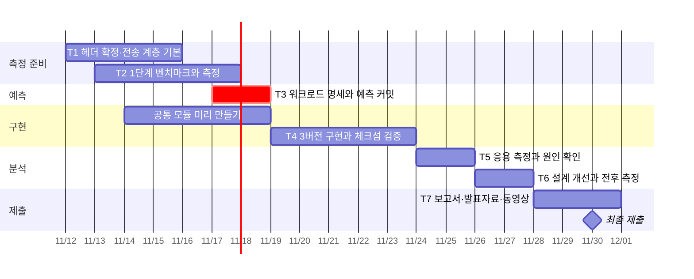

# 구현 계획 — 공유 캔버스 서버

[문서 안내](../../README.md#관련-문서)

[요구사항](../requirements/README.md)을 구현하는 구조와 순서를 정한다. 세부 설계는 [설계 명세](README.md), 측정은 [측정 방법](../measurement/README.md)에 둔다. 완료 여부를 기록하는 별도 현황 문서는 쓰지 않는다. 진행 상황은 GitHub의 [이슈](https://github.com/unix-ipc-canvas/canvas/issues)와 [마일스톤](https://github.com/unix-ipc-canvas/canvas/milestones)으로 본다.

## 구현 방향

서버·클라이언트·벤치마크는 `transport.h`의 함수만 부르고, 어떤 IPC인지는 링크할 때 정해진다. 그래서 세 버전의 차이는 전송 계층 파일 하나뿐이고, 1단계 벤치마크와 2단계 응용이 같은 전송 코드를 쓴다.

```text
canvas/
├── include/          proto.h, transport.h          (합의 후 고정)
├── src/transport/    transport_{pipe,mq,shm}.c     (IPC 담당이 1개씩)
├── src/common/       canvas, server, client, verify, util
├── src/bench/        bench.c                       (1단계 echo 벤치마크)
├── scripts/          측정 자동화, 그래프, verify.sh
└── results/          측정 원자료 CSV
```

| 파일 | 책임·계약 | 담당 |
| --- | --- | --- |
| `include/proto.h` | 메시지 형식, 캔버스·타일 상수 | 공통 |
| `include/transport.h` | 전송 계층 인터페이스. 메시지 하나를 통째로 주고받는다 | 공통 |
| `src/transport/transport_pipe.c` | FIFO 구현 | pipe 담당 |
| `src/transport/transport_mq.c` | System V message queue 구현. 큰 메시지 분할·재조립 | mq 담당 |
| `src/transport/transport_shm.c` | System V shared memory + semaphore 구현 | shm 담당 |
| `src/common/canvas.c` | 캔버스, 타일 락, PGM 저장, 체크섬 | 서버 담당 |
| `src/common/server.c` | 수신·워커·관리 스레드, 작업 큐, 종료 처리 | 서버 담당 |
| `src/common/client.c` | 송신·수신·통계 스레드, 워크로드 생성기, CSV 출력 | 클라이언트 담당 |
| `src/common/verify.c` | 정답 체크섬 계산 | 클라이언트 담당 |
| `src/common/util.c` | 시각, 통계, `getrusage`, VmRSS | 측정 담당 |
| `src/bench/bench.c` | 1단계 echo 벤치마크 | 측정 담당 |
| `scripts/` | 실험 실행, 그래프, `verify.sh` | 측정 담당 |

- `server.c`, `client.c`, `bench.c`에는 IPC 고유 코드(`msgsnd`, `shmat`, `mkfifo` 등)를 넣지 않는다.
- `include/`의 두 헤더는 초안이다. 11월 15일까지 확정하고, 그 뒤에는 세 사람이 합의한 PR로만 바꾼다.
- 설계 선택은 모두 실행 옵션으로 만든다([실행 옵션](README.md#실행-옵션)).
- 처음 구현은 전역 락 1개다. 타일별 락과 그 밖의 개선은 원인 분석 뒤 [설계 개선](#단계별-계획) 단계에서 넣어 전후를 잰다.
- 명세에 없는 결정은 가장 단순한 쪽으로 하고 코드에 `/* DECISION: ... */`로 남긴 뒤 PR에서 알린다.

## 담당

IPC는 한 사람이 하나씩 맡고, 공통 부분은 셋으로 나눈다. 1단계 측정과 2단계 분석은 담당과 관계없이 셋이 함께 한다. 이름은 팀 회의 뒤 채운다.

| 팀원 | IPC | 공통 부분 | 보고서 |
| --- | --- | --- | --- |
| | pipe | 서버 담당 | 4장, 5장 |
| | message queue | 클라이언트 담당 | 2장, 3장 |
| | shared memory | 측정 담당 | 6장 |

## 단계별 계획

> [!IMPORTANT]
> 예측(T3)을 커밋하기 전에는 T4의 `server.c`, `client.c`를 시작하지 않는다. `make test`의 T-00이 이를 검사한다.



| 단계 | 산출물 | 기한 |
| --- | --- | --- |
| T1 | 측정용 컴퓨터 확정, 두 헤더 확정, `transport_*.c`의 기본 송수신 | 11/15 |
| T2 | `bench.c`, 1단계 측정 스크립트, 크기별·클라이언트 수별 원자료와 그래프 | 11/17 |
| T3 | [성능 예측](../records/prediction.md)의 워크로드 명세와 예측 커밋 | 11/18 |
| T4 | `canvas.c`, `server.c`, `client.c`, `verify.c`, `scripts/verify.sh`. 세 버전 체크섬 일치 | 11/23 |
| T5 | 응용 측정, 예측 대비 비교, 원인 확인 실험 | 11/25 |
| T6 | 설계 개선 1회 이상과 전후 측정, IPC 선택 가이드라인 | 11/27 |
| T7 | 최종보고서, 발표자료, 동영상, `make dist` | 11/30 |

11월 12일에 일정을 다시 잡았다. 제출일(11/30)은 그대로 두고 앞 단계를 2~4일씩 미뤘다. 그만큼 뒤가 줄었다.

- 구현(T4)은 예측 커밋 다음 날부터 5일이다. 줄어든 시간은 예측과 무관한 `canvas.c`, `util.c`, `verify.c`를 T1~T3 기간에 미리 만들어 메운다. `server.c`와 `client.c`만 예측 뒤에 시작한다.
- 분석(T5)과 개선(T6)은 2일씩, 보고서와 발표(T7)는 3일이다. 더 밀리면 T3 기한(11/18)은 지키고 T4의 범위를 줄인다.

## 검증 전략

[테스트 명세](../verification/README.md)에서 관리한다.

## 리스크 및 미결정

| 항목 | 상태 | 재개 조건 |
| --- | --- | --- |
| 뷰어 방송을 넣을지 | 미결정 | 11/15까지 팀 회의에서 정한다. 넣으면 요구사항에 추가한 뒤 예측을 쓴다. 11/21까지 기본 기능이 세 버전에서 돌지 않으면 뺀다 |
| FIFO를 pipe 버전으로 인정하는지 | 미확인 | 교수님 답변. 인정하지 않으면 서버가 `fork`한 클라이언트와 익명 pipe로 잇는 구조를 다시 설계한다 |
| 측정용 컴퓨터 | 미결정 | 팀 회의. 네이티브 Linux가 가상머신·WSL2보다 측정 잡음이 적다 |
| 담당자 | 미결정 | 팀 회의 |
| System V 메시지 한도(`msgmax`, `msgmnb`)를 올려서 잴지 | 미결정 | 1단계에서 기본값과 상향값을 모두 재 보고 정한다. 이유를 보고서에 쓴다 |
| mq 응답 큐를 클라이언트별로 둘지, 하나를 `mtype`으로 나눌지 | 미결정 | mq 담당이 1단계에서 재 보고 정한다 |
| shm 버전의 알림 방식(세마포어, 프로세스 공유 mutex + 조건변수) | 미결정 | shm 담당이 1단계에서 정한다 |

| 실패 | 점검 |
| --- | --- |
| 세 버전의 결과가 비슷하게 나온다 | 서버 연산이 IPC 비용을 덮는지 본다. DRAW 사각형을 줄이고 구간별 시간을 확인한다 |
| 체크섬이 가끔 어긋난다 | 락 범위, 여러 타일의 잠금 순서, 응답 송신 락을 본다 |
| 종료 뒤 자원이 남는다 | 신호 처리 스레드, 종료 순서, 비정상 종료 경로를 본다. 급하면 `make ipcclean` |
| 측정값이 흔들린다 | CPU 주파수 설정, 다른 프로그램, 워밍업, 반복 횟수를 본다 |
