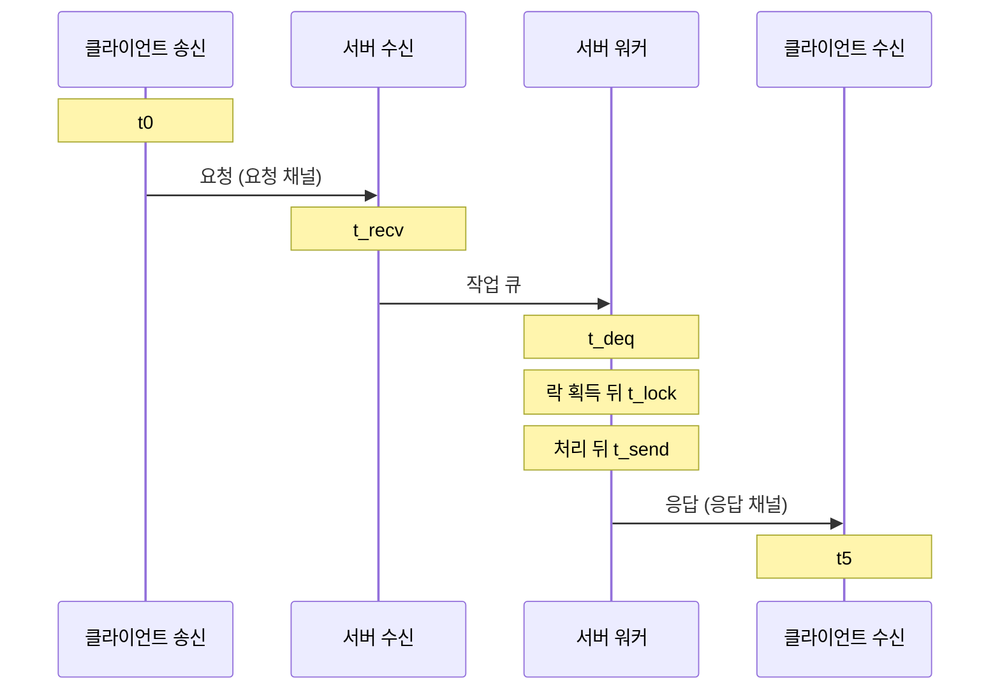

# 측정 방법 — 공유 캔버스 서버

[문서 안내](../../README.md#관련-문서)

1단계 벤치마크와 2단계 응용을 같은 방법으로 잰다. 과제가 요구하는 조건의 원본은 [측정 방법 필수 요건](../assignment/README.md#측정-방법-필수-요건)이고, 이 문서는 우리가 그것을 어떻게 지키는지 정한다. 보고서 2.2절과 6.2절은 이 문서에서 옮긴다.

> [!NOTE]
> 1단계 벤치마크의 측정 방법과 원자료 형식은 확정했다. 2단계 클라이언트의 측정 구간과 CSV 칸은 [2단계 실험](#2단계-실험)에 적었다.

## 원칙

- 모든 수치는 측정용 컴퓨터 1대에서 스크립트로 잰 값이다. 손으로 옮겨 적거나 다른 컴퓨터의 값을 섞지 않는다.
- 한 번에 요인 하나만 바꾼다. 바꾼 옵션과 고정한 옵션을 원자료에 함께 남긴다.
- 측정에 쓴 커밋을 기록한다. 코드를 고친 뒤의 값과 섞이지 않게 한다.

## 측정용 컴퓨터

이동건의 PC 1대에서 모든 수치를 잰다. 네이티브 Linux라 가상머신·WSL2보다 측정 잡음이 적다.

| 항목 | 값 |
| --- | --- |
| CPU | Intel Core 5 120U, 논리 CPU 12개 (P코어 2개 × 하이퍼스레딩 = CPU 0~3, 최대 5.0GHz / E코어 8개 = CPU 4~11, 최대 3.8GHz) |
| 메모리 | 14GiB |
| OS, 커널 | Ubuntu 26.04.1 LTS, 7.0.0-43-generic, 가상화 없음 |
| gcc | 15.2.0 |
| CPU 주파수 설정 | `powersave` (intel_pstate 기본값). 바꾸지 않는다 |

- P코어와 E코어가 섞인 CPU다. 스레드가 어느 코어에 놓이는지에 따라 값이 흔들릴 수 있다. `taskset` 으로 고정하지 않고 운영체제 배치 그대로 재며, 실행 사이의 편차로 그 영향을 본다.
- 측정하는 동안 다른 무거운 작업(시뮬레이션, 브라우저 등)은 멈춘다. Claude 데스크톱 앱처럼 끌 수 없는 프로그램은 측정 환경 기록에 남긴다.

## 측정 환경 기록

측정용 컴퓨터에서 아래를 실행해 보고서 2.1절 표에 옮긴다. `scripts/bench.sh` 가 측정을 시작할 때 같은 내용과 IPC 한도를 `results/bench_env.txt` 에 남기고, 측정 시작과 끝에 CPU를 쓰는 프로세스(`top`)도 함께 남긴다. 끌 수 없는 프로그램은 거기서 확인한다. 출력은 영어 기준이라 `LC_ALL=C`를 붙인다(한국어 설정에서는 `lscpu`의 항목 이름이 한국어로 나와 아래 `grep`이 빈 결과를 낸다).

```bash
LC_ALL=C lscpu | grep -E 'Model name|^CPU\(s\)|Thread|Core'
LC_ALL=C free -h | head -2
. /etc/os-release && echo "$PRETTY_NAME"; uname -r
gcc --version | head -1
systemd-detect-virt        # none 이면 네이티브
```

## 타임스탬프 위치

시각은 모두 `clock_gettime(CLOCK_MONOTONIC, ...)`으로 잰다. 같은 컴퓨터의 프로세스는 같은 시계를 쓰므로 클라이언트와 서버의 시각을 직접 뺄 수 있다.



| 시각 | 찍는 곳 | 이유 |
| --- | --- | --- |
| `t0` | 클라이언트, `tp_send_req` 호출 직전 | 요청 생성 비용을 빼고 전송부터 잰다 |
| `t_recv` | 서버 수신 스레드, `tp_recv_req`가 돌아온 직후 | 요청 전송 구간의 끝 |
| `t_deq` | 워커, 작업 큐에서 꺼낸 직후 | 큐 대기와 스레드 깨우기 비용을 분리한다 |
| `t_lock` | 워커, 필요한 락을 모두 잡은 직후 | 락 대기를 분리한다 |
| `t_send` | 워커, `tp_send_resp` 호출 직전 | 처리 구간의 끝이자 응답 전송의 시작 |
| `t5` | 클라이언트 수신 스레드, `tp_recv_resp`가 돌아온 직후 | 응답을 통째로 받은 시점 |

| 구간 | 계산 |
| --- | --- |
| 요청 전송 | `t_recv - t0` |
| 큐 대기 | `t_deq - t_recv` |
| 락 대기 | `t_lock - t_deq` |
| 처리 | `t_send - t_lock` |
| 응답 전송 | `t5 - t_send` |
| 왕복 지연 | `t5 - t0` |

1단계 벤치마크는 서버 쪽 구간이 없으므로 `t0`과 `t5`만 쓴다. 작은 메시지에서는 시계를 읽는 비용이 결과에 섞인다. `clock_gettime`을 연달아 불러 그 비용을 따로 재고 보고서에 함께 쓴다.

## 반복과 통계

- 조건마다 워밍업 요청을 먼저 보내고 버린 뒤 잰다.
- 지연은 요청 하나를 표본 하나로 본다. 상위 99%가 의미를 가지려면 표본이 수천 개는 있어야 한다.
- 보고하는 값은 평균, 중앙값, 상위 99%, 최대다. 백분위수는 nearest-rank 방식이다(작은 쪽부터 ceil(q × n)번째 값, `util.c`의 `lat_stats`).
- 과제의 "30회 이상"은 표본 수로 보면 충분히 넘는다. 같은 조건을 20번 실행하고, 실행마다 낸 값(평균, 중앙값, 상위 99%, 최대, 처리량)의 중앙값을 그래프와 표에 쓴다. 실행 사이의 편차((최대 - 최소) / 중앙값)를 요약표에 함께 낸다.
- IPC 사이의 순위는 실행별 값에서 좋은 쪽과 나쁜 쪽을 4분의 1씩 뺀 범위(20번이면 가운데 10번)가 겹치지 않을 때만 매긴다. 겹치면 차이가 실행 사이의 흔들림보다 작은 것이므로 `≈`로 묶는다(`scripts/plot-bench.py`). 실행 하나가 튀어도 순위가 뒤집히지 않고, 흔들림보다 작은 차이로 순위를 매기지도 않게 하려는 것이다.

## 1단계 벤치마크

`src/bench/bench.c` 하나가 각 IPC에 링크되어 `bin/bench_<ipc>` 가 된다. 한 번 실행하면 조건 하나를 재고 CSV에 두 줄(client, server)을 붙인다. 실행 옵션은 [README의 사용 방법](../../README.md#사용-방법)에 있다.

| 항목 | 정한 것 | 이유 |
| --- | --- | --- |
| 구조 | 조정 프로세스가 서버 1개와 클라이언트 N개를 `fork` 한다. 서버는 받은 메시지를 같은 크기로 돌려준다(echo) | 실행 한 번이 조건 하나가 되어 스크립트로 반복하기 쉽다 |
| 서버 처리 | 받은 스레드에서 바로 돌려준다. 작업 큐·워커를 거치지 않는다 | 스레드 깨우기 비용이 섞이면 IPC 자체의 차이가 가려진다. 큐 비용은 2단계 구간별 시간으로 잰다 |
| 스레드 | 서버 echo·admin·stats + main, 클라이언트 send·recv·stats + main | 과제 조건(프로세스마다 3개 이상)을 벤치에도 지킨다 |
| HELLO | 측정 메시지와 같은 크기로 보낸다 | pipe 버전은 `PIPE_BUF` 이하 요청을 잠금 없이 쓰므로 크기가 섞이면 요청 스트림이 섞인다 |
| 측정 시작 | 모든 클라이언트가 워밍업 응답을 다 받은 뒤 조정 프로세스가 실시간 신호로 한꺼번에 시작시킨다 | 클라이언트 수별 측정에서 모두가 같은 시간대에 경쟁하게 한다 |
| IPC | pipe(FIFO), upipe(익명 pipe), mq, shm | 강의 5장의 pipe 두 가지를 모두 잰다. upipe는 채널 구조가 FIFO 버전과 같고 이름이 있는지만 다르다. 세 IPC의 순위 비교는 pipe, mq, shm으로 한다 |
| 메시지 크기 | 64B, 1KB, 4KB, 16KB, 64KB, 256KB, 1MB (payload) | 과제 최소 5단계에 `PIPE_BUF`(4KB)와 `msgmax`(8KB) 앞뒤를 더했다 |
| 클라이언트 수 | 1, 2, 4, 8 | 과제 조건 |
| 표본 수 (클라이언트 합) | 16KB 이하 20,000, 64KB 10,000, 256KB 4,000, 1MB 1,000 | 큰 메시지는 실행 시간을 줄이고, 작은 메시지는 상위 99%가 뜻을 갖게 |
| 워밍업 (클라이언트마다) | 16KB 이하 500, 64KB 200, 256KB 100, 1MB 30 | |
| 동시 요청 | 지연 실행 1, 처리량 실행 16 | 처리량은 요청을 쌓아 두고 보내야 IPC 한계가 드러난다 |
| 반복 | 같은 조건 20번. 반복마다 IPC 순서를 돌린다 | 처음 5번으로 잰 결과에서 16KB 이하의 실행 사이 편차가 9~85%로 IPC 사이의 차이보다 컸다. 반복을 늘려 중앙값과 순위를 믿을 만하게 한다. 시간에 따른 변화(발열, 다른 작업)가 한 IPC에만 몰리지 않게 순서를 돌린다 |
| 결과 모으기 | 지연은 모든 클라이언트의 표본을 합쳐 통계를 낸다. 처리량은 (잰 메시지 수) / (가장 먼저 시작한 시각부터 가장 늦게 끝난 시각까지) | 클라이언트마다의 백분위수를 평균하면 전체 분포의 백분위수가 아니다 |
| 자원 사용량 | client 줄은 모든 클라이언트의 합(VmRSS·VmHWM은 가장 큰 값), server 줄은 서버 하나. 둘 다 측정 구간만 | |
| clock_gettime 비용 | 100만 번 연달아 불러 한 번의 비용을 잰다 (`bench -K`, `results/bench_clock.csv`) | 작은 메시지의 지연에 섞이는 측정 비용을 보고서에 함께 쓴다 |

`scripts/bench.sh` 가 위 조합을 모두 돌린다. 커밋하지 않은 코드 변경이 있으면 멈춘다. 그래프와 요약표는 `scripts/plot-bench.py` 가 `docs/assets/bench/` 에 만든다. 측정 기록과 해석은 [1단계 측정 결과](stage1.md)에 있다.

## 2단계 실험

기준 조건은 [성능 예측](../records/prediction.md)의 워크로드 명세를 따른다. 기준에서 요인 하나만 바꿔 가며 잰다. `scripts/app-bench.sh`가 아래 실험을 모두 돌린다. 반복은 1단계와 같은 20번이고(`REPS=20`), 반복마다 IPC 순서를 돌려 시간에 따라 바뀌는 조건이 한 IPC에만 몰리지 않게 한다. 실행마다 서버와 클라이언트를 새로 띄운다.

- 기준 조건: DRAW 90%, `-r 16`, `-S 256`, 클라이언트 4, 워커 4, `-l global`, `-t 64`, 클라이언트마다 측정 요청 20,000개(워밍업 500). 처리량은 `-f 16`, 지연은 `-f 1`.
- SNAPSHOT만 보내는 실행은 응답이 커서 요청 수를 줄인다: `-S` 256은 10,000개, 512는 4,000개, 1024는 2,000개(워밍업 200, 100, 30).
- 표에 없는 요인은 기준값이다. 처리량은 `-f 16`, 요청 종류별 비용만 지연(`-f 1`)도 잰다.
- 측정 기록, 결과, 원인 확인 실험(`scripts/exp-stage2.sh`), 예측과의 비교는 [2단계 측정 결과](stage2.md)에 있다.

| 실험 | 바꾸는 요인 | 값 | 보려는 것 |
| --- | --- | --- | --- |
| IPC 비교 | IPC 버전 | pipe, mq, shm | 예측(P1~P6)이 맞는지 |
| 요청 종류별 비용 | 클라이언트 `-m`, `-S` (클라이언트 1) | DRAW만(`-m 100`), SNAPSHOT만(`-m 0`) × `-S` 128, 256, 512, 1024 | 작은 요청·응답과 큰 응답 각각에서 IPC 차이(예측 P1~P3, P6). 지연과 처리량 모두 잰다 |
| DRAW 비율 | 클라이언트 `-m` (클라이언트 1과 4) | 70, 80, 85, 90, 95, 100 | shm과 mq의 처리량 순위가 바뀌는 비율(예측 P6) |
| 클라이언트 수 | 동시에 띄우는 클라이언트 수 | 1, 2, 4, 8 | 경쟁이 늘 때 IPC마다 처리량이 어떻게 변하는지 |
| 워커 수 | 서버 `-w` | 1, 2, 4, 8 | 스레드를 늘린 효과와 한계. 강의(멀티스레드 설계 방법)가 권하는 스레드 수별 측정이다. 클라이언트는 8개로 둔다 |
| 락 방식 | 서버 `-l` | `global`, `tile`, `tile-rw` | 락 대기 구간이 얼마나 줄어드는지 |
| 타일 크기 | 서버 `-t` | 16, 64, 256, 1024 | 잠금 분할도. `-l tile`에서만 잰다. 1024는 타일이 1개라 전역 락과 단위가 같다 |

설계 개선(T6) 실험은 원인을 없애는 옵션 하나를 켜고 끈 것을 [서버 비교](stage2.md#서버-비교)와 같은 방식으로 잰다. 두 조건의 `app-bench.sh`를 `REPS=2`씩 다른 폴더로 5번 번갈아 불러 조건마다 10번이고, 묶지 않은 것과 P코어(`taskset -c 0-3`)에 묶은 것을 함께 잰다(`scripts/exp-stage2.sh`의 `pipesz`). 결과는 `results/exp-app-pipesz/<조건>-<배치>-<번>/`에 같은 이름으로 둔다. 서버가 읽는 전송 계층 환경 변수(`OSP_*`)는 `app_env.txt`에 남는다.

| 실험 | 바꾸는 요인 | 값 | 보려는 것 |
| --- | --- | --- | --- |
| pipe 버퍼 크기 | pipe 서버 환경 변수 `OSP_PIPE_SZ` | 없음(64KB), 1048576(1MB) | 64KB보다 큰 응답에서 버퍼마다 잠들고 깨는 비용이 줄어드는지([1단계 해석](stage1.md), [2단계 P3](stage2.md#예측과-비교)). 요청 종류별 비용과 기준 조건을 pipe로만 잰다 |

클라이언트(`client.c`)가 재는 방법

| 항목 | 정한 것 |
| --- | --- |
| 워밍업 | 클라이언트마다 `-w`개(기본 500)를 먼저 보내고 응답을 모두 받은 뒤 잰다. DRAW의 v를 0으로 보내 캔버스를 바꾸지 않는다 |
| 측정 구간 | 첫 측정 요청을 보내기 직전부터 마지막 측정 응답을 받을 때까지. `elapsed_s`, CPU 시간, 컨텍스트 스위치가 이 구간의 값이고, VmRSS·VmHWM은 구간이 끝난 직후의 값이다 |
| 지연 | 측정 요청마다 `t5 - t0` 하나를 표본으로 남겨 `lat_stats`로 낸다 |
| 구간별 시간 | `req_us`, `queue_us`, `lock_us`, `work_us`, `resp_us`는 측정 요청 전체의 [구간](#타임스탬프-위치) 평균이다 |
| 처리량 | `thr_msg_s` = 측정 요청 수 / `elapsed_s`. `thr_mb_s`는 받은 응답 payload(서버 시각 포함)의 합 / `elapsed_s` |
| 서버 쪽 칸 | `workers`는 끝날 때 보내는 STATS 응답의 워커 수다. `clients`, `lock`, `tile`은 클라이언트 옵션 `-c`, `-L`, `-T`로 받은 값을 적는다 |
| CSV에 쓰지 않는 실행 | 신호로 멈췄거나, 전송 계층이 실패했거나, 응답 검사(종류, 길이, 서버 시각 순서)에 실패한 실행. 종료 코드 1 |

한 실행의 값은 `scripts/plot-app.py`가 아래처럼 모은다. 같은 조건의 20번 실행은 1단계처럼 중앙값을 쓰고, 순위는 가운데 범위(좋은 쪽·나쁜 쪽 4분의 1씩 뺀 범위)가 겹치면 ≈로 묶는다.

| 지표 | 한 실행의 값 |
| --- | --- |
| 처리량 | 모든 클라이언트의 측정 요청 수 합 / 가장 긴 `elapsed_s`. 클라이언트는 `-G`로 워밍업 뒤 멈춰 있다가 스크립트의 SIGUSR2로 함께 측정을 시작하므로, 가장 긴 `elapsed_s`가 첫 요청부터 마지막 응답까지의 시간이다 |
| 지연 | 클라이언트마다의 중앙값(상위 99%)의 중앙값. 클라이언트 표본을 합친 백분위수가 아니다. 지연은 주로 클라이언트 1에서 비교하므로 표본 원자료를 남기지 않기로 했다 |
| 구간별 시간 | 클라이언트의 구간 평균을 요청 수로 가중 평균 |
| 서버 CPU 시간 | 서버 줄의 `utime_s + stime_s`. 서버 스레드가 떠 있던 전체 구간(클라이언트의 워밍업, 시작 신호 대기 포함)의 값이라 비교에만 쓴다 |

- `-G` 없이 클라이언트를 동시에 띄우면 시작 시각이 어긋나, 시험 삼아 잰 4클라이언트 실행에서 클라이언트별 처리량의 합과 (요청 수 합 / 가장 긴 elapsed)가 14% 달랐다. 그래서 시작을 맞추는 옵션을 클라이언트에 더했다.
- 스레드 수(클라이언트 × 3 + 서버 워커 + 2)가 측정용 컴퓨터의 논리 CPU 12개를 넘는 조합은 표에 그 사실을 함께 적는다. 클라이언트의 3은 송신·수신·통계이고, main과 신호 스레드는 끝날 때까지 잠들어 있어 세지 않는다. 넘는 지점에서 처리량이 꺾이면 IPC보다 CPU 부족이 원인일 수 있다.
- 모든 실행에서 구간별 시간, CPU 시간, 컨텍스트 스위치를 함께 남겨 원인 분석에 쓴다.

## 지연과 처리량

| 지표 | 재는 방법 |
| --- | --- |
| 지연 | 동시에 띄워 둘 요청 수를 1로 둔다. 응답을 받아야 다음 요청을 보낸다 |
| 처리량 | 동시 요청 수를 늘려 정해진 건수를 보내고, 전체 걸린 시간으로 초당 메시지 수와 초당 바이트 수를 구한다. 바이트 수는 한쪽 방향의 payload만 센다(1MB/s = 10^6 B/s) |

두 지표를 한 실행에서 함께 구하지 않는다. 우리 응용에 어느 쪽이 중요한지는 [성능 예측](../records/prediction.md)에서 워크로드와 함께 정한다.

## 자원 사용량

| 항목 | 방법 |
| --- | --- |
| CPU 시간 | `getrusage(RUSAGE_SELF)`의 `ru_utime`, `ru_stime`. 측정 구간 앞뒤의 차이 |
| 컨텍스트 스위치 | 같은 호출의 `ru_nvcsw`(자발적), `ru_nivcsw`(비자발적) |
| 메모리 | `/proc/self/status`의 `VmRSS`, `VmHWM` |

서버와 클라이언트 양쪽에서 재고, 어느 프로세스의 값인지 원자료에 적는다.

## 간섭 줄이기

- 측정 구간 안에서 `printf` 등 출력을 하지 않는다. 기록은 메모리에 쌓고 끝난 뒤에 쓴다.
- 측정 중에는 브라우저 같은 무거운 프로그램을 끈다.
- CPU 주파수 설정(governor)과 `taskset` 사용 여부는 바꿨으면 바꾼 대로 기록한다. 클라이언트 8개가 코어 수를 넘는지 함께 본다.
- 기록 배열은 미리 잡아 둔다. 측정 구간 안에서 `malloc`을 부르지 않는다.

## 원인 분석 도구

추정한 원인은 아래 근거 중 하나 이상으로 확인한다.

| 알고 싶은 것 | 방법 |
| --- | --- |
| 어느 구간이 느린가 | 구간별 시간 |
| 시스템 콜을 몇 번 부르는가 | `strace -c -f ./bin/...` |
| 스레드가 얼마나 자주 멈추는가 | 자발적·비자발적 컨텍스트 스위치 수 |
| 전체 자원 사용 | `/usr/bin/time -v ./bin/...` |
| 락을 얼마나 기다리는가 | 락 대기 구간, 락 방식 옵션만 바꾼 재측정 |

`strace`는 프로그램을 느리게 만든다. 횟수를 세는 데만 쓰고, 그 실행의 시간 값은 버린다.

## 원자료 형식

실행 하나가 요약 CSV의 한 줄(1단계는 client, server 두 줄)이다. 파일은 `results/<단계>_<실험이름>.csv`에 둔다. 열은 아래로 확정했고 `include/util.h`의 `CSV_HEADER`가 같은 순서로 쓴다. 바꾸면 이 문서부터 고친다.

```text
stage,ipc,role,experiment,commit,run,
msg_size,clients,inflight,workers,lock,tile,draw_pct,rect,snap,
n,elapsed_s,lat_mean_us,lat_p50_us,lat_p99_us,lat_max_us,thr_msg_s,thr_mb_s,
req_us,queue_us,lock_us,work_us,resp_us,
utime_s,stime_s,nvcsw,nivcsw,vmrss_kb,vmhwm_kb
```

- `stage`는 `bench` 또는 `app`, `ipc`는 `pipe`·`mq`·`shm`(1단계는 `upipe`도), `role`은 `server` 또는 `client`.
- `experiment`는 실험 이름이다. 1단계는 `latency`(동시 요청 1), `throughput`(동시 요청 16), `clock`(clock_gettime 비용, `ipc` 칸이 비어 있다).
- `commit`은 측정한 코드의 커밋, `run`은 같은 조건의 반복 번호, `elapsed_s`는 측정 구간의 길이(초)다.
- `workers`, `lock`, `tile`은 서버 옵션 `-w`, `-l`, `-t`의 값이다.
- 해당 없는 칸은 비운다. 1단계에는 `workers`부터 `snap`까지와 구간별 시간이 없다.
- 클라이언트 프로세스 여럿이 같은 파일에 써도 줄이 섞이지 않게 `csv_append`(`util.c`)가 파일 잠금을 걸고 쓴다. 2단계 `client.c`도 이 함수를 쓴다. 머리글이 다른 파일(열을 바꾸기 전에 잰 결과)에는 덧붙이지 않고 실패한다.
- 1단계 파일: `results/bench_latency.csv`, `results/bench_throughput.csv`, `results/bench_clock.csv`, 측정 환경 `results/bench_env.txt`. 처음 측정(반복 5번, 성능 예측의 근거)은 `results/` 바로 아래, 반복 20번으로 다시 잰 것은 `results/stage1-r20/`, 원인 확인 실험은 `results/exp-<실험>/`에 같은 이름으로 둔다([1단계 측정 결과](stage1.md#측정-기록)).
- 2단계 파일: `results/app_<실험>.csv`, 측정 환경 `results/app_env.txt`. 원인 확인 실험은 `results/exp-app-<실험>/`에 같은 이름으로 두고, 스레드 배치 표본은 `results/exp-app-placement/placement.jsonl`이다([2단계 측정 결과](stage2.md#측정-기록)).
- 실험의 비교 표는 `scripts/compare-bench.py`가 `docs/assets/bench/experiments.md`로 만든다.
- 그래프는 이 CSV에서만 만든다. 축 이름과 단위(µs, ms, MB/s)를 표시하고, 같은 조건의 세 IPC를 한 그래프에 그린다.

## IPC 한도 확인

설계가 기대는 숫자다. 측정용 컴퓨터에서 직접 확인하고 보고서에 실제 값을 쓴다.

```bash
ipcs -l                               # System V 한도 전체
cat /proc/sys/kernel/msgmax           # 메시지 하나의 최대 크기
cat /proc/sys/kernel/msgmnb           # 큐 하나의 최대 바이트
getconf PIPE_BUF /                    # 원자적으로 써지는 최대 크기
cat /proc/sys/fs/pipe-max-size        # 파이프 버퍼를 키울 수 있는 한도
```

파이프 버퍼의 현재 크기는 코드에서 `fcntl(fd, F_GETPIPE_SZ)`로 읽는다.
