# 2단계 측정 결과 — 다중 그림판 공유 캔버스 서버

[문서 안내](../../README.md#관련-문서)

보고서 6.2~6.6절의 원본이다. 실험 목록과 재현 방법은 [측정 방법](README.md#2단계-실험), 예측은 [워크로드 명세와 성능 예측](../records/prediction.md)에 있다. 원자료는 `results/app/`, 그림과 요약표는 `python3 scripts/plot-app.py`가 만든 `docs/assets/app/`이다. 본문의 "n장", "n.n절"은 최종보고서의 장·절이다.

## 측정 방법과 기록

- **측정 지점.** 클라이언트가 요청을 보내기 직전(`t0`), 서버 수신 스레드가 받은 직후(`t_recv`), 워커가 작업 큐에서 꺼낸 직후(`t_deq`), 락을 모두 잡은 직후(`t_lock`), 응답을 보내기 직전(`t_send`), 클라이언트가 응답을 통째로 받은 직후(`t5`). 모두 `CLOCK_MONOTONIC`이라 프로세스 사이에서 바로 뺄 수 있다. 왕복 지연 `t5 − t0`를 요청 전송, 큐 대기, 락 대기, 처리, 응답 전송의 다섯 구간으로 나눈다.
- **측정 항목.** 왕복 지연(평균, 중앙값, 상위 99%, 최대, DRAW·SNAPSHOT 따로), 처리량(초당 요청 수와 응답 MB/s), 구간별 시간, CPU 시간(`getrusage`), 자발적·비자발적 컨텍스트 스위치, 메모리(서버 `VmHWM`, IPC 버퍼 용량, shm 실제 사용량).
- **실행 한 번.** 서버를 새로 띄우고, 실행기가 클라이언트 N개를 워밍업시킨 뒤 신호 하나로 함께 시작시킨다. 지연은 모든 클라이언트의 표본을 합쳐 백분위수를 낸다(클라이언트별 백분위수의 평균이 아니다). 끝나면 검증기로 정답 체크섬을 만들어 서버의 체크섬과 비교하고, 다르면 실패로 센다.
- **반복과 통계.** 조건·IPC마다 30번. 반복마다 IPC 순서를 돌리고(pipe → mq → shm, mq → shm → pipe, …), 실행마다의 값의 중앙값을 쓴다. 순위는 1단계와 같은 규칙으로, 실행별 값에서 좋은 쪽과 나쁜 쪽을 4분의 1씩 뺀 가운데 범위(30번이면 가운데 15번)가 겹치면 `≈`로 묶는다.
- **측정 기록.** 커밋 `4b74c25`, 본 측정 11월 28일 00:31~03:40(3시간 8분), 추가 원인 확인 실험 03:47~04:06, 04:08~04:14, 실행 4,140번 중 실패 0번, 측정 동안 1분마다 다른 무거운 프로세스가 없는지 확인했다. 원자료 `results/app/<실험>.csv`, 요약표와 그림은 `scripts/plot-app.py`가 만든 `docs/assets/app/`.

**표.** 2단계 실험 (기준에서 요인 하나만 바꾼다. 공통: 서버 워커 4, 타일 64, 클라이언트마다 워밍업 200개(256 이상 50개). 측정 시간은 type·thr·cause-workers·cause-mix·cause-ring 1초, scale·lock·cause-lockw 2초(클라이언트 256 이상 3초), 나머지 3초)
| 실험 | 바꾸는 요인 | 고정한 것 | IPC | 확인하는 것 |
| --- | --- | --- | --- | --- |
| `type` | 요청 종류와 크기: DRAW만 16 × 16 / SNAPSHOT만 한 변 16, 64, 128, 256 | 클라이언트 1, 동시 요청 1, 그림판 1 | 셋 | P1, P2, P7 |
| `thr` | (기준 혼합의 처리량) | 클라이언트 1, 동시 요청 16, 그림판 1 | 셋 | P3 |
| `scale` | 클라이언트 1, 4, 16, 64, 256, 1024 × 기준 혼합 / DRAW만 | 동시 요청 1, 그림판 8 | 셋 | P4, P5, P7 |
| `lock` | 락 `rw`(타일 rwlock) / `room`(그림판 전체 mutex) × 클라이언트 16, 64, 256 | 기준 혼합, 동시 요청 1, 그림판 1 | 셋 | P6 |
| `target` | 사람 속도 부하: 클라이언트마다 초당 67개, 동시 요청 4 | 클라이언트 1024, 그림판 8 | 셋 | P8, N-2 |
| `cause-procs` | 클라이언트 64 × 동시 요청 16 / 256 × 4 / 1024 × 1 | 띄운 요청 수 1024, 기준 혼합, 그림판 8 | 셋 | 처리량이 떨어지는 원인이 요청 양인지 기다리는 프로세스 수인지 |
| `imp-mq-q` | mq 응답 큐 수 Q = 1, 2, 4, 8 | 클라이언트 1024, 기준 혼합, 동시 요청 1 | mq | 응답 큐 하나에 수신자가 몰리는 것이 원인인지 + 개선 1 |
| `imp-mq-req` | 요청 큐 용량 16,384 / 8,192B × 입장 제한 없음 / 있음 | 응답 큐 8개, 클라이언트 256·1024 | mq | 응답 큐를 나눈 뒤 드러난 요청 큐 병목의 원인 + 개선 2 |
| `imp-scale` | 처음 설계(클라이언트 1024) / 개선한 설계(클라이언트 1, 64, 256, 1024) | 기준 혼합, 동시 요청 1, 그림판 8 | mq, shm | 개선 전후(N-6), 클라이언트가 적을 때 손해가 없는지 |
| `imp-target` | 사람 속도 부하에서 개선한 설계 | `target`과 같음 | mq, shm | 개선 뒤 N-2 |
| `mem-shm` | shm 응답 링 34칸(응답 2개) / 17칸(응답 1개) × 동시 요청 1, 4 | 클라이언트 1024, 개선한 요청 링 | shm | 메모리 절감(N-5) |
| `cause-workers` (본 측정 뒤 추가) | 서버 워커 수 1, 2, 4, 8 | `thr`와 같음 | 셋 | P3가 틀린 원인(워커끼리의 응답 채널 경쟁) |
| `cause-lockw` (본 측정 뒤 추가) | 서버 워커 수 1, 4, 16 | `lock`의 그림판 전체 mutex, 클라이언트 64 | 셋 | P6가 틀린 원인(락을 다투는 스레드 수) |
| `cause-mix` (본 측정 뒤 추가) | 요청 종류: DRAW만 / SNAPSHOT만 | `thr`와 같음 | 셋 | P3가 틀린 원인(작은 요청과 큰 요청의 비용) |
| `cause-ring` (본 측정 뒤 추가) | shm 응답 링 34·68·136칸 | `thr`와 같음 | shm | P3가 틀린 원인 후보(응답 링 크기) |

원인 확인·개선 실험(`cause-procs`부터)은 구현을 마친 뒤 시험 삼아 돌린 측정(원자료로 쓰지 않음)에서 클라이언트 1024개일 때 mq·shm 처리량이 64개일 때보다 크게 떨어진 것을 보고, 본 측정을 시작하기 전에 함께 넣었다. 개선은 서버 환경 변수로 켜고 끄므로(기본값 = 처음 설계) 개선 전후를 같은 실행 파일로 잰다.

본 측정 뒤에 추가한 네 실험(`cause-workers`, `cause-lockw`, `cause-mix`, `cause-ring`)은 P3·P6가 틀린 원인을 가리려고 같은 실행 파일(커밋 `4b74c25`)과 같은 방법으로 따로 돌렸다. 시스템 콜 수는 `scripts/syscall-count.sh`가 서버와 클라이언트를 `strace -f -c`로 감싸 요청 하나당 호출 수를 센다(strace가 느리게 하므로 시간은 쓰지 않는다).

## 측정 결과

**측정 기록.** 측정은 이동건 PC의 터미널(Ptyxis) 새 창에서 `scripts/app-bench.sh`로 돌렸다. 시작 전에 1분 부하 1.5 미만, CPU를 30% 넘게 쓰는 프로세스 없음이 20초 간격으로 3번 이어질 때까지 기다렸고, 옆 창에서 1분마다 부하와 무거운 프로세스를 기록했다(`results/app/monitor-main.log`). 측정 직전의 빌드를 빼면 무거운 프로세스로 잡힌 것은 측정 중인 우리 서버와 클라이언트뿐이었다. 본 측정은 11월 28일 00:31~03:40(3시간 8분)에 실행 3,240번, 실패 0번이었고, 끝난 뒤 남은 우리 IPC 자원과 FIFO는 0개였다(그림, 화면 기록 전체는 `results/app/run-main.log`). 원인 확인 실험 두 가지(`cause-workers`, `cause-lockw`)는 본 측정 결과를 본 뒤 같은 방법으로 따로 돌렸다(03:47~04:14, 실행 900번, 실패 0번. 원자료 `results/app/cause-*.csv`, 화면 기록 `results/app/run-cause*.log`).

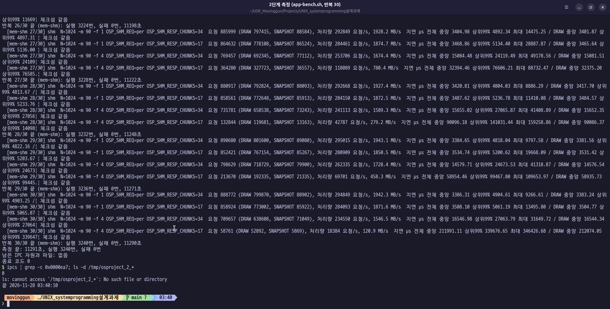

### 요청 종류별 지연 (클라이언트 1, 동시 요청 1)

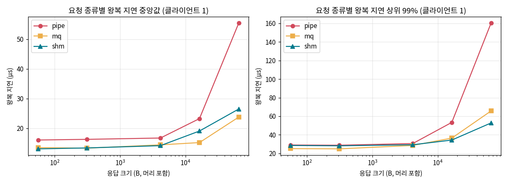

**표.** 요청 종류별 왕복 지연과 자원 사용 (그림판 1, 조건·IPC마다 30번 실행의 중앙값)
| 요청 | 응답 크기 | IPC | 평균 µs | 중앙값 µs | 상위 99% µs | 최대 µs | 문맥 교환 /요청 | CPU µs /요청 | 중앙값 순위 |
| --- | ---: | --- | ---: | ---: | ---: | ---: | ---: | ---: | --- |
| DRAW 16 × 16 | 56 | pipe | 16.7 | 16.1 | 29.0 | 285 | 4.00 | 20.5 | shm ≈ mq ≈ pipe |
| DRAW 16 × 16 | 56 | mq | 14.1 | 13.5 | 25.2 | 258 | 4.00 | 17.0 |  |
| DRAW 16 × 16 | 56 | shm | 14.4 | 13.1 | 28.6 | 185 | 4.00 | 17.8 |  |
| SNAPSHOT 16 × 16 | 312 | pipe | 16.5 | 16.3 | 28.8 | 240 | 4.00 | 20.2 | mq ≈ shm ≈ pipe |
| SNAPSHOT 16 × 16 | 312 | mq | 14.2 | 13.3 | 24.9 | 226 | 4.00 | 17.4 |  |
| SNAPSHOT 16 × 16 | 312 | shm | 14.2 | 13.4 | 28.2 | 206 | 4.00 | 17.3 |  |
| SNAPSHOT 64 × 64 | 4,152 | pipe | 17.2 | 16.7 | 30.6 | 248 | 4.00 | 20.8 | shm ≈ mq ≈ pipe |
| SNAPSHOT 64 × 64 | 4,152 | mq | 14.8 | 14.4 | 28.6 | 203 | 4.00 | 17.7 |  |
| SNAPSHOT 64 × 64 | 4,152 | shm | 15.6 | 14.2 | 29.3 | 175 | 4.00 | 18.6 |  |
| SNAPSHOT 128 × 128 | 16,440 | pipe | 24.8 | 23.3 | 53.4 | 391 | 4.00 | 28.5 | mq ≈ shm ≈ pipe |
| SNAPSHOT 128 × 128 | 16,440 | mq | 17.5 | 15.2 | 36.5 | 189 | 4.00 | 22.1 |  |
| SNAPSHOT 128 × 128 | 16,440 | shm | 20.2 | 19.1 | 34.4 | 215 | 4.00 | 23.8 |  |
| SNAPSHOT 256 × 256 | 65,592 | pipe | 59.3 | 55.5 | 160 | 488 | 6.00 | 62.7 | mq ≈ shm < pipe |
| SNAPSHOT 256 × 256 | 65,592 | mq | 29.3 | 23.8 | 65.7 | 428 | 5.72 | 42.7 |  |
| SNAPSHOT 256 × 256 | 65,592 | shm | 28.2 | 26.5 | 52.8 | 264 | 4.00 | 31.8 |  |

- DRAW(응답 56B)의 중앙값은 pipe 16.1µs, mq 13.5µs, shm 13.1µs로 순위가 `shm ≈ mq ≈ pipe`이다. 실행 사이 편차가 IPC 사이의 차이보다 커서 구분되지 않는다. 구간별로 보면 요청 전송 4.2µs~5.2µs, 서버 안의 큐 넘김(수신 스레드 → 워커) 4.3µs~4.8µs, 응답 전송 4.8µs~6.4µs로, 1단계 echo에 없던 **수신 스레드 → 워커 넘김**이 왕복의 약 30%를 차지한다.
- SNAPSHOT은 응답이 16KB(128 × 128) 이하일 때까지 세 IPC가 구분되지 않다가, 64KB(256 × 256)에서 pipe만 55.5µs로 mq(23.8µs)의 2.3배가 된다(순위 `mq ≈ shm < pipe`). 차이는 거의 응답 전송 구간에서 난다(pipe 40.5µs, mq 18.6µs, shm 13.6µs).
- 요청 하나의 자발적 문맥 교환은 DRAW에서 세 IPC 모두 4.00번이다(클라이언트 송신·수신, 서버 수신·워커가 한 번씩 잠든다). 64KB SNAPSHOT에서는 pipe 6.00번, mq 5.72번, shm 4.00번으로, pipe·mq는 응답을 나눠 옮기면서 더 잠든다. CPU 시간도 pipe 62.7µs > mq 42.7µs > shm 31.8µs 순서다.

### 처리량 (클라이언트 1, 동시 요청 16)

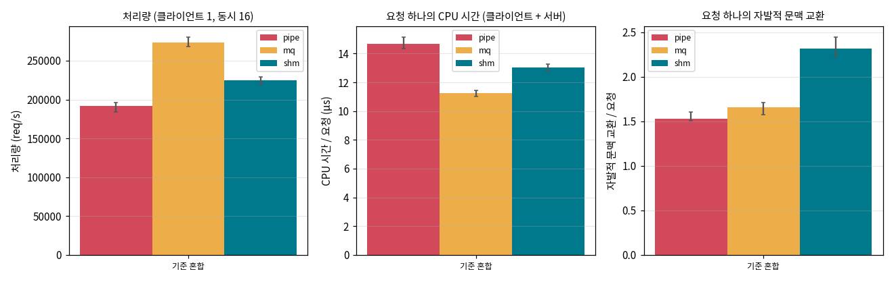

**표.** 처리량 실험 (클라이언트 1, 동시 요청 16, 기준 혼합, 그림판 1, 30번 실행의 중앙값)
| IPC | 처리량 req/s | 응답 MB/s | 중앙값 µs | 상위 99% µs | 문맥 교환 /요청 (서버) | CPU µs /요청 | 실행 사이 편차 |
| --- | ---: | ---: | ---: | ---: | ---: | ---: | ---: |
| pipe | 191,365 | 1,250 | 69.9 | 258 | 1.53 (1.03) | 14.7 | 23% |
| mq | 273,704 | 1,794 | 48.4 | 164 | 1.66 (0.89) | 11.2 | 15% |
| shm | 224,527 | 1,469 | 64.9 | 148 | 2.32 (1.42) | 13.0 | 39% |

- 처리량은 mq 273,704 > shm 224,527 > pipe 191,365 요청/s로, 세 IPC의 가운데 범위가 겹치지 않는다(`mq > shm > pipe`). mq가 shm보다 1.22배 높다.
- shm은 요청 하나에 자발적 문맥 교환이 2.32번(서버 1.42번)으로 셋 중 가장 많이 잠든다. mq는 1.66번(서버 0.89번), pipe는 1.53번이다. 이 차이의 원인은 6.4절에서 확인한다.

### 클라이언트 수 (동시 요청 1, 그림판 8)


**표.** 클라이언트 수별 처리량(요청/s)과 DRAW 상위 99%, 기준 혼합 (30번 실행의 중앙값)
| 클라이언트 | pipe 처리량 | mq 처리량 | shm 처리량 | 처리량 순위 | pipe DRAW p99 | mq DRAW p99 | shm DRAW p99 | DRAW p99 순위 |
| ---: | ---: | ---: | ---: | --- | ---: | ---: | ---: | --- |
| 1 | 34,416 | 41,725 | 39,556 | mq ≈ shm ≈ pipe | 41.6µs | 35.0µs | 38.2µs | mq ≈ shm ≈ pipe |
| 4 | 60,464 | 64,583 | 67,166 | shm ≈ mq > pipe | 84.6µs | 85.7µs | 84.1µs | shm ≈ pipe ≈ mq |
| 16 | 334,278 | 288,509 | 58,530 | pipe > mq > shm | 82.3µs | 108µs | 402µs | pipe < mq < shm |
| 64 | 365,272 | 268,586 | 36,604 | pipe > mq > shm | 270µs | 409µs | 2.5ms | pipe < mq < shm |
| 256 | 272,133 | 72,670 | 42,885 | pipe > mq > shm | 1.3ms | 5.9ms | 11.6ms | pipe < mq < shm |
| 1024 | 242,051 | 15,194 | 40,656 | pipe > shm > mq | 5.2ms | 153.1ms | 47.2ms | pipe < shm < mq |

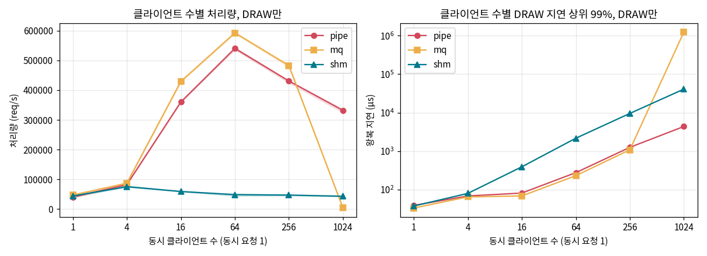

**표.** 클라이언트 수별 처리량과 DRAW 상위 99%, DRAW만
| 클라이언트 | pipe 처리량 | mq 처리량 | shm 처리량 | 처리량 순위 | pipe DRAW p99 | mq DRAW p99 | shm DRAW p99 | DRAW p99 순위 |
| ---: | ---: | ---: | ---: | --- | ---: | ---: | ---: | --- |
| 1 | 40,286 | 47,102 | 44,017 | mq ≈ shm ≈ pipe | 38.7µs | 33.0µs | 37.3µs | mq ≈ shm ≈ pipe |
| 4 | 82,506 | 87,212 | 75,376 | mq > pipe > shm | 68.1µs | 64.3µs | 79.3µs | mq ≈ pipe < shm |
| 16 | 360,105 | 429,284 | 59,287 | mq > pipe > shm | 81.0µs | 68.2µs | 389µs | mq < pipe < shm |
| 64 | 540,214 | 592,462 | 48,459 | mq > pipe > shm | 275µs | 229µs | 2.2ms | mq < pipe < shm |
| 256 | 430,696 | 482,442 | 47,204 | mq > pipe > shm | 1.2ms | 1.1ms | 9.5ms | mq < pipe < shm |
| 1024 | 332,014 | 4,449 | 43,239 | pipe > shm > mq | 4.4ms | 1,239.0ms | 40.8ms | pipe < shm < mq |

- 클라이언트 1·4개에서는 세 IPC가 비슷하다. 클라이언트 16개부터 순위가 크게 갈린다. shm은 16개에서 이미 58,530 요청/s에 머물고(pipe의 0.18배), 그 뒤로 클라이언트가 늘어도 4만 안팎에서 더 오르지 않는다. mq는 64개까지 pipe를 따라가다가 256개에서 72,670, 1024개에서 15,194 요청/s로 무너진다. pipe는 64개에서 가장 높고(365,272) 1024개에서도 242,051 요청/s를 낸다.
- DRAW만 보내면(응답이 모두 56B) mq가 256개까지 1위지만, 1024개에서는 4,449 요청/s로 떨어지고 DRAW 상위 99%가 1,239.0ms가 된다. 이때 요청 하나의 자발적 문맥 교환이 326번이다(256개일 때 2.03번).

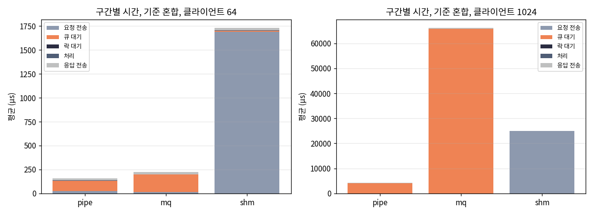

**표.** 구간별 시간 평균과 요청 하나의 자발적 문맥 교환 (기준 혼합, 그림판 8)
| 클라이언트 | IPC | 요청 전송 | 큐 대기 | 락 대기 | 처리 | 응답 전송 | 문맥 교환 /요청 (서버) |
| ---: | --- | ---: | ---: | ---: | ---: | ---: | ---: |
| 1 | pipe | 6.2µs | 5.8µs | 0.3µs | 1.2µs | 10.4µs | 4.20 (2.10) |
| 1 | mq | 5.2µs | 5.3µs | 0.3µs | 1.0µs | 7.6µs | 4.13 (2.06) |
| 1 | shm | 6.2µs | 5.4µs | 0.3µs | 1.0µs | 7.7µs | 4.00 (2.00) |
| 16 | pipe | 14.6µs | 8.0µs | 0.3µs | 1.3µs | 14.1µs | 2.62 (0.53) |
| 16 | mq | 10.8µs | 16.9µs | 0.2µs | 1.2µs | 16.5µs | 3.07 (0.92) |
| 16 | shm | 215µs | 12.5µs | 0.6µs | 2.7µs | 25.5µs | 4.63 (1.63) |
| 64 | pipe | 26.8µs | 107µs | 0.3µs | 1.4µs | 23.1µs | 2.28 (0.19) |
| 64 | mq | 13.7µs | 184µs | 0.3µs | 1.4µs | 24.4µs | 2.95 (0.80) |
| 64 | shm | 1.7ms | 12.7µs | 0.7µs | 3.2µs | 24.7µs | 4.43 (1.43) |
| 256 | pipe | 33.3µs | 842µs | 0.3µs | 1.7µs | 40.4µs | 2.31 (0.22) |
| 256 | mq | 38.3µs | 3.3ms | 0.6µs | 2.7µs | 97.2µs | 2.76 (0.61) |
| 256 | shm | 5.9ms | 5.5µs | 0.4µs | 1.6µs | 13.0µs | 4.05 (1.05) |
| 1024 | pipe | 32.4µs | 4.1ms | 0.3µs | 1.7µs | 47.4µs | 2.55 (0.36) |
| 1024 | mq | 44.0µs | 65.8ms | 0.6µs | 2.7µs | 322µs | 3.15 (0.68) |
| 1024 | shm | 25.0ms | 5.5µs | 0.4µs | 1.6µs | 15.1µs | 4.02 (1.02) |

- 시간이 어디서 늘어나는지가 IPC마다 다르다. shm은 **요청 전송**(클라이언트 `t0` → 서버 `t_recv`)이 클라이언트 수에 비례해 늘어(16개 215µs, 64개 1.7ms, 1024개 25.0ms) 왕복의 거의 전부가 된다. 요청이 서버에 들어가기 전에 줄을 선다는 뜻이다. mq와 pipe는 요청은 바로 들어가고 **큐 대기**(서버 작업 큐 안)가 늘어난다(1024개에서 mq 65.8ms, pipe 4.1ms). 워커가 요청을 꺼내는 속도, 즉 응답을 내보내는 속도가 병목이라는 뜻이다.
- 락 대기는 모든 조건에서 1µs 안팎으로, 그림판 8개 + 타일 rwlock에서는 락이 병목이 아니다.

### 락 방식 (그림판 1, 동시 요청 1)

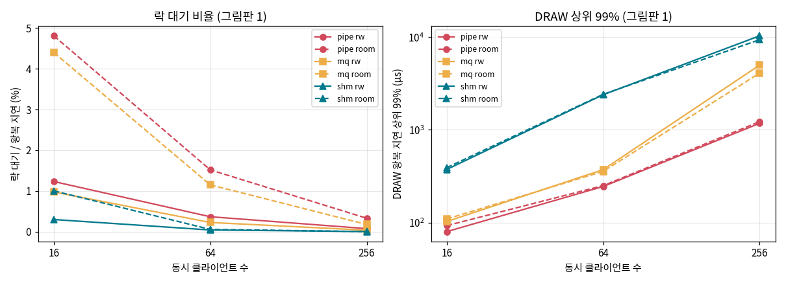

**표.** 락 방식별 처리량과 락 대기 (그림판 1, 기준 혼합, 동시 요청 1, 30번 실행의 중앙값)
| 락 | 클라이언트 | IPC | 처리량 | 락 대기 µs | 락 대기 / 왕복 | DRAW p99 |
| --- | ---: | --- | ---: | ---: | ---: | ---: |
| rw | 16 | pipe | 340,366 | 0.5 | 1.2% | 80.0µs |
| rw | 16 | mq | 294,126 | 0.4 | 1.0% | 103µs |
| rw | 16 | shm | 61,968 | 0.7 | 0.3% | 374µs |
| rw | 64 | pipe | 388,906 | 0.6 | 0.4% | 245µs |
| rw | 64 | mq | 282,308 | 0.5 | 0.2% | 373µs |
| rw | 64 | shm | 40,926 | 0.7 | 0.0% | 2.4ms |
| rw | 256 | pipe | 291,308 | 0.7 | 0.1% | 1.2ms |
| rw | 256 | mq | 87,336 | 1.1 | 0.0% | 5.0ms |
| rw | 256 | shm | 44,185 | 0.3 | 0.0% | 10.3ms |
| room | 16 | pipe | 312,780 | 2.0 | 4.8% | 92.8µs |
| room | 16 | mq | 280,085 | 2.1 | 4.4% | 109µs |
| room | 16 | shm | 61,581 | 2.4 | 1.0% | 392µs |
| room | 64 | pipe | 354,040 | 2.6 | 1.5% | 250µs |
| room | 64 | mq | 276,001 | 2.5 | 1.2% | 357µs |
| room | 64 | shm | 39,843 | 0.9 | 0.1% | 2.4ms |
| room | 256 | pipe | 269,191 | 3.1 | 0.3% | 1.2ms |
| room | 256 | mq | 108,323 | 4.2 | 0.2% | 4.1ms |
| room | 256 | shm | 44,587 | 0.2 | 0.0% | 9.4ms |

- 모든 요청이 그림판 하나에 몰려도 타일 rwlock(기준)의 락 대기는 클라이언트 16개에서 0.4µs~0.7µs, 256개에서 0.3µs~1.1µs로 왕복의 1.2% 이하다.
- 그림판 전체를 mutex 하나로 잠가도(`-l room`) 락 대기는 16개에서 2.0µs~2.4µs, 64개에서 0.9µs~2.6µs로 왕복의 4.8%(16개), 1.5%(64개) 이하에 그쳤다. 처리량은 pipe에서 rwlock보다 9% 낮은 정도다(64개).

### 목표 부하 (사람 1024명 속도)

클라이언트 1024개가 사람 속도(초당 67개, DRAW 90%)로 보내 서버에 68,608 요청/s가 들어오는 조건이다. 동시 요청은 4개까지 띄워 둔다.

**표.** 목표 부하에서 처리한 요청과 DRAW 지연 (처음 설계, 30번 실행의 중앙값)
| IPC | 처리한 요청/s | DRAW 중앙값 | DRAW 상위 99% | DRAW 최대 | 16.7ms 안? (안에 든 실행) |
| --- | ---: | ---: | ---: | ---: | --- |
| pipe | 68,336 | 5.2ms | 8.3ms | 19.5ms | 예 (29/30) |
| mq | 16,946 | 233.8ms | 398.1ms | 410.3ms | 아니오 (0/30) |
| shm | 11,101 | 184.4ms | 209.5ms | 211.6ms | 아니오 (0/30) |

- pipe만 보낸 요청을 모두 처리하고(68,336 요청/s) DRAW 상위 99%가 8.3ms로 한 프레임(16.7ms) 안이다.
- mq(16,946 요청/s, DRAW 상위 99% 398.1ms)와 shm(11,101 요청/s, 209.5ms)은 보낸 속도를 따라가지 못해 요청이 쌓였다. 개선 뒤의 결과는 6.5절에 있다.

### 메모리

**표.** 메모리 사용량 (기준 혼합, 그림판 8. IPC 버퍼 용량은 pipe: 연 FIFO 버퍼의 합, mq: 큐 용량의 합, shm: 공유 메모리 크기)
| 클라이언트 | IPC | 서버 VmHWM | IPC 버퍼 용량 | shm 실제 사용 | 가장 작은 응답 채널 | 클라이언트 VmHWM(가장 큰 것) |
| ---: | --- | ---: | ---: | ---: | ---: | ---: |
| 1 | pipe | 10.6MB | 128KB | - | 65,536B | 2.4MB |
| 1 | mq | 10.8MB | 32KB | - | 16,384B | 2.6MB |
| 1 | shm | 10.8MB | 136.1MB | 208KB | 139,264B | 2.4MB |
| 64 | pipe | 10.6MB | 4.1MB | - | 65,536B | 2.2MB |
| 64 | mq | 11.3MB | 32KB | - | 16,384B | 2.3MB |
| 64 | shm | 19.2MB | 136.1MB | 8.6MB | 139,264B | 2.1MB |
| 1024 | pipe | 10.6MB | 55.6MB | - | 8,192B | 2.1MB |
| 1024 | mq | 18.8MB | 32KB | - | 16,384B | 2.3MB |
| 1024 | shm | 146.8MB | 136.1MB | 136.1MB | 139,264B | 2.1MB |

- shm은 서버가 받을 수 있는 클라이언트 수(1024)만큼 응답 링을 처음에 만들어 공유 메모리가 늘 136.1MB다. 실제로 쓰는 쪽(물리 메모리)은 접속한 클라이언트 수에 따라 늘어 클라이언트 1개면 208KB, 1024개면 136.1MB이고, 서버의 `VmHWM`(146.8MB)에 그대로 들어간다.
- pipe의 버퍼는 커널 메모리라 서버 `VmHWM`(10.6MB)에 보이지 않는다. 연 FIFO 버퍼 용량의 합은 1024개에서 55.6MB이고, 가장 작은 응답 FIFO는 8,192B였다. 사용자별 파이프 버퍼 한도(`pipe-user-pages-soft` 16,384쪽 = 64MB)를 넘은 뒤에 연 FIFO는 64KB가 아니라 8KB로 만들어진 것이다.
- mq는 큐 두 개(요청 16,384B, 응답 16,384B)뿐이라 클라이언트 수와 관계없이 32KB다. 서버 `VmHWM`은 18.8MB다.
- 세 버전 모두 클라이언트당 IPC 버퍼가 N-5의 160KB 이하다(shm 136KB, pipe 64KB 이하, mq는 공유).


## 예측 대비 실측 비교

판정은 3장의 기준을 그대로 쓴다(일치: 순위와 수치 범위가 모두 맞음, 부분 일치: 순위는 맞고 범위가 벗어났거나 일부 조건에서만 맞음, 불일치: 순위가 다름). 순위는 30번 실행의 가운데 범위가 겹치면 `≈`다.

**표.** 예측 대비 실측 (실측은 30번 실행의 중앙값)
| 조건 | 예측 (3장) | 실측 결과 | 일치 여부 |
| --- | --- | --- | --- |
| P1 클라이언트 1, DRAW 지연 | 세 IPC ≈, DRAW p50 15~25µs | 중앙값 pipe 16.1, mq 13.5, shm 13.1µs, 순위 `shm ≈ mq ≈ pipe` | 부분 일치. 순위(≈)는 맞고, mq·shm 값이 범위(15~25µs)보다 조금 낮다 |
| P2 클라이언트 1, SNAPSHOT 64KB 지연 | mq ≈ shm < pipe, pipe 50~65µs, mq·shm 25~40µs, 약 1.7배 | pipe 55.5, mq 23.8, shm 26.5µs, `mq ≈ shm < pipe`, pipe가 2.3배(mq 대비) | 부분 일치. 순위는 맞고, mq가 범위 아래이며 배수가 예측(1.7배)보다 크다 |
| P3 처리량(클라이언트 1, 동시 16) | shm > mq > pipe, 상한 shm 45만·mq 35만·pipe 23만 | mq 273,704 > shm 224,527 > pipe 191,365 요청/s (`mq > shm > pipe`). 상한 대비 pipe 83%, mq 78%, shm 50% | **불일치.** mq가 1위, shm은 상한의 절반. 원인 (3) |
| P4 DRAW만, 클라이언트 64 이상 | shm의 DRAW 지연이 가장 길다, pipe ≈ mq < shm | DRAW p99 64개 `mq < pipe < shm`, 256개 `mq < pipe < shm`, 1024개 `pipe < shm < mq`(mq 1,239.0ms). shm은 4개부터 가장 길다 | 부분 일치. 64·256개는 shm이 가장 길지만 pipe ≈ mq가 아니라 mq < pipe. 1024개는 mq가 가장 길다. 원인 (1)·(2) |
| P5 혼합, 클라이언트 1 → 1024 | 16개 이하 shm > mq > pipe, 256·1024개 pipe > shm > mq, mq SNAPSHOT p99가 가장 김 | 처리량 순위 1개 `mq ≈ shm ≈ pipe`, 4개 `shm ≈ mq > pipe`, 16개 `pipe > mq > shm`, 256개 `pipe > mq > shm`, 1024개 `pipe > shm > mq`. SNAPSHOT p99 최대: 256개 shm 11.7ms, 1024개 mq 155.1ms. 1024개에서 가장 작은 응답 FIFO 8,192B | 부분 일치. 1024개 순위만 맞고, 16·256개는 shm이 꼴찌, SNAPSHOT p99 최대가 mq인 것은 1024개뿐. 원인 (1)·(2) |
| P6 락 방식 | 기준(rwlock)에서 락 대기 5% 미만, 그림판 1 + 전체 mutex면 64개 이상에서 30% 이상 | 기준(타일 rwlock)의 락 대기는 왕복의 1.2% 이하. 그림판 전체 mutex(그림판 1)에서도 64개 pipe 1.5%·mq 1.2%·shm 0.1%, 256개 0.3% 이하(락 대기 자체는 0.2µs~4.2µs) | 부분 일치. 기준 5% 미만은 맞고, 전체 mutex에서도 30%에 크게 못 미친다. 원인 (4) |
| P7 자원 사용량 | 문맥 교환 DRAW 4~5번, SNAPSHOT pipe·mq 6~8번 > shm 4~5번. 메모리(1024개) shm 약 140MB ≫ pipe ≈ mq | DRAW 4.00번(셋 모두), SNAPSHOT pipe 6.00·mq 5.72·shm 4.00번. 공유 메모리 shm 136.1MB, 서버 VmHWM pipe 10.6·mq 18.8MB(pipe의 커널 FIFO 버퍼 55.6MB는 별도) | 부분 일치. 순위와 메모리 크기는 맞고, mq SNAPSHOT이 범위(6~8번) 아래 |
| P8 목표 부하(1024명 속도) | pipe·shm은 DRAW p99 16.7ms 이하, mq는 넘을 수 있음 | 보낸 속도 68,608 req/s에 처리량 pipe 68,336·mq 16,946·shm 11,101. DRAW p99 pipe 8.3ms, mq 398.1ms, shm 209.5ms(16.7ms 안은 pipe뿐) | 부분 일치. pipe 통과·mq 초과는 맞고, shm도 넘었다. 원인 (5) |


**맞은 부분.** 작은 요청은 IPC가 구분되지 않고(P1), 64KB SNAPSHOT은 pipe만 두 배 넘게 느리다(P2)는 1단계의 결론은 응용에서도 그대로였다. 요청 하나의 문맥 교환 수(P7)와 메모리의 크기 순서(P7), 클라이언트가 많아지면 클라이언트별 FIFO를 쓰는 pipe가 1위가 된다는 큰 그림(P5의 256·1024개)도 맞았다. pipe가 1024개에서 사용자별 파이프 버퍼 한도에 걸려 나중에 연 FIFO가 8KB가 된다는 예측도 측정값(가장 작은 응답 FIFO 8,192B)과 같았다.

**틀린 부분.** 틀린 곳은 모두 **동기화, 즉 여러 스레드·프로세스가 같은 것을 어떻게 기다리고 깨우는가**에서 나왔다. 1단계 echo에는 워커도, 클라이언트 수백 개도 없었으므로 1단계 수치만으로는 볼 수 없던 요인이다. 아래 다섯 가지를 구간별 시간, 문맥 교환 수, 시스템 콜 수로 추정하고, 그 요인 하나만 바꾼 실험으로 확인했다. 추정이 틀린 경우(P3의 워커 경쟁과 응답 링 크기)도 그대로 적었다.

### (1) shm: 요청 링 하나를 모두가 MUTEX로 다툰다 (P4·P5·P8의 shm)

- **관찰.** shm은 클라이언트 16개부터 처리량이 3.7만~5.9만 요청/s에서 멈추고, 늘어난 시간은 모두 **요청 전송** 구간이다(16개 215µs → 1024개 25.0ms). 요청 전송 시간 ≈ 클라이언트 수 ÷ 처리량(1024 ÷ 40,656/s = 25.2ms)이어서, 요청들이 서버에 들어가기 전에 한 줄로 서 있다는 뜻이다. 요청 하나의 자발적 문맥 교환도 클라이언트 1024개에서 shm 4.02번(서버 1.02번)으로 pipe 2.55번, mq 3.15번보다 많다.
- **추정.** 모든 클라이언트가 요청 링 하나의 MUTEX 세마포어를 잡아야 보낼 수 있다. System V 세마포어는 값을 올리면 기다리던 프로세스에 차례로 넘겨주므로, 링에 한 칸을 넣을 때마다 잠든 프로세스 하나가 깨어나 스케줄될 때까지 링이 멈춘다(lock convoy). 처리량은 "깨우기 한 번의 지연"의 역수에 묶인다. 1단계의 클라이언트 8개, 64B에서 shm이 가장 느렸던 것도 같은 현상의 작은 판이다.
- **확인 1 (요인: 기다리는 프로세스 수).** 띄운 요청 수(1024)는 같게 두고 클라이언트 프로세스 수만 바꾸면(`cause-procs`), shm은 64 × 16 90,054, 256 × 4 43,759, 1024 × 1 41,471 요청/s다. 기다리는 프로세스가 64개일 때가 1024개일 때의 2.2배이고, 요청 전송도 24.5ms → 716µs로 줄었다. 요청 양(띄운 요청 1024개)이 같아도 MUTEX를 기다리는 프로세스가 많을수록 느려지므로, 요인은 요청 양이 아니라 **기다리는 쪽의 수**다. 다만 64개에서도 pipe(222,930)의 40%에 그쳐, 모든 요청이 링 하나의 MUTEX를 거친다는 구조가 남는다(확인 2).
- **확인 2 (요인: 요청 링 구조).** 요청 링만 클라이언트별로 나누면(MUTEX 없음, 6.5절 개선 2) 클라이언트 1024개에서 처리량이 40,656 → 276,971 요청/s, 요청 전송이 25.0ms → 168µs, 요청 하나의 문맥 교환이 4.02 → 2.03번이 됐다. 바꾼 것은 요청 링의 구조 하나뿐이므로 원인이 확인됐다.

### (2) mq: 응답 큐 하나, 그리고 가득 찬 요청 큐의 한꺼번에 깨우기 (P4의 1024개, P5, P8의 mq)

- **관찰 1 (혼합).** mq는 256개부터 **큐 대기**(서버 작업 큐 안)가 늘어난다(256개 3.3ms, 1024개 65.8ms). 수신 스레드는 요청을 계속 받아 넣는데 워커가 응답을 못 내보내 작업 큐가 쌓인다는 뜻이다. 예측(P5)대로 응답 큐 하나(16,384B)에 64KB 응답의 8KB 조각이 2개씩만 들어가고, 클라이언트 1024개가 모두 그 큐 하나에서 자기 mtype을 기다린다.
- **확인 1 (요인: 응답 큐 수).** 응답 큐 수 Q만 바꾸면(`imp-mq-q`, 클라이언트 1024, 입장 제한 없음) 처리량이 Q = 1 15,681, 2 40,240, 4 140,909, 8 131,935 요청/s다. Q를 1에서 4로 늘리면 처리량이 9.0배, 큐 대기가 63.3ms → 6.8ms로 줄어, 응답 큐 하나가 병목이라는 추정은 맞았다. 그런데 Q = 8은 중앙값이 Q = 4보다 나아지지 않았고 실행마다 크게 갈렸다(실행별 2,683 ~ 238,621 요청/s, 가운데 범위 45,326 ~ 198,319). 실행 하나하나를 보면(그림) 대부분의 실행은 요청 하나의 문맥 교환이 2.5~3.7번이고 요청 전송이 수십 µs인데, 처리량이 낮은 실행일수록 문맥 교환이 많고(가장 많은 실행 634번) 요청 전송이 길다(가장 긴 실행 442.8ms). 문맥 교환이 10번을 넘은 실행은 Q = 1, 2, 4, 8에서 각각 30번 중 2, 2, 4, 12번이다. 응답 쪽이 빨라질수록 요청이 요청 큐 앞에 몰려, 아래 관찰 2의 '한꺼번에 깨우기'에 빠지는 실행이 늘어난 것이다. 깨어난 송신자들이 다시 잠들기까지 CPU를 쓰는 동안 수신 스레드가 늦어져 요청 큐가 비지 않으므로, 한번 빠지면 쉽게 돌아오지 못하는 것으로 보인다. 응답 큐만 나누면 된다는 처음 판단은 틀렸고([AI 활용 기록](../records/ai-log.md) 2번 표의 8번), 그래서 개선 1에 요청 큐 입장 제한(②)을 더했다.

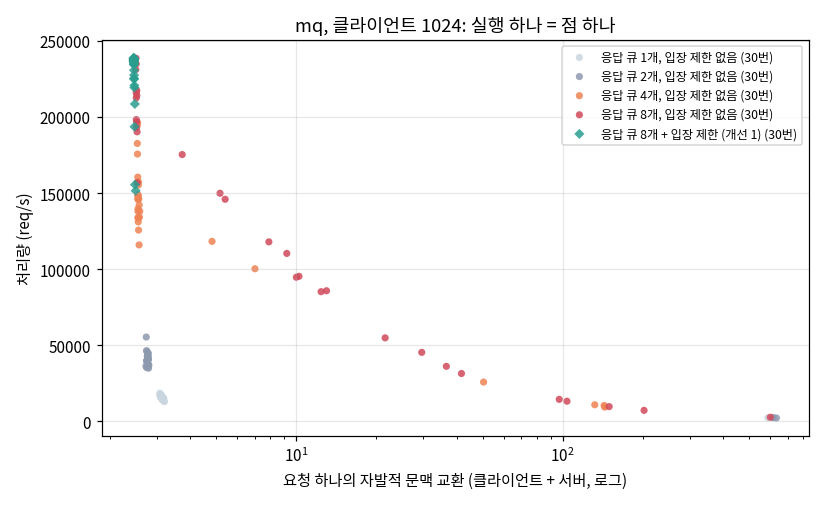

- **관찰 2 (DRAW만, 1024개).** 응답이 모두 56B여서 응답 큐가 병목이 아닌 조건에서도 mq는 1024개에서 4,449 요청/s로 무너졌다. 요청 전송이 212.1ms이고, 요청 하나에 자발적 문맥 교환이 326번이다(256개에서는 2.03번). 요청 큐(16,384B)에는 48B 요청이 341개만 들어가므로, 띄운 요청 1024개 가운데 나머지 송신자는 `msgsnd`에서 잠든다. 리눅스는 메시지 하나가 빠질 때 기다리던 송신자 가운데 자리에 들어갈 수 있는 쪽을 **모두** 깨우고(48B 하나가 빠지면 48B를 보내려는 송신자가 모두 해당), 그중 하나만 넣고 나머지는 다시 잠든다(thundering herd).
- **확인 2 (요인: 요청 큐 용량).** 응답 큐를 8개로 나눈 상태에서 클라이언트 256개(띄운 요청 256 < 341)에 요청 큐 용량만 8,192B(170개)로 줄이면(`imp-mq-req`), 처리량이 280,280 → 86,928 요청/s, 문맥 교환이 2.54 → 16.07번이 되고, 30번 중 20번이 한꺼번에 깨우기(요청 하나의 문맥 교환 10번 초과)에 빠졌다. 같은 용량에서 입장 제한(6.5절 개선 1의 ②)만 켜면 272,121 요청/s(문맥 교환 2.50번)로 돌아온다. "띄운 요청 > 요청 큐에 들어가는 요청"이 되는 순간 무너진다는 것이 요인 하나로 확인됐다.
- **확인 3 (요인: 기다리는 프로세스 수).** `cause-procs`에서 mq는 64 × 16 26,770, 256 × 4 42,554, 1024 × 1 15,583 요청/s다. shm과 달리 mq는 프로세스가 가장 적은 64 × 16에서 요청 전송이 15.4ms, 요청 하나의 자발적 문맥 교환이 60.84번으로 튀었다. 이 조건에서는 큐 대기(16.3µs)와 응답 전송(17.4µs)이 짧아, 요청이 서버 안이 아니라 요청 큐 앞에 몰려 있다. 요청 큐에는 48B 요청이 341개만 들어가므로 64개 프로세스의 송신 스레드가 `msgsnd`에서 잠들고, 메시지 하나가 빠질 때마다 함께 깨어 다시 잠든다(문맥 교환 수가 기다리는 송신자 수 64에 가깝다. 관찰 2와 같은 현상). 256 × 4와 1024 × 1에서는 요청 전송이 45.3µs, 40.7µs로 짧은 대신 큐 대기가 20.5ms, 64.0ms로 길어, 요청이 서버 작업 큐에 쌓이고 응답 큐가 병목이다. 같은 요청 양에서도 **어느 큐가 가득 차느냐**에 따라 mq가 무너지는 곳이 달라진다. 어느 쪽이 차는지를 이 실험만으로 미리 알 수는 없어서, 두 큐를 모두 고친 것이 6.5절의 개선 1이다.

### (3) 클라이언트 1개의 처리량에서 shm이 mq에 졌다 (P3)

- **관찰.** 1단계 64KB에서 shm의 처리량은 mq의 4배였는데, 응용(동시 요청 16)에서는 mq 273,704 > shm 224,527 요청/s였다. 상한 대비 shm만 50%로 크게 모자라고, 요청 하나에 서버가 1.42번 잠든다(mq 0.89번).
- **추정 1과 확인 (요인: 워커 수).** 1단계 echo 서버는 받은 스레드가 바로 응답했지만 응용 서버는 워커 4개가 같은 클라이언트의 응답 채널에 보낸다. shm 응답 링의 MUTEX는 System V 세마포어라 (1)처럼 넘겨주기가 생기므로, 워커들의 응답 채널 경쟁을 첫 후보로 봤다. 워커 수만 1·2·4·8로 바꾸면(`cause-workers`) 처리량은 모두 워커 1개일 때 가장 높았지만, 순위는 네 경우 모두 `mq > shm > pipe`였다. 다툴 워커가 없는 1개일 때도 mq 468,120 > shm 402,138이므로 **워커 경쟁은 순위를 뒤집은 원인이 아니다(추정 1은 틀림).** 워커 1개 → 2개에서 shm이 49% 줄어 셋 중 가장 크게 떨어졌으므로(mq 29%, pipe 39%) 경쟁의 영향은 shm에서 가장 크지만, 순위를 바꿀 만큼은 아니다.
- **추정 2와 확인 (요인: 응답 링 크기).** 응답 링(34칸)에는 64KB 응답이 2개만 들어가므로 동시 요청 16에서 SNAPSHOT이 겹치면 워커가 기다린다고 보고, 링 크기만 34·68·136칸으로 바꿨다(`cause-ring`). 처리량이 242,267, 237,719, 245,185 요청/s로 가운데 범위가 겹쳐(≈) **이것도 원인이 아니었다.**
- **확인 3 (요인: 요청 종류).** 요청 종류만 바꾸면(`cause-mix`) DRAW만은 mq 684,504 > pipe 519,651 > shm 262,169, SNAPSHOT만은 shm 121,403 > mq 60,650 > pipe 26,769 요청/s다. shm은 64KB에서 mq의 2.0배지만 작은 요청에서는 0.38배다. 예측(P3)과 같은 식으로 요청 하나의 비용(1/처리량)을 9:1로 섞으면 mq 337,425, shm 234,930, pipe 182,898 요청/s로 실측과 순위가 같다. 즉 식은 맞았고 **넣은 값이 틀렸다.** 예측은 작은 요청의 비용을 1단계 64B echo에서 가져왔는데(shm이 mq의 0.69배), 응용의 작은 요청에서 shm은 mq의 0.38배였고, 요청의 90%가 작은 요청이라 이것이 순위를 정했다.
- **근거 (시스템 콜 수).** strace로 센 요청 하나당 시스템 콜(기준 혼합, 동시 요청 16, `scripts/syscall-count.sh`, `results/app/syscalls.txt`)은 shm이 15.1번(클라이언트 5.94 + 서버 9.16)으로 mq 9.6번(4.74 + 4.83), pipe 10.3번(5.09 + 5.23)보다 많다. shm은 메시지를 보내고 받을 때마다 세마포어 연산(`semtimedop`)이 두 번씩이라 요청 하나에 8번이고(mq의 `msgsnd`·`msgrcv`는 작은 요청에 4번, 64KB 응답의 조각까지 쳐서 평균 5.6번), 서버 스레드 사이의 넘김(`futex`)도 요청 하나에 5.16번으로 mq(2.06번)의 2.5배였다. 서버가 잠드는 횟수의 차이와 같은 방향이다.


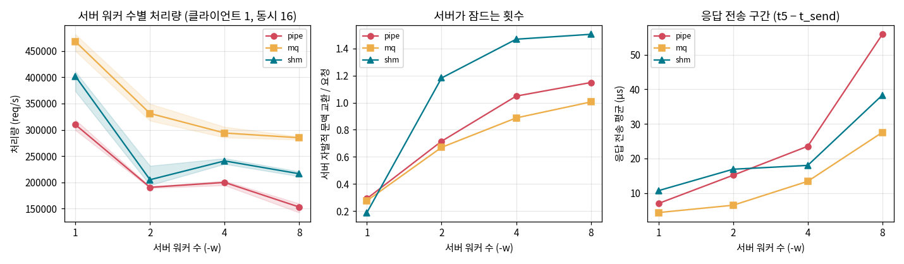

**표.** 서버 워커 수 (클라이언트 1, 동시 요청 16, 기준 혼합, 그림판 1, 30번 실행의 중앙값)
| 워커 | IPC | 처리량 | 순위 | 중앙값 µs | 응답 전송 µs | 큐 대기 µs | 문맥 교환 /요청 (서버) | CPU µs /요청 |
| ---: | --- | ---: | --- | ---: | ---: | ---: | ---: | ---: |
| 1 | pipe | 309,834 | mq > shm > pipe | 42.3 | 7.0 | 32.1 | 0.64 (0.29) | 7.5 |
| 1 | mq | 468,120 |  | 26.7 | 4.3 | 20.2 | 0.51 (0.28) | 5.8 |
| 1 | shm | 402,138 |  | 32.7 | 10.7 | 17.8 | 0.36 (0.19) | 7.5 |
| 2 | pipe | 190,386 | mq > shm > pipe | 71.7 | 15.1 | 59.4 | 1.11 (0.72) | 13.6 |
| 2 | mq | 331,174 |  | 41.9 | 6.5 | 33.8 | 1.27 (0.67) | 8.7 |
| 2 | shm | 204,897 |  | 74.6 | 16.9 | 53.9 | 1.89 (1.18) | 16.4 |
| 4 | pipe | 199,796 | mq > shm > pipe | 67.4 | 23.5 | 48.9 | 1.57 (1.05) | 14.0 |
| 4 | mq | 293,865 |  | 45.2 | 13.4 | 33.7 | 1.69 (0.89) | 10.5 |
| 4 | shm | 240,744 |  | 62.7 | 18.0 | 41.2 | 2.44 (1.47) | 12.0 |
| 8 | pipe | 152,801 | mq > shm > pipe | 71.4 | 55.9 | 39.2 | 1.71 (1.15) | 19.2 |
| 8 | mq | 284,842 |  | 36.5 | 27.5 | 21.2 | 1.83 (1.01) | 11.2 |
| 8 | shm | 216,234 |  | 70.6 | 38.3 | 28.4 | 2.58 (1.50) | 13.0 |

### (4) 그림판 전체 mutex의 락 대기가 작았다 (P6)

- **관찰.** 그림판 1개 + 그림판 전체 mutex에서도 락 대기는 0.9µs~2.6µs(클라이언트 64개)로, 왕복의 0.1~1.5%에 그쳤다. 예측한 30%의 수십분의 일이다. 타일 rwlock(기준)과 비교해도 처리량 차이는 실행 사이 편차 안팎이었다.
- **추정.** 락을 잡는 쪽은 워커 4개뿐이고, 락 안의 일(64KB 복사 포함)은 평균 1~3µs다. 왕복은 IPC와 작업 큐 대기로 수백 µs가 걸리므로, 4개가 짧게 다투는 락 대기는 왕복에서 작은 몫이 된다. 예측은 "SNAPSHOT 복사 동안 같은 그림판의 DRAW가 모두 기다린다"고 봤지만, 기다릴 수 있는 것은 클라이언트 수가 아니라 워커 수였다.
- **확인 (요인: 락을 다투는 스레드 수).** `cause-lockw`에서 워커 수만 바꾸면 락 대기가 워커 1개 0.06µs → 4개 2.5µs → 16개 7.9µs(pipe. mq도 0.04 → 2.4 → 8.5µs)로 워커 수를 따라 늘었다. 클라이언트는 64개 그대로이므로, 같은 락을 기다리는 쪽의 수는 클라이언트 수가 아니라 **워커 수**로 정해진다는 것이 확인됐다. 워커 16개에서도 락 대기는 왕복의 3.4% 이하였다. 락 안의 일(처리 1.9µs)이 왕복(231µs)보다 훨씬 짧기 때문이다. shm은 요청이 링 앞에서 줄을 서느라 서버 안에 동시에 들어오는 요청이 적어 락 대기가 0.8µs 안팎이었다. 워커를 늘린다고 처리량이 늘지도 않았다(pipe 4개 365,309 → 16개 262,666 요청/s).

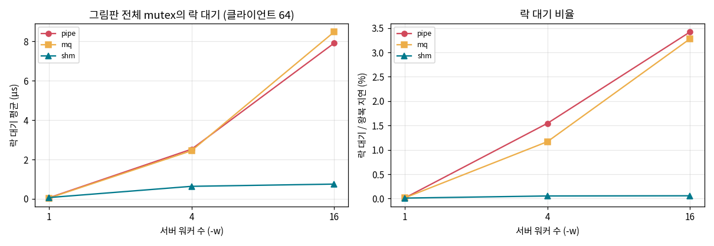

**표.** 그림판 전체 mutex에서 워커 수 (그림판 1, 클라이언트 64, 동시 요청 1, 기준 혼합, 30번 실행의 중앙값)
| 워커 | IPC | 처리량 | 락 대기 µs | 락 대기 / 왕복 | 큐 대기 µs | DRAW p99 |
| ---: | --- | ---: | ---: | ---: | ---: | ---: |
| 1 | pipe | 147,135 | 0.1 | 0.0% | 400 | 998µs |
| 1 | mq | 229,431 | 0.0 | 0.0% | 252 | 719µs |
| 1 | shm | 93,371 | 0.1 | 0.0% | 4.5 | 1.3ms |
| 4 | pipe | 365,309 | 2.5 | 1.5% | 127 | 237µs |
| 4 | mq | 291,195 | 2.4 | 1.2% | 178 | 319µs |
| 4 | shm | 53,084 | 0.6 | 0.1% | 9.1 | 1.7ms |
| 16 | pipe | 262,666 | 7.9 | 3.4% | 18.2 | 332µs |
| 16 | mq | 231,713 | 8.5 | 3.3% | 156 | 420µs |
| 16 | shm | 48,331 | 0.8 | 0.1% | 10.0 | 1.7ms |

### (5) 목표 부하에서 mq·shm이 한 프레임을 넘었다 (P8)

- **관찰.** 목표 부하(보낸 속도 68,608 요청/s)에서 shm은 늘어난 시간이 거의 모두 요청 전송(180.3ms)이고 큐 대기·응답 전송은 6.0µs, 15.2µs로 짧다. mq는 반대로 큐 대기(232.0ms)가 왕복의 거의 전부다.
- **원인.** shm은 (1)의 요청 링 줄서기, mq는 (2)의 응답 큐 병목과 같은 모양이다. 두 IPC 모두 처음 설계로 낼 수 있는 처리량(shm 11,101, mq 16,946 요청/s)이 보낸 속도보다 낮아 요청이 쌓였다. 예측은 shm의 요청 링 경쟁이 클라이언트 64개 이상의 DRAW 지연을 늘릴 것(P4)까지는 봤지만, 그 경쟁이 처리량 자체를 목표 부하 아래로 묶을 만큼 클 것은 예상하지 못했다.
- **확인.** 두 원인을 고친 설계(6.5절)로 같은 목표 부하를 다시 쟀다(`imp-target`).


## 설계 개선과 전후 비교

6.4절에서 확인한 두 원인을 줄이는 쪽으로 개선을 정했다(구현 계획의 미결정 U-1의 후보 가운데 "mq 응답 큐 나누기", "shm 요청 링 경쟁 줄이기"). 두 개선 모두 서버 환경 변수로 켜고 끄며 기본값은 처음 설계다. 그래서 개선 전후를 **같은 실행 파일**로 잰다. 클라이언트는 서버가 잠금 파일에 적어 둔 설정을 읽어 따른다.

### 개선 1: mq 응답 큐 Q개 + 요청 큐 입장 제한 (`OSP_MQ_RESP_Q=8 OSP_MQ_ADMIT=1`)

- ① 응답 큐를 Q개(key 60021~60028)로 나누고 클라이언트 번호 % Q로 고른다. 큐 하나를 기다리는 수신자 수가 1/Q로 줄고 큐마다 64KB 응답의 조각이 따로 들어간다.
- ② 요청 큐 입장 제한: System V 세마포어(key 60029) 하나를 요청 큐의 빈 자리 수(64B 단위)로 두는 **유한 버퍼의 빈 칸 세마포어**다. 보내는 쪽이 `msgsnd` 전에 조각 크기만큼 얻고, 서버가 꺼낸 만큼 돌려준다. 그래서 `msgsnd`는 가득 찬 큐에서 잠들지 않는다. 세마포어 하나짜리 `semop`은 값이 0이 되면 더 깨우지 않으므로, 기다리는 쪽을 들어갈 수 있는 만큼만 깨운다.

```c
/* transport_mq.c: 조각 하나를 큐에 넣기. admit >= 0 이면 입장 세마포어를 먼저 얻는다 */
static int put_frag(int qid, const frag_t *f, size_t len, const atomic_bool *dead, int admit)
{
    if (admit >= 0 && admit_op(admit, (short)-admit_units(len)) < 0) return -1;
    for (;;) {
        if (dead && atomic_load(dead)) { errno = EPIPE; return -1; }
        if (msgsnd(qid, f, len, 0) == 0) return 0;     /* 자리가 있어 막히지 않는다 */
        ...
    }
}
/* 서버 수신 스레드: 꺼낸 조각만큼 돌려준다 */
ssize_t n = msgrcv(srv_req_q, srv_rbuf, srv_limit, 0, 0);
...
if (srv_admit_sem >= 0) admit_op(srv_admit_sem, admit_units((size_t)n));
```

### 개선 2: shm 클라이언트별 요청 링 (`OSP_SHM_REQ=per`)

요청 링을 클라이언트마다 하나(64B 칸 16개)로 나눴다. 링마다 쓰는 쪽이 하나라 MUTEX가 필요 없고, 빈 칸 세마포어만 링마다 둔다. 서버 수신 스레드는 세마포어 0번(초인종)을 기다렸다가 깨면 링들을 돌아가며 꺼낸다.

```c
/* transport_shm.c ring_send_per: 클라이언트의 요청 보내기 (링마다 쓰는 쪽은 나 하나) */
struct sembuf room = { (unsigned short)(r->base + S_FREE), (short)-(int)k, 0 };
if (sem_ops(r->semid, &room, 1, w) < 0) return -1;                  /* 빈 칸만 기다린다 (MUTEX 없음) */
uint64_t head = __atomic_load_n(&r->hdr->head, __ATOMIC_RELAXED);      /* 쓰는 쪽은 나 하나 */
size_t off = (size_t)(head % r->nchunks) * r->chunk;
memcpy(r->data + off, hdr, sizeof *hdr);
if (hdr->payload_len) copy_in(r, off + sizeof *hdr, payload, hdr->payload_len);
__atomic_store_n(&r->hdr->head, head + k, __ATOMIC_RELEASE);           /* 내용을 다 쓴 뒤에 보이게 한다 */
struct sembuf bell = { S_DOORBELL, 1, 0 };                             /* 초인종: 어딘가에 요청이 있다 */
return sem_ops(r->semid, &bell, 1, NULL);

/* transport_shm.c recv_per: 서버 수신 스레드. 지난번 다음 링부터 돌며 빈 링은 건너뛴다 */
for (uint32_t s = 0; s < srv_nclients; s++) {
    uint32_t i = srv_cursor + s;
    if (i >= srv_nclients) i -= srv_nclients;
    ring_t *r = &srv_reqp[i];
    if (__atomic_load_n(&r->hdr->head, __ATOMIC_ACQUIRE) == __atomic_load_n(&r->hdr->tail, __ATOMIC_RELAXED))
        continue;
    srv_cursor = i + 1 < srv_nclients ? i + 1 : 0;
    if (!srv_credit) {                       /* 받아 둔 초인종이 없으면 하나 가져간다 (값이 넘치지 않게) */
        struct sembuf take = { S_DOORBELL, -1, IPC_NOWAIT };
        while (semop(semid, &take, 1) < 0 && errno == EINTR)
            ;
    }
    srv_credit = false;
    return ring_take_per(r, hdr, payload, cap);
}
srv_credit = false;
struct sembuf wait = { S_DOORBELL, -1, 0 };  /* 모두 비었으면 초인종을 기다린다 */
```

- 보내는 쪽은 head를 올린 **뒤에** 초인종을 누르므로, 서버가 초인종을 받고 훑으면 메시지가 반드시 보인다. 기다리지 않고 꺼낸 메시지의 초인종은 `IPC_NOWAIT`로 하나 가져가 세마포어 값이 넘치지 않는다(4.3절의 경쟁 표).
- 요청 링이 클라이언트당 1,088B(64B 칸 16개 + 링 머리)라 1024개면 1,088KB다. 모두가 나눠 쓰던 요청 링(64KB)이 없어지므로 공유 메모리는 1,024KB 는다(측정: 클라이언트 1024개에서 136.1MB → 137.1MB).

### 전후 비교

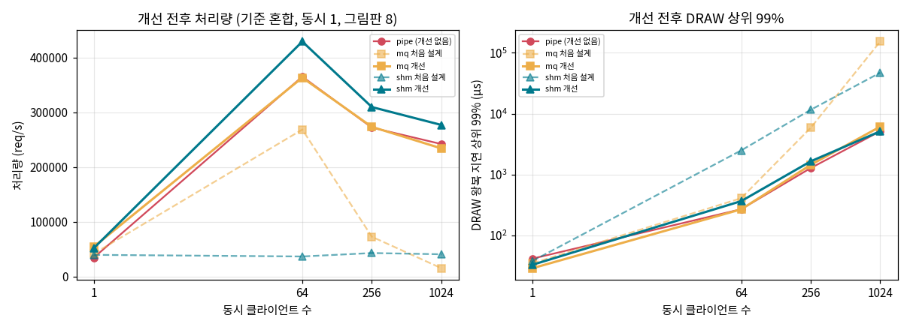

**표.** 개선 전후 (기준 혼합, 동시 요청 1, 그림판 8. 처음 설계는 scale 실험의 값)
| 클라이언트 | IPC | 처음 설계 처리량 (scale) | 개선 처리량 | 배 | 처음 DRAW p99 | 개선 DRAW p99 | 개선 요청 전송 | 개선 큐 대기 | 개선 문맥 교환 /요청 |
| ---: | --- | ---: | ---: | ---: | ---: | ---: | ---: | ---: | ---: |
| 1 | mq | 41,725 | 54,248 | 1.3 | 35.0µs | 29.0µs | 4.6µs | 3.9µs | 4.16 |
| 1 | shm | 39,556 | 51,742 | 1.3 | 38.2µs | 33.0µs | 6.0µs | 3.8µs | 4.00 |
| 64 | mq | 268,586 | 363,437 | 1.4 | 409µs | 268µs | 22.0µs | 118µs | 2.45 |
| 64 | shm | 36,604 | 429,330 | 11.7 | 2.5ms | 366µs | 24.9µs | 71.4µs | 2.02 |
| 256 | mq | 72,670 | 273,507 | 3.8 | 5.9ms | 1.4ms | 25.6µs | 857µs | 2.49 |
| 256 | shm | 42,885 | 309,669 | 7.2 | 11.6ms | 1.6ms | 76.6µs | 668µs | 2.03 |
| 1024 | mq | 15,194 | 234,109 | 15.4 | 153.1ms | 6.1ms | 31.8µs | 4.3ms | 2.46 |
| 1024 | shm | 40,656 | 276,971 | 6.8 | 47.2ms | 5.1ms | 168µs | 3.4ms | 2.03 |

- **클라이언트 1024개.** mq는 15,194 → 234,109 요청/s(15.4배), shm은 40,656 → 276,971 요청/s(6.8배)가 됐고, DRAW 상위 99%는 mq 153.1ms → 6.1ms, shm 47.2ms → 5.1ms로 줄었다. 같은 시간대에 다시 잰 처음 설계(`imp-scale` 안)도 mq 16,606, shm 43,418 요청/s로 `scale`의 값과 거의 같아, 차이는 측정 시간대가 아니라 개선에서 나왔다.
- **줄어든 곳.** shm은 요청 전송이 25.0ms → 168µs, 서버가 요청 하나에 잠드는 횟수가 1.02 → 0.03번이 됐다. 링마다 쓰는 쪽이 하나라 MUTEX가 없고, 서버는 초인종을 한 번 받으면 쌓인 요청을 기다리지 않고 꺼낸다. mq는 큐 대기가 65.8ms → 4.3ms, 요청 하나의 CPU 시간(클라이언트 + 서버)이 533 → 41µs로 줄었다. 처음 설계의 mq는 응답 큐 하나를 두고 1024개가 깨고 잠들기를 되풀이하느라 CPU를 썼다. 입장 제한을 넣은 뒤로는 30번 모두 한꺼번에 깨우기에 빠지지 않았다(요청 하나의 문맥 교환 최대 2.48번).
- **클라이언트 수별.** 개선한 shm은 64·256·1024개에서 429,330, 309,669, 276,971 요청/s로, 개선이 없는 pipe(`scale`, 365,272, 272,133, 242,051)보다 높다. 클라이언트 1개에서는 개선한 설계도 처리량이 처음 설계보다 낮지 않았다(mq 54,248, shm 51,742 요청/s. 처음 설계 값은 다른 시간대에 잰 `scale`의 41,725, 39,556이라 이 차이 자체는 해석하지 않는다).

**표.** 목표 부하 (클라이언트 1024개가 초당 67개씩, 동시 요청 4. 보낸 속도 68,608 요청/s)
| 설계 | IPC | 처리한 요청/s | DRAW p50 | DRAW p99 | DRAW 최대 | 16.7ms 안? (안에 든 실행) |
| --- | --- | ---: | ---: | ---: | ---: | --- |
| 처음 설계 | pipe | 68,336 | 5.2ms | 8.3ms | 19.5ms | 예 (29/30) |
| 처음 설계 | mq | 16,946 | 233.8ms | 398.1ms | 410.3ms | 아니오 (0/30) |
| 처음 설계 | shm | 11,101 | 184.4ms | 209.5ms | 211.6ms | 아니오 (0/30) |
| 개선한 설계 | mq | 68,299 | 6.0ms | 16.2ms | 23.3ms | 예 (18/30) |
| 개선한 설계 | shm | 67,756 | 143µs | 2.6ms | 31.0ms | 예 (30/30) |

- 개선한 설계로 같은 목표 부하를 다시 재면 mq는 68,299 요청/s, DRAW 상위 99% 16.2ms, shm은 67,756 요청/s, 2.6ms다(처음 설계 mq 398.1ms, shm 209.5ms). shm은 30번 실행 모두 한 프레임 안에 들었고, DRAW 중앙값이 143µs로 pipe(5.2ms)보다 훨씬 짧다. 들어온 요청이 줄을 서지 않고 바로 처리된다는 뜻이다(큐 대기 119µs). mq는 중앙값으로는 한 프레임 안이지만 30번 중 18번만 들어 아슬아슬하다. 큐 대기가 3.5ms, 요청 전송이 2.2ms로, 입장 제한 앞에 줄이 남아 있다.
- 요구사항 N-2(목표 부하에서 DRAW 상위 99% 16.7ms 이하)는 처음 설계에서는 pipe만 만족했고, 개선 뒤에는 shm이 여유 있게, mq가 겨우 만족한다.

### 원인 확인 실험의 결과 (개선 1의 근거)

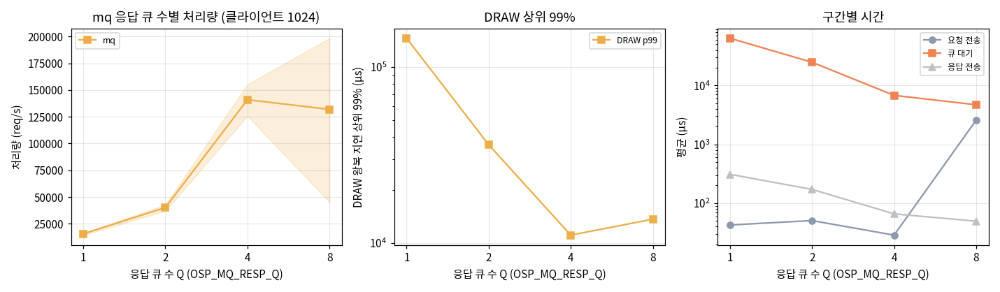

**표.** mq 응답 큐 수 (클라이언트 1024, 기준 혼합, 동시 요청 1, 입장 제한 없음)
| 응답 큐 Q | 처리량 (가운데 범위) | 실행별 처리량 최소 ~ 최대 | DRAW p99 | 요청 전송 | 큐 대기 | 응답 전송 | 문맥 교환 /요청 |
| ---: | ---: | ---: | ---: | ---: | ---: | ---: | ---: |
| 1 | 15,681 (14,454 ~ 16,228) | 2,309 ~ 18,492 | 145.9ms | 42.6µs | 63.3ms | 309µs | 3.14 |
| 2 | 40,240 (36,992 ~ 42,900) | 2,203 ~ 55,395 | 36.2ms | 50.6µs | 24.8ms | 171µs | 2.77 |
| 4 | 140,909 (125,688 ~ 155,243) | 9,364 ~ 196,352 | 11.1ms | 28.6µs | 6.8ms | 65.8µs | 2.55 |
| 8 | 131,935 (45,326 ~ 198,319) | 2,683 ~ 238,621 | 13.6ms | 2.6ms | 4.7ms | 49.5µs | 6.65 |

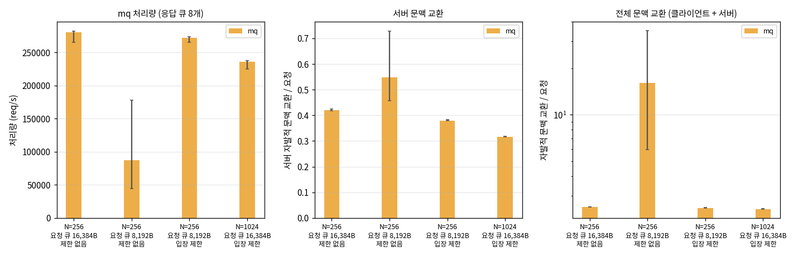

**표.** mq 요청 큐 용량과 입장 제한 (응답 큐 8개, 기준 혼합, 동시 요청 1)
| 클라이언트 | 요청 큐 용량 | 입장 제한 | 처리량 (가운데 범위) | 실행별 최소 ~ 최대 | DRAW p99 | 요청 전송 | 문맥 교환 /요청 (서버) |
| ---: | ---: | --- | ---: | ---: | ---: | ---: | ---: |
| 256 | 16,384B | 없음 | 280,280 (265,554 ~ 282,564) | 186,019 ~ 283,567 | 1.4ms | 18.0µs | 2.54 (0.42) |
| 256 | 8,192B | 없음 | 86,928 (44,753 ~ 178,134) | 26,469 ~ 283,253 | 20.2ms | 2.2ms | 16.07 (0.55) |
| 256 | 8,192B | 있음 | 272,121 (265,857 ~ 273,931) | 212,511 ~ 281,106 | 1.4ms | 28.1µs | 2.50 (0.38) |
| 1024 | 16,384B | 있음 | 236,374 (225,318 ~ 237,872) | 151,511 ~ 238,978 | 6.1ms | 27.6µs | 2.46 (0.32) |

### 메모리 절감 (N-5)

**표.** shm 응답 링 칸 수 (클라이언트 1024, 클라이언트별 요청 링, 기준 혼합)
| 동시 요청 | 응답 링 | 공유 메모리 크기 | 실제 사용 | 처리량 | DRAW p99 | SNAPSHOT p99 | 응답 전송 |
| ---: | ---: | ---: | ---: | ---: | ---: | ---: | ---: |
| 1 | 34칸 | 137.1MB | 137.1MB | 291,301 | 4.9ms | 4.9ms | 88.1µs |
| 1 | 17칸 | 69.1MB | 69.1MB | 283,177 | 5.1ms | 5.0ms | 90.4µs |
| 4 | 34칸 | 137.1MB | 137.1MB | 250,566 | 27.2ms | 27.2ms | 85.8µs |
| 4 | 17칸 | 69.1MB | 69.1MB | 97,420 | 91.2ms | 91.2ms | 186µs |

- 응답 링을 응답 2개 크기(34칸, 기본값)에서 1개 크기(17칸)로 줄이면 공유 메모리가 137.1MB → 69.1MB로 절반이 된다(실제 사용량도 같다).
- 동시 요청 1에서는 처리량이 291,301 → 283,177 요청/s(-2.8%)로 거의 그대로이고 DRAW 상위 99%도 4.9ms → 5.1ms로 거의 같다. 그러나 동시 요청 4에서는 250,566 → 97,420 요청/s(-61%), DRAW 상위 99% 27.2ms → 91.2ms로 나빠진다. 응답 링에 64KB 응답이 하나만 들어가면 워커는 클라이언트가 앞 응답을 다 읽을 때까지 기다려야 하고(응답 전송 85.8µs → 186µs), 그동안 그 워커는 다른 클라이언트의 일을 못 하는 것으로 보인다.
- 따라서 응답 링은 클라이언트가 동시에 기다리는 응답 수만큼 있어야 한다. 17칸은 동시 요청을 1개로 제한하는 클라이언트에만 쓸 수 있는 절감이고, 목표 부하(동시 요청 4)를 위해 기본값은 34칸으로 둔다. N-5의 "메모리를 줄이는 방안을 넣고 효과를 확인한다"는 이 실험으로 확인했고, 절감에는 동시 요청 수라는 조건이 붙는다는 것을 알았다.

### 평가: 개선 효과가 예상과 같았나

- **기대.** 개선을 정할 때(설계 명세의 11/28 결정) shm은 MUTEX가 없어지면 요청 전송 구간의 줄이 사라지고, mq는 응답 큐를 나누면 응답 큐 앞의 줄(큐 대기)이 짧아질 것으로 봤다.
- **shm은 기대대로였고, 그 이상이었다.** 요청 전송이 25.0ms → 168µs로 줄어 클라이언트 1024개 처리량이 6.8배가 됐고, 개선이 없는 pipe보다도 높아졌다. 서버가 요청 하나에 잠드는 횟수가 1.02 → 0.03번이 된 것은 기대하지 않은 효과다. 요청이 이어서 들어오면 서버 수신 스레드는 받아 둔 초인종으로 링을 훑기만 하고 잠들지 않는다.
- **mq는 응답 큐 나누기만으로는 기대와 달랐다.** Q = 4까지는 기대대로 큐 대기가 줄었지만, Q = 8에서는 30번 중 12번이 요청 큐의 한꺼번에 깨우기로 무너졌다. 병목이 응답 큐에서 요청 큐로 옮겨 간 것이다. 입장 제한을 더한 뒤에야 기대한 효과(클라이언트 1024개 15.4배, 30번 모두 무너지지 않음)가 나왔다. 목표 부하에서도 mq는 한 프레임을 겨우 지켜(30번 중 18번), 응답 큐 Q개 구조의 여유는 shm보다 작다.
- **대가.** shm은 공유 메모리가 1,024KB(클라이언트별 요청 링 1,088KB − 나눠 쓰던 요청 링 64KB) 늘었고, mq는 큐가 8개 늘어 큐 용량 합이 32KB → 144KB가 되고 세마포어 1개와 보낼 때마다 `semop` 한 번이 더해졌다. 클라이언트 1개에서는 처리량이 처음 설계보다 낮아지지 않았다.


## IPC 선택 가이드라인

측정한 조건 안에서 "이 응용에는 무엇을, 어떤 조건이면 무엇을"을 정리한다. 수치는 모두 이 컴퓨터에서 잰 30번 실행의 중앙값이다.

**우리 응용의 선택: 개선한 설계의 shm(클라이언트별 요청 링).** 사람 1024명 속도의 목표 부하에서 DRAW 상위 99%가 2.6ms로 한 프레임(16.7ms) 안이고, 클라이언트 64·256·1024개의 처리량이 세 IPC 가운데 가장 높다(276,971 요청/s, 1024개). 64KB SNAPSHOT도 복사가 한 번이라 pipe보다 빠르다. 대신 공유 메모리를 클라이언트 수만큼 미리 잡는다(1024개면 137.1MB). **구조를 바꿀 수 없다면 pipe**다. 처음 설계 그대로 목표 부하를 만족한 것은 pipe뿐이었다(8.3ms).

**표.** 조건별 IPC 선택
| 조건 | 고를 IPC | 근거 (측정값) | 주의할 점 |
| --- | --- | --- | --- |
| 클라이언트가 적고(1~4개) 요청·응답이 작다 | 무엇이든. 단순한 pipe | 클라이언트 1개 DRAW 중앙값 13.1µs~16.1µs로 구분되지 않음(P1) | 차이는 수신 → 워커 넘김(약 30%)이 더 크다 |
| 클라이언트가 적고 64KB 응답이 잦다 | mq 또는 shm | 64KB SNAPSHOT 중앙값 pipe 55.5µs, mq 23.8µs, shm 26.5µs(P2) | pipe는 커널 복사가 두 번이고 64KB를 나눠 옮기며 더 잠든다 |
| 한 클라이언트가 요청을 많이 띄운다 | mq | 동시 요청 16: mq 273,704 > shm 224,527 > pipe 191,365 요청/s(P3) | shm은 작은 요청 하나에 세마포어 연산이 8번이라, 작은 요청이 많으면 mq보다 느리다(원인 (3)) |
| 클라이언트 수백~수천 개 | 개선한 shm, 구조를 못 바꾸면 pipe | 1024개 처리량: 개선 shm 276,971, pipe 242,051, 개선 mq 234,109 | pipe는 1024개면 사용자별 파이프 버퍼 한도로 FIFO가 8KB로 줄어든다. 링·큐 하나를 모두가 나눠 쓰는 shm·mq(처음 설계)는 쓰지 않는다 |
| 메모리가 빠듯하다 | pipe 또는 mq | 1024개: 서버 `VmHWM` pipe 10.6MB(+ 커널 FIFO 버퍼 55.6MB), mq 18.8MB, shm 공유 메모리 136.1MB | shm 응답 링을 응답 1개 크기로 줄이면 공유 메모리가 절반(69.1MB)이 되지만 동시 요청이 1개일 때만 손해가 없다 |

**설계할 때 지킬 것.** IPC 종류보다 "여러 프로세스가 무엇을 함께 기다리는가"가 성능을 갈랐다.

- **채널을 클라이언트별로 나눈다.** 모두가 나눠 쓰는 것(shm 요청 링의 MUTEX, mq 응답 큐 하나)은 클라이언트 16~256개부터 병목이 됐다. 나눈 쪽(pipe의 응답 FIFO, 개선한 shm의 요청 링, 입장 제한을 더한 mq 응답 큐 8개)은 1024개까지 버텼다.
- **System V 세마포어 하나를 많은 프로세스가 MUTEX로 다투게 하지 않는다.** 풀릴 때 기다리던 프로세스에 넘겨주므로(handoff) 처리량이 "깨우기 한 번의 지연"에 묶인다(원인 (1)).
- **가득 찰 수 있는 메시지 큐 앞에서 송신자를 재우지 않는다.** 리눅스는 메시지 하나가 빠질 때 기다리던 송신자를 모두 깨운다(원인 (2)). 빈 자리 수를 세는 세마포어로 먼저 입장을 제한하면 하나씩 깨운다(개선 1).
