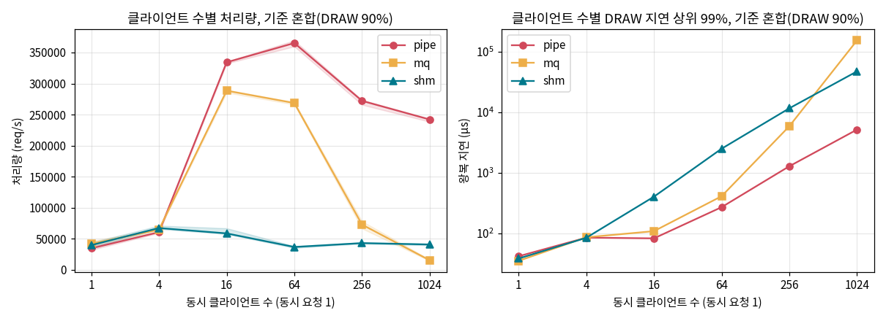
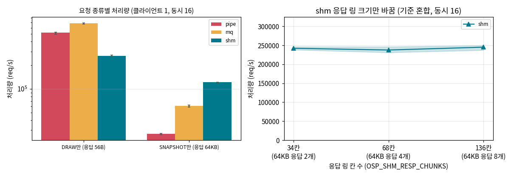

# 2단계 측정 결과 — 다중 그림판 공유 캔버스 서버

[문서 안내](../../README.md#관련-문서)

보고서 6.2~6.6절의 원본이다. 실험 목록과 재현 방법은 [측정 방법](README.md#2단계-실험), 예측은 [워크로드 명세와 성능 예측](../records/prediction.md)에 있다. 원자료는 `results/app/`, 그림과 요약표는 `python3 scripts/plot-app.py`가 만든 `docs/assets/app/`이다. 본문의 "n장", "n.n절"은 최종보고서의 장·절이다.

## 측정 방법과 기록

- **측정 지점**: 클라이언트 보내기 직전(`t0`), 서버 수신 직후(`t_recv`), 큐에서 꺼낸 직후(`t_deq`), 락 획득 직후(`t_lock`), 응답 직전(`t_send`), 클라이언트가 응답을 다 받은 직후(`t5`). 모두 `CLOCK_MONOTONIC`이라 프로세스 사이에서 바로 뺄 수 있다. 왕복(`t5 − t0`)을 요청 전송·큐 대기·락 대기·처리·응답 전송으로 나눠 병목 위치를 찾는다.
- **측정 항목**: 지연(평균, 중앙값, 상위 99%, 최대), 처리량(요청/s, MB/s), CPU 시간·자발적/비자발적 문맥 교환(`getrusage`), 메모리(`VmHWM`, IPC 버퍼 용량, shm 실제 사용량).
- **실행 한 번**: 서버를 새로 띄우고 실행기가 클라이언트 N개를 워밍업시킨 뒤 신호 하나로 함께 시작한다. 지연은 모든 클라이언트의 표본을 합쳐 백분위수를 낸다. 끝나면 검증기의 정답과 서버 체크섬을 비교한다.
- **반복과 통계**: 조건·IPC마다 30번. 비교하는 쪽(세 IPC, 한 실험 안의 조건들)은 같은 반복 안에서 번갈아 재고, 반복마다 IPC 순서를 돌린다(개선 전후는 짝수 반복에서 조건 순서도 거꾸로). 실행별 값의 중앙값을 쓴다. IPC 순위는 가운데 범위(30번 중 가운데 15번)가 겹치면 `≈`. 개선 전후처럼 같은 반복 안에서 번갈아 잰 두 조건은 반복마다 짝을 지어, 개선이 앞선 반복이 30번 중 21번 이상이거나 9번 이하일 때만 차이가 있다고 본다(부호 검정, 유의수준 5%). 비교는 한 실험 안의 값끼리만 한다.
- **측정 조건**: 모든 측정은 같은 노트북에서 전원 어댑터를 연결하고 배터리가 완충인 상태로, 다른 무거운 프로세스가 없을 때 커밋한 코드로 했다(측정 환경 기록과 충전 기록으로 확인). 실행 5,700번 모두 체크섬이 정답과 같았고 실패 0번, 끝난 뒤 남은 IPC 자원 0개.

**표.** 2단계 실험 (기준에서 요인 하나만 바꾼다)
| 실험 | 바꾸는 요인 | 고정한 것 | 확인하는 것 |
| --- | --- | --- | --- |
| `type` | 요청 종류와 크기 (DRAW / SNAPSHOT 한 변 16~256) | 클라이언트 1, 동시 요청 1 | P1, P2, P7 |
| `thr` | (기준 혼합의 처리량) | 클라이언트 1, 동시 요청 16 | P3 |
| `scale` | 클라이언트 1~1024 × 기준 혼합 / DRAW만 | 동시 요청 1, 그림판 8 | P4, P5, P7 |
| `lock` | 타일 rwlock / 그림판 전체 mutex × 클라이언트 16~256 | 그림판 1 | P6 |
| `cause-procs` | 클라이언트 64 × 16 / 256 × 4 / 1024 × 1 | 띄운 요청 1024 | 요청 양인가, 기다리는 프로세스 수인가 |
| `imp-mq-q`, `imp-mq-req` | mq 응답 큐 수 / 요청 큐 용량 × 입장 제한 | 클라이언트 1024 (256) | mq 원인 + 개선 1 |
| `cause-workers`, `cause-mix`, `cause-ring` | 워커 수 / 요청 종류 / shm 응답 링 크기 | `thr`와 같음 | P3 원인 |
| `cause-lockw` | 워커 수 1·4·16 | 그림판 전체 mutex, 클라이언트 64 | P6 원인 |
| `cause-pipe` | 받기 방식(묶어 읽기) / 응답 FIFO 용량 64KB·128KB·1MB | 클라이언트 1 | pipe 64KB의 원인 |
| `imp-all` | 처음 설계 / 개선한 설계 (세 IPC, 같은 반복 안에서 번갈아) | 클라이언트 1·64·256·1024, `thr` | 개선 전후 처리량·지연 (N-6) |
| `target-all` | 처음 설계 / 개선한 설계 (같은 반복 안에서 번갈아) | 사람 속도 부하: 클라이언트 1024, 초당 67개, 동시 요청 4, 보내는 위상을 흩음 | P8, 개선 전후 (N-2) |
| `cause-scan` | shm 요청 링 공용 / 클라이언트별 × 서버가 받을 클라이언트 수 `-N` 1024 / 16 | `thr`와 같음 | shm 개선의 대가 |
| `mem-shm` | shm 응답 링 34칸 / 17칸 × 동시 요청 1·4 | 클라이언트 1024 | 메모리 절감 (N-5) |

**수치 타당성 점검.** 원자료가 서로 맞는지 세 가지로 확인했다.

- **리틀의 법칙** (처리량 × 평균 지연 = 시스템 안의 요청 수): 닫힌 고리 조건 179개에서 (처리량 × 평균 지연) ÷ (띄운 요청 수)의 중앙값이 0.96다. 1보다 작은 몫은 클라이언트가 응답을 받고 다음 요청을 보내기까지의 틈(약 4µs)이다. 크게 벗어난 두 조건(`cause-procs` 64 × 16의 shm 0.06, mq 0.40)은 송신 스레드가 요청 링 MUTEX·가득 찬 요청 큐에서 막혀 띄울 수 있는 요청을 다 띄우지 못한 것으로, 6.4절 (1)·(2)의 원인과 같다.
- **CPU 상한**: 모든 실행에서 (클라이언트 + 서버 CPU 시간) ÷ 측정 시간이 논리 CPU 11.3개 이하다(이 컴퓨터는 12개).
- **1단계·커널 한도와 일치**: DRAW 왕복(13~16µs) ≈ 1단계 64B echo(8~10µs) + 서버 안의 넘김(4.3~4.8µs, 구간 측정). 64KB 응답의 mq `msgsnd` 9.00번(조각 9개), pipe 문맥 교환 6.00번(64KB FIFO를 56B 넘침, 6.4절 (6)), shm 공유 메모리 142,671,872B = 1024 × 139,328B(링 34칸 × 4KB + 머리).

## 측정 결과

### 요청 종류별 지연 (클라이언트 1, 동시 요청 1)


**표.** 왕복 지연과 자원 사용 (그림판 1, 30번 실행의 중앙값)
| 요청 | IPC | 평균 µs | 중앙값 µs | 상위 99% µs | 최대 µs | 자발적 문맥 교환 /요청 | CPU µs /요청 |
| --- | --- | ---: | ---: | ---: | ---: | ---: | ---: |
| DRAW (응답 56B) | pipe | 16.7 | 16.1 | 29.0 | 285 | 4.00 | 20.5 |
| | mq | 14.1 | 13.5 | 25.2 | 258 | 4.00 | 17.0 |
| | shm | 14.4 | 13.1 | 28.6 | 185 | 4.00 | 17.8 |
| SNAPSHOT 256 × 256 (65,592B) | pipe | 59.3 | 55.5 | 160.2 | 488 | 6.00 | 62.7 |
| | mq | 29.3 | 23.8 | 65.7 | 428 | 5.72 | 42.7 |
| | shm | 28.2 | 26.5 | 52.8 | 264 | 4.00 | 31.8 |

- DRAW는 세 IPC가 구분되지 않는다(`shm ≈ mq ≈ pipe`). 1단계 echo에 없던 **수신 스레드 → 워커 넘김**(4.3~4.8µs)이 왕복의 약 30%다.
- 응답이 16KB(128 × 128) 이하이면 세 IPC가 구분되지 않다가, 64KB에서 pipe만 55.5µs로 mq의 2.3배가 된다(차이는 거의 응답 전송 구간).
- 비자발적 문맥 교환은 모든 조건에서 요청 1,000개에 몇 번 수준이라 표에서 뺐다(원자료 `nivcsw` 열).

### 처리량 (클라이언트 1, 동시 요청 16)

**표.** 처리량 (기준 혼합, 그림판 1, 30번 실행의 중앙값)
| IPC | 처리량 (요청/s) | 응답 MB/s | 지연 중앙값 µs | 상위 99% µs | 자발적 문맥 교환 /요청 (서버) | CPU µs /요청 |
| --- | ---: | ---: | ---: | ---: | ---: | ---: |
| pipe | 191,365 | 1,250 | 69.9 | 258 | 1.53 (1.03) | 14.7 |
| mq | 273,704 | 1,794 | 48.4 | 164 | 1.66 (0.89) | 11.2 |
| shm | 224,527 | 1,469 | 64.9 | 148 | 2.32 (1.42) | 13.0 |

처리량 순위는 `mq > shm > pipe`(가운데 범위가 겹치지 않음). shm이 요청 하나에 가장 많이 잠든다(서버 1.42번).

### 클라이언트 수 (동시 요청 1, 그림판 8)



**표.** 클라이언트 수별 처리량(요청/s)·DRAW 상위 99%와 구간별 시간 (기준 혼합, 30번 실행의 중앙값)
| 클라이언트 | pipe | mq | shm | 처리량 순위 | DRAW p99 pipe / mq / shm | 늘어난 구간 |
| ---: | ---: | ---: | ---: | --- | --- | --- |
| 1 | 34,416 | 41,725 | 39,556 | `mq ≈ shm ≈ pipe` | 41.6µs / 35.0µs / 38.2µs | |
| 16 | 334,278 | 288,509 | 58,530 | `pipe > mq > shm` | 82.3µs / 108µs / 402µs | shm 요청 전송 215µs |
| 64 | 365,272 | 268,586 | 36,604 | `pipe > mq > shm` | 270µs / 409µs / 2.5ms | shm 요청 전송 1.7ms |
| 256 | 272,133 | 72,670 | 42,885 | `pipe > mq > shm` | 1.3ms / 5.9ms / 11.6ms | mq 큐 대기 3.3ms |
| 1024 | 242,051 | 15,194 | 40,656 | `pipe > shm > mq` | 5.2ms / 153.1ms / 47.2ms | shm 요청 전송 25.0ms, mq 큐 대기 65.8ms |

- 클라이언트 4개까지는 세 IPC가 비슷하다. shm은 16개부터 4만~6만 요청/s에 머물고 늘어난 시간이 모두 **요청 전송**(서버에 들어가기 전)이다. mq는 256개부터 무너지고 늘어난 시간이 **큐 대기**(서버 작업 큐 안)다. pipe는 64개에서 가장 높고 1024개에서도 242,051 요청/s.
- DRAW만 보내면 mq가 256개까지 1위지만 1024개에서 4,449 요청/s로 무너진다(요청 하나에 자발적 문맥 교환 326번).

### 락 방식 (그림판 1, 동시 요청 1)

**표.** 락 대기 (그림판 1, 클라이언트 64, 30번 실행의 중앙값)
| 락 | IPC | 처리량 | 락 대기 µs | 락 대기 / 왕복 |
| --- | --- | ---: | ---: | ---: |
| 타일 rwlock | pipe / mq / shm | 388,906 / 282,308 / 40,926 | 0.6 / 0.5 / 0.7 | 0.4% / 0.2% / 0.0% |
| 그림판 전체 mutex | pipe / mq / shm | 354,040 / 276,001 / 39,843 | 2.6 / 2.5 / 0.9 | 1.5% / 1.2% / 0.1% |

모든 요청이 그림판 하나에 몰려도 락 대기는 왕복의 몇 % 이하다(16·256개도 같은 경향, 전체 표는 `docs/assets/app/summary.md`).

### 목표 부하 (사람 1024명 속도)

클라이언트 1024개가 초당 67개씩(DRAW 90%, 동시 요청 4) 보내 서버에 68,608 요청/s가 들어오는 조건이다. 사람은 서로 다른 순간에 그리므로 클라이언트마다 보내는 시점을 번호로 흩었다.

**표.** 목표 부하, 처음 설계 (`target-all`, 30번 실행의 중앙값, "안"은 DRAW 상위 99%가 16.7ms 안에 든 실행 수)
| IPC | 처리량 (요청/s) | DRAW 중앙값 | DRAW 상위 99% | 안 |
| --- | ---: | ---: | ---: | ---: |
| pipe | 68,107 | 67.2µs | 394µs | 30/30 |
| mq | 15,010 | 254.4ms | 446.2ms | 0/30 |
| shm | 10,657 | 193.1ms | 214.6ms | 0/30 |

처음 설계는 pipe만 30번 모두 DRAW 상위 99%가 16.7ms 안이었다. mq·shm은 처리량(mq 15,010, shm 10,657 요청/s)이 들어온 요청(68,608/s)보다 낮아 요청이 쌓였다.

### 메모리 (클라이언트 1024, 기준 혼합, 그림판 8)

**표.** 메모리 사용량 (IPC 버퍼: pipe = 연 FIFO 용량 합, mq = 큐 용량 합, shm = 공유 메모리 크기)
| IPC | 서버 VmHWM | IPC 버퍼 용량 | 가장 작은 응답 채널 |
| --- | ---: | ---: | ---: |
| pipe | 10.6MB | 55.6MB (커널 메모리) | 8,192B |
| mq | 18.8MB | 32KB | 16,384B |
| shm | 146.8MB | 136.1MB (실제 사용 136.1MB) | 139,264B |

shm은 받을 수 있는 클라이언트 수만큼 응답 링을 미리 만들어 공유 메모리가 늘 136.1MB다(실제 사용량은 접속한 수만큼: 1개면 208KB). pipe는 사용자별 파이프 버퍼 한도(64MB)를 넘은 뒤에 연 FIFO가 64KB가 아니라 8KB로 만들어진다. 세 버전 모두 클라이언트당 IPC 버퍼 160KB 이하(N-5)다.


## 예측 대비 실측 비교

판정은 3장의 기준 그대로다(일치: 순위와 범위가 모두 맞음, 부분 일치: 순위는 맞고 범위가 벗어났거나 일부 조건에서만 맞음, 불일치: 순위가 다름).

**표.** 예측 대비 실측 (30번 실행의 중앙값)
| 조건 | 예측 (3장) | 실측 결과 | 일치 여부 |
| --- | --- | --- | --- |
| P1 클라이언트 1, DRAW 지연 | ≈, p50 15~25µs | pipe 16.1, mq 13.5, shm 13.1µs, `shm ≈ mq ≈ pipe` | 부분 일치. mq·shm이 범위보다 조금 낮다(넘김 비용을 5~10µs로 잡았으나 4.3~4.8µs) |
| P2 SNAPSHOT 64KB 지연 | mq ≈ shm < pipe, pipe 약 1.7배 | pipe 55.5, mq 23.8, shm 26.5µs, pipe가 2.3배 | 부분 일치. 배수가 크다. 원인 (6) |
| P3 처리량 (클라이언트 1, 동시 16) | shm > mq > pipe, shm이 pipe의 약 2배 | mq 273,704 > shm 224,527 > pipe 191,365 | **불일치.** 원인 (3) |
| P4 DRAW만, 클라이언트 64 이상 | shm이 가장 길다, pipe ≈ mq | 64·256개 `mq < pipe < shm`, 1024개 mq가 가장 김(1.2초) | 부분 일치. 원인 (1)·(2) |
| P5 혼합, 클라이언트 1 → 1024 | 16개 이하 shm 1위, 256·1024개 pipe > shm > mq | 16·64·256개 `pipe > mq > shm`, 1024개 `pipe > shm > mq` | 부분 일치. 1024개만 맞음. 원인 (1)·(2) |
| P6 락 방식 | 그림판 전체 mutex면 64개 이상에서 락 대기 ≥ 왕복의 30% | 64개 1.5% 이하, 256개 0.3% 이하 | 부분 일치. 기준 5% 미만은 맞음. 원인 (4) |
| P7 자원 사용 | 문맥 교환 DRAW 4~5, SNAPSHOT pipe·mq 6~8 > shm. 메모리 shm ≫ | DRAW 4.00, SNAPSHOT pipe 6.00·mq 5.72·shm 4.00. shm 136.1MB | 부분 일치. mq가 범위 아래(조각 송수신이 겹쳐 덜 잠듦, 1단계와 같음) |
| P8 목표 부하 | pipe·shm은 p99 16.7ms 이하, mq는 넘을 수 있음 | 처음 설계 DRAW 상위 99%: pipe 394µs(30/30), mq 446.2ms(0/30), shm 214.6ms(0/30). mq·shm은 처리량이 모자람 | 부분 일치. shm도 넘었다. 원인 (1)·(5) |

**맞은 것**: 작은 요청은 IPC가 구분되지 않고 64KB는 pipe만 느리다는 1단계 결론, 문맥 교환 수와 메모리의 크기 순서, 클라이언트가 많으면 클라이언트별 FIFO를 쓰는 pipe가 1위라는 큰 그림. **틀린 것**은 모두 **여러 스레드·프로세스가 같은 것을 어떻게 기다리고 깨우는가**에서 나왔다. 1단계 echo에는 워커도 클라이언트 수백 개도 없어서 볼 수 없던 요인이다. 아래 원인은 구간별 시간·문맥 교환·시스템 콜 수로 추정하고, 그 요인 하나만 바꾼 실험으로 확인했다. 틀린 추정도 그대로 적었다.

### (1) shm: 요청 링 하나를 모두가 MUTEX로 다툰다 (P4·P5·P8)

- **관찰**: 16개부터 처리량이 4만 안팎에서 멈추고, 늘어난 시간이 모두 요청 전송이다(1024개 25.0ms ≈ 1024 ÷ 40,656/s). 요청이 서버에 들어가기 전에 한 줄로 서 있다.
- **추정**: System V 세마포어는 값을 올리면 기다리던 프로세스에 차례로 넘겨준다. 링에 한 칸 넣을 때마다 잠든 프로세스 하나가 깨어 스케줄될 때까지 링이 멈춘다(lock convoy).
- **확인 1** (기다리는 프로세스 수만): 띄운 요청 1024개는 그대로 두고 프로세스 수만 바꾸면 64 × 16에서 90,054, 1024 × 1에서 41,471 요청/s. 요청 양이 아니라 기다리는 쪽의 수가 요인이다.
- **확인 2** (요청 링 구조만): 링을 클라이언트별로 나누면(개선 2, `imp-all`) 1024개 처리량 41,383 → 259,985 요청/s, 요청 전송 24.6ms → 167µs.

### (2) mq: 응답 큐 하나와 가득 찬 요청 큐의 한꺼번에 깨우기 (P4·P5·P8)

- **관찰**: 256개부터 큐 대기가 늘어난다(1024개 65.8ms). 응답 큐 하나(16KB)에 64KB 응답의 8KB 조각이 2개씩만 들어가고 1024개가 그 큐에서 자기 mtype을 기다린다.
- **확인 1** (응답 큐 수만): Q = 1, 2, 4, 8이면 처리량 15,681, 40,240, 140,909, 131,935 요청/s. 4까지는 기대대로였지만 Q = 8은 실행마다 크게 갈렸다(2,683~238,621). 요청 하나의 문맥 교환이 10번을 넘은 실행이 Q = 1, 2, 4, 8에서 30번 중 2, 2, 4, 12번이었다.
- **추정 2**: 요청 큐(16KB)에는 48B 요청이 341개만 들어간다. 리눅스는 메시지 하나가 빠질 때 기다리던 송신자를 **모두** 깨우고 하나만 넣는다(thundering herd). 응답 쪽이 빨라질수록 요청이 요청 큐 앞에 몰려 여기에 빠지는 실행이 늘었다.
- **확인 2** (요청 큐 용량만): 응답 큐 8개, 클라이언트 256개(띄운 요청 256 < 341)에서 요청 큐만 8KB(170개)로 줄이면 280,280 → 86,928 요청/s, 문맥 교환 2.54 → 16.07번, 30번 중 20번이 무너졌다. 같은 용량에 입장 제한(개선 1의 ②)만 켜면 272,121 요청/s로 돌아온다.


### (3) 클라이언트 1개의 처리량에서 shm이 mq에 졌다 (P3)

- **추정 1과 확인** (워커 수만 1·2·4·8): 다툴 워커가 없는 1개일 때도 mq 468,120 > shm 402,138이고 순위는 네 경우 모두 `mq > shm > pipe`. **워커 경쟁은 원인이 아니다.**
- **추정 2와 확인** (shm 응답 링 크기만 34·68·136칸): 242,267, 237,719, 245,185 요청/s(≈). **이것도 원인이 아니다.**
- **확인 3** (요청 종류만): DRAW만은 mq 684,504 > pipe 519,651 > shm 262,169, SNAPSHOT만은 shm 121,403 > mq 60,650 > pipe 26,769 요청/s. shm은 64KB에서 mq의 2.0배지만 작은 요청에서는 0.38배다. 이 두 값을 9:1로 섞으면 실측과 순위가 같다. 즉 예측의 식은 맞았고 **넣은 값이 틀렸다**(1단계 64B echo에서 shm은 mq의 0.69배였다).
- **근거** (`strace -c`, 요청 하나당): shm은 보내고 받을 때마다 세마포어 연산이 둘이라 요청 하나에 `semtimedop` 8번(mq의 `msgsnd`·`msgrcv`는 4번), 서버 안 넘김(`futex`)도 5.16번(mq 2.06번)이다.



### (4) 그림판 전체 mutex의 락 대기가 작았다 (P6)

- **추정**: 락을 잡는 것은 클라이언트가 아니라 워커 4개뿐이고, 락 안의 일(64KB 복사 포함)은 1~3µs다. 예측은 "클라이언트가 모두 기다린다"고 봤다.
- **확인** (워커 수만 1·4·16): 락 대기가 0.06 → 2.5 → 7.9µs(pipe)로 **워커 수**를 따라 늘었고, 16개에서도 왕복의 3.4% 이하였다.

### (5) 목표 부하: 처음 설계의 mq·shm은 처리량이 모자랐다 (P8)

- **관찰**: 처음 설계의 mq·shm은 낼 수 있는 처리량(mq 15,010, shm 10,657 요청/s)이 보낸 속도(68,608)보다 낮아 요청이 쌓였고, DRAW 상위 99%가 mq 446.2ms, shm 214.6ms였다.
- **원인**: (1)·(2)와 같다. 개선한 설계의 결과는 6.5절에 있다.

### (6) 64KB 응답에서 pipe만 느리다: 응답 FIFO가 가장 큰 응답보다 56B 작다 (P2, P3의 pipe)

- **관찰**: 64KB SNAPSHOT에서 pipe 55.5µs(mq 23.8µs), 요청 하나에 문맥 교환 6.00번(shm 4.00번). 서버는 요청 하나에 `read` 2.00번(머리·본문을 따로 읽음).
- **추정 1** (메시지마다 `read` 2번): 받기 버퍼로 FIFO에 쌓인 바이트를 한 번에 읽게 하면(`OSP_PIPE_RBUF=1`) 기준 혼합(동시 16) 처리량 202,936 → 175,079, DRAW만 520,040 → 536,641 요청/s. **원인이 아니다.**
- **추정 2** (응답 FIFO 용량): FIFO 기본 용량 65,536B가 가장 큰 응답(머리 포함 65,592B)보다 56B 작아, 64KB 응답마다 워커가 FIFO에서 잠들고 클라이언트가 비워 줄 때까지 기다린다. 용량만 128KB / 1MB로 바꾸면(`OSP_PIPE_RESP_SZ`) SNAPSHOT만 처리량 27,865 → 43,171 / 47,457 요청/s, SNAPSHOT 하나의 지연(동시 1) 49.1 → 40.0 / 42.3µs. **원인이다.**
- **1024개에서는 FIFO를 키울 자리가 없다**: 사용자별 파이프 버퍼 한도(`pipe-user-pages-soft`, 64MB)를 1024개가 나누면 64KB도 안 된다. 처음 설계 1024개에서도 이미 FIFO 용량 합이 55.6MB였고, 가장 작은 FIFO는 8KB였다(나중에 연 약 150개).

## 설계 개선과 전후 비교

세 개선 모두 서버 환경 변수로 켜고(기본값 = 처음 설계) 같은 실행 파일로 잰다. 개선도 처음 설계와 같은 제약을 지킨다: 서버는 기본 설정(받을 클라이언트 1024), 커널 한도는 기본값, IPC 버퍼는 클라이언트당 160KB 이하(N-5).

**개선 1: mq 응답 큐 8개 + 요청 큐 입장 제한** (`OSP_MQ_RESP_Q=8 OSP_MQ_ADMIT=1`, 원인 (2)). ① 응답 큐를 8개로 나눠 클라이언트 번호 % 8로 고른다. ② 요청 큐의 빈 자리 수를 세는 세마포어를 보내는 쪽이 `msgsnd` 전에 얻고 서버가 꺼낸 만큼 돌려준다. 가득 찬 큐에서 송신자가 잠들지 않고, 세마포어는 들어갈 수 있는 만큼만 깨운다.

```c
/* transport_mq.c put_frag: 입장 세마포어를 먼저 얻는다. 그 뒤의 msgsnd 는 자리가 있어 막히지 않는다 */
if (admit >= 0 && admit_op(admit, (short)-admit_units(len)) < 0) return -1;
/* 서버 수신 스레드: 꺼낸 조각만큼 돌려준다 */
ssize_t n = msgrcv(srv_req_q, srv_rbuf, srv_limit, 0, 0);
if (srv_admit_sem >= 0) admit_op(srv_admit_sem, admit_units((size_t)n));
```

**개선 2: shm 클라이언트별 요청 링** (`OSP_SHM_REQ=per`, 원인 (1)). 요청 링을 클라이언트마다 하나(64B 칸 16개)로 나눈다. 쓰는 쪽이 하나라 MUTEX가 없고, 서버는 세마포어 0번(초인종)을 기다렸다가 링들을 돌며 꺼낸다.

```c
/* transport_shm.c ring_send_per: 빈 칸만 기다리고(MUTEX 없음), 내용을 다 쓴 뒤 head 를 올리고 초인종을 누른다 */
if (sem_ops(r->semid, &room, 1, w) < 0) return -1;
memcpy(r->data + off, hdr, sizeof *hdr);
__atomic_store_n(&r->hdr->head, head + k, __ATOMIC_RELEASE);
return sem_ops(r->semid, &bell, 1, NULL);
```

**개선 3: pipe 응답 FIFO 키우기 + 송신 스레드** (`OSP_PIPE_GROW=1 OSP_PIPE_ASYNC=1`, 원인 (6)). 워커가 응답 FIFO에서 클라이언트를 기다리지 않게 한다. ① 32KB보다 큰 응답을 보낼 때 그 FIFO를 128KB로 키운다. 사용자별 한도를 새 클라이언트 몫으로 남기려고, 붙은 클라이언트가 384개(한도의 3/4 ÷ 128KB) 이하이고 0.1초 동안 새로 붙지 않았을 때만 키운다. ② 그래도 다 들어가지 않으면(1024개) 워커는 막히지 않게 쓴 뒤 나머지를 클라이언트별 자리에 두고 다음 요청으로 간다. 송신 스레드가 `epoll`로 그 FIFO에 자리가 나면 나머지를 쓴다. 이 자리는 160KB − FIFO 크기(기본 96KB, 키운 FIFO면 32KB)로 묶어 FIFO와 합쳐 클라이언트당 160KB를 넘지 않고, 넘칠 때는 처음 설계처럼 워커가 기다린다.

```c
/* transport_pipe.c fit_resp_locked: 보내기 직전, 그 클라이언트의 송신 락 안 */
if (total <= GROW_MIN || n > srv_grow_max || mono_ns() - atomic_load(&srv_open_ns) < GROW_HOLD_NS) return;
if (fcntl(fd, F_SETPIPE_SZ, GROW_SZ) >= 0) srv_grown[id] = true;   /* 한도를 넘으면 커널이 거부한다 */
/* send_resp_async_locked: 막히지 않게 써 보고, 못 쓴 뒤쪽은 송신 스레드에 맡긴다 */
size_t cap = pend_cap_locked(id), done = 0;              /* 나머지 자리: 160KB − FIFO 크기 */
int rc = write_from(fd, hdr, payload, &done);
while (rc == 0 && total - done > cap) {                 /* 나머지가 한도를 넘는다: 자리가 날 때까지 기다리며 쓴다 */
    /* … poll(POLLOUT, 0.05초) 뒤 다시 write_from … */
}
if (rc == 0) {
    if (done < total) {                                 /* 못 쓴 뒤쪽을 송신 스레드에 맡긴다 */
        pend_put(id, hdr, payload, done);
        pend_arm(id);                                   /* 송신 스레드의 epoll 에 EPOLLOUT 을 건다 */
    }
    return 0;
}
```

**표.** 세 개선의 대가 (세 IPC가 같은 제약 안: 서버 기본 설정, 커널 기본 한도, 클라이언트당 IPC 버퍼 160KB 이하)
| | mq (개선 1) | shm (개선 2) | pipe (개선 3) |
| --- | --- | --- | --- |
| 커널 객체 | 메시지 큐 7개(응답), 세마포어 1개(입장 제한) 추가 | 같은 key. 요청 세마포어 집합 3개 → 1 + 클라이언트 수 | 없음(FIFO 크기만 바뀜) |
| 메모리 | 큐 7 × 16KB = 112KB | 요청 영역 64KB → 1,088B × 클라이언트 수(1024개면 1.06MB) | FIFO 64KB → 128KB(384개 이하일 때만), 송신 스레드 자리(쓴 만큼) |
| 클라이언트당 버퍼 | 큐를 나눠 씀 | 140,416B | FIFO + 송신 스레드 자리 ≤ 160KB |
| 서버 스레드 | 8개 (감시 스레드, 처음 설계부터) | 7개 | 8개 (송신 스레드 추가) |
| 느려진 곳 (`imp-all`, 반복별 짝 비교로 차이가 있는 것만) | 처리량 클라이언트 1·동시 16 0.97배 | 처리량 클라이언트 1 0.90배, 클라이언트 1·동시 16 0.94배 (대부분 받을 때 링 1,024개를 훑는 비용) | 상위 99% 지연 64개 1.28배, 256개 1.36배, 1024개 1.12배 |

**전후 비교** (`imp-all`, `target-all`): 세 IPC를 같은 조건 목록으로, 한 반복 안에서 처음 설계와 개선을 번갈아 30번씩 쟀다(짝수 반복은 조건 순서를 거꾸로). 전후는 이 측정 안의 값끼리만 비교한다(6.3절과는 잰 시각이 달라 같은 조건이라도 값이 다를 수 있다).

**표.** 개선 전후 처리량 (`imp-all`, 30번 실행의 중앙값, 요청/s, 괄호는 개선 ÷ 처음과 개선이 앞선 반복 수, ≈는 차이 없음)
| 조건 | pipe | mq | shm |
| --- | --- | --- | --- |
| 클라이언트 1 | 35,545 → 35,008 (0.98배, 16/30 ≈) | 41,251 → 41,460 (1.01배, 14/30 ≈) | 37,630 → 33,783 (0.90배, 7/30) |
| 클라이언트 64 | 361,865 → 406,397 (1.12배, 30/30) | 267,964 → 339,450 (1.27배, 30/30) | 36,766 → 403,153 (10.97배, 30/30) |
| 클라이언트 256 | 265,246 → 294,996 (1.11배, 30/30) | 79,546 → 249,191 (3.13배, 30/30) | 42,752 → 291,659 (6.82배, 30/30) |
| 클라이언트 1024 | 238,626 → 262,018 (1.10배, 30/30) | 15,066 → 205,011 (13.61배, 30/30) | 41,383 → 259,985 (6.28배, 30/30) |
| 클라이언트 1, 동시 요청 16 | 192,712 → 223,462 (1.16배, 30/30) | 287,485 → 278,336 (0.97배, 9/30) | 237,086 → 223,779 (0.94배, 1/30) |

**표.** 개선 전후 지연 (`imp-all`, 전체 요청의 왕복 지연, 30번 실행의 중앙값, 처음 설계 → 개선한 설계)
| 조건 | pipe 중앙값 / 상위 99% | mq 중앙값 / 상위 99% | shm 중앙값 / 상위 99% |
| --- | --- | --- | --- |
| 클라이언트 1 | 17.8µs / 87.2µs → 18.8µs / 80.5µs | 15.4µs / 70.6µs → 16.0µs / 69.4µs | 18.6µs / 60.2µs → 21.9µs / 65.3µs |
| 클라이언트 64 | 153µs / 297µs → 124µs / 380µs | 213µs / 440µs → 162µs / 350µs | 1.8ms / 2.5ms → 123µs / 401µs |
| 클라이언트 256 | 922µs / 1.3ms → 794µs / 1.8ms | 3.1ms / 5.3ms → 951µs / 2.1ms | 5.8ms / 10.4ms → 811µs / 1.9ms |
| 클라이언트 1024 | 4.2ms / 5.2ms → 3.8ms / 5.8ms | 57.4ms / 147.5ms → 4.7ms / 7.5ms | 24.2ms / 43.4ms → 3.8ms / 5.5ms |
| 클라이언트 1, 동시 요청 16 | 69.7µs / 256µs → 58.8µs / 236µs | 45.8µs / 157µs → 46.4µs / 160µs | 62.0µs / 126µs → 66.1µs / 147µs |


- **mq·shm**: 클라이언트 1024개 처리량 mq 15,066 → 205,011(13.6배), shm 41,383 → 259,985(6.3배). 전체 상위 99%는 mq 147.5ms → 7.5ms, shm 43.4ms → 5.5ms. 무너지던 곳(요청 링 MUTEX, 큐의 한꺼번에 깨우기)이 사라졌다. 클라이언트가 하나일 때는 동시 요청 1에서 mq 1.01배(≈), shm 0.90배, 동시 요청 16에서 mq 0.97배, shm 0.94배였다. shm이 느려진 것은 대가다. 서버 수신 스레드는 요청을 받을 때마다 클라이언트별 링을 받을 수 있는 클라이언트 수(`-N 1024`)만큼 차례로 훑으므로, 클라이언트가 하나면 매번 빈 링 1,023개를 지난다. `-N`만 16으로 줄이면(`cause-scan`, 네 조건을 같은 반복 안에서 번갈아 30번) 클라이언트별 링이 221,011 → 237,764 요청/s(30번 중 29번 빨라짐)로 공용 링과의 차이가 6.1% → 0.8%로 줄고, 요청 전송 구간이 13.0µs → 4.2µs로 공용 링(4.2µs)과 같아졌다. 느려진 몫의 대부분이 링 훑기였다(남은 0.8%의 원인은 확인하지 않았다).
- **pipe**: 처리량 클라이언트 1 0.98배(≈), 64 1.12배, 256 1.11배, 1024 1.10배, 클라이언트 1·동시 16 1.16배. 64·256개에서는 응답 FIFO를 128KB로 키우는 쪽이, 사용자별 한도로 키울 수 없는 1024개에서는 송신 스레드가 일한다. 전체 상위 99%가 64개 297µs → 380µs, 256개 1.3ms → 1.8ms, 1024개 5.2ms → 5.8ms로 늘었다. 1024개에서는 워커가 기다리던 시간이 송신 스레드 쪽으로 옮겨 가 응답 전송 구간이 49.5µs → 152µs가 됐다.
- **지연(속도)**: 클라이언트 1024개의 왕복 중앙값은 pipe 4.2ms → 3.8ms, mq 57.4ms → 4.7ms, shm 24.2ms → 3.8ms, 상위 99%는 pipe 5.2ms → 5.8ms, mq 147.5ms → 7.5ms, shm 43.4ms → 5.5ms. 목표 부하(사람 1024명)의 DRAW 상위 99%는 pipe 394µs → 378µs, mq 446.2ms → 919µs, shm 214.6ms → 1.3ms다.

**표.** 목표 부하의 개선 전후 (`target-all`, DRAW 지연, 30번 실행의 중앙값, "안"은 상위 99%가 16.7ms 안인 실행 수)
| IPC | 처리량 (요청/s) 처음 → 개선 | DRAW 중앙값 처음 → 개선 | DRAW 상위 99% 처음 → 개선 | 안 처음 → 개선 |
| --- | --- | --- | --- | --- |
| pipe | 68,107 → 67,970 | 67.2µs → 64.9µs | 394µs → 378µs | 30/30 → 30/30 |
| mq | 15,010 → 68,062 | 254.4ms → 59.2µs | 446.2ms → 919µs | 0/30 → 30/30 |
| shm | 10,657 → 67,755 | 193.1ms → 102µs | 214.6ms → 1.3ms | 0/30 → 30/30 |

**목표 부하 (N-2)**: 처음 설계는 pipe만 30번 모두 DRAW 상위 99%가 16.7ms 안이었고, 개선한 설계는 pipe·mq·shm이 30번 모두 통과했다. 세 IPC 모두 개선한 설계로 N-2를 만족한다.

**메모리 (N-5)**: shm 응답 링을 34칸 → 17칸으로 줄이면(클라이언트 1024) 공유 메모리가 137.1MB → 69.1MB로 절반이 된다. 동시 요청 1에서는 처리량 291,301 → 283,177 요청/s(-2.8%)로 거의 그대로지만, 동시 요청 4에서는 250,566 → 97,420 요청/s(-61%)로 나빠진다(링에 응답이 하나만 들어가 워커가 기다림). 그래서 기본값은 34칸으로 두고, 17칸은 동시 요청을 1개로 제한하는 클라이언트에만 쓰는 절감으로 정리했다. 개선한 pipe는 FIFO를 키울 때(384개 이하)만 커널 메모리가 늘어(클라이언트 256개 FIFO 용량 합 16.1 → 32.1MB), 송신 스레드 자리는 쓴 쪽만 잡힌다(1024개 서버 VmHWM 10.7 → 21.6MB).

**평가.** shm은 기대 이상이었다(MUTEX가 없어지자 서버가 초인종으로 링을 훑기만 해 거의 잠들지 않았다). 다만 클라이언트 하나가 요청을 많이 띄우면 그 훑기 때문에 0.94배로 느려진다. mq는 응답 큐 나누기만으로는 30번 중 12번 무너져 기대와 달랐고, 입장 제한을 더한 뒤에야 기대한 효과가 나왔다. pipe는 원인 (6)을 고쳐 64·256개에서 처리량이 1.12·1.11배가 됐지만, 처음부터 무너지는 곳이 없어 개선 폭이 작다(상위 99% 지연과 맞바꿨다). 사용자별 파이프 한도 때문에 1024개에서는 FIFO를 키울 수 없다는 것이 pipe 설계의 한계다.

## IPC 선택 가이드라인

측정한 조건 안에서 정리한다(수치는 이 컴퓨터에서 잰 30번 실행의 중앙값).

**우리 응용의 선택: pipe. 목표 부하(사람 1024명)에서 처음 설계로도 30번 모두 통과했고, 개선한 세 IPC 가운데 DRAW 상위 99%가 가장 짧다(pipe 378µs, mq 919µs, shm 1.3ms, 30번 모두 pipe가 가장 짧음). 클라이언트 1024개 처리량은 `pipe ≈ shm > mq`다.**

**표.** 조건별 IPC 선택
| 조건 | 고를 IPC | 근거 (측정값) | 주의할 점 |
| --- | --- | --- | --- |
| 클라이언트가 적고 요청·응답이 작다 | 무엇이든 (단순한 pipe) | DRAW 중앙값 13.1~16.1µs로 구분되지 않음 | 차이는 서버 안 넘김(약 30%)이 더 크다 |
| 클라이언트가 적고 64KB 응답이 잦다 | mq 또는 shm. pipe면 응답 FIFO를 응답 하나보다 크게 | 64KB SNAPSHOT 중앙값 pipe 55.5µs, mq 23.8µs, shm 26.5µs. pipe도 FIFO만 128KB로 키우면 SNAPSHOT만 처리량 27,865 → 43,171 요청/s | pipe 기본 FIFO(64KB)는 64KB 응답보다 56B 작다 |
| 한 클라이언트가 요청을 많이 띄운다 | mq | 클라이언트 1·동시 16, 개선한 설계: `mq > shm ≈ pipe` (pipe 223,462, mq 278,336, shm 223,779 요청/s) | shm은 작은 요청 하나에 세마포어 연산 8번 |
| 클라이언트 수백~수천 개 (우리 응용) | pipe | 목표 부하(사람 1024명)의 DRAW 상위 99%, 개선한 설계: `pipe < mq ≈ shm` (pipe 378µs, mq 919µs, shm 1.3ms). 1024개 처리량, 개선한 설계: `pipe ≈ shm > mq` (pipe 262,018, mq 205,011, shm 259,985 요청/s) | 처음 설계의 shm·mq는 쓰지 않는다(목표 부하에서 30번 중 shm 0번, mq 0번 통과). pipe는 1024개면 사용자별 한도로 FIFO가 8KB까지 줄어든다 |
| 메모리가 빠듯하다 | pipe 또는 mq | 1024개: 서버 VmHWM pipe 10.6MB(+ 커널 FIFO 55.6MB), mq 18.8MB, shm 공유 메모리 136.1MB | shm 응답 링을 절반으로 줄이면 동시 요청 1일 때만 손해가 없다 |

**설계 원칙.** IPC 종류보다 "여러 프로세스가 무엇을 함께 기다리는가"가 성능을 갈랐다.

- **채널을 클라이언트별로 나눈다.** 모두가 나눠 쓰는 것(shm 요청 링의 MUTEX, mq 응답 큐 하나)은 16~256개부터 병목이 됐고, 나눈 쪽은 1024개까지 버텼다. 다만 나눈 채널을 받을 때마다 모두 훑으면 클라이언트가 적을 때 느려진다(shm, 클라이언트 1·동시 16에서 0.94배). 쓰는 채널만 따로 표시해 두는 것이 다음 개선이다.
- **System V 세마포어 하나를 많은 프로세스가 MUTEX로 다투게 하지 않는다.** 넘겨주기 때문에 처리량이 깨우기 한 번의 지연에 묶인다.
- **가득 찰 수 있는 메시지 큐 앞에서 송신자를 재우지 않는다.** 빈 자리 세마포어로 먼저 입장을 제한하면 하나씩 깨운다.
- **채널 용량은 가장 큰 메시지 하나보다 크게, 키울 수 없으면 보내는 쪽이 기다리지 않게.** pipe FIFO가 응답보다 56B 작은 것만으로 64KB 응답의 지연과 처리량이 크게 나빠졌다. 사용자별 한도로 키울 수 없는 1024개에서는 송신을 워커에서 떼어 냈다.
- **비교하는 두 쪽의 조건을 같게.** 서버 설정, 메모리 한도, 잰 시각이 다르면 개선 효과와 IPC 차이를 가를 수 없다. 비교하는 쪽은 같은 반복 안에서 번갈아 쟀다.
- **부하를 만들 때 도착 모양까지 정한다.** 클라이언트들이 같은 순간에 보내게 하면 도착이 주기마다 몰리고 그 모양이 IPC마다 달라 IPC 비교가 흐려진다(8.2절 사례 6).
